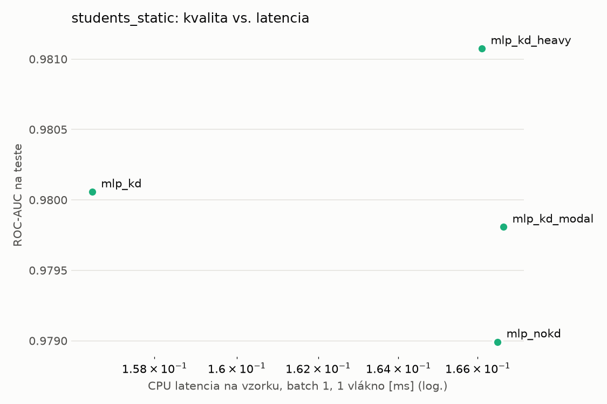
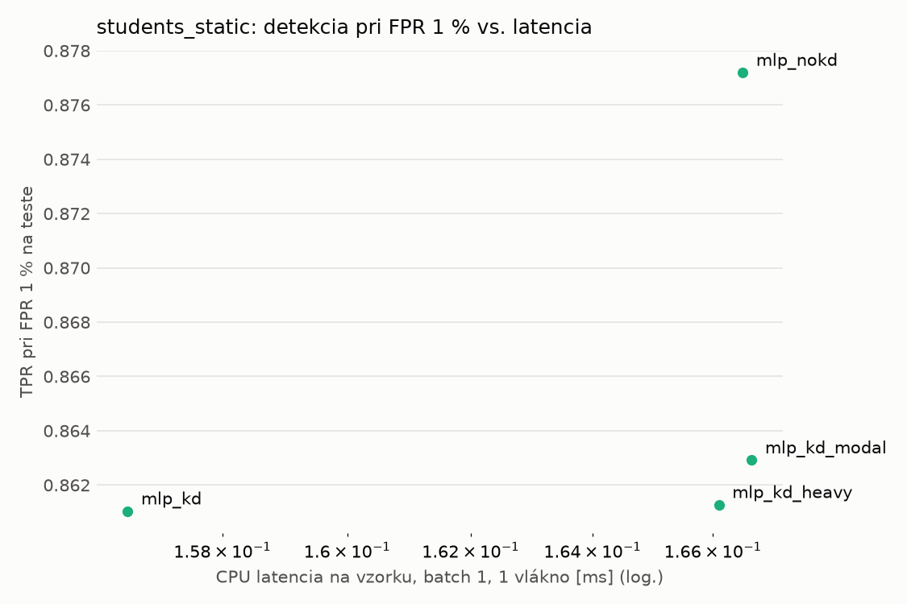
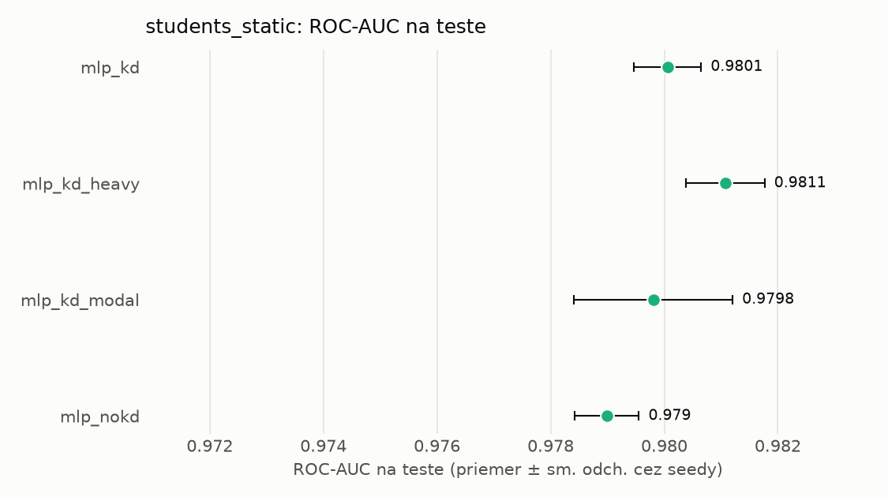
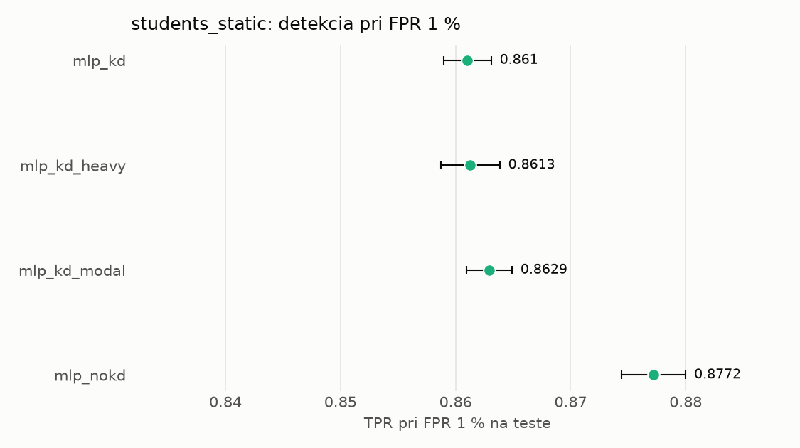

# Porovnanie modelov – students_static

> Generované `src/evaluation/compare.py` (2026-11-23T22:12:03+01:00); použitý je posledný beh každého modelu.
> Metriky sú priemer cez seedy. \* = pri prahu určenom na validácii (FPR ≤ 1 %).
> CPU ms/vz. = medián latencie jednej vzorky na 1 vlákne vrátane transformácie vstupu (meranie hneď po tréningu,
> orientačné). Oficiálne merania spotreby sú v časti „Spotreba zdrojov pri inferencii“.

## Detekčná kvalita a orientačné časy
| model | ROC-AUC val | ROC-AUC test | TPR@FPR 1 % test | TPR@FPR 0,1 % test | F1 test* | FPR test* | gap train−val | CPU ms/vz. | CPU vz./s | GPU ms/vz. | parametre | MB | tréning s | ladenie min |
|---|---|---|---|---|---|---|---|---|---|---|---|---|---|---|
| [mlp_kd](../../students_static/mlp_kd/20261123-221044/README.md) | 0.9875 | 0.9801 ± 0.0006 | 0.8610 | 0.6605 | 0.8982 | 0.0061 | 0.0046 | 0.157 | 3 423 872 | 0.465 | 10 689 | 0.05 | 4.7 | 0.0 |
| [mlp_kd_heavy](../../students_static/mlp_kd_heavy/20261123-221149/README.md) | 0.9865 | 0.9811 ± 0.0007 | 0.8613 | 0.6654 | 0.9001 | 0.0059 | 0.0055 | 0.166 | 4 528 572 | 0.280 | 10 689 | 0.05 | 3.8 | 0.0 |
| [mlp_kd_modal](../../students_static/mlp_kd_modal/20261123-221125/README.md) | 0.9876 | 0.9798 ± 0.0014 | 0.8629 | 0.6838 | 0.9007 | 0.0065 | 0.0043 | 0.167 | 5 184 336 | 0.442 | 10 689 | 0.05 | 7.3 | 0.0 |
| [mlp_nokd](../../students_static/mlp_nokd/20261123-221100/README.md) | 0.9875 | 0.9790 ± 0.0006 | 0.8772 | 0.6169 | 0.9097 | 0.0060 | 0.0071 | 0.166 | 4 292 061 | 0.450 | 10 689 | 0.05 | 7.8 | 0.0 |

## Nízka prevalencia malvéru (test, prah z validácie)
| model | TPR | FPR | precision @ 1 % | falošné na 1 skutočný poplach @ 1 % | precision @ 0.1 % | falošné na 1 skutočný poplach @ 0.1 % |
|---|---|---|---|---|---|---|
| mlp_kd | 0.8214 | 0.0061 | 0.576 | 0.74 | 0.119 | 7.43 |
| mlp_kd_heavy | 0.8244 | 0.0059 | 0.586 | 0.71 | 0.123 | 7.12 |
| mlp_kd_modal | 0.8260 | 0.0065 | 0.561 | 0.78 | 0.112 | 7.91 |
| mlp_nokd | 0.8405 | 0.0060 | 0.587 | 0.70 | 0.124 | 7.09 |

Prepočet: TPR a FPR nezávisia od podielu malvéru, preto sa dajú preniesť na nízku prevalenciu (v reálnej prevádzke je malvéru ~1 % alebo menej; v teste 54 %). „Falošné na 1 skutočný poplach“ = koľko neškodných súborov je označených na každý zachytený malvér.

## Spotreba zdrojov pri inferencii (benchmark, testovacia množina)
_Benchmark zatiaľ nebol spustený (`python -m src.evaluation.benchmark --approach students_static`)._

## Grafy

