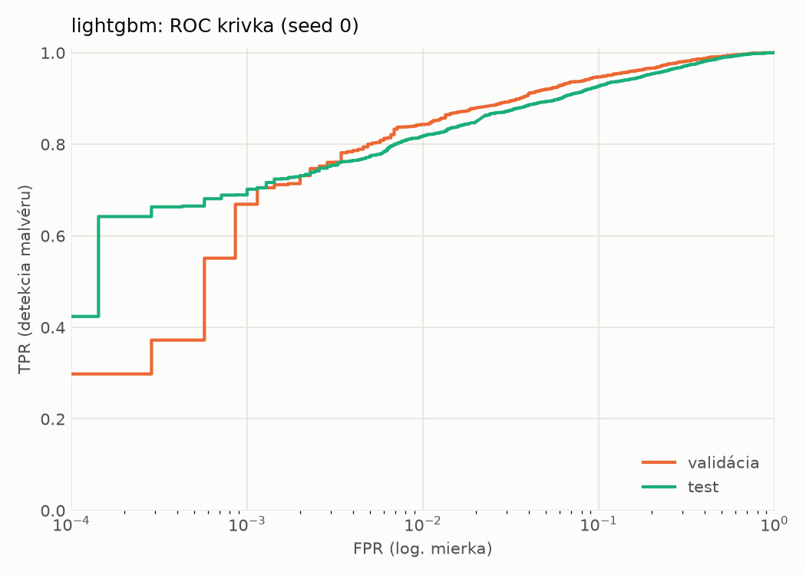
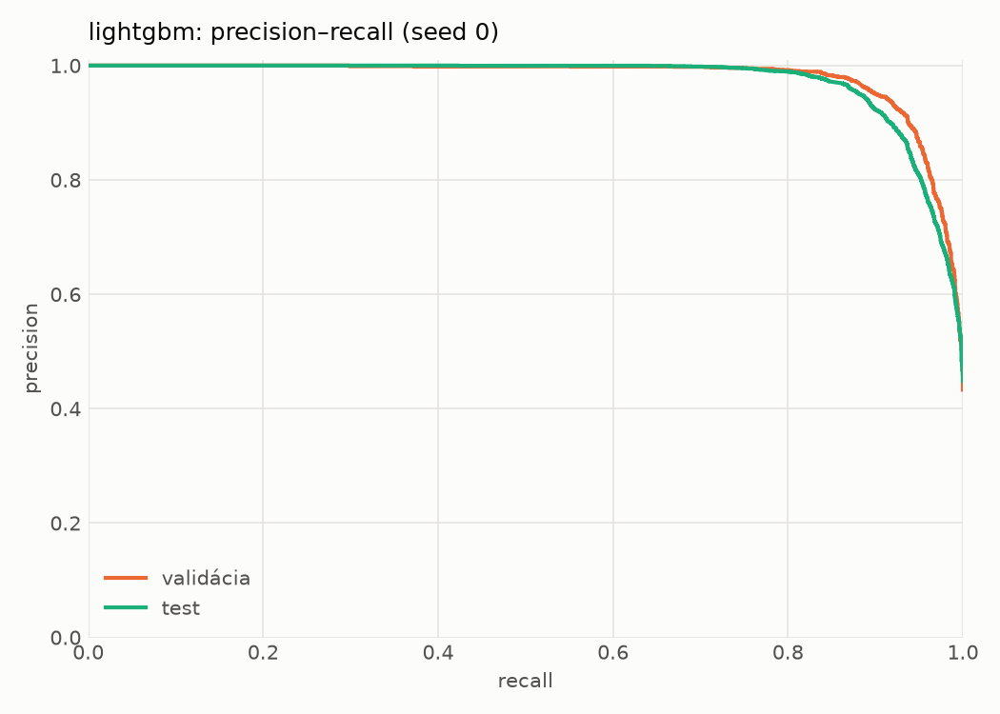
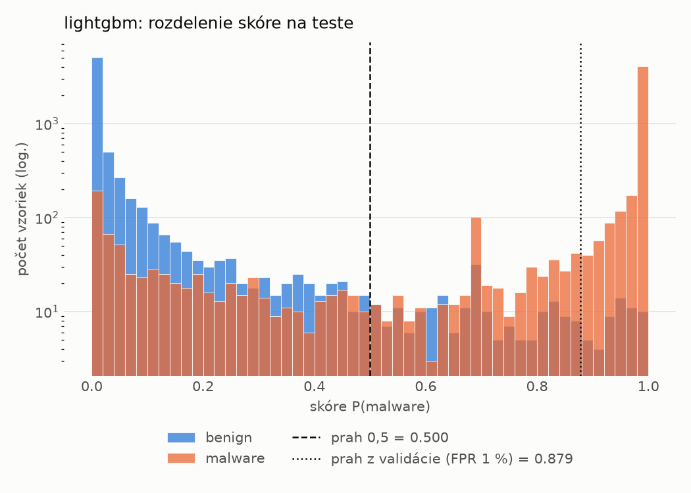
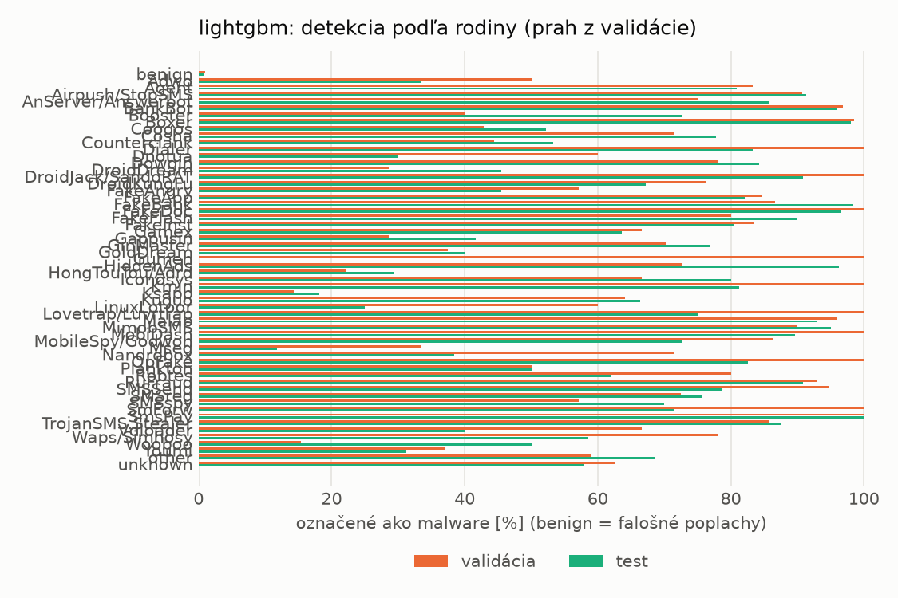
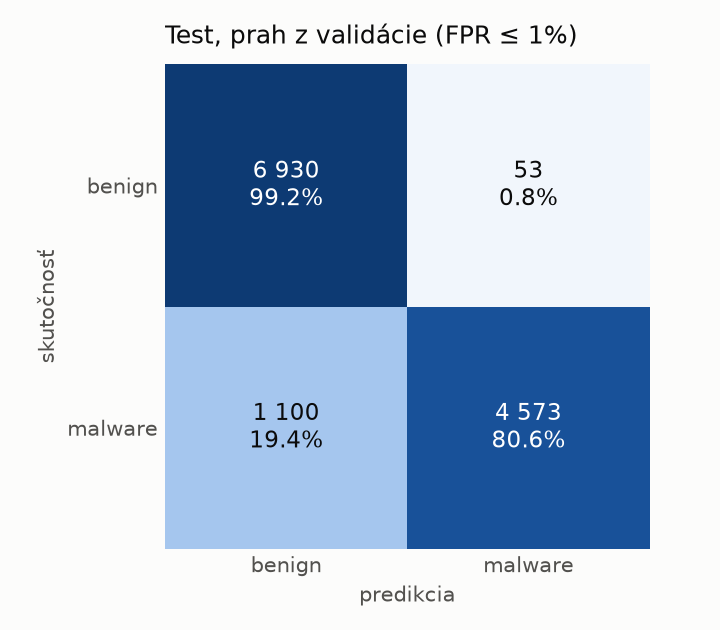
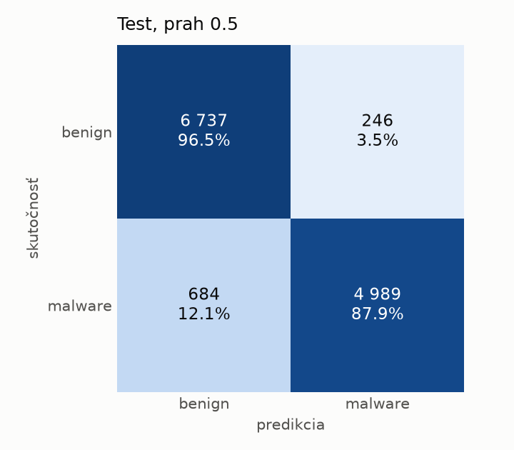
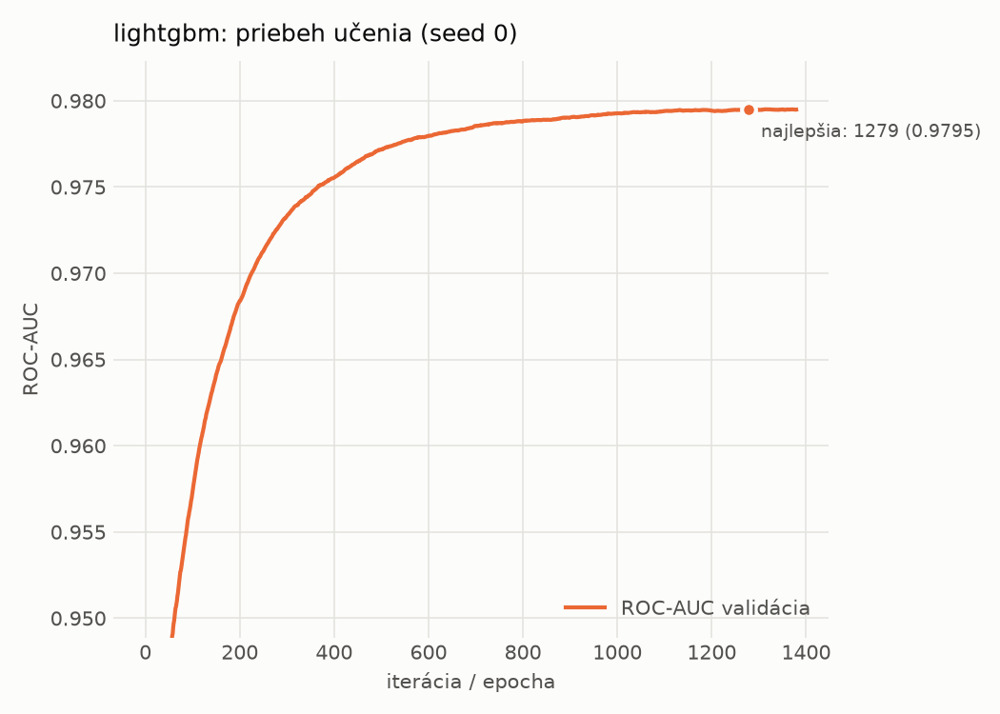

# dynamic/lightgbm – beh `20261123-220043`

> Automaticky generované (`src/training/run_tabular.py`). Konfigurácia: `config.yaml`, protokol: `protocol.yaml`.

- **Model:** `lightgbm` – LightGBM, gradient boosting stromov s early stopping na validácii (pôvodné hodnoty príznakov)
- **Ladenie:** bez ladenia – hyperparametre prevzaté z `runs_v4/emu_p/full/dynamic/lightgbm/20261123-191933`
- **Finálne modely:** seedy [0, 1, 2]; hodnoty sú priemer ± smerodajná odchýlka cez seedy
- **Najlepšie hyperparametre:** `{"num_boost_round": 5000, "early_stopping_rounds": 100, "learning_rate": 0.020757076290036595, "num_leaves": 469, "min_child_samples": 116, "feature_fraction": 0.9578728497385997, "bagging_fraction": 0.9870779948179744, "lambda_l1": 0.002495609179699052, "lambda_l2": 0.0024900497451761272}`

## Detekčná kvalita (bez prahu)
| metrika | train (podvzorka) | validácia | test |
|---|---|---|---|
| ROC-AUC | 0.9999 ± 0.0000 | 0.9796 ± 0.0001 | 0.9723 ± 0.0004 |
| PR-AUC | 0.9999 ± 0.0000 | 0.9791 ± 0.0002 | 0.9741 ± 0.0003 |
| TPR pri FPR 1 % | 0.9996 ± 0.0001 | 0.8454 ± 0.0023 | 0.8183 ± 0.0029 |
| TPR pri FPR 0,1 % | 0.9862 ± 0.0011 | 0.6793 ± 0.0132 | 0.6953 ± 0.0059 |
| log loss | 0.0180 ± 0.0024 | 0.1802 ± 0.0030 | 0.2218 ± 0.0039 |
| Brier skóre | 0.0035 ± 0.0003 | 0.0481 ± 0.0001 | 0.0585 ± 0.0001 |

Rozdiel ROC-AUC train − validácia: **0.0204** (veľký rozdiel = preučenie).

## Pri prahu z validácie (FPR ≤ 1% na validácii)
| metrika | train (podvzorka) | validácia | test |
|---|---|---|---|
| accuracy | 0.9894 ± 0.0016 | 0.9275 ± 0.0010 | 0.9094 ± 0.0026 |
| balanced accuracy | 0.9876 ± 0.0018 | 0.9178 ± 0.0012 | 0.8999 ± 0.0029 |
| precision | 0.9993 ± 0.0000 | 0.9851 ± 0.0000 | 0.9876 ± 0.0008 |
| recall (TPR) | 0.9757 ± 0.0037 | 0.8454 ± 0.0023 | 0.8079 ± 0.0061 |
| FPR | 0.0005 ± 0.0000 | 0.0097 ± 0.0000 | 0.0082 ± 0.0006 |
| F1 | 0.9873 ± 0.0019 | 0.9099 ± 0.0014 | 0.8888 ± 0.0035 |
| MCC | 0.9784 ± 0.0031 | 0.8569 ± 0.0019 | 0.8253 ± 0.0046 |

## Pri pevnom prahu 0.5
| metrika | train (podvzorka) | validácia | test |
|---|---|---|---|
| accuracy | 0.9962 ± 0.0002 | 0.9372 ± 0.0006 | 0.9267 ± 0.0002 |
| balanced accuracy | 0.9964 ± 0.0002 | 0.9337 ± 0.0006 | 0.9224 ± 0.0003 |
| precision | 0.9929 ± 0.0001 | 0.9446 ± 0.0010 | 0.9518 ± 0.0011 |
| recall (TPR) | 0.9981 ± 0.0002 | 0.9082 ± 0.0008 | 0.8811 ± 0.0014 |
| FPR | 0.0053 ± 0.0001 | 0.0407 ± 0.0008 | 0.0363 ± 0.0009 |
| F1 | 0.9955 ± 0.0002 | 0.9260 ± 0.0007 | 0.9151 ± 0.0003 |
| MCC | 0.9922 ± 0.0003 | 0.8720 ± 0.0012 | 0.8527 ± 0.0002 |

## Výpočtové nároky (seed 0, testovacia množina)
| meranie | hodnota |
|---|---|
| tréning finálneho modelu | 24.0 s (priemer cez seedy) |
| ladenie spolu | 0 s |
| počet parametrov / uzlov | 768 327 |
| veľkosť modelu na disku | 42.62 MB |
| CPU latencia modelu (batch 1, 1 vlákno) | 0.271 ms (p95 0.333) |
| CPU priepustnosť (24 vlákien) | 42 672 vzoriek/s |

## Grafy
| | |
|---|---|
|  |  |
|  |  |
|  |  |
|  |  |

## Súbory
`metrics.json` (všetky metriky po seedoch vrátane rodín), `timing.json`, `hpo_trials.csv`,
`predictions/<časť>_seed<N>.parquet` (sha256, family, label, score), `model/seed_<N>/`, `log.txt`.
