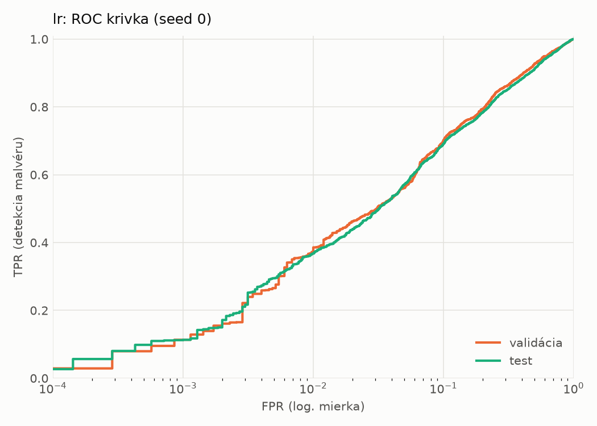
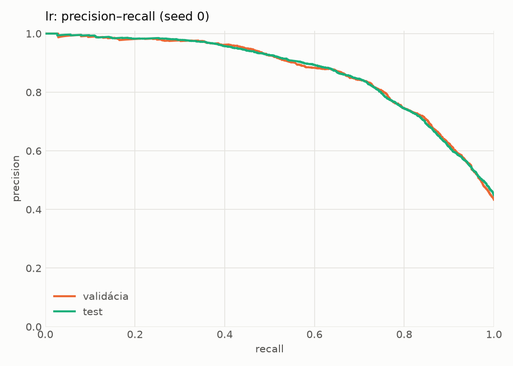
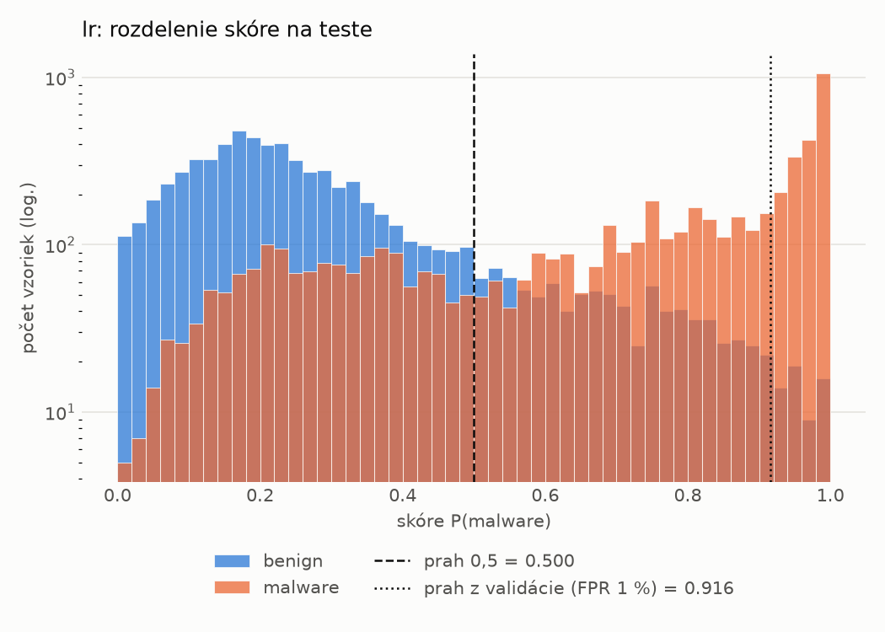
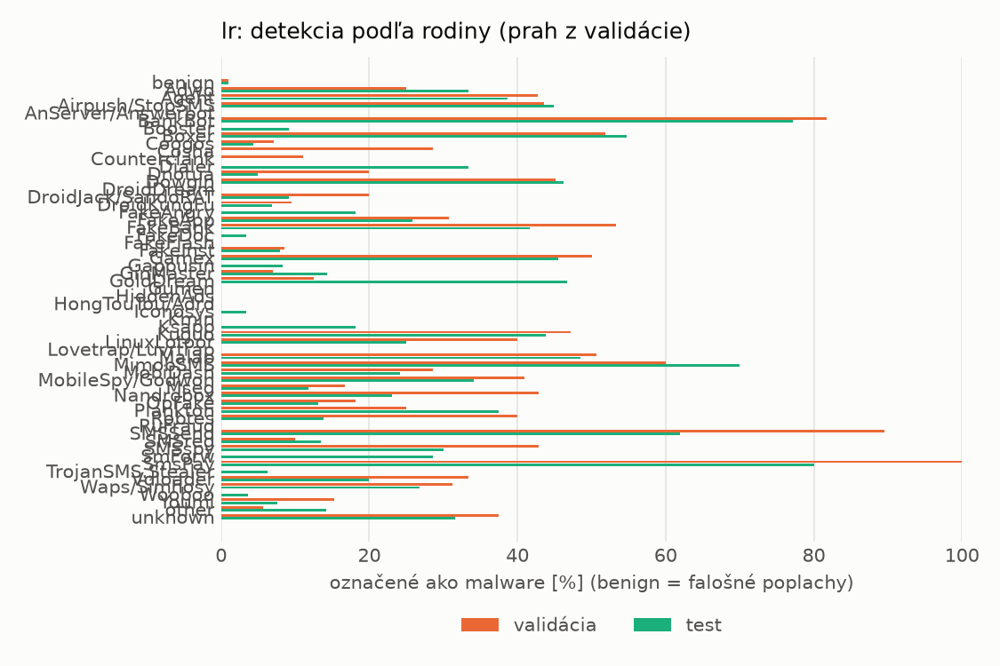
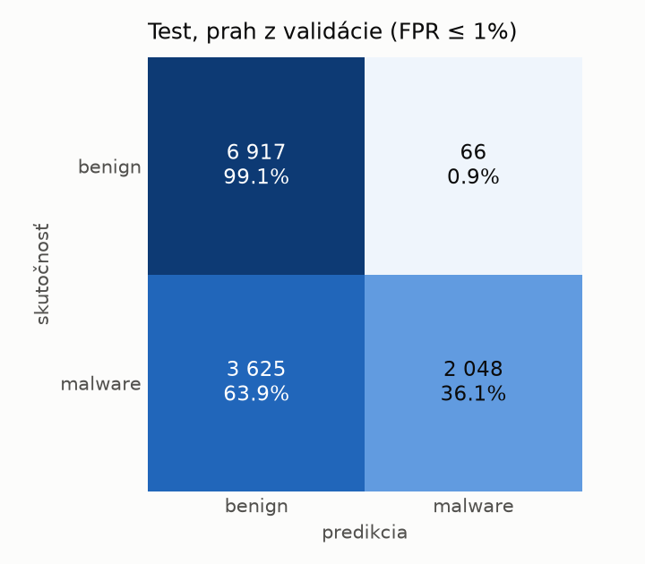
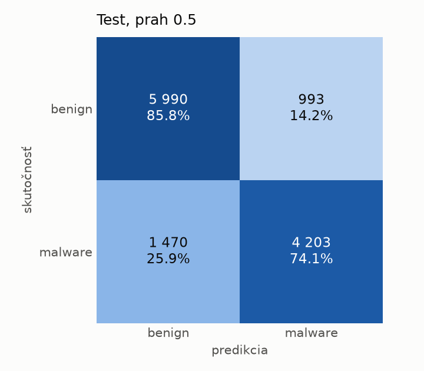

# dynamic/lr – beh `20261123-220022`

> Automaticky generované (`src/training/run_tabular.py`). Konfigurácia: `config.yaml`, protokol: `protocol.yaml`.

- **Model:** `logreg` – logistická regresia s L2 regularizáciou (vstup signed log1p + štandardizácia)
- **Ladenie:** bez ladenia – hyperparametre prevzaté z `runs_v4/emu_p/full/dynamic/lr/20261123-191800`
- **Finálne modely:** seedy [0, 1, 2]; hodnoty sú priemer ± smerodajná odchýlka cez seedy
- **Najlepšie hyperparametre:** `{"max_iter": 2000, "C": 7.504621081078761}`

## Detekčná kvalita (bez prahu)
| metrika | train (podvzorka) | validácia | test |
|---|---|---|---|
| ROC-AUC | 0.8732 ± 0.0000 | 0.8764 ± 0.0000 | 0.8688 ± 0.0000 |
| PR-AUC | 0.8605 ± 0.0000 | 0.8678 ± 0.0000 | 0.8681 ± 0.0000 |
| TPR pri FPR 1 % | 0.3804 ± 0.0000 | 0.3722 ± 0.0000 | 0.3677 ± 0.0000 |
| TPR pri FPR 0,1 % | 0.0941 ± 0.0000 | 0.1133 ± 0.0000 | 0.1123 ± 0.0000 |
| log loss | 0.4372 ± 0.0000 | 0.4332 ± 0.0000 | 0.4414 ± 0.0000 |
| Brier skóre | 0.1388 ± 0.0000 | 0.1376 ± 0.0000 | 0.1414 ± 0.0000 |

Rozdiel ROC-AUC train − validácia: **-0.0032** (veľký rozdiel = preučenie).

## Pri prahu z validácie (FPR ≤ 1% na validácii)
| metrika | train (podvzorka) | validácia | test |
|---|---|---|---|
| accuracy | 0.7339 ± 0.0000 | 0.7226 ± 0.0000 | 0.7084 ± 0.0000 |
| balanced accuracy | 0.6880 ± 0.0000 | 0.6812 ± 0.0000 | 0.6758 ± 0.0000 |
| precision | 0.9630 ± 0.0000 | 0.9669 ± 0.0000 | 0.9688 ± 0.0000 |
| recall (TPR) | 0.3870 ± 0.0000 | 0.3722 ± 0.0000 | 0.3610 ± 0.0000 |
| FPR | 0.0109 ± 0.0000 | 0.0097 ± 0.0000 | 0.0095 ± 0.0000 |
| F1 | 0.5521 ± 0.0000 | 0.5375 ± 0.0000 | 0.5260 ± 0.0000 |
| MCC | 0.4944 ± 0.0000 | 0.4819 ± 0.0000 | 0.4687 ± 0.0000 |

## Pri pevnom prahu 0.5
| metrika | train (podvzorka) | validácia | test |
|---|---|---|---|
| accuracy | 0.8048 ± 0.0000 | 0.8120 ± 0.0000 | 0.8054 ± 0.0000 |
| balanced accuracy | 0.7966 ± 0.0000 | 0.8053 ± 0.0000 | 0.7993 ± 0.0000 |
| precision | 0.7850 ± 0.0000 | 0.7997 ± 0.0000 | 0.8089 ± 0.0000 |
| recall (TPR) | 0.7428 ± 0.0000 | 0.7550 ± 0.0000 | 0.7409 ± 0.0000 |
| FPR | 0.1496 ± 0.0000 | 0.1445 ± 0.0000 | 0.1422 ± 0.0000 |
| F1 | 0.7633 ± 0.0000 | 0.7767 ± 0.0000 | 0.7734 ± 0.0000 |
| MCC | 0.5981 ± 0.0000 | 0.6153 ± 0.0000 | 0.6052 ± 0.0000 |

## Výpočtové nároky (seed 0, testovacia množina)
| meranie | hodnota |
|---|---|
| tréning finálneho modelu | 0.4 s (priemer cez seedy) |
| ladenie spolu | 0 s |
| počet parametrov / uzlov | 124 |
| veľkosť modelu na disku | 0.01 MB |
| transformácia vstupu – latencia (1 vlákno) | 0.005 ms |
| transformácia vstupu – priepustnosť | 1 402 016 vzoriek/s |
| CPU latencia modelu (batch 1, 1 vlákno) | 0.004 ms (p95 0.004) |
| CPU priepustnosť (24 vlákien) | 4 486 034 vzoriek/s |

## Grafy
| | |
|---|---|
|  |  |
|  |  |
|  |  |
|  |  |

## Súbory
`metrics.json` (všetky metriky po seedoch vrátane rodín), `timing.json`, `hpo_trials.csv`,
`predictions/<časť>_seed<N>.parquet` (sha256, family, label, score), `model/seed_<N>/`, `log.txt`.
