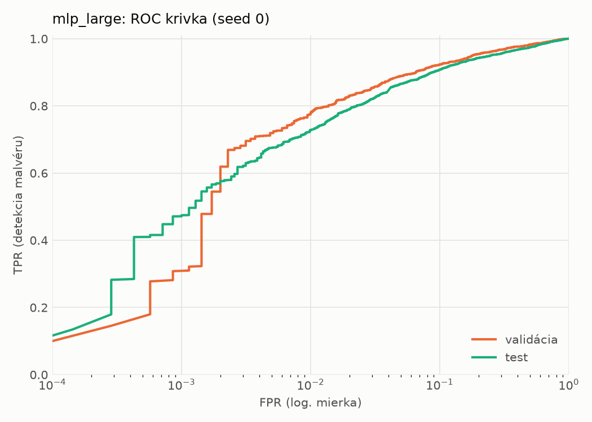
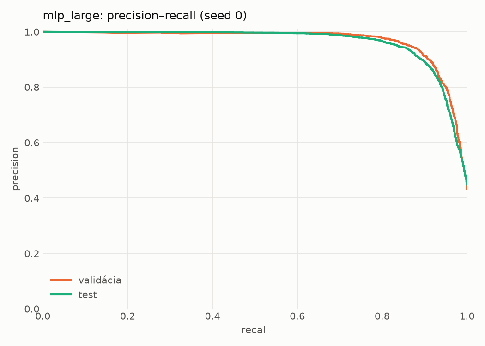
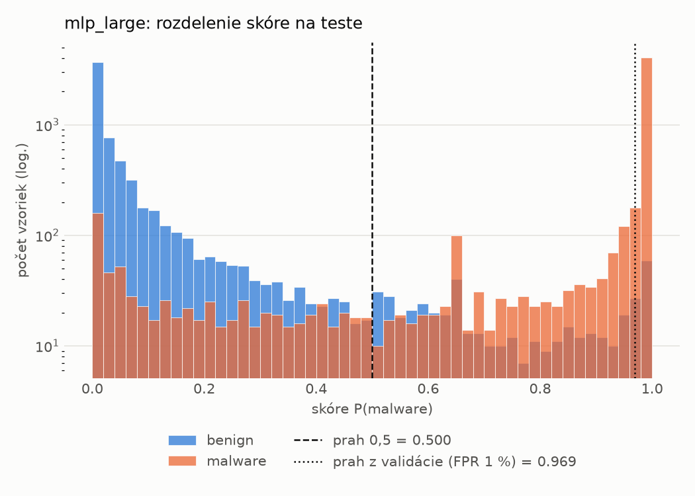
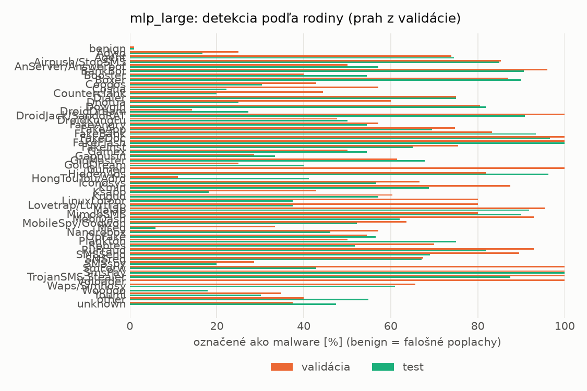
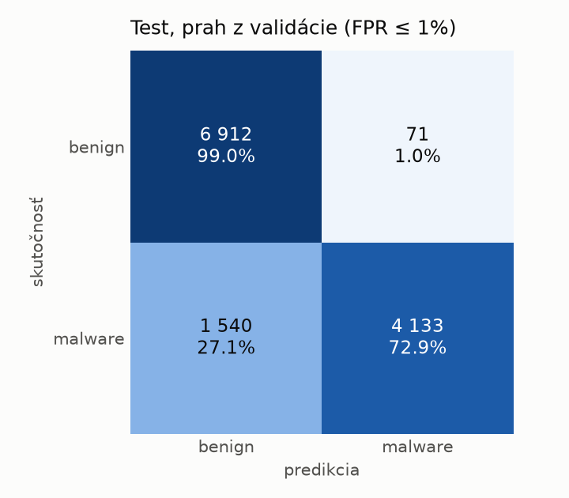
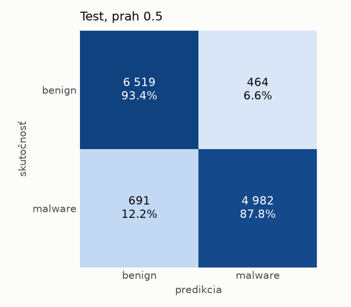
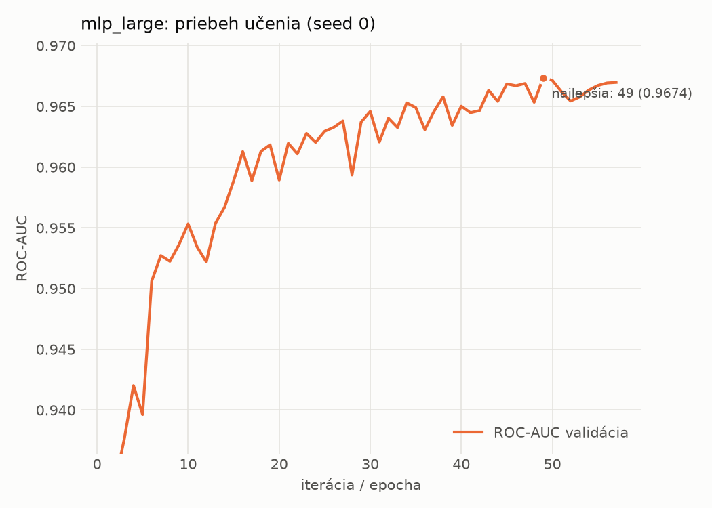

# dynamic/mlp_large – beh `20261123-220313`

> Automaticky generované (`src/training/run_tabular.py`). Konfigurácia: `config.yaml`, protokol: `protocol.yaml`.

- **Model:** `mlp` – veľká neurónová sieť (3–5 skrytých vrstiev, 512–2048 neurónov), kandidát na učiteľa
- **Ladenie:** bez ladenia – hyperparametre prevzaté z `runs_v4/emu_p/full/dynamic/mlp_large/20261123-194626`
- **Finálne modely:** seedy [0, 1, 2]; hodnoty sú priemer ± smerodajná odchýlka cez seedy
- **Najlepšie hyperparametre:** `{"max_epochs": 100, "patience": 8, "hidden_layers": 3, "hidden_width": 1024, "width_decay": 0.5, "dropout": 0.11628417924821868, "lr": 0.0004582958225587737, "weight_decay": 0.0007705605519981878, "batch_size": 512}`

## Detekčná kvalita (bez prahu)
| metrika | train (podvzorka) | validácia | test |
|---|---|---|---|
| ROC-AUC | 0.9947 ± 0.0007 | 0.9672 ± 0.0004 | 0.9575 ± 0.0018 |
| PR-AUC | 0.9937 ± 0.0008 | 0.9662 ± 0.0004 | 0.9606 ± 0.0014 |
| TPR pri FPR 1 % | 0.9218 ± 0.0072 | 0.7776 ± 0.0165 | 0.7289 ± 0.0018 |
| TPR pri FPR 0,1 % | 0.8528 ± 0.0116 | 0.3318 ± 0.0822 | 0.4366 ± 0.0379 |
| log loss | 0.0924 ± 0.0064 | 0.2367 ± 0.0051 | 0.2730 ± 0.0061 |
| Brier skóre | 0.0260 ± 0.0018 | 0.0616 ± 0.0010 | 0.0712 ± 0.0014 |

Rozdiel ROC-AUC train − validácia: **0.0275** (veľký rozdiel = preučenie).

## Pri prahu z validácie (FPR ≤ 1% na validácii)
| metrika | train (podvzorka) | validácia | test |
|---|---|---|---|
| accuracy | 0.9233 ± 0.0082 | 0.8982 ± 0.0072 | 0.8735 ± 0.0069 |
| balanced accuracy | 0.9096 ± 0.0097 | 0.8839 ± 0.0083 | 0.8600 ± 0.0079 |
| precision | 0.9992 ± 0.0007 | 0.9839 ± 0.0003 | 0.9834 ± 0.0032 |
| recall (TPR) | 0.8196 ± 0.0194 | 0.7776 ± 0.0165 | 0.7301 ± 0.0180 |
| FPR | 0.0005 ± 0.0004 | 0.0097 ± 0.0000 | 0.0100 ± 0.0022 |
| F1 | 0.9005 ± 0.0117 | 0.8686 ± 0.0104 | 0.8379 ± 0.0107 |
| MCC | 0.8501 ± 0.0154 | 0.8019 ± 0.0133 | 0.7600 ± 0.0114 |

## Pri pevnom prahu 0.5
| metrika | train (podvzorka) | validácia | test |
|---|---|---|---|
| accuracy | 0.9660 ± 0.0024 | 0.9208 ± 0.0011 | 0.9087 ± 0.0006 |
| balanced accuracy | 0.9641 ± 0.0026 | 0.9187 ± 0.0007 | 0.9054 ± 0.0008 |
| precision | 0.9681 ± 0.0020 | 0.9134 ± 0.0044 | 0.9189 ± 0.0035 |
| recall (TPR) | 0.9512 ± 0.0042 | 0.9027 ± 0.0023 | 0.8735 ± 0.0042 |
| FPR | 0.0230 ± 0.0015 | 0.0653 ± 0.0038 | 0.0627 ± 0.0033 |
| F1 | 0.9596 ± 0.0029 | 0.9080 ± 0.0010 | 0.8956 ± 0.0009 |
| MCC | 0.9304 ± 0.0048 | 0.8386 ± 0.0022 | 0.8154 ± 0.0012 |

## Výpočtové nároky (seed 0, testovacia množina)
| meranie | hodnota |
|---|---|
| tréning finálneho modelu | 8.5 s (priemer cez seedy) |
| ladenie spolu | 0 s |
| počet parametrov / uzlov | 786 945 |
| veľkosť modelu na disku | 3.17 MB |
| transformácia vstupu – latencia (1 vlákno) | 0.015 ms |
| transformácia vstupu – priepustnosť | 761 552 vzoriek/s |
| CPU latencia modelu (batch 1, 1 vlákno) | 0.156 ms (p95 0.378) |
| CPU priepustnosť (24 vlákien) | 363 026 vzoriek/s |
| GPU latencia (batch 1) | 0.432 ms (p95 0.952) |
| GPU priepustnosť | 1 484 627 vzoriek/s |
| GPU špičková pamäť | 146 MB |

## Grafy
| | |
|---|---|
|  |  |
|  |  |
|  |  |
|  |  |

## Súbory
`metrics.json` (všetky metriky po seedoch vrátane rodín), `timing.json`, `hpo_trials.csv`,
`predictions/<časť>_seed<N>.parquet` (sha256, family, label, score), `model/seed_<N>/`, `log.txt`.
