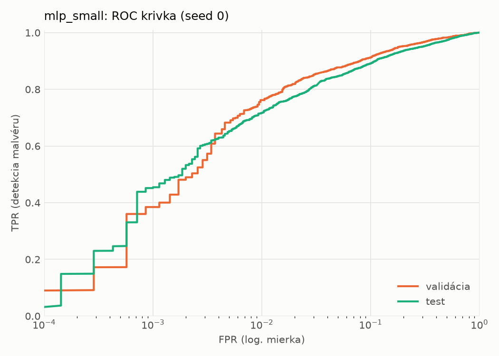
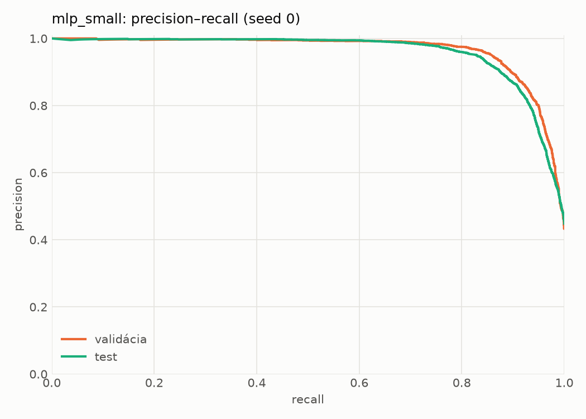
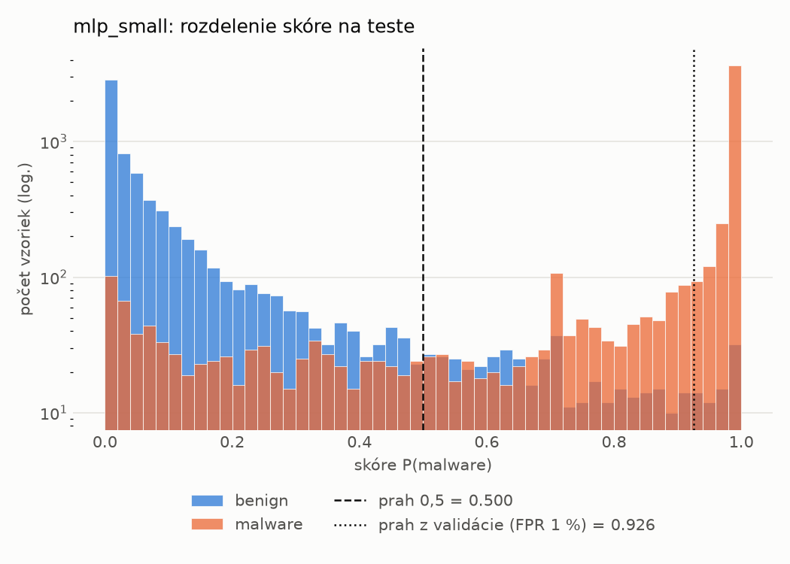
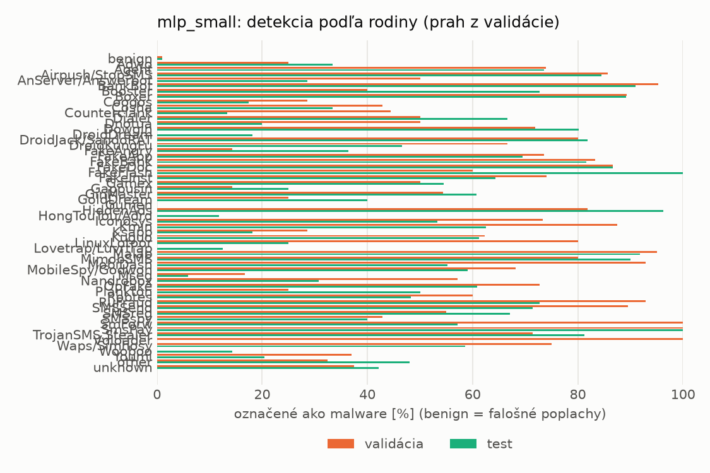
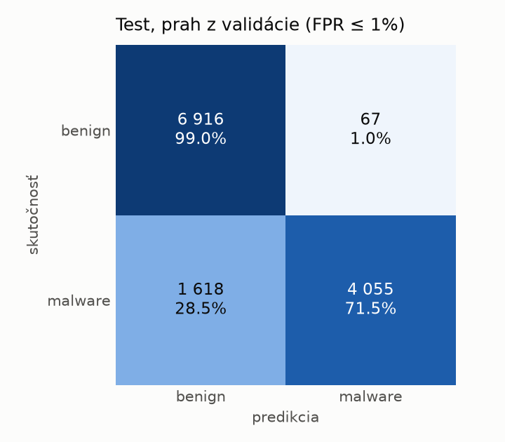
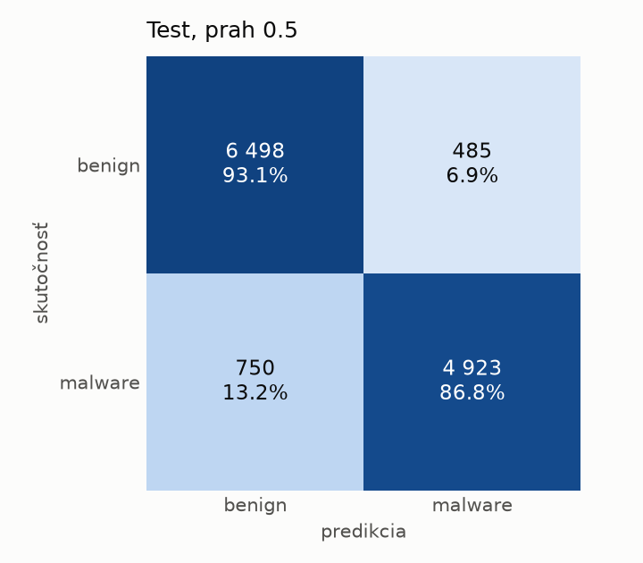
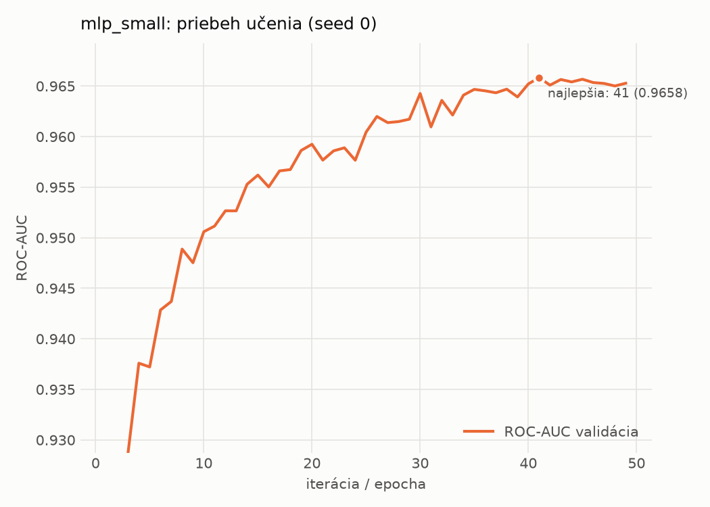

# dynamic/mlp_small – beh `20261123-220218`

> Automaticky generované (`src/training/run_tabular.py`). Konfigurácia: `config.yaml`, protokol: `protocol.yaml`.

- **Model:** `mlp` – malá neurónová sieť (1–2 skryté vrstvy), kandidát na ľahkého študenta
- **Ladenie:** bez ladenia – hyperparametre prevzaté z `runs_v4/emu_p/full/dynamic/mlp_small/20261123-193925`
- **Finálne modely:** seedy [0, 1, 2]; hodnoty sú priemer ± smerodajná odchýlka cez seedy
- **Najlepšie hyperparametre:** `{"width_decay": 0.5, "max_epochs": 100, "patience": 8, "hidden_layers": 2, "hidden_width": 256, "dropout": 0.06125761383416514, "lr": 0.0018225597913134257, "weight_decay": 9.759441755448828e-06, "batch_size": 256}`

## Detekčná kvalita (bez prahu)
| metrika | train (podvzorka) | validácia | test |
|---|---|---|---|
| ROC-AUC | 0.9898 ± 0.0012 | 0.9653 ± 0.0009 | 0.9565 ± 0.0006 |
| PR-AUC | 0.9885 ± 0.0012 | 0.9642 ± 0.0008 | 0.9588 ± 0.0005 |
| TPR pri FPR 1 % | 0.8828 ± 0.0085 | 0.7532 ± 0.0085 | 0.7126 ± 0.0034 |
| TPR pri FPR 0,1 % | 0.7974 ± 0.0124 | 0.3188 ± 0.0627 | 0.4242 ± 0.0271 |
| log loss | 0.1256 ± 0.0063 | 0.2381 ± 0.0068 | 0.2661 ± 0.0014 |
| Brier skóre | 0.0362 ± 0.0020 | 0.0644 ± 0.0008 | 0.0729 ± 0.0006 |

Rozdiel ROC-AUC train − validácia: **0.0244** (veľký rozdiel = preučenie).

## Pri prahu z validácie (FPR ≤ 1% na validácii)
| metrika | train (podvzorka) | validácia | test |
|---|---|---|---|
| accuracy | 0.9066 ± 0.0034 | 0.8876 ± 0.0037 | 0.8631 ± 0.0033 |
| balanced accuracy | 0.8899 ± 0.0041 | 0.8717 ± 0.0042 | 0.8484 ± 0.0037 |
| precision | 0.9988 ± 0.0008 | 0.9833 ± 0.0002 | 0.9842 ± 0.0006 |
| recall (TPR) | 0.7805 ± 0.0087 | 0.7532 ± 0.0085 | 0.7060 ± 0.0077 |
| FPR | 0.0007 ± 0.0005 | 0.0097 ± 0.0000 | 0.0092 ± 0.0004 |
| F1 | 0.8762 ± 0.0052 | 0.8530 ± 0.0055 | 0.8222 ± 0.0051 |
| MCC | 0.8188 ± 0.0062 | 0.7824 ± 0.0067 | 0.7419 ± 0.0057 |

## Pri pevnom prahu 0.5
| metrika | train (podvzorka) | validácia | test |
|---|---|---|---|
| accuracy | 0.9523 ± 0.0027 | 0.9138 ± 0.0014 | 0.9046 ± 0.0022 |
| balanced accuracy | 0.9501 ± 0.0029 | 0.9118 ± 0.0013 | 0.9015 ± 0.0022 |
| precision | 0.9509 ± 0.0026 | 0.9034 ± 0.0024 | 0.9123 ± 0.0033 |
| recall (TPR) | 0.9358 ± 0.0044 | 0.8968 ± 0.0014 | 0.8710 ± 0.0029 |
| FPR | 0.0355 ± 0.0018 | 0.0733 ± 0.0020 | 0.0681 ± 0.0028 |
| F1 | 0.9433 ± 0.0032 | 0.9001 ± 0.0015 | 0.8912 ± 0.0025 |
| MCC | 0.9023 ± 0.0055 | 0.8243 ± 0.0027 | 0.8071 ± 0.0044 |

## Výpočtové nároky (seed 0, testovacia množina)
| meranie | hodnota |
|---|---|
| tréning finálneho modelu | 17.6 s (priemer cez seedy) |
| ladenie spolu | 0 s |
| počet parametrov / uzlov | 65 537 |
| veľkosť modelu na disku | 0.27 MB |
| transformácia vstupu – latencia (1 vlákno) | 0.006 ms |
| transformácia vstupu – priepustnosť | 1 203 625 vzoriek/s |
| CPU latencia modelu (batch 1, 1 vlákno) | 0.224 ms (p95 0.237) |
| CPU priepustnosť (24 vlákien) | 2 752 142 vzoriek/s |
| GPU latencia (batch 1) | 0.630 ms (p95 0.666) |
| GPU priepustnosť | 1 512 971 vzoriek/s |
| GPU špičková pamäť | 66 MB |

## Grafy
| | |
|---|---|
|  |  |
|  |  |
|  |  |
|  |  |

## Súbory
`metrics.json` (všetky metriky po seedoch vrátane rodín), `timing.json`, `hpo_trials.csv`,
`predictions/<časť>_seed<N>.parquet` (sha256, family, label, score), `model/seed_<N>/`, `log.txt`.
