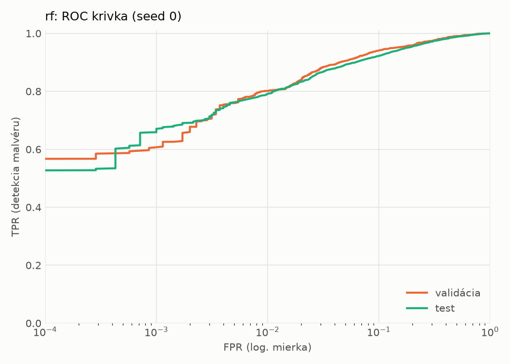
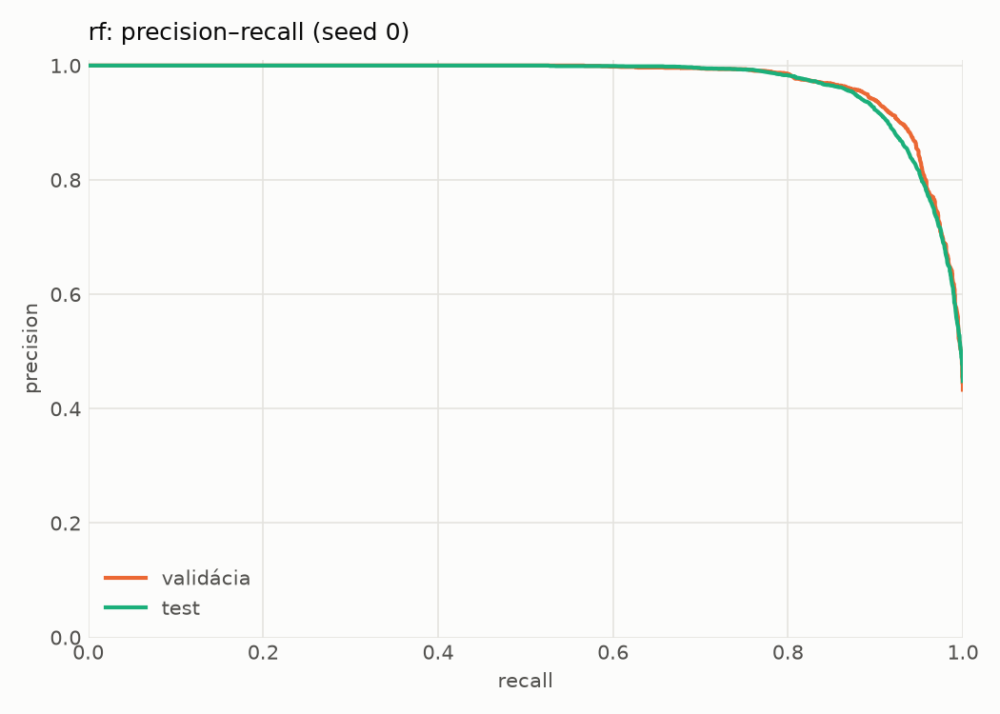
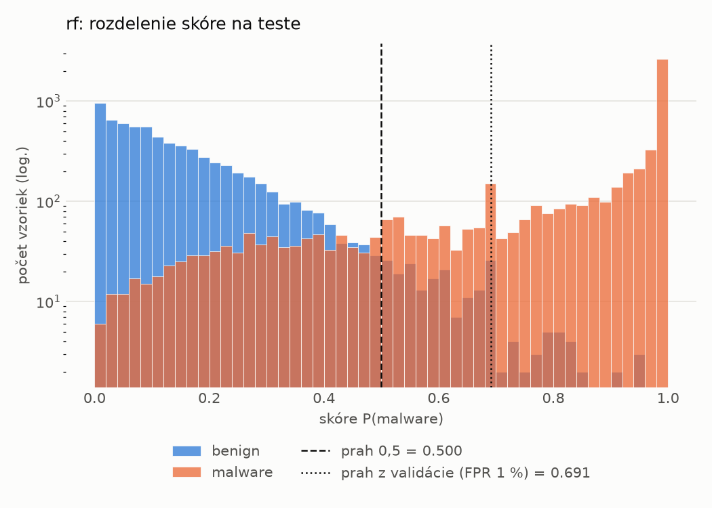
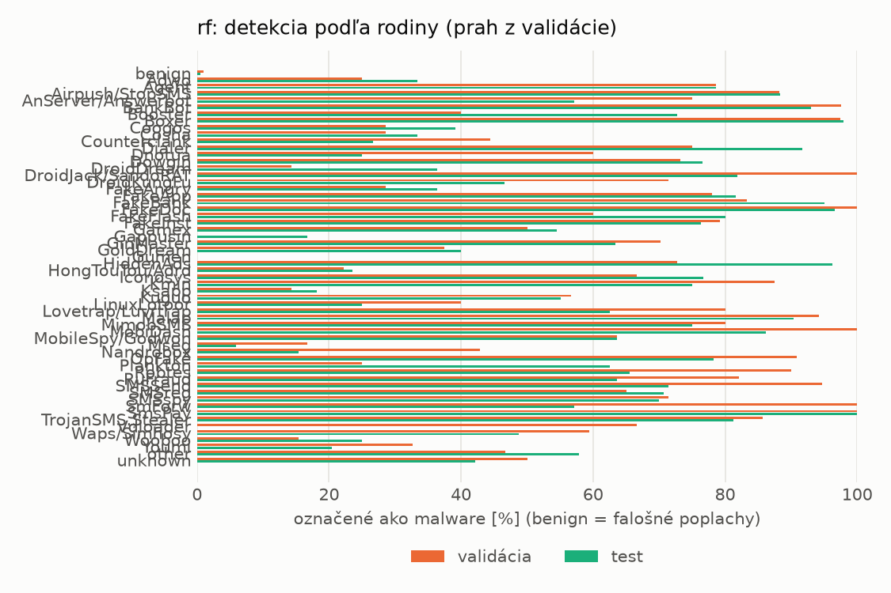
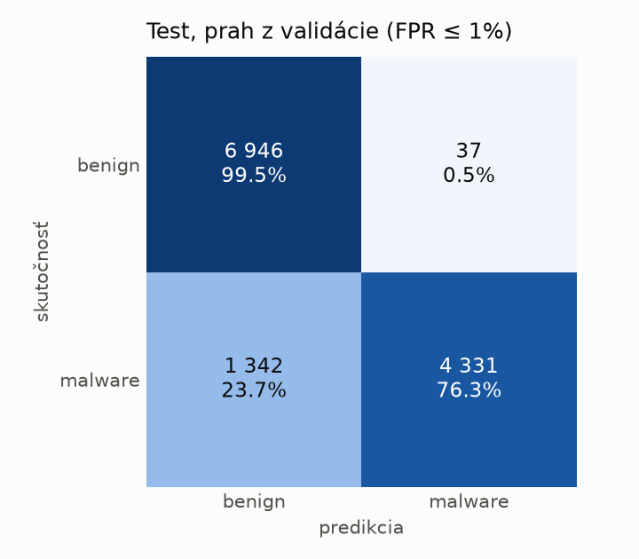
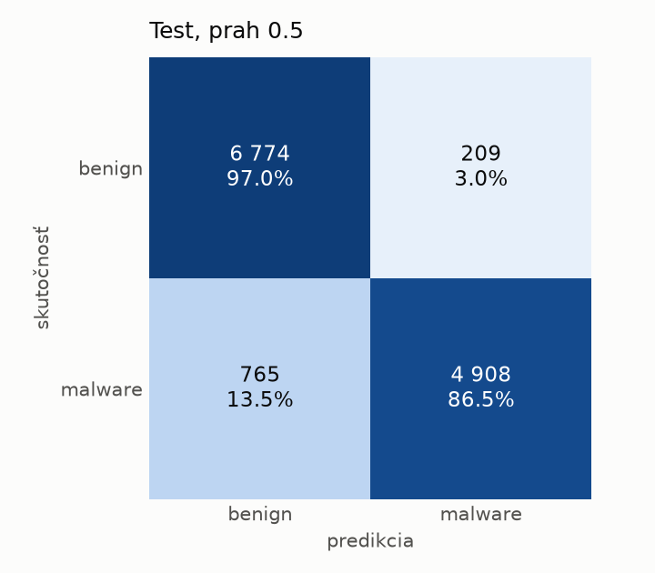

# dynamic/rf – beh `20261123-220025`

> Automaticky generované (`src/training/run_tabular.py`). Konfigurácia: `config.yaml`, protokol: `protocol.yaml`.

- **Model:** `random_forest` – Random Forest (pôvodné hodnoty príznakov)
- **Ladenie:** bez ladenia – hyperparametre prevzaté z `runs_v4/emu_p/full/dynamic/rf/20261123-191811`
- **Finálne modely:** seedy [0, 1, 2]; hodnoty sú priemer ± smerodajná odchýlka cez seedy
- **Najlepšie hyperparametre:** `{"n_estimators": 450, "max_depth": null, "min_samples_leaf": 1, "max_features": "sqrt"}`

## Detekčná kvalita (bez prahu)
| metrika | train (podvzorka) | validácia | test |
|---|---|---|---|
| ROC-AUC | 0.9998 ± 0.0000 | 0.9756 ± 0.0002 | 0.9714 ± 0.0001 |
| PR-AUC | 0.9998 ± 0.0000 | 0.9753 ± 0.0002 | 0.9728 ± 0.0001 |
| TPR pri FPR 1 % | 1.0000 ± 0.0000 | 0.8013 ± 0.0045 | 0.7909 ± 0.0023 |
| TPR pri FPR 0,1 % | 0.9858 ± 0.0004 | 0.6195 ± 0.0174 | 0.6537 ± 0.0042 |
| log loss | 0.0636 ± 0.0002 | 0.2078 ± 0.0004 | 0.2237 ± 0.0006 |
| Brier skóre | 0.0092 ± 0.0000 | 0.0585 ± 0.0001 | 0.0641 ± 0.0001 |

Rozdiel ROC-AUC train − validácia: **0.0243** (veľký rozdiel = preučenie).

## Pri prahu z validácie (FPR ≤ 1% na validácii)
| metrika | train (podvzorka) | validácia | test |
|---|---|---|---|
| accuracy | 0.9940 ± 0.0004 | 0.9085 ± 0.0019 | 0.8908 ± 0.0012 |
| balanced accuracy | 0.9932 ± 0.0004 | 0.8958 ± 0.0022 | 0.8788 ± 0.0014 |
| precision | 0.9981 ± 0.0000 | 0.9846 ± 0.0002 | 0.9909 ± 0.0010 |
| recall (TPR) | 0.9877 ± 0.0009 | 0.8013 ± 0.0045 | 0.7633 ± 0.0032 |
| FPR | 0.0014 ± 0.0000 | 0.0096 ± 0.0002 | 0.0057 ± 0.0006 |
| F1 | 0.9929 ± 0.0004 | 0.8835 ± 0.0027 | 0.8623 ± 0.0018 |
| MCC | 0.9877 ± 0.0007 | 0.8212 ± 0.0035 | 0.7924 ± 0.0020 |

## Pri pevnom prahu 0.5
| metrika | train (podvzorka) | validácia | test |
|---|---|---|---|
| accuracy | 0.9973 ± 0.0001 | 0.9315 ± 0.0001 | 0.9224 ± 0.0009 |
| balanced accuracy | 0.9976 ± 0.0001 | 0.9258 ± 0.0002 | 0.9169 ± 0.0010 |
| precision | 0.9941 ± 0.0000 | 0.9552 ± 0.0008 | 0.9587 ± 0.0005 |
| recall (TPR) | 0.9994 ± 0.0001 | 0.8833 ± 0.0010 | 0.8640 ± 0.0018 |
| FPR | 0.0043 ± 0.0000 | 0.0316 ± 0.0006 | 0.0303 ± 0.0003 |
| F1 | 0.9968 ± 0.0001 | 0.9179 ± 0.0002 | 0.9089 ± 0.0012 |
| MCC | 0.9944 ± 0.0001 | 0.8613 ± 0.0001 | 0.8450 ± 0.0018 |

## Výpočtové nároky (seed 0, testovacia množina)
| meranie | hodnota |
|---|---|
| tréning finálneho modelu | 2.7 s (priemer cez seedy) |
| ladenie spolu | 0 s |
| počet parametrov / uzlov | 4 118 138 |
| veľkosť modelu na disku | 329.81 MB |
| CPU latencia modelu (batch 1, 1 vlákno) | 13.317 ms (p95 13.734) |
| CPU priepustnosť (24 vlákien) | 110 220 vzoriek/s |

## Grafy
| | |
|---|---|
|  |  |
|  |  |
|  |  |
|  |  |

## Súbory
`metrics.json` (všetky metriky po seedoch vrátane rodín), `timing.json`, `hpo_trials.csv`,
`predictions/<časť>_seed<N>.parquet` (sha256, family, label, score), `model/seed_<N>/`, `log.txt`.
