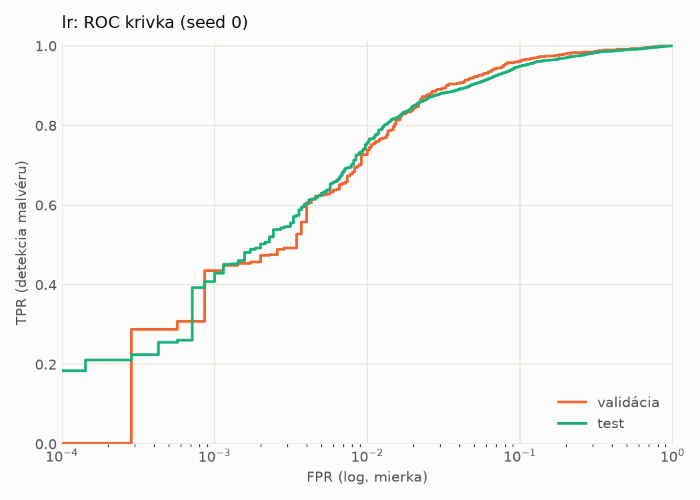
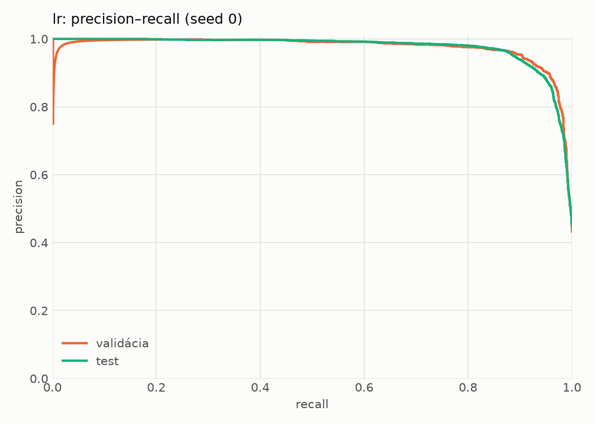
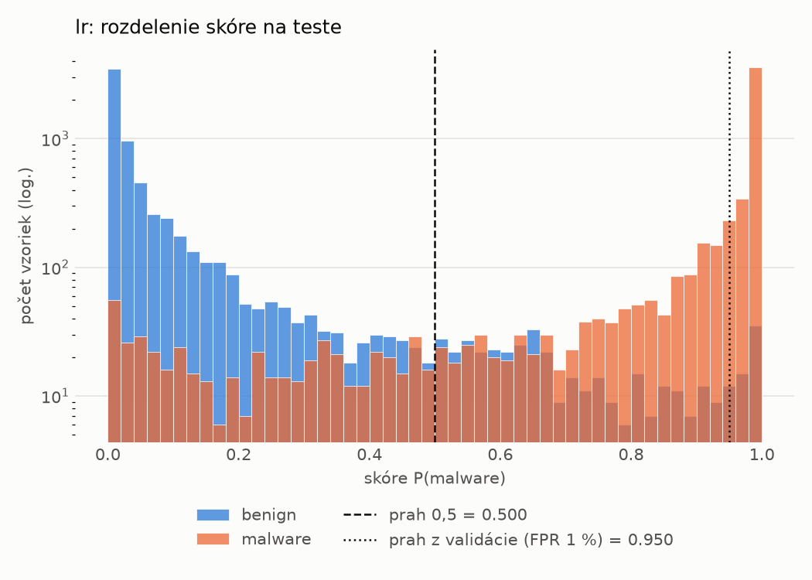
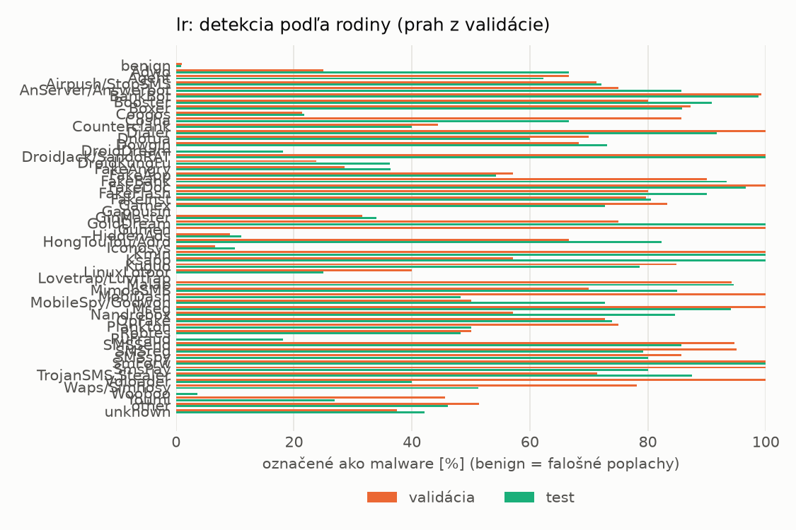
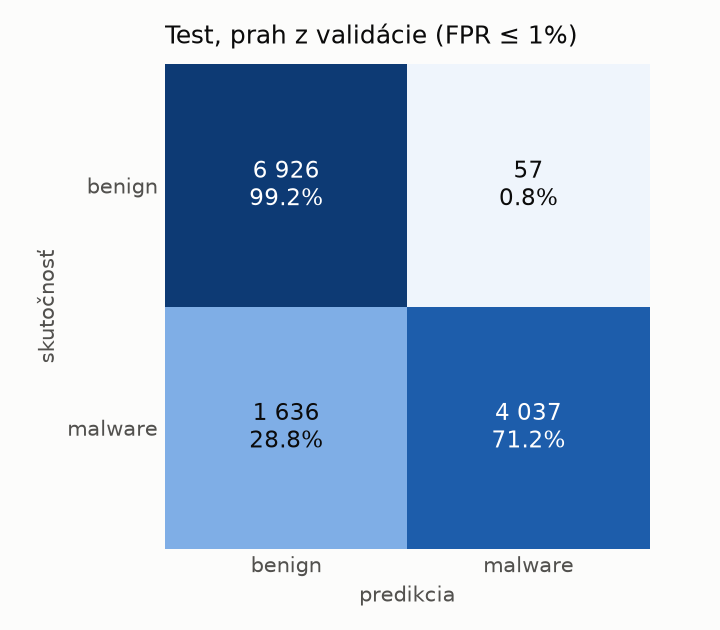
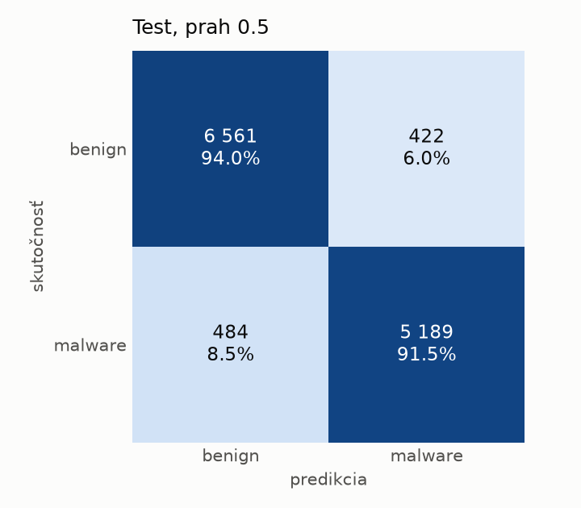

# hybrid/lr – beh `20261123-220344`

> Automaticky generované (`src/training/run_tabular.py`). Konfigurácia: `config.yaml`, protokol: `protocol.yaml`.

- **Model:** `logreg` – logistická regresia s L2 regularizáciou (vstup signed log1p + štandardizácia)
- **Ladenie:** bez ladenia – hyperparametre prevzaté z `runs_v4/emu_p/full/hybrid/lr/20261123-195300`
- **Finálne modely:** seedy [0, 1, 2]; hodnoty sú priemer ± smerodajná odchýlka cez seedy
- **Najlepšie hyperparametre:** `{"max_iter": 2000, "C": 7.106361724509844}`

## Detekčná kvalita (bez prahu)
| metrika | train (podvzorka) | validácia | test |
|---|---|---|---|
| ROC-AUC | 0.9820 ± 0.0000 | 0.9794 ± 0.0000 | 0.9759 ± 0.0000 |
| PR-AUC | 0.9790 ± 0.0000 | 0.9753 ± 0.0000 | 0.9751 ± 0.0000 |
| TPR pri FPR 1 % | 0.7815 ± 0.0000 | 0.7272 ± 0.0000 | 0.7534 ± 0.0000 |
| TPR pri FPR 0,1 % | 0.4568 ± 0.0000 | 0.4360 ± 0.0000 | 0.4077 ± 0.0000 |
| log loss | 0.1650 ± 0.0000 | 0.1770 ± 0.0000 | 0.1905 ± 0.0000 |
| Brier skóre | 0.0465 ± 0.0000 | 0.0477 ± 0.0000 | 0.0525 ± 0.0000 |

Rozdiel ROC-AUC train − validácia: **0.0026** (veľký rozdiel = preučenie).

## Pri prahu z validácie (FPR ≤ 1% na validácii)
| metrika | train (podvzorka) | validácia | test |
|---|---|---|---|
| accuracy | 0.8849 ± 0.0000 | 0.8763 ± 0.0000 | 0.8662 ± 0.0000 |
| balanced accuracy | 0.8654 ± 0.0000 | 0.8587 ± 0.0000 | 0.8517 ± 0.0000 |
| precision | 0.9883 ± 0.0000 | 0.9828 ± 0.0000 | 0.9861 ± 0.0000 |
| recall (TPR) | 0.7371 ± 0.0000 | 0.7272 ± 0.0000 | 0.7116 ± 0.0000 |
| FPR | 0.0064 ± 0.0000 | 0.0097 ± 0.0000 | 0.0082 ± 0.0000 |
| F1 | 0.8444 ± 0.0000 | 0.8359 ± 0.0000 | 0.8267 ± 0.0000 |
| MCC | 0.7766 ± 0.0000 | 0.7618 ± 0.0000 | 0.7478 ± 0.0000 |

## Pri pevnom prahu 0.5
| metrika | train (podvzorka) | validácia | test |
|---|---|---|---|
| accuracy | 0.9386 ± 0.0000 | 0.9363 ± 0.0000 | 0.9284 ± 0.0000 |
| balanced accuracy | 0.9376 ± 0.0000 | 0.9356 ± 0.0000 | 0.9271 ± 0.0000 |
| precision | 0.9244 ± 0.0000 | 0.9233 ± 0.0000 | 0.9248 ± 0.0000 |
| recall (TPR) | 0.9313 ± 0.0000 | 0.9302 ± 0.0000 | 0.9147 ± 0.0000 |
| FPR | 0.0561 ± 0.0000 | 0.0590 ± 0.0000 | 0.0604 ± 0.0000 |
| F1 | 0.9278 ± 0.0000 | 0.9267 ± 0.0000 | 0.9197 ± 0.0000 |
| MCC | 0.8744 ± 0.0000 | 0.8704 ± 0.0000 | 0.8552 ± 0.0000 |

## Výpočtové nároky (seed 0, testovacia množina)
| meranie | hodnota |
|---|---|
| tréning finálneho modelu | 0.5 s (priemer cez seedy) |
| ladenie spolu | 0 s |
| počet parametrov / uzlov | 287 |
| veľkosť modelu na disku | 0.01 MB |
| transformácia vstupu – latencia (1 vlákno) | 0.006 ms |
| transformácia vstupu – priepustnosť | 507 456 vzoriek/s |
| CPU latencia modelu (batch 1, 1 vlákno) | 0.004 ms (p95 0.005) |
| CPU priepustnosť (24 vlákien) | 2 339 545 vzoriek/s |

## Grafy
| | |
|---|---|
|  |  |
|  |  |
|  |  |
|  |  |

## Súbory
`metrics.json` (všetky metriky po seedoch vrátane rodín), `timing.json`, `hpo_trials.csv`,
`predictions/<časť>_seed<N>.parquet` (sha256, family, label, score), `model/seed_<N>/`, `log.txt`.
