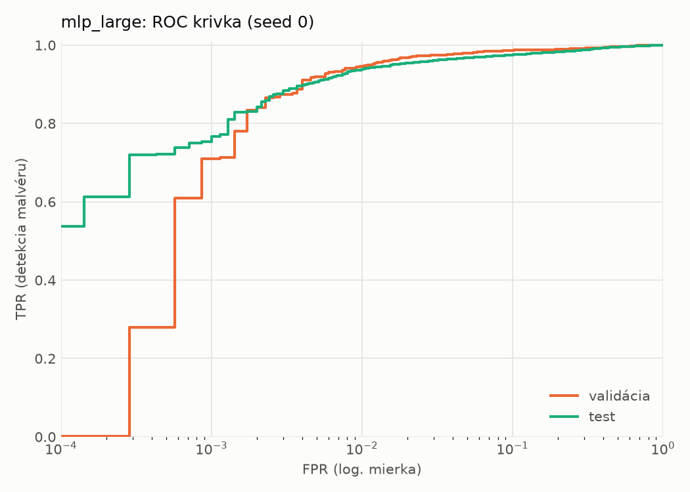
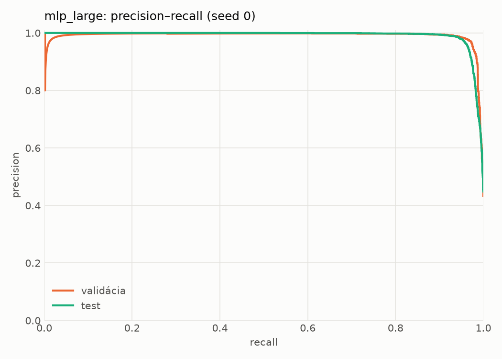
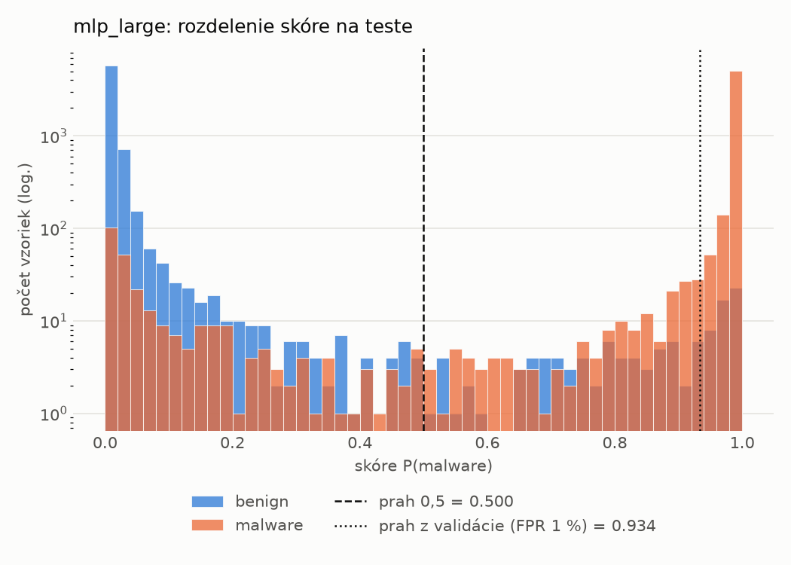
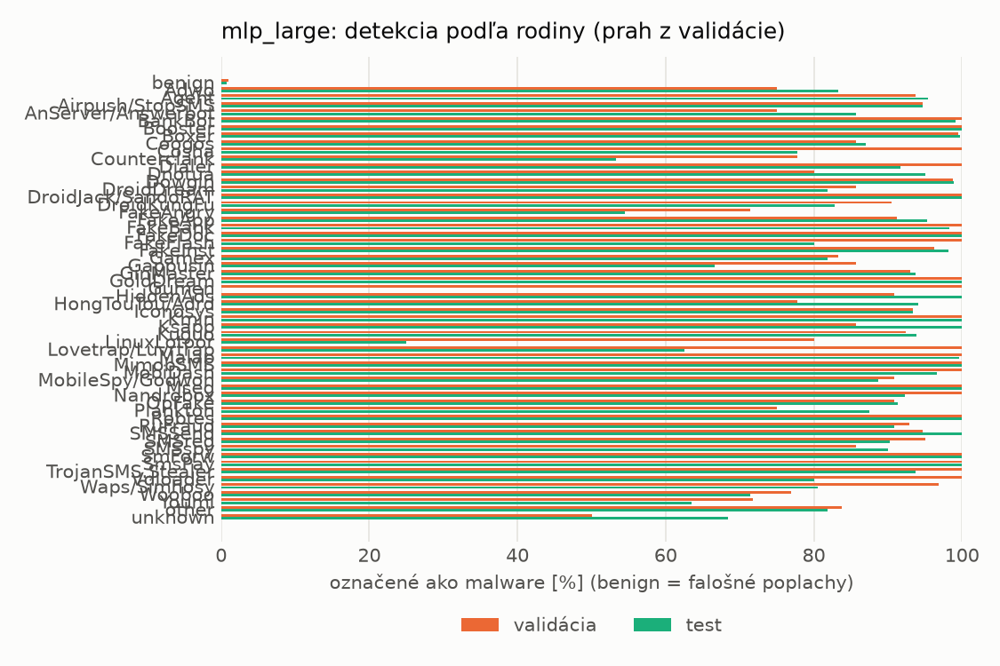
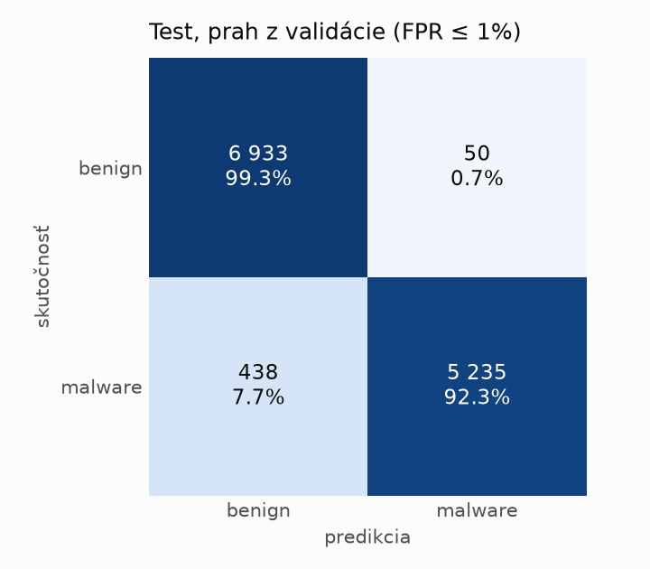
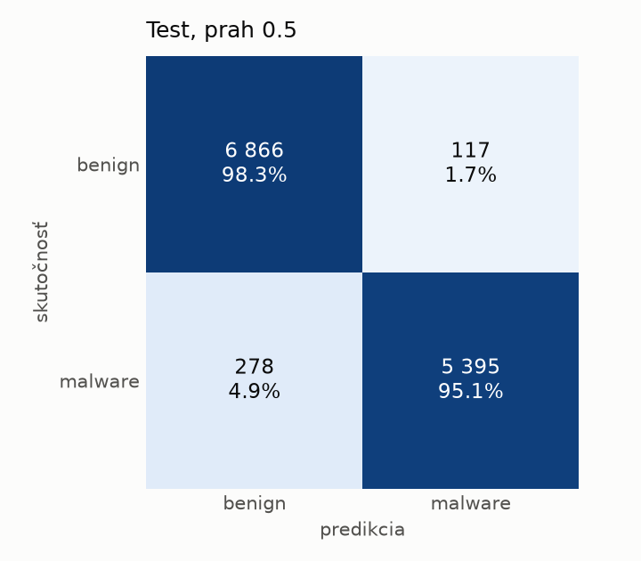
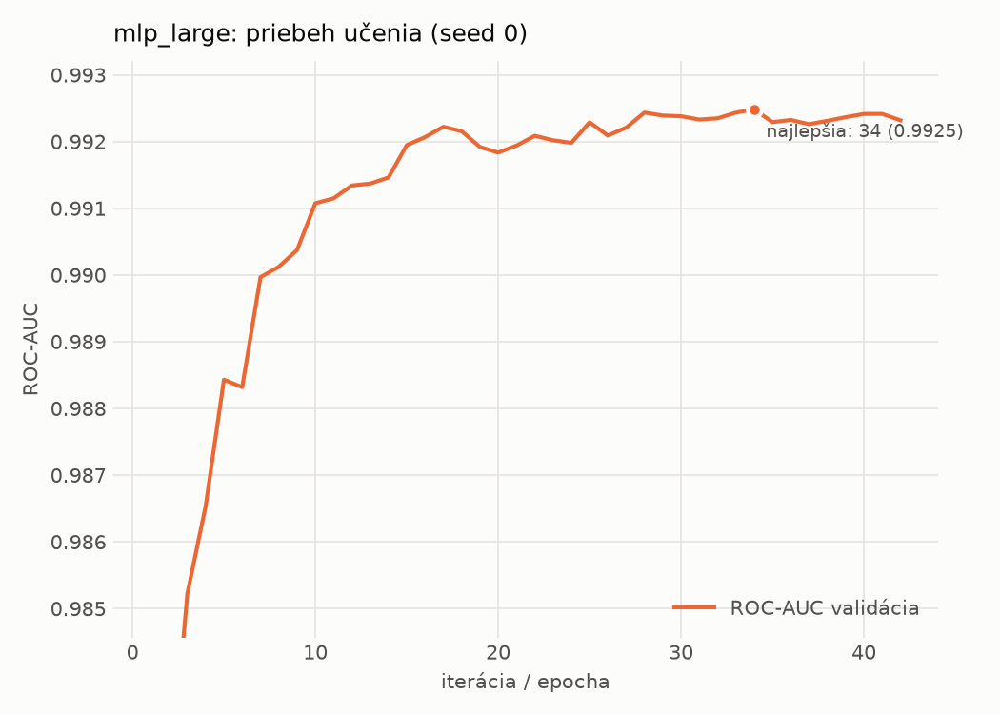

# hybrid/mlp_large – beh `20261123-220507`

> Automaticky generované (`src/training/run_tabular.py`). Konfigurácia: `config.yaml`, protokol: `protocol.yaml`.

- **Model:** `mlp` – veľká neurónová sieť (3–5 skrytých vrstiev, 512–2048 neurónov), kandidát na učiteľa
- **Ladenie:** bez ladenia – hyperparametre prevzaté z `runs_v4/emu_p/full/hybrid/mlp_large/20261123-200933`
- **Finálne modely:** seedy [0, 1, 2]; hodnoty sú priemer ± smerodajná odchýlka cez seedy
- **Najlepšie hyperparametre:** `{"max_epochs": 100, "patience": 8, "hidden_layers": 5, "hidden_width": 512, "width_decay": 0.5, "dropout": 0.18561035972653261, "lr": 0.00013117672209273214, "weight_decay": 3.948210593203141e-06, "batch_size": 512}`

## Detekčná kvalita (bez prahu)
| metrika | train (podvzorka) | validácia | test |
|---|---|---|---|
| ROC-AUC | 0.9986 ± 0.0001 | 0.9928 ± 0.0003 | 0.9892 ± 0.0005 |
| PR-AUC | 0.9986 ± 0.0001 | 0.9920 ± 0.0012 | 0.9899 ± 0.0012 |
| TPR pri FPR 1 % | 0.9895 ± 0.0006 | 0.9443 ± 0.0027 | 0.9332 ± 0.0032 |
| TPR pri FPR 0,1 % | 0.9616 ± 0.0130 | 0.7476 ± 0.0412 | 0.7710 ± 0.0183 |
| log loss | 0.0352 ± 0.0019 | 0.0906 ± 0.0009 | 0.1140 ± 0.0042 |
| Brier skóre | 0.0073 ± 0.0006 | 0.0222 ± 0.0003 | 0.0281 ± 0.0010 |

Rozdiel ROC-AUC train − validácia: **0.0058** (veľký rozdiel = preučenie).

## Pri prahu z validácie (FPR ≤ 1% na validácii)
| metrika | train (podvzorka) | validácia | test |
|---|---|---|---|
| accuracy | 0.9853 ± 0.0018 | 0.9704 ± 0.0012 | 0.9604 ± 0.0015 |
| balanced accuracy | 0.9829 ± 0.0021 | 0.9673 ± 0.0013 | 0.9567 ± 0.0016 |
| precision | 0.9985 ± 0.0004 | 0.9867 ± 0.0000 | 0.9901 ± 0.0008 |
| recall (TPR) | 0.9668 ± 0.0040 | 0.9443 ± 0.0027 | 0.9209 ± 0.0025 |
| FPR | 0.0011 ± 0.0003 | 0.0097 ± 0.0000 | 0.0074 ± 0.0006 |
| F1 | 0.9824 ± 0.0022 | 0.9650 ± 0.0014 | 0.9543 ± 0.0017 |
| MCC | 0.9701 ± 0.0037 | 0.9400 ± 0.0023 | 0.9214 ± 0.0029 |

## Pri pevnom prahu 0.5
| metrika | train (podvzorka) | validácia | test |
|---|---|---|---|
| accuracy | 0.9914 ± 0.0006 | 0.9735 ± 0.0009 | 0.9672 ± 0.0017 |
| balanced accuracy | 0.9907 ± 0.0006 | 0.9731 ± 0.0011 | 0.9655 ± 0.0017 |
| precision | 0.9936 ± 0.0009 | 0.9683 ± 0.0004 | 0.9772 ± 0.0020 |
| recall (TPR) | 0.9861 ± 0.0006 | 0.9705 ± 0.0021 | 0.9489 ± 0.0019 |
| FPR | 0.0047 ± 0.0007 | 0.0243 ± 0.0003 | 0.0179 ± 0.0016 |
| F1 | 0.9898 ± 0.0007 | 0.9694 ± 0.0011 | 0.9629 ± 0.0019 |
| MCC | 0.9824 ± 0.0013 | 0.9460 ± 0.0019 | 0.9338 ± 0.0034 |

## Výpočtové nároky (seed 0, testovacia množina)
| meranie | hodnota |
|---|---|
| tréning finálneho modelu | 8.5 s (priemer cez seedy) |
| ladenie spolu | 0 s |
| počet parametrov / uzlov | 323 521 |
| veľkosť modelu na disku | 1.32 MB |
| transformácia vstupu – latencia (1 vlákno) | 0.017 ms |
| transformácia vstupu – priepustnosť | 288 671 vzoriek/s |
| CPU latencia modelu (batch 1, 1 vlákno) | 0.173 ms (p95 0.450) |
| CPU priepustnosť (24 vlákien) | 742 353 vzoriek/s |
| GPU latencia (batch 1) | 0.584 ms (p95 1.358) |
| GPU priepustnosť | 1 106 410 vzoriek/s |
| GPU špičková pamäť | 183 MB |

## Grafy
| | |
|---|---|
|  |  |
|  |  |
|  |  |
|  |  |

## Súbory
`metrics.json` (všetky metriky po seedoch vrátane rodín), `timing.json`, `hpo_trials.csv`,
`predictions/<časť>_seed<N>.parquet` (sha256, family, label, score), `model/seed_<N>/`, `log.txt`.
