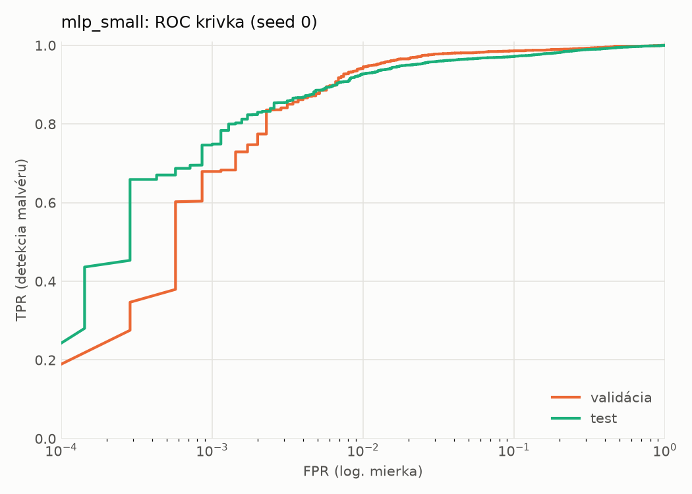
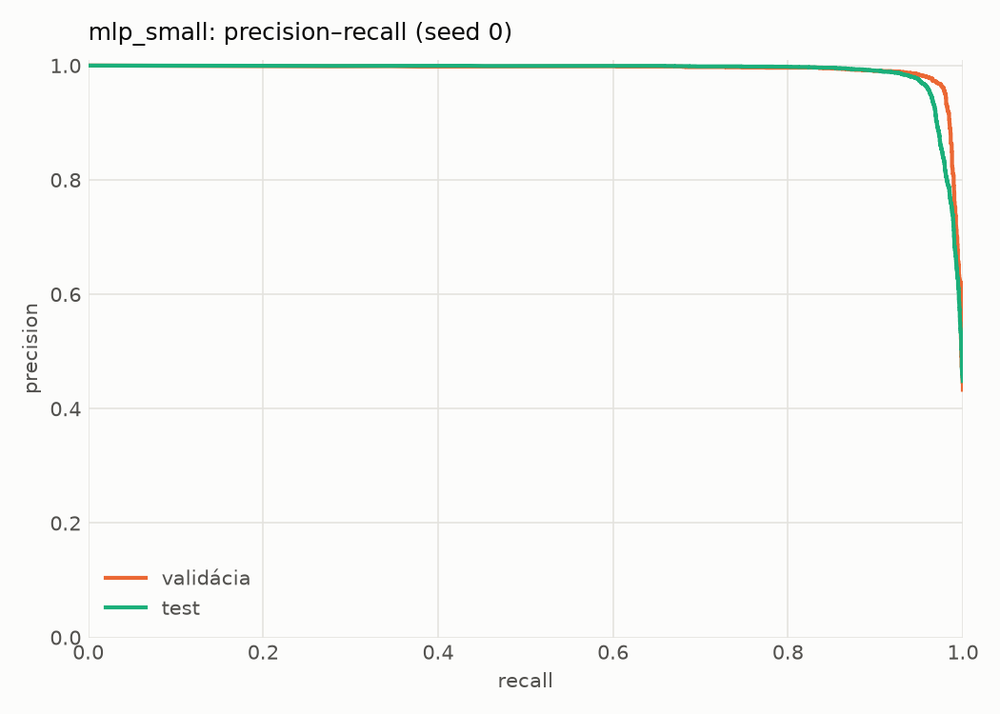
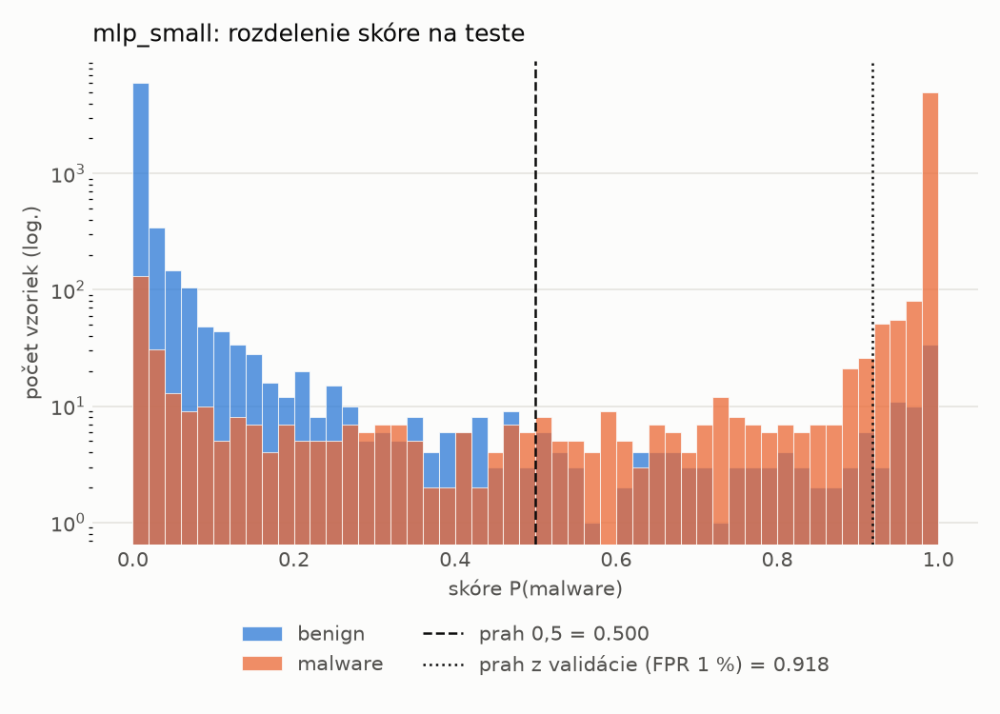
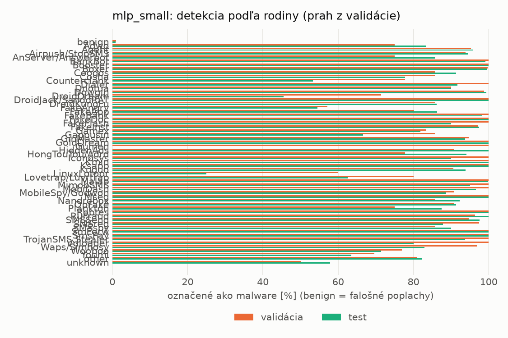
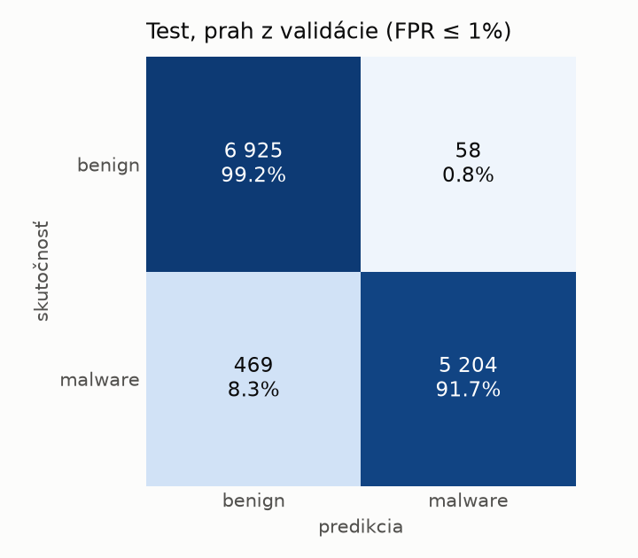
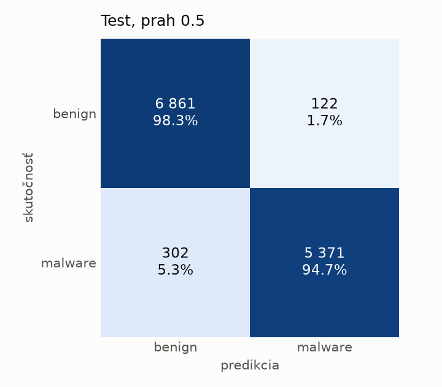
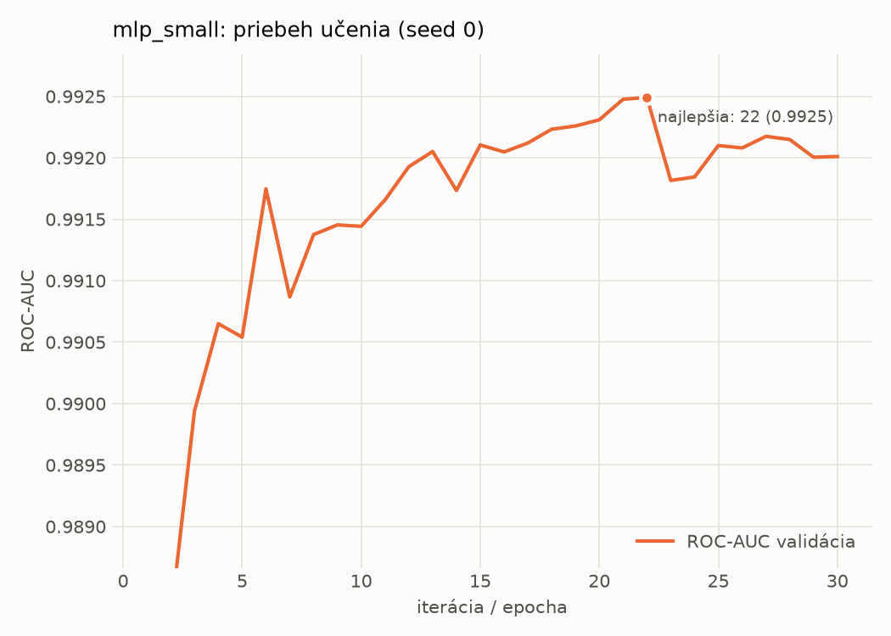

# hybrid/mlp_small – beh `20261123-220451`

> Automaticky generované (`src/training/run_tabular.py`). Konfigurácia: `config.yaml`, protokol: `protocol.yaml`.

- **Model:** `mlp` – malá neurónová sieť (1–2 skryté vrstvy), kandidát na ľahkého študenta
- **Ladenie:** bez ladenia – hyperparametre prevzaté z `runs_v4/emu_p/full/hybrid/mlp_small/20261123-200627`
- **Finálne modely:** seedy [0, 1, 2]; hodnoty sú priemer ± smerodajná odchýlka cez seedy
- **Najlepšie hyperparametre:** `{"width_decay": 0.5, "max_epochs": 100, "patience": 8, "hidden_layers": 2, "hidden_width": 256, "dropout": 0.2736594475747717, "lr": 0.0019631646658614973, "weight_decay": 0.0007425190310675283, "batch_size": 512}`

## Detekčná kvalita (bez prahu)
| metrika | train (podvzorka) | validácia | test |
|---|---|---|---|
| ROC-AUC | 0.9991 ± 0.0002 | 0.9923 ± 0.0002 | 0.9892 ± 0.0007 |
| PR-AUC | 0.9990 ± 0.0003 | 0.9914 ± 0.0006 | 0.9900 ± 0.0004 |
| TPR pri FPR 1 % | 0.9881 ± 0.0022 | 0.9403 ± 0.0020 | 0.9301 ± 0.0033 |
| TPR pri FPR 0,1 % | 0.9660 ± 0.0104 | 0.6145 ± 0.0732 | 0.7280 ± 0.0205 |
| log loss | 0.0307 ± 0.0038 | 0.1030 ± 0.0027 | 0.1285 ± 0.0055 |
| Brier skóre | 0.0079 ± 0.0010 | 0.0216 ± 0.0004 | 0.0284 ± 0.0003 |

Rozdiel ROC-AUC train − validácia: **0.0068** (veľký rozdiel = preučenie).

## Pri prahu z validácie (FPR ≤ 1% na validácii)
| metrika | train (podvzorka) | validácia | test |
|---|---|---|---|
| accuracy | 0.9818 ± 0.0009 | 0.9686 ± 0.0009 | 0.9593 ± 0.0014 |
| balanced accuracy | 0.9786 ± 0.0011 | 0.9653 ± 0.0010 | 0.9555 ± 0.0016 |
| precision | 0.9992 ± 0.0010 | 0.9866 ± 0.0000 | 0.9899 ± 0.0011 |
| recall (TPR) | 0.9578 ± 0.0029 | 0.9403 ± 0.0020 | 0.9186 ± 0.0034 |
| FPR | 0.0006 ± 0.0007 | 0.0097 ± 0.0000 | 0.0076 ± 0.0008 |
| F1 | 0.9780 ± 0.0011 | 0.9629 ± 0.0011 | 0.9529 ± 0.0017 |
| MCC | 0.9631 ± 0.0017 | 0.9366 ± 0.0017 | 0.9192 ± 0.0027 |

## Pri pevnom prahu 0.5
| metrika | train (podvzorka) | validácia | test |
|---|---|---|---|
| accuracy | 0.9900 ± 0.0008 | 0.9739 ± 0.0004 | 0.9662 ± 0.0008 |
| balanced accuracy | 0.9891 ± 0.0007 | 0.9734 ± 0.0003 | 0.9644 ± 0.0007 |
| precision | 0.9931 ± 0.0014 | 0.9706 ± 0.0021 | 0.9770 ± 0.0024 |
| recall (TPR) | 0.9832 ± 0.0008 | 0.9692 ± 0.0015 | 0.9470 ± 0.0006 |
| FPR | 0.0050 ± 0.0011 | 0.0225 ± 0.0017 | 0.0181 ± 0.0019 |
| F1 | 0.9881 ± 0.0009 | 0.9699 ± 0.0004 | 0.9618 ± 0.0009 |
| MCC | 0.9795 ± 0.0015 | 0.9469 ± 0.0008 | 0.9319 ± 0.0017 |

## Výpočtové nároky (seed 0, testovacia množina)
| meranie | hodnota |
|---|---|
| tréning finálneho modelu | 4.5 s (priemer cez seedy) |
| ladenie spolu | 0 s |
| počet parametrov / uzlov | 107 265 |
| veľkosť modelu na disku | 0.45 MB |
| transformácia vstupu – latencia (1 vlákno) | 0.007 ms |
| transformácia vstupu – priepustnosť | 295 672 vzoriek/s |
| CPU latencia modelu (batch 1, 1 vlákno) | 0.086 ms (p95 0.098) |
| CPU priepustnosť (24 vlákien) | 1 359 851 vzoriek/s |
| GPU latencia (batch 1) | 0.653 ms (p95 0.736) |
| GPU priepustnosť | 1 016 342 vzoriek/s |
| GPU špičková pamäť | 107 MB |

## Grafy
| | |
|---|---|
|  |  |
|  |  |
|  |  |
|  |  |

## Súbory
`metrics.json` (všetky metriky po seedoch vrátane rodín), `timing.json`, `hpo_trials.csv`,
`predictions/<časť>_seed<N>.parquet` (sha256, family, label, score), `model/seed_<N>/`, `log.txt`.
