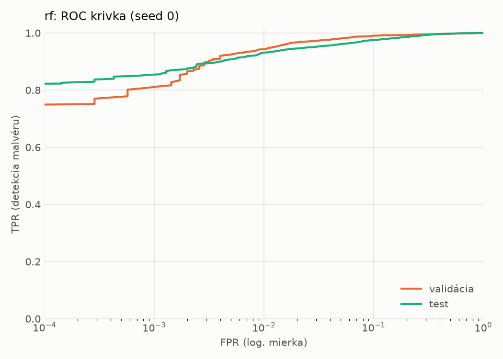
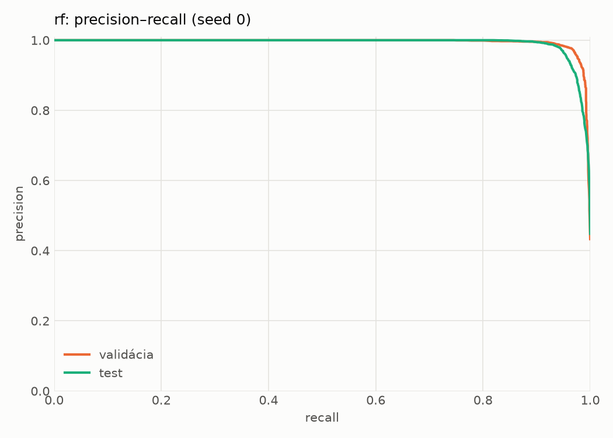
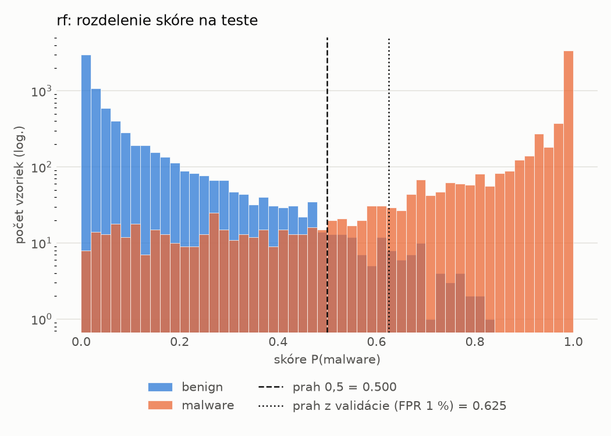
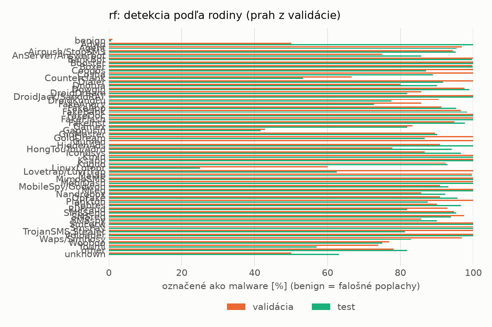
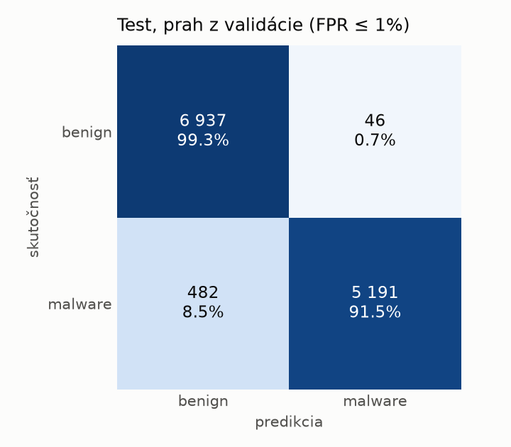
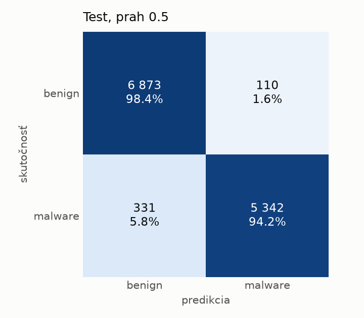

# hybrid/rf – beh `20261123-220347`

> Automaticky generované (`src/training/run_tabular.py`). Konfigurácia: `config.yaml`, protokol: `protocol.yaml`.

- **Model:** `random_forest` – Random Forest (pôvodné hodnoty príznakov)
- **Ladenie:** bez ladenia – hyperparametre prevzaté z `runs_v4/emu_p/full/hybrid/rf/20261123-195313`
- **Finálne modely:** seedy [0, 1, 2]; hodnoty sú priemer ± smerodajná odchýlka cez seedy
- **Najlepšie hyperparametre:** `{"n_estimators": 200, "max_depth": null, "min_samples_leaf": 1, "max_features": "sqrt"}`

## Detekčná kvalita (bez prahu)
| metrika | train (podvzorka) | validácia | test |
|---|---|---|---|
| ROC-AUC | 1.0000 ± 0.0000 | 0.9945 ± 0.0002 | 0.9913 ± 0.0000 |
| PR-AUC | 1.0000 ± 0.0000 | 0.9944 ± 0.0001 | 0.9915 ± 0.0000 |
| TPR pri FPR 1 % | 1.0000 ± 0.0000 | 0.9435 ± 0.0015 | 0.9278 ± 0.0031 |
| TPR pri FPR 0,1 % | 1.0000 ± 0.0000 | 0.8100 ± 0.0228 | 0.8552 ± 0.0045 |
| log loss | 0.0292 ± 0.0001 | 0.1041 ± 0.0006 | 0.1223 ± 0.0012 |
| Brier skóre | 0.0033 ± 0.0000 | 0.0248 ± 0.0001 | 0.0318 ± 0.0002 |

Rozdiel ROC-AUC train − validácia: **0.0055** (veľký rozdiel = preučenie).

## Pri prahu z validácie (FPR ≤ 1% na validácii)
| metrika | train (podvzorka) | validácia | test |
|---|---|---|---|
| accuracy | 1.0000 ± 0.0001 | 0.9701 ± 0.0007 | 0.9588 ± 0.0016 |
| balanced accuracy | 1.0000 ± 0.0001 | 0.9670 ± 0.0008 | 0.9548 ± 0.0018 |
| precision | 1.0000 ± 0.0000 | 0.9869 ± 0.0002 | 0.9913 ± 0.0008 |
| recall (TPR) | 0.9999 ± 0.0001 | 0.9435 ± 0.0015 | 0.9162 ± 0.0043 |
| FPR | 0.0000 ± 0.0000 | 0.0096 ± 0.0002 | 0.0065 ± 0.0006 |
| F1 | 1.0000 ± 0.0001 | 0.9647 ± 0.0009 | 0.9522 ± 0.0019 |
| MCC | 0.9999 ± 0.0001 | 0.9395 ± 0.0014 | 0.9183 ± 0.0030 |

## Pri pevnom prahu 0.5
| metrika | train (podvzorka) | validácia | test |
|---|---|---|---|
| accuracy | 1.0000 ± 0.0000 | 0.9741 ± 0.0002 | 0.9650 ± 0.0002 |
| balanced accuracy | 1.0000 ± 0.0000 | 0.9732 ± 0.0003 | 0.9628 ± 0.0002 |
| precision | 1.0000 ± 0.0000 | 0.9733 ± 0.0010 | 0.9800 ± 0.0005 |
| recall (TPR) | 1.0000 ± 0.0000 | 0.9666 ± 0.0014 | 0.9412 ± 0.0009 |
| FPR | 0.0000 ± 0.0000 | 0.0203 ± 0.0008 | 0.0156 ± 0.0004 |
| F1 | 1.0000 ± 0.0000 | 0.9699 ± 0.0002 | 0.9602 ± 0.0002 |
| MCC | 1.0000 ± 0.0000 | 0.9471 ± 0.0004 | 0.9297 ± 0.0003 |

## Výpočtové nároky (seed 0, testovacia množina)
| meranie | hodnota |
|---|---|
| tréning finálneho modelu | 1.4 s (priemer cez seedy) |
| ladenie spolu | 0 s |
| počet parametrov / uzlov | 978 294 |
| veľkosť modelu na disku | 78.52 MB |
| CPU latencia modelu (batch 1, 1 vlákno) | 5.848 ms (p95 6.142) |
| CPU priepustnosť (24 vlákien) | 169 244 vzoriek/s |

## Grafy
| | |
|---|---|
|  |  |
|  |  |
|  |  |
|  |  |

## Súbory
`metrics.json` (všetky metriky po seedoch vrátane rodín), `timing.json`, `hpo_trials.csv`,
`predictions/<časť>_seed<N>.parquet` (sha256, family, label, score), `model/seed_<N>/`, `log.txt`.
