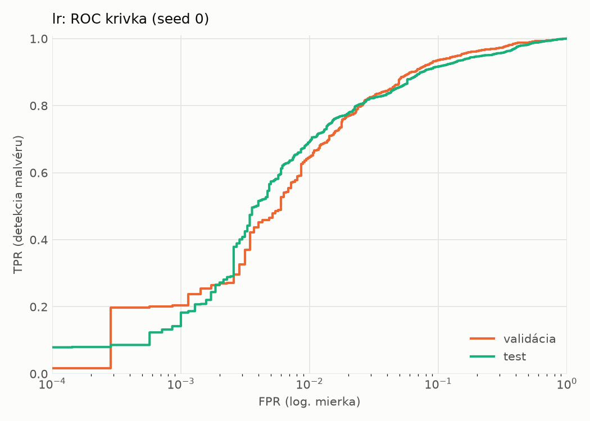
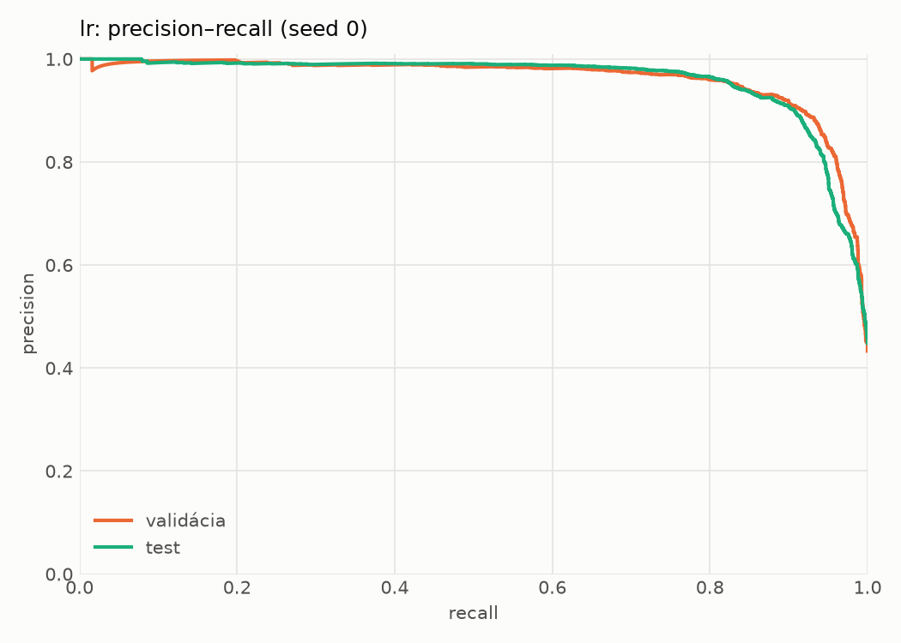
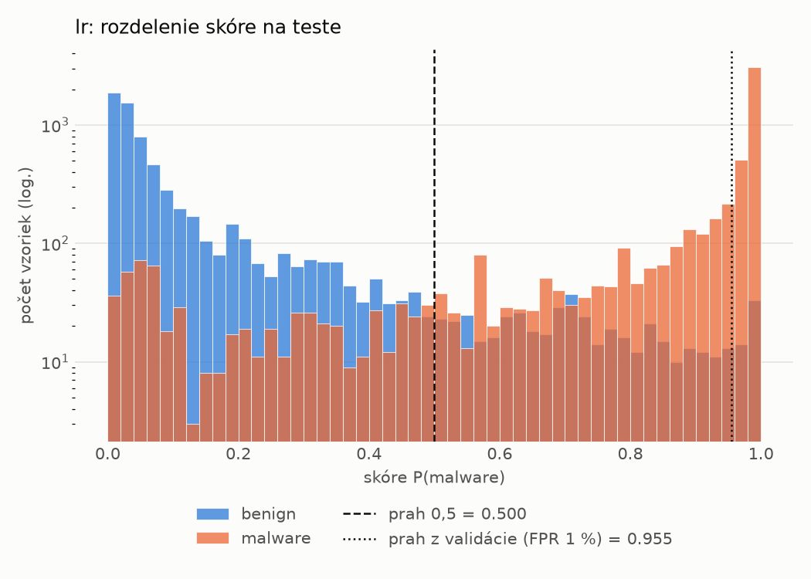
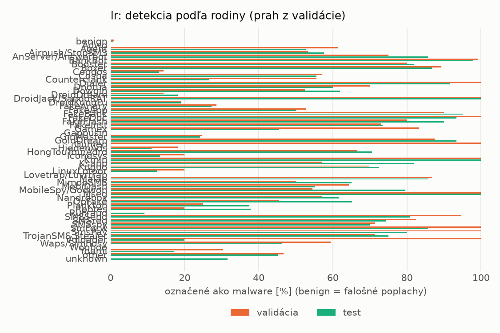
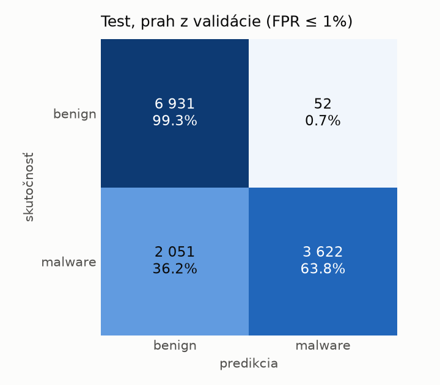
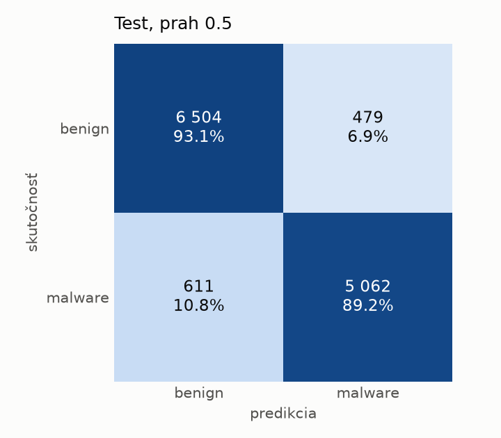

# static/lr – beh `20261123-185349`

> Automaticky generované (`src/training/run_tabular.py`). Konfigurácia: `config.yaml`, protokol: `protocol.yaml`.

- **Model:** `logreg` – logistická regresia s L2 regularizáciou (vstup signed log1p + štandardizácia)
- **Ladenie:** bez ladenia – hyperparametre prevzaté z `runs_v4/real_p/full/static/lr/20261122-230905`
- **Finálne modely:** seedy [0, 1, 2]; hodnoty sú priemer ± smerodajná odchýlka cez seedy
- **Najlepšie hyperparametre:** `{"max_iter": 2000, "C": 5.669849511478847}`

## Detekčná kvalita (bez prahu)
| metrika | train (podvzorka) | validácia | test |
|---|---|---|---|
| ROC-AUC | 0.9706 ± 0.0000 | 0.9681 ± 0.0000 | 0.9614 ± 0.0000 |
| PR-AUC | 0.9660 ± 0.0000 | 0.9618 ± 0.0000 | 0.9597 ± 0.0000 |
| TPR pri FPR 1 % | 0.7303 ± 0.0000 | 0.6450 ± 0.0000 | 0.6906 ± 0.0000 |
| TPR pri FPR 0,1 % | 0.2086 ± 0.0000 | 0.2038 ± 0.0000 | 0.1421 ± 0.0000 |
| log loss | 0.2113 ± 0.0000 | 0.2233 ± 0.0000 | 0.2413 ± 0.0000 |
| Brier skóre | 0.0595 ± 0.0000 | 0.0620 ± 0.0000 | 0.0680 ± 0.0000 |

Rozdiel ROC-AUC train − validácia: **0.0025** (veľký rozdiel = preučenie).

## Pri prahu z validácie (FPR ≤ 1% na validácii)
| metrika | train (podvzorka) | validácia | test |
|---|---|---|---|
| accuracy | 0.8486 ± 0.0000 | 0.8408 ± 0.0000 | 0.8338 ± 0.0000 |
| balanced accuracy | 0.8225 ± 0.0000 | 0.8176 ± 0.0000 | 0.8155 ± 0.0000 |
| precision | 0.9868 ± 0.0000 | 0.9806 ± 0.0000 | 0.9858 ± 0.0000 |
| recall (TPR) | 0.6515 ± 0.0000 | 0.6450 ± 0.0000 | 0.6385 ± 0.0000 |
| FPR | 0.0064 ± 0.0000 | 0.0097 ± 0.0000 | 0.0074 ± 0.0000 |
| F1 | 0.7848 ± 0.0000 | 0.7782 ± 0.0000 | 0.7750 ± 0.0000 |
| MCC | 0.7101 ± 0.0000 | 0.6974 ± 0.0000 | 0.6914 ± 0.0000 |

## Pri pevnom prahu 0.5
| metrika | train (podvzorka) | validácia | test |
|---|---|---|---|
| accuracy | 0.9262 ± 0.0000 | 0.9204 ± 0.0000 | 0.9139 ± 0.0000 |
| balanced accuracy | 0.9243 ± 0.0000 | 0.9191 ± 0.0000 | 0.9119 ± 0.0000 |
| precision | 0.9141 ± 0.0000 | 0.9068 ± 0.0000 | 0.9136 ± 0.0000 |
| recall (TPR) | 0.9115 ± 0.0000 | 0.9096 ± 0.0000 | 0.8923 ± 0.0000 |
| FPR | 0.0630 ± 0.0000 | 0.0714 ± 0.0000 | 0.0686 ± 0.0000 |
| F1 | 0.9128 ± 0.0000 | 0.9082 ± 0.0000 | 0.9028 ± 0.0000 |
| MCC | 0.8488 ± 0.0000 | 0.8379 ± 0.0000 | 0.8257 ± 0.0000 |

## Výpočtové nároky (seed 0, testovacia množina)
| meranie | hodnota |
|---|---|
| tréning finálneho modelu | 0.3 s (priemer cez seedy) |
| ladenie spolu | 0 s |
| počet parametrov / uzlov | 164 |
| veľkosť modelu na disku | 0.01 MB |
| transformácia vstupu – latencia (1 vlákno) | 0.005 ms |
| transformácia vstupu – priepustnosť | 1 134 284 vzoriek/s |
| CPU latencia modelu (batch 1, 1 vlákno) | 0.004 ms (p95 0.004) |
| CPU priepustnosť (24 vlákien) | 3 485 925 vzoriek/s |

## Grafy
| | |
|---|---|
|  |  |
|  |  |
|  |  |
|  |  |

## Súbory
`metrics.json` (všetky metriky po seedoch vrátane rodín), `timing.json`, `hpo_trials.csv`,
`predictions/<časť>_seed<N>.parquet` (sha256, family, label, score), `model/seed_<N>/`, `log.txt`.
