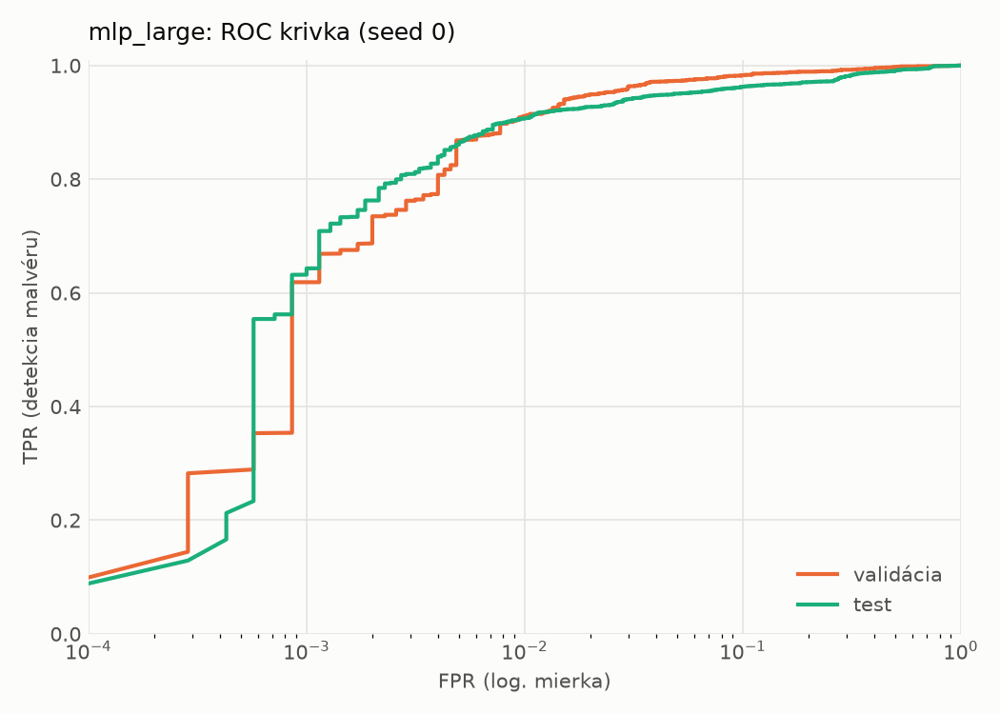
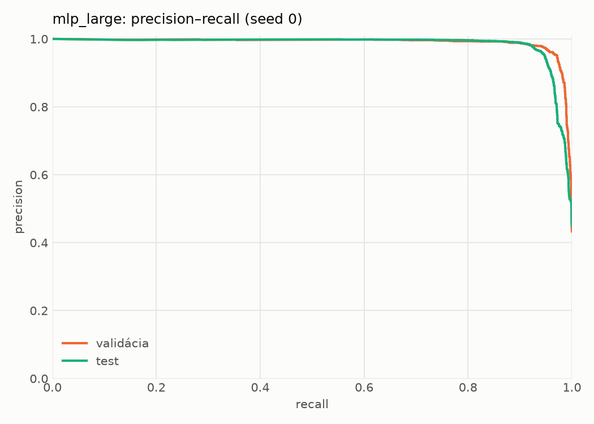
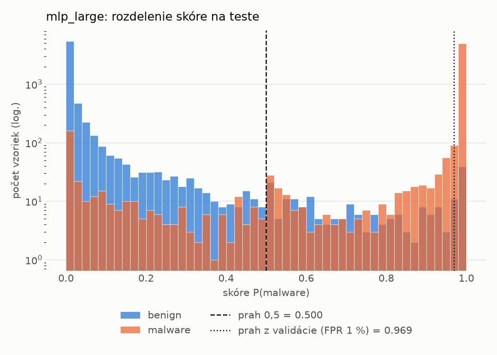
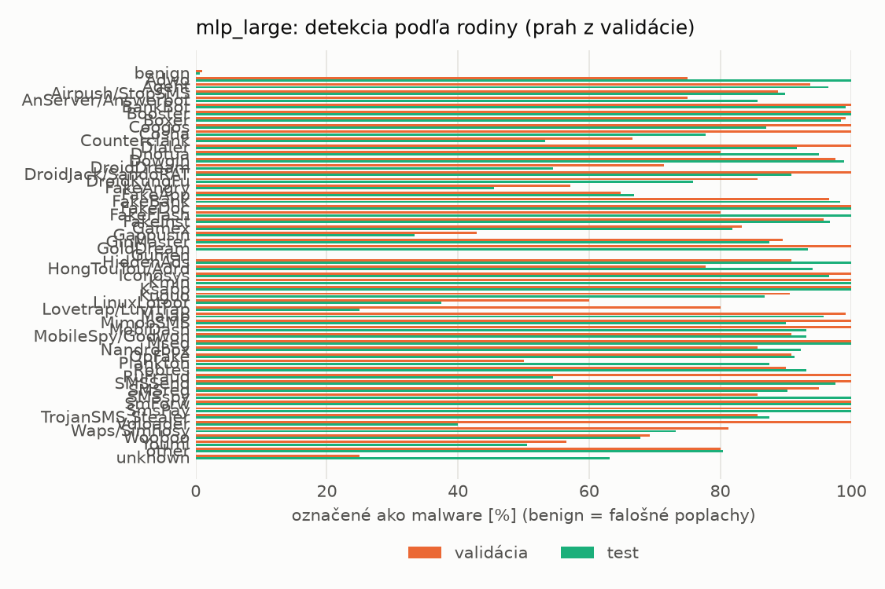
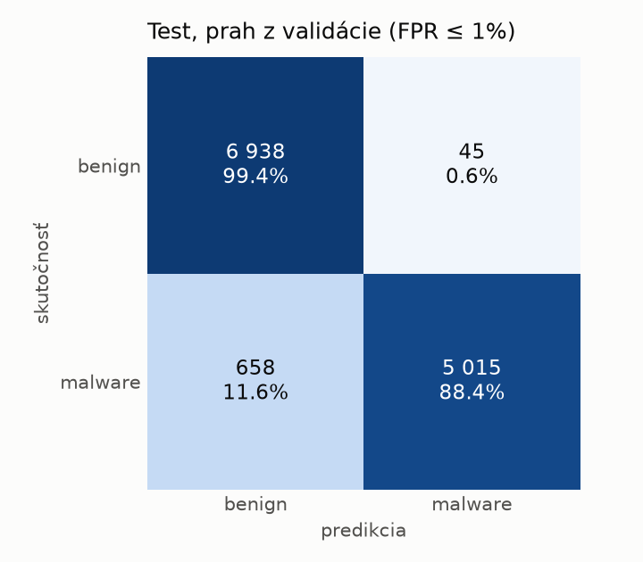
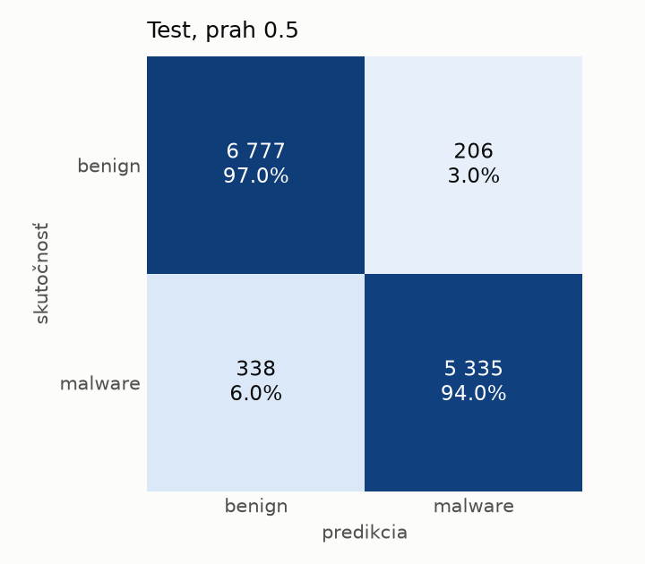
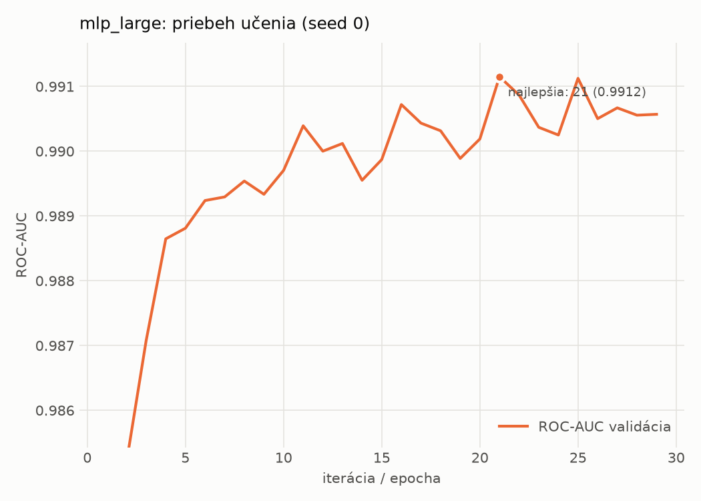

# static/mlp_large – beh `20261123-185506`

> Automaticky generované (`src/training/run_tabular.py`). Konfigurácia: `config.yaml`, protokol: `protocol.yaml`.

- **Model:** `mlp` – veľká neurónová sieť (3–5 skrytých vrstiev, 512–2048 neurónov), kandidát na učiteľa
- **Ladenie:** bez ladenia – hyperparametre prevzaté z `runs_v4/real_p/full/static/mlp_large/20261122-232356`
- **Finálne modely:** seedy [0, 1, 2]; hodnoty sú priemer ± smerodajná odchýlka cez seedy
- **Najlepšie hyperparametre:** `{"max_epochs": 100, "patience": 8, "hidden_layers": 3, "hidden_width": 2048, "width_decay": 0.5, "dropout": 0.24592095800405475, "lr": 0.0002046278772560144, "weight_decay": 0.007038560648637635, "batch_size": 256}`

## Detekčná kvalita (bez prahu)
| metrika | train (podvzorka) | validácia | test |
|---|---|---|---|
| ROC-AUC | 0.9983 ± 0.0005 | 0.9909 ± 0.0003 | 0.9831 ± 0.0010 |
| PR-AUC | 0.9980 ± 0.0005 | 0.9898 ± 0.0002 | 0.9840 ± 0.0001 |
| TPR pri FPR 1 % | 0.9744 ± 0.0042 | 0.9102 ± 0.0002 | 0.9072 ± 0.0006 |
| TPR pri FPR 0,1 % | 0.9228 ± 0.0182 | 0.5915 ± 0.0297 | 0.6623 ± 0.0615 |
| log loss | 0.0476 ± 0.0050 | 0.1212 ± 0.0043 | 0.1616 ± 0.0009 |
| Brier skóre | 0.0130 ± 0.0013 | 0.0283 ± 0.0006 | 0.0364 ± 0.0007 |

Rozdiel ROC-AUC train − validácia: **0.0074** (veľký rozdiel = preučenie).

## Pri prahu z validácie (FPR ≤ 1% na validácii)
| metrika | train (podvzorka) | validácia | test |
|---|---|---|---|
| accuracy | 0.9687 ± 0.0024 | 0.9556 ± 0.0001 | 0.9435 ± 0.0009 |
| balanced accuracy | 0.9633 ± 0.0027 | 0.9502 ± 0.0001 | 0.9377 ± 0.0011 |
| precision | 0.9980 ± 0.0016 | 0.9862 ± 0.0000 | 0.9913 ± 0.0016 |
| recall (TPR) | 0.9280 ± 0.0044 | 0.9102 ± 0.0002 | 0.8817 ± 0.0029 |
| FPR | 0.0014 ± 0.0011 | 0.0097 ± 0.0000 | 0.0063 ± 0.0012 |
| F1 | 0.9617 ± 0.0030 | 0.9467 ± 0.0001 | 0.9333 ± 0.0012 |
| MCC | 0.9370 ± 0.0048 | 0.9109 ± 0.0002 | 0.8892 ± 0.0016 |

## Pri pevnom prahu 0.5
| metrika | train (podvzorka) | validácia | test |
|---|---|---|---|
| accuracy | 0.9829 ± 0.0012 | 0.9647 ± 0.0019 | 0.9554 ± 0.0017 |
| balanced accuracy | 0.9821 ± 0.0017 | 0.9641 ± 0.0023 | 0.9535 ± 0.0023 |
| precision | 0.9831 ± 0.0020 | 0.9589 ± 0.0049 | 0.9649 ± 0.0047 |
| recall (TPR) | 0.9765 ± 0.0050 | 0.9597 ± 0.0070 | 0.9347 ± 0.0084 |
| FPR | 0.0124 ± 0.0016 | 0.0314 ± 0.0041 | 0.0277 ± 0.0040 |
| F1 | 0.9798 ± 0.0015 | 0.9593 ± 0.0023 | 0.9495 ± 0.0022 |
| MCC | 0.9650 ± 0.0025 | 0.9282 ± 0.0038 | 0.9101 ± 0.0032 |

## Výpočtové nároky (seed 0, testovacia množina)
| meranie | hodnota |
|---|---|
| tréning finálneho modelu | 10.4 s (priemer cez seedy) |
| ladenie spolu | 0 s |
| počet parametrov / uzlov | 2 966 529 |
| veľkosť modelu na disku | 11.91 MB |
| transformácia vstupu – latencia (1 vlákno) | 0.015 ms |
| transformácia vstupu – priepustnosť | 693 339 vzoriek/s |
| CPU latencia modelu (batch 1, 1 vlákno) | 0.304 ms (p95 0.675) |
| CPU priepustnosť (24 vlákien) | 96 541 vzoriek/s |
| GPU latencia (batch 1) | 0.418 ms (p95 0.934) |
| GPU priepustnosť | 805 386 vzoriek/s |
| GPU špičková pamäť | 248 MB |

## Grafy
| | |
|---|---|
|  |  |
|  |  |
|  |  |
|  |  |

## Súbory
`metrics.json` (všetky metriky po seedoch vrátane rodín), `timing.json`, `hpo_trials.csv`,
`predictions/<časť>_seed<N>.parquet` (sha256, family, label, score), `model/seed_<N>/`, `log.txt`.
