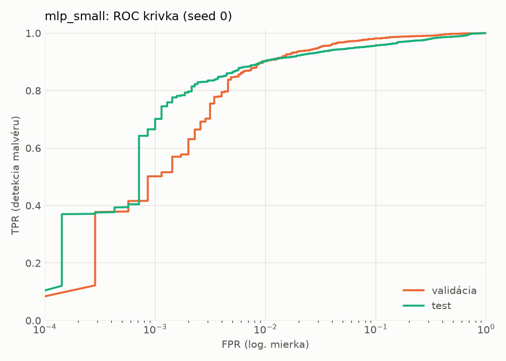
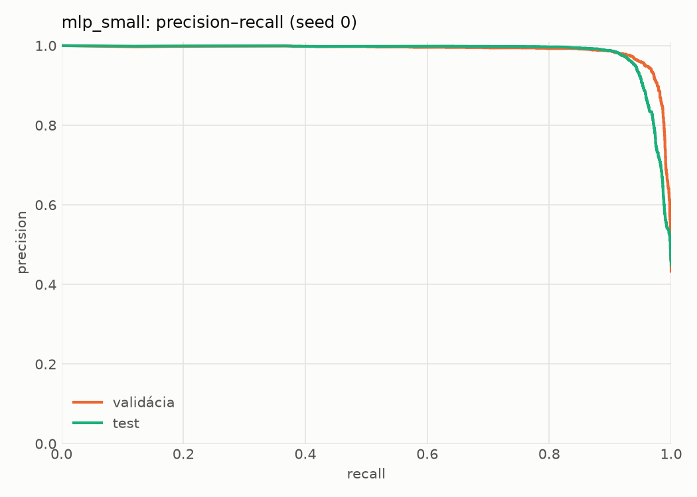
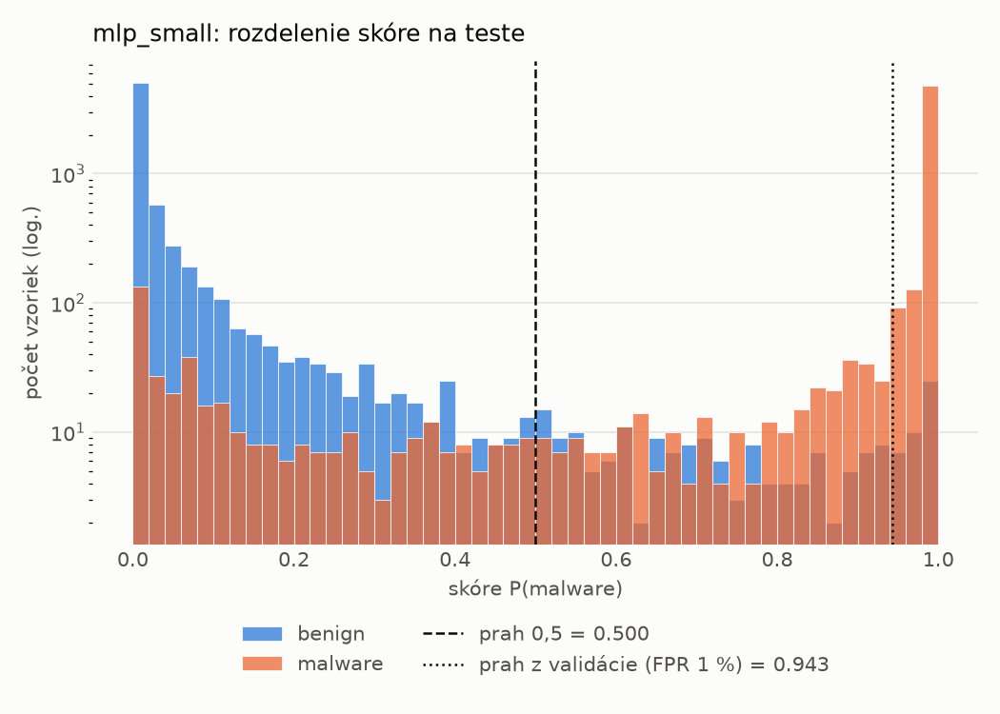
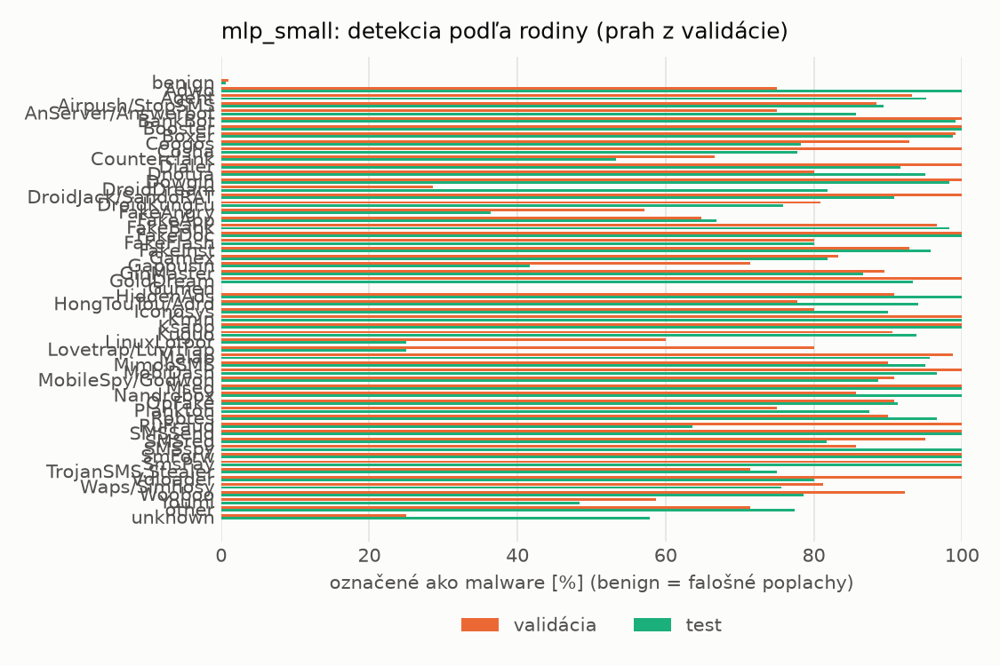
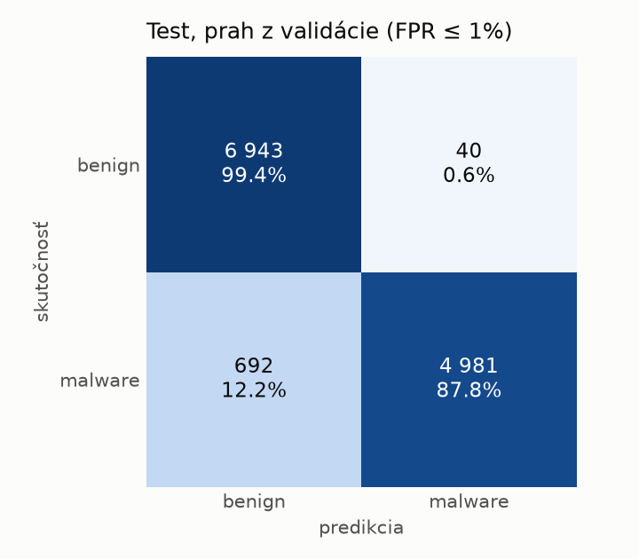
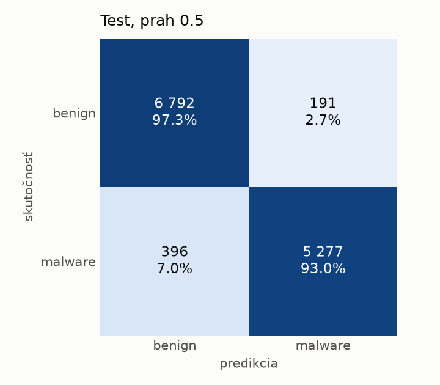
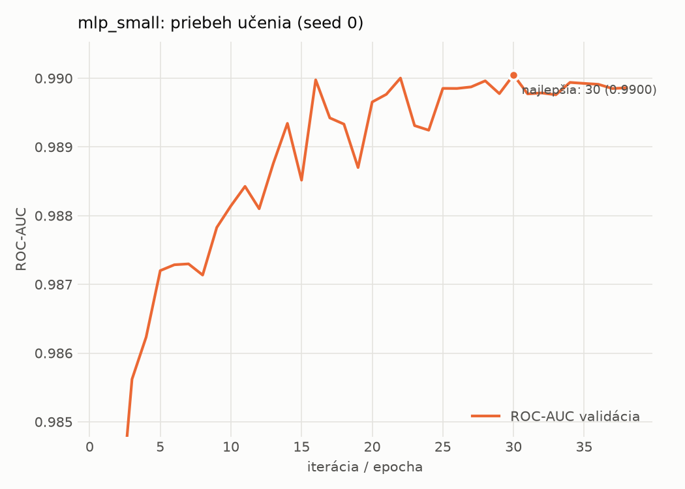

# static/mlp_small – beh `20261123-185440`

> Automaticky generované (`src/training/run_tabular.py`). Konfigurácia: `config.yaml`, protokol: `protocol.yaml`.

- **Model:** `mlp` – malá neurónová sieť (1–2 skryté vrstvy), kandidát na ľahkého študenta
- **Ladenie:** bez ladenia – hyperparametre prevzaté z `runs_v4/real_p/full/static/mlp_small/20261122-231849`
- **Finálne modely:** seedy [0, 1, 2]; hodnoty sú priemer ± smerodajná odchýlka cez seedy
- **Najlepšie hyperparametre:** `{"width_decay": 0.5, "max_epochs": 100, "patience": 8, "hidden_layers": 2, "hidden_width": 256, "dropout": 0.2770731649287669, "lr": 0.0010447758392925718, "weight_decay": 0.0006745378680415608, "batch_size": 256}`

## Detekčná kvalita (bez prahu)
| metrika | train (podvzorka) | validácia | test |
|---|---|---|---|
| ROC-AUC | 0.9970 ± 0.0006 | 0.9904 ± 0.0004 | 0.9821 ± 0.0010 |
| PR-AUC | 0.9965 ± 0.0006 | 0.9891 ± 0.0007 | 0.9840 ± 0.0009 |
| TPR pri FPR 1 % | 0.9583 ± 0.0048 | 0.9064 ± 0.0034 | 0.9012 ± 0.0018 |
| TPR pri FPR 0,1 % | 0.8751 ± 0.0206 | 0.5839 ± 0.0748 | 0.6684 ± 0.0573 |
| log loss | 0.0645 ± 0.0060 | 0.1207 ± 0.0044 | 0.1556 ± 0.0035 |
| Brier skóre | 0.0177 ± 0.0017 | 0.0303 ± 0.0008 | 0.0375 ± 0.0003 |

Rozdiel ROC-AUC train − validácia: **0.0066** (veľký rozdiel = preučenie).

## Pri prahu z validácie (FPR ≤ 1% na validácii)
| metrika | train (podvzorka) | validácia | test |
|---|---|---|---|
| accuracy | 0.9644 ± 0.0024 | 0.9540 ± 0.0015 | 0.9432 ± 0.0028 |
| balanced accuracy | 0.9585 ± 0.0028 | 0.9483 ± 0.0017 | 0.9374 ± 0.0031 |
| precision | 0.9955 ± 0.0012 | 0.9861 ± 0.0001 | 0.9909 ± 0.0010 |
| recall (TPR) | 0.9201 ± 0.0055 | 0.9064 ± 0.0034 | 0.8814 ± 0.0066 |
| FPR | 0.0031 ± 0.0008 | 0.0097 ± 0.0000 | 0.0066 ± 0.0007 |
| F1 | 0.9563 ± 0.0030 | 0.9446 ± 0.0019 | 0.9329 ± 0.0035 |
| MCC | 0.9284 ± 0.0047 | 0.9077 ± 0.0029 | 0.8885 ± 0.0052 |

## Pri pevnom prahu 0.5
| metrika | train (podvzorka) | validácia | test |
|---|---|---|---|
| accuracy | 0.9770 ± 0.0023 | 0.9611 ± 0.0021 | 0.9536 ± 0.0001 |
| balanced accuracy | 0.9758 ± 0.0024 | 0.9602 ± 0.0022 | 0.9514 ± 0.0001 |
| precision | 0.9778 ± 0.0027 | 0.9562 ± 0.0018 | 0.9648 ± 0.0002 |
| recall (TPR) | 0.9678 ± 0.0028 | 0.9537 ± 0.0032 | 0.9304 ± 0.0003 |
| FPR | 0.0162 ± 0.0019 | 0.0333 ± 0.0013 | 0.0275 ± 0.0002 |
| F1 | 0.9728 ± 0.0027 | 0.9550 ± 0.0025 | 0.9473 ± 0.0001 |
| MCC | 0.9529 ± 0.0047 | 0.9207 ± 0.0043 | 0.9063 ± 0.0002 |

## Výpočtové nároky (seed 0, testovacia množina)
| meranie | hodnota |
|---|---|
| tréning finálneho modelu | 8.1 s (priemer cez seedy) |
| ladenie spolu | 0 s |
| počet parametrov / uzlov | 75 777 |
| veľkosť modelu na disku | 0.32 MB |
| transformácia vstupu – latencia (1 vlákno) | 0.006 ms |
| transformácia vstupu – priepustnosť | 1 108 571 vzoriek/s |
| CPU latencia modelu (batch 1, 1 vlákno) | 0.084 ms (p95 0.098) |
| CPU priepustnosť (24 vlákien) | 1 763 263 vzoriek/s |
| GPU latencia (batch 1) | 0.413 ms (p95 0.436) |
| GPU priepustnosť | 2 551 767 vzoriek/s |
| GPU špičková pamäť | 75 MB |

## Grafy
| | |
|---|---|
|  |  |
|  |  |
|  |  |
|  |  |

## Súbory
`metrics.json` (všetky metriky po seedoch vrátane rodín), `timing.json`, `hpo_trials.csv`,
`predictions/<časť>_seed<N>.parquet` (sha256, family, label, score), `model/seed_<N>/`, `log.txt`.
