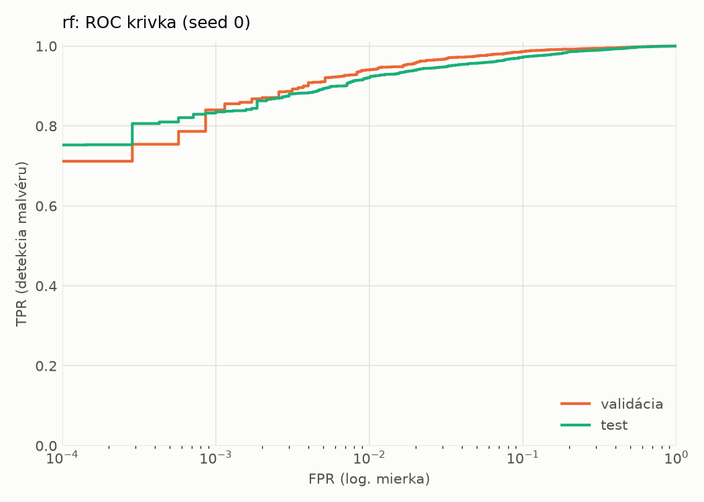
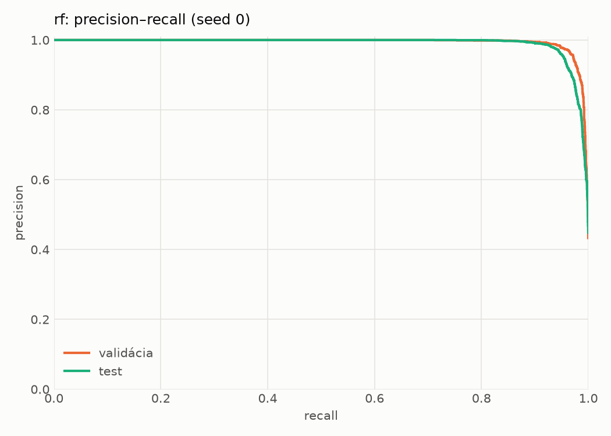
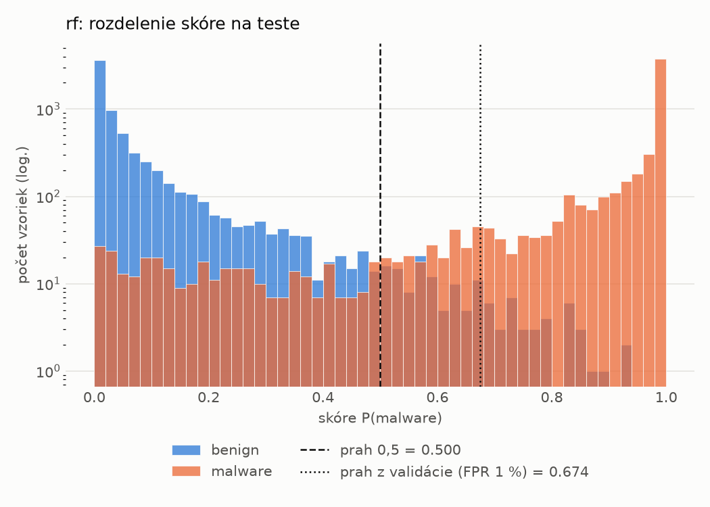
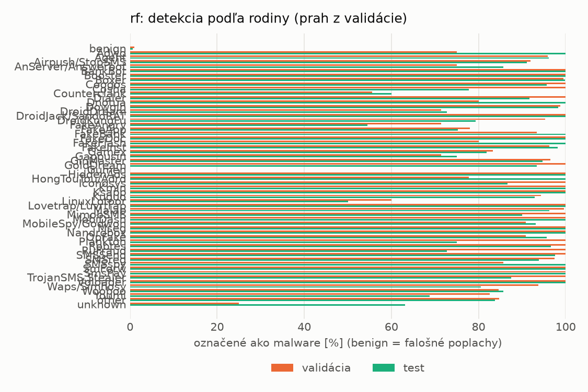
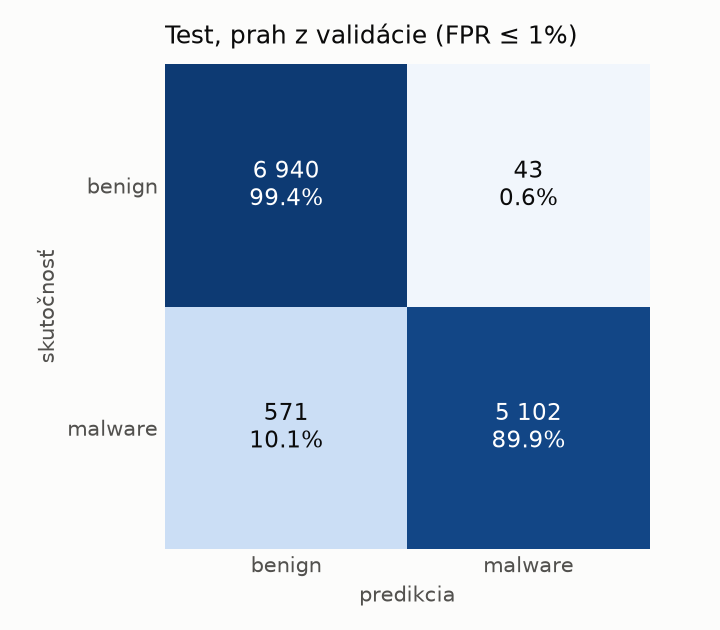
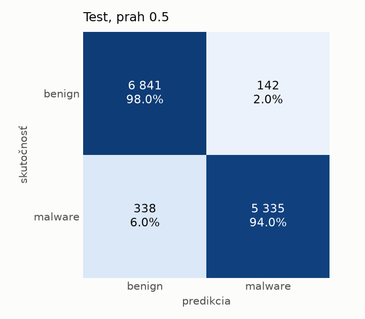

# static/rf – beh `20261123-185351`

> Automaticky generované (`src/training/run_tabular.py`). Konfigurácia: `config.yaml`, protokol: `protocol.yaml`.

- **Model:** `random_forest` – Random Forest (pôvodné hodnoty príznakov)
- **Ladenie:** bez ladenia – hyperparametre prevzaté z `runs_v4/real_p/full/static/rf/20261122-230914`
- **Finálne modely:** seedy [0, 1, 2]; hodnoty sú priemer ± smerodajná odchýlka cez seedy
- **Najlepšie hyperparametre:** `{"n_estimators": 500, "max_depth": 32, "min_samples_leaf": 1, "max_features": "log2"}`

## Detekčná kvalita (bez prahu)
| metrika | train (podvzorka) | validácia | test |
|---|---|---|---|
| ROC-AUC | 1.0000 ± 0.0000 | 0.9937 ± 0.0001 | 0.9894 ± 0.0002 |
| PR-AUC | 1.0000 ± 0.0000 | 0.9937 ± 0.0000 | 0.9901 ± 0.0002 |
| TPR pri FPR 1 % | 0.9998 ± 0.0001 | 0.9403 ± 0.0004 | 0.9183 ± 0.0032 |
| TPR pri FPR 0,1 % | 0.9977 ± 0.0004 | 0.8351 ± 0.0107 | 0.8304 ± 0.0025 |
| log loss | 0.0350 ± 0.0003 | 0.0966 ± 0.0001 | 0.1209 ± 0.0008 |
| Brier skóre | 0.0053 ± 0.0001 | 0.0250 ± 0.0000 | 0.0325 ± 0.0002 |

Rozdiel ROC-AUC train − validácia: **0.0063** (veľký rozdiel = preučenie).

## Pri prahu z validácie (FPR ≤ 1% na validácii)
| metrika | train (podvzorka) | validácia | test |
|---|---|---|---|
| accuracy | 0.9929 ± 0.0001 | 0.9687 ± 0.0001 | 0.9519 ± 0.0003 |
| balanced accuracy | 0.9916 ± 0.0001 | 0.9654 ± 0.0001 | 0.9470 ± 0.0004 |
| precision | 1.0000 ± 0.0000 | 0.9869 ± 0.0002 | 0.9915 ± 0.0004 |
| recall (TPR) | 0.9832 ± 0.0003 | 0.9403 ± 0.0004 | 0.9003 ± 0.0008 |
| FPR | 0.0000 ± 0.0000 | 0.0096 ± 0.0002 | 0.0063 ± 0.0003 |
| F1 | 0.9915 ± 0.0001 | 0.9630 ± 0.0001 | 0.9437 ± 0.0004 |
| MCC | 0.9855 ± 0.0002 | 0.9368 ± 0.0002 | 0.9050 ± 0.0006 |

## Pri pevnom prahu 0.5
| metrika | train (podvzorka) | validácia | test |
|---|---|---|---|
| accuracy | 0.9981 ± 0.0003 | 0.9698 ± 0.0004 | 0.9617 ± 0.0004 |
| balanced accuracy | 0.9978 ± 0.0003 | 0.9692 ± 0.0004 | 0.9597 ± 0.0004 |
| precision | 0.9994 ± 0.0001 | 0.9659 ± 0.0006 | 0.9740 ± 0.0001 |
| recall (TPR) | 0.9960 ± 0.0006 | 0.9644 ± 0.0004 | 0.9397 ± 0.0008 |
| FPR | 0.0004 ± 0.0001 | 0.0260 ± 0.0004 | 0.0204 ± 0.0001 |
| F1 | 0.9977 ± 0.0003 | 0.9651 ± 0.0005 | 0.9565 ± 0.0005 |
| MCC | 0.9960 ± 0.0006 | 0.9385 ± 0.0008 | 0.9228 ± 0.0008 |

## Výpočtové nároky (seed 0, testovacia množina)
| meranie | hodnota |
|---|---|
| tréning finálneho modelu | 1.5 s (priemer cez seedy) |
| ladenie spolu | 0 s |
| počet parametrov / uzlov | 2 956 544 |
| veľkosť modelu na disku | 236.90 MB |
| CPU latencia modelu (batch 1, 1 vlákno) | 14.346 ms (p95 14.950) |
| CPU priepustnosť (24 vlákien) | 113 464 vzoriek/s |

## Grafy
| | |
|---|---|
|  |  |
|  |  |
|  |  |
|  |  |

## Súbory
`metrics.json` (všetky metriky po seedoch vrátane rodín), `timing.json`, `hpo_trials.csv`,
`predictions/<časť>_seed<N>.parquet` (sha256, family, label, score), `model/seed_<N>/`, `log.txt`.
