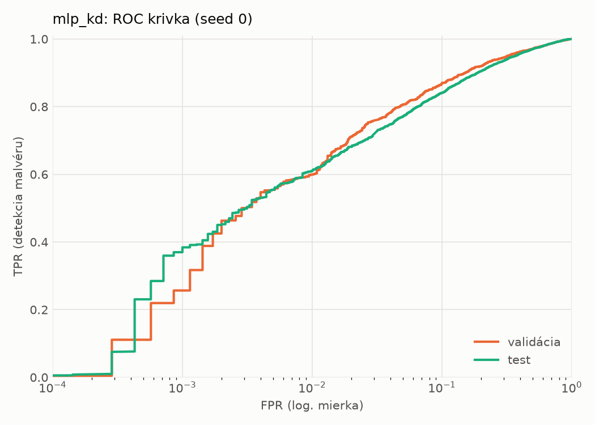
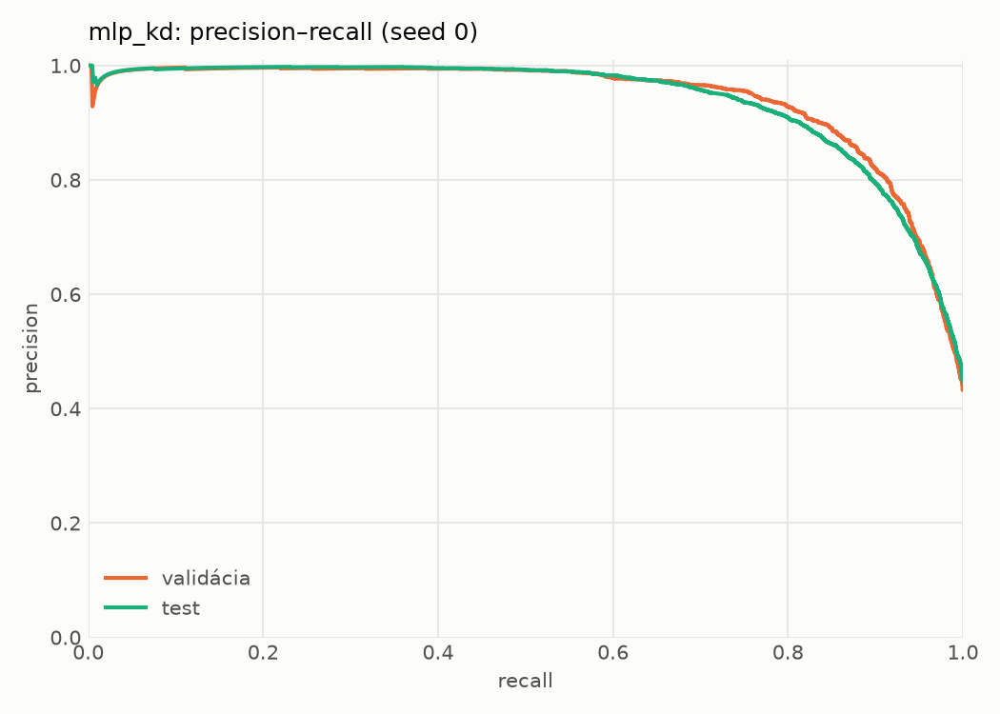
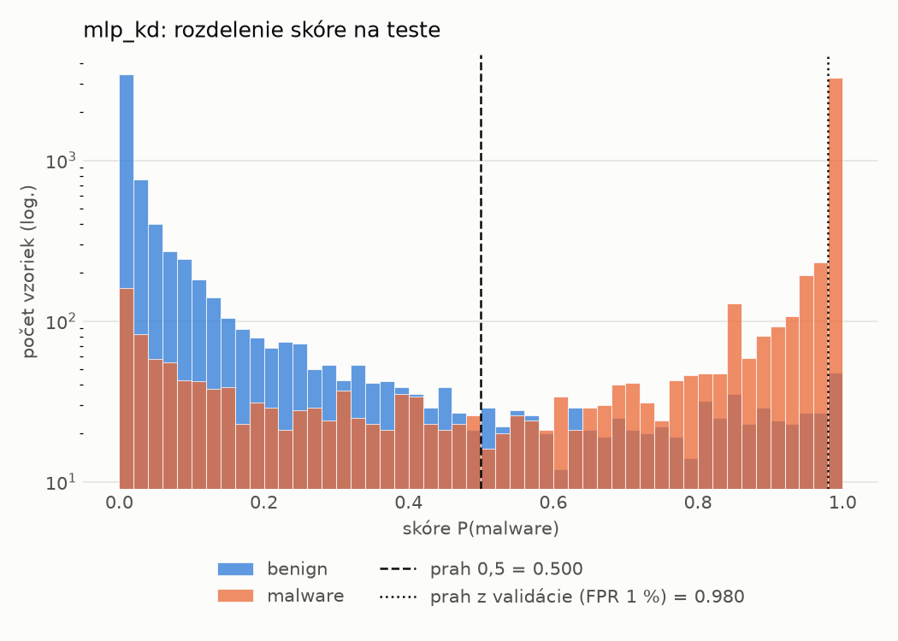
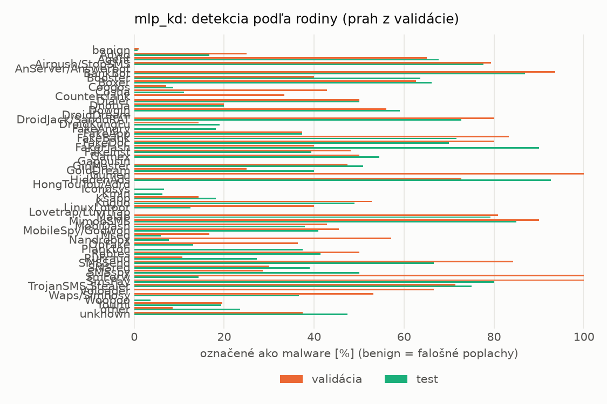
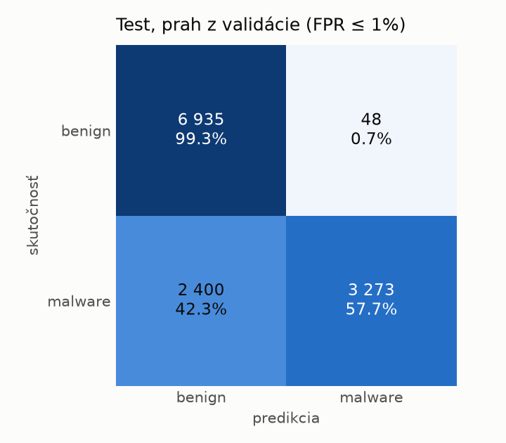
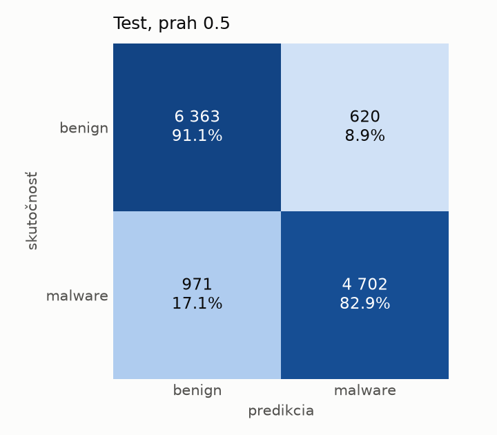
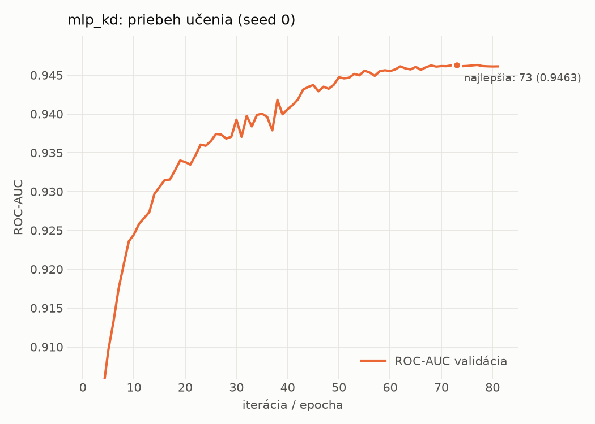

# dynamic/mlp_kd – beh `20261123-221205`

> Automaticky generované (`src/training/run_tabular.py`). Konfigurácia: `config.yaml`, protokol: `protocol.yaml`.

- **Model:** `mlp` – študent – malé MLP učené destiláciou z hybridného učiteľa
- **Ladenie:** bez ladenia – hyperparametre prevzaté z `runs_v4/emu_p/full/students_dynamic/mlp_kd/20261123-204643`
- **Finálne modely:** seedy [0, 1, 2]; hodnoty sú priemer ± smerodajná odchýlka cez seedy
- **Najlepšie hyperparametre:** `{"hidden_layers": 1, "max_epochs": 100, "patience": 8, "hidden_width": 64, "dropout": 0.18336599346560475, "lr": 0.002029071520651615, "weight_decay": 5.085344324013556e-05, "batch_size": 1024, "kd_alpha": 0.6628106947860043, "kd_temperature": 3.3639590927520047}`

## Detekčná kvalita (bez prahu)
| metrika | train (podvzorka) | validácia | test |
|---|---|---|---|
| ROC-AUC | 0.9538 ± 0.0026 | 0.9456 ± 0.0020 | 0.9374 ± 0.0029 |
| PR-AUC | 0.9508 ± 0.0026 | 0.9425 ± 0.0016 | 0.9382 ± 0.0027 |
| TPR pri FPR 1 % | 0.6756 ± 0.0101 | 0.6150 ± 0.0169 | 0.6098 ± 0.0058 |
| TPR pri FPR 0,1 % | 0.4806 ± 0.0156 | 0.2315 ± 0.0259 | 0.3584 ± 0.0216 |
| log loss | 0.2831 ± 0.0079 | 0.3180 ± 0.0050 | 0.3473 ± 0.0074 |
| Brier skóre | 0.0808 ± 0.0024 | 0.0859 ± 0.0016 | 0.0955 ± 0.0015 |

Rozdiel ROC-AUC train − validácia: **0.0082** (veľký rozdiel = preučenie).

## Pri prahu z validácie (FPR ≤ 1% na validácii)
| metrika | train (podvzorka) | validácia | test |
|---|---|---|---|
| accuracy | 0.8428 ± 0.0058 | 0.8278 ± 0.0073 | 0.8108 ± 0.0049 |
| balanced accuracy | 0.8159 ± 0.0070 | 0.8026 ± 0.0085 | 0.7898 ± 0.0056 |
| precision | 0.9844 ± 0.0025 | 0.9797 ± 0.0005 | 0.9840 ± 0.0014 |
| recall (TPR) | 0.6392 ± 0.0148 | 0.6150 ± 0.0169 | 0.5875 ± 0.0117 |
| FPR | 0.0075 ± 0.0013 | 0.0097 ± 0.0000 | 0.0078 ± 0.0008 |
| F1 | 0.7750 ± 0.0105 | 0.7556 ± 0.0129 | 0.7356 ± 0.0089 |
| MCC | 0.6990 ± 0.0102 | 0.6741 ± 0.0132 | 0.6512 ± 0.0082 |

## Pri pevnom prahu 0.5
| metrika | train (podvzorka) | validácia | test |
|---|---|---|---|
| accuracy | 0.8922 ± 0.0019 | 0.8887 ± 0.0029 | 0.8751 ± 0.0019 |
| balanced accuracy | 0.8869 ± 0.0016 | 0.8850 ± 0.0028 | 0.8703 ± 0.0016 |
| precision | 0.8887 ± 0.0049 | 0.8828 ± 0.0048 | 0.8885 ± 0.0063 |
| recall (TPR) | 0.8523 ± 0.0015 | 0.8569 ± 0.0018 | 0.8248 ± 0.0036 |
| FPR | 0.0785 ± 0.0040 | 0.0869 ± 0.0038 | 0.0841 ± 0.0056 |
| F1 | 0.8701 ± 0.0019 | 0.8696 ± 0.0032 | 0.8554 ± 0.0017 |
| MCC | 0.7785 ± 0.0039 | 0.7729 ± 0.0060 | 0.7473 ± 0.0041 |

## Výpočtové nároky (seed 0, testovacia množina)
| meranie | hodnota |
|---|---|
| tréning finálneho modelu | 6.8 s (priemer cez seedy) |
| ladenie spolu | 0 s |
| počet parametrov / uzlov | 8 129 |
| veľkosť modelu na disku | 0.04 MB |
| transformácia vstupu – latencia (1 vlákno) | 0.006 ms |
| transformácia vstupu – priepustnosť | 1 299 384 vzoriek/s |
| CPU latencia modelu (batch 1, 1 vlákno) | 0.055 ms (p95 0.065) |
| CPU priepustnosť (24 vlákien) | 7 540 066 vzoriek/s |
| GPU latencia (batch 1) | 0.286 ms (p95 0.313) |
| GPU priepustnosť | 2 758 140 vzoriek/s |
| GPU špičková pamäť | 53 MB |

## Grafy
| | |
|---|---|
|  |  |
|  |  |
|  |  |
|  |  |

## Súbory
`metrics.json` (všetky metriky po seedoch vrátane rodín), `timing.json`, `hpo_trials.csv`,
`predictions/<časť>_seed<N>.parquet` (sha256, family, label, score), `model/seed_<N>/`, `log.txt`.
