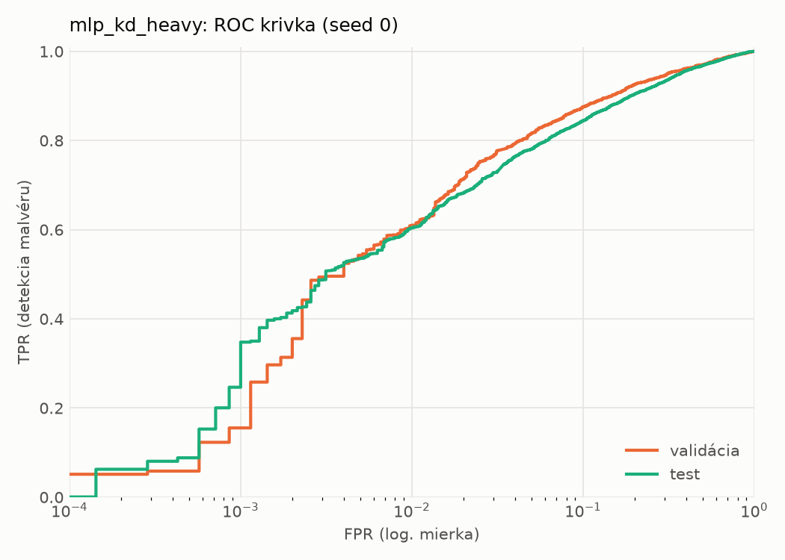
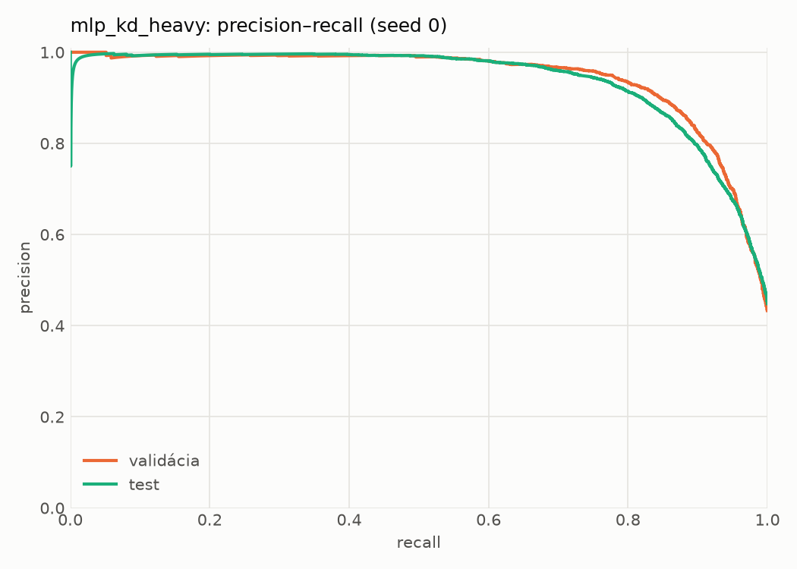
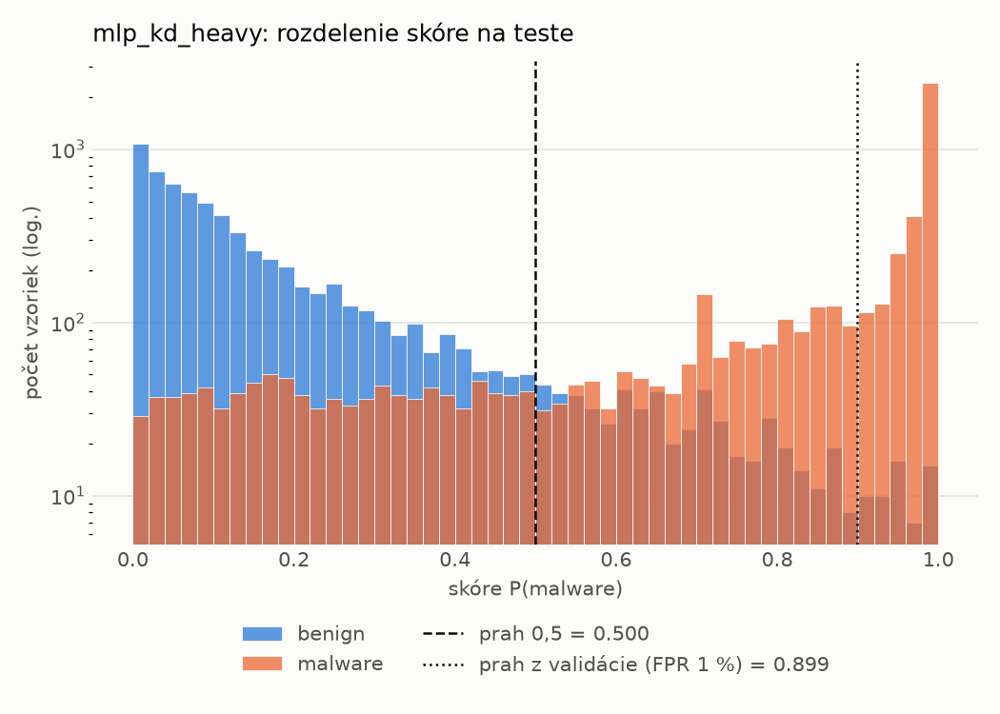
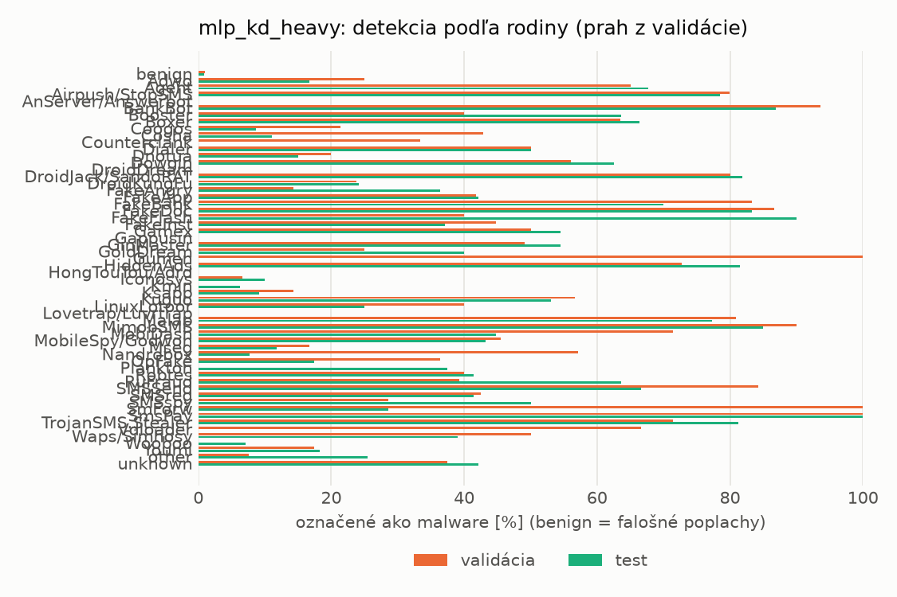
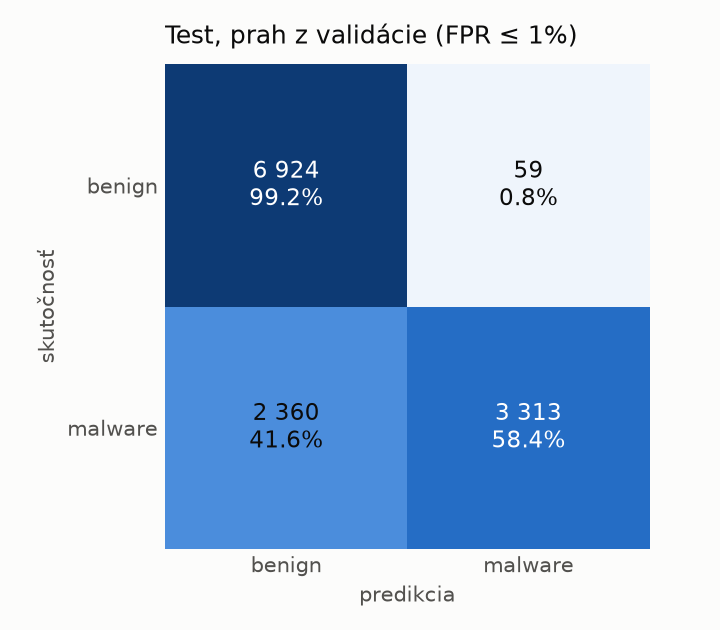
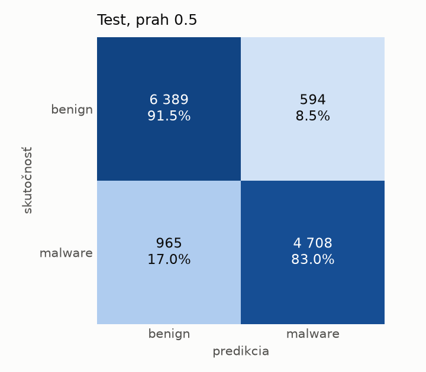
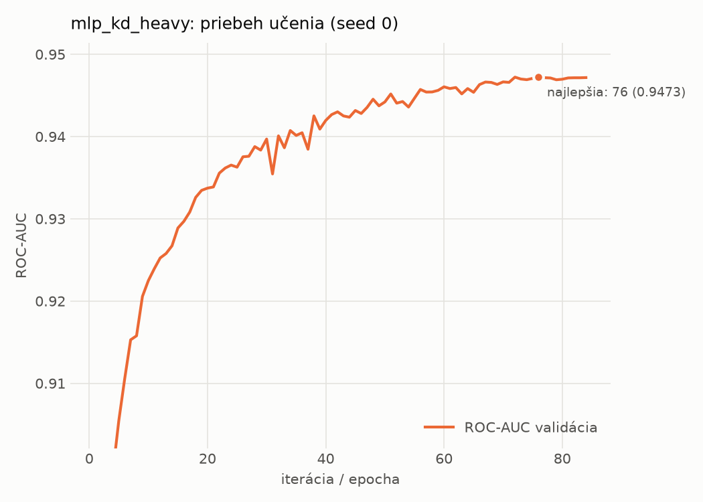

# dynamic/mlp_kd_heavy – beh `20261123-221338`

> Automaticky generované (`src/training/run_tabular.py`). Konfigurácia: `config.yaml`, protokol: `protocol.yaml`.

- **Model:** `mlp` – študent – malé MLP učené destiláciou z mlp_large hybridu (V4)
- **Ladenie:** bez ladenia – hyperparametre prevzaté z `runs_v4/emu_p/full/students_dynamic/mlp_kd_heavy/20261123-210504`
- **Finálne modely:** seedy [0, 1, 2]; hodnoty sú priemer ± smerodajná odchýlka cez seedy
- **Najlepšie hyperparametre:** `{"hidden_layers": 1, "max_epochs": 100, "patience": 8, "hidden_width": 64, "dropout": 0.11940169496551375, "lr": 0.0010131280233016235, "weight_decay": 6.964554367863767e-06, "batch_size": 1024, "kd_alpha": 0.5527208987397508, "kd_temperature": 1.1661827551200896}`

## Detekčná kvalita (bez prahu)
| metrika | train (podvzorka) | validácia | test |
|---|---|---|---|
| ROC-AUC | 0.9567 ± 0.0015 | 0.9461 ± 0.0013 | 0.9377 ± 0.0018 |
| PR-AUC | 0.9533 ± 0.0016 | 0.9437 ± 0.0012 | 0.9380 ± 0.0017 |
| TPR pri FPR 1 % | 0.6829 ± 0.0213 | 0.6090 ± 0.0004 | 0.6056 ± 0.0119 |
| TPR pri FPR 0,1 % | 0.4935 ± 0.0338 | 0.1851 ± 0.0258 | 0.2701 ± 0.0500 |
| log loss | 0.2568 ± 0.0041 | 0.2848 ± 0.0028 | 0.3055 ± 0.0039 |
| Brier skóre | 0.0772 ± 0.0014 | 0.0838 ± 0.0011 | 0.0922 ± 0.0013 |

Rozdiel ROC-AUC train − validácia: **0.0106** (veľký rozdiel = preučenie).

## Pri prahu z validácie (FPR ≤ 1% na validácii)
| metrika | train (podvzorka) | validácia | test |
|---|---|---|---|
| accuracy | 0.8407 ± 0.0016 | 0.8252 ± 0.0002 | 0.8093 ± 0.0005 |
| balanced accuracy | 0.8133 ± 0.0019 | 0.7996 ± 0.0002 | 0.7882 ± 0.0006 |
| precision | 0.9851 ± 0.0015 | 0.9795 ± 0.0000 | 0.9829 ± 0.0012 |
| recall (TPR) | 0.6337 ± 0.0039 | 0.6090 ± 0.0004 | 0.5847 ± 0.0017 |
| FPR | 0.0071 ± 0.0007 | 0.0097 ± 0.0000 | 0.0083 ± 0.0006 |
| F1 | 0.7713 ± 0.0028 | 0.7510 ± 0.0003 | 0.7332 ± 0.0011 |
| MCC | 0.6954 ± 0.0030 | 0.6694 ± 0.0003 | 0.6483 ± 0.0008 |

## Pri pevnom prahu 0.5
| metrika | train (podvzorka) | validácia | test |
|---|---|---|---|
| accuracy | 0.8963 ± 0.0022 | 0.8911 ± 0.0006 | 0.8767 ± 0.0006 |
| balanced accuracy | 0.8908 ± 0.0024 | 0.8871 ± 0.0010 | 0.8719 ± 0.0007 |
| precision | 0.8957 ± 0.0039 | 0.8872 ± 0.0021 | 0.8916 ± 0.0039 |
| recall (TPR) | 0.8548 ± 0.0051 | 0.8575 ± 0.0042 | 0.8252 ± 0.0042 |
| FPR | 0.0732 ± 0.0032 | 0.0833 ± 0.0022 | 0.0815 ± 0.0037 |
| F1 | 0.8748 ± 0.0028 | 0.8721 ± 0.0012 | 0.8571 ± 0.0008 |
| MCC | 0.7869 ± 0.0046 | 0.7776 ± 0.0013 | 0.7507 ± 0.0013 |

## Výpočtové nároky (seed 0, testovacia množina)
| meranie | hodnota |
|---|---|
| tréning finálneho modelu | 7.0 s (priemer cez seedy) |
| ladenie spolu | 0 s |
| počet parametrov / uzlov | 8 129 |
| veľkosť modelu na disku | 0.04 MB |
| transformácia vstupu – latencia (1 vlákno) | 0.015 ms |
| transformácia vstupu – priepustnosť | 780 955 vzoriek/s |
| CPU latencia modelu (batch 1, 1 vlákno) | 0.152 ms (p95 0.162) |
| CPU priepustnosť (24 vlákien) | 5 864 418 vzoriek/s |
| GPU latencia (batch 1) | 0.447 ms (p95 0.476) |
| GPU priepustnosť | 2 819 148 vzoriek/s |
| GPU špičková pamäť | 77 MB |

## Grafy
| | |
|---|---|
|  |  |
|  |  |
|  |  |
|  |  |

## Súbory
`metrics.json` (všetky metriky po seedoch vrátane rodín), `timing.json`, `hpo_trials.csv`,
`predictions/<časť>_seed<N>.parquet` (sha256, family, label, score), `model/seed_<N>/`, `log.txt`.
