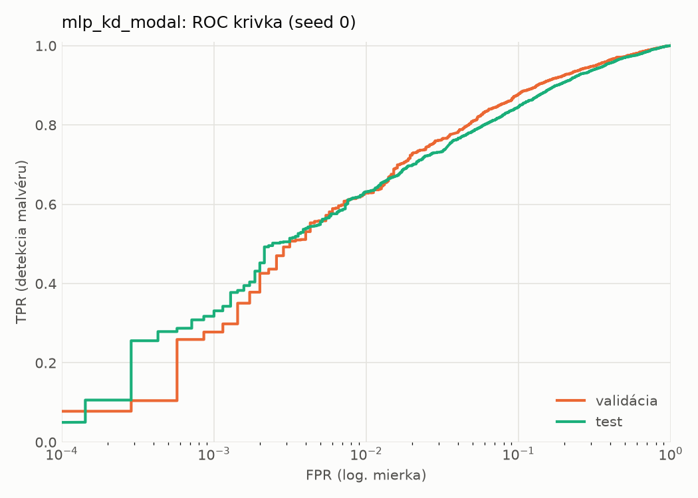
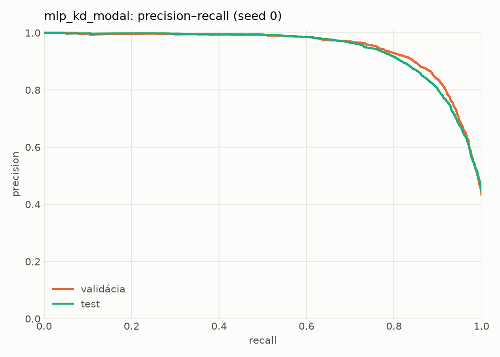
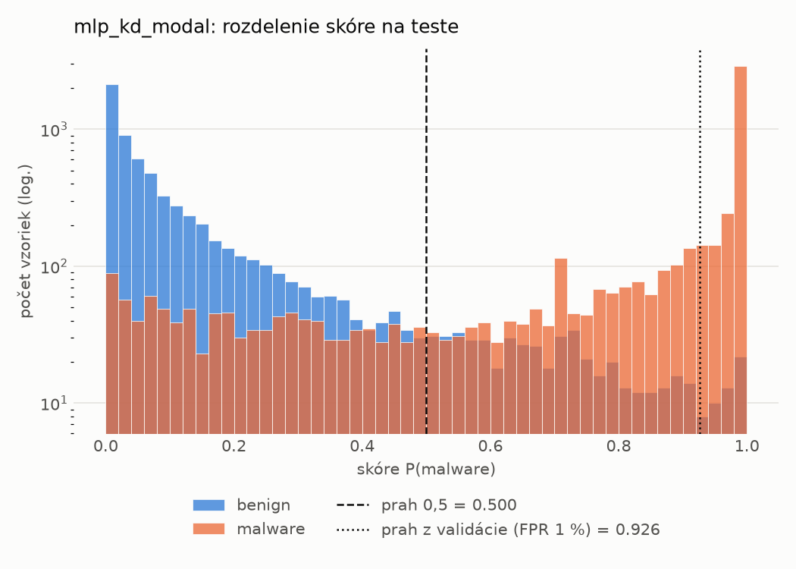
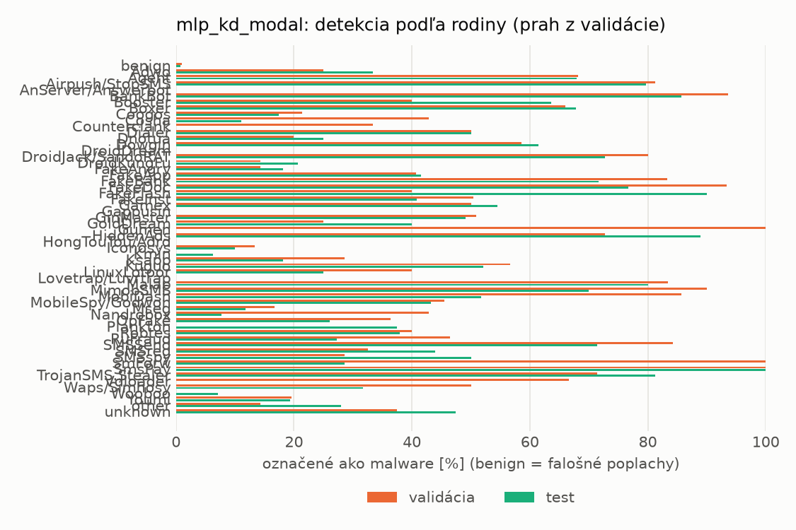
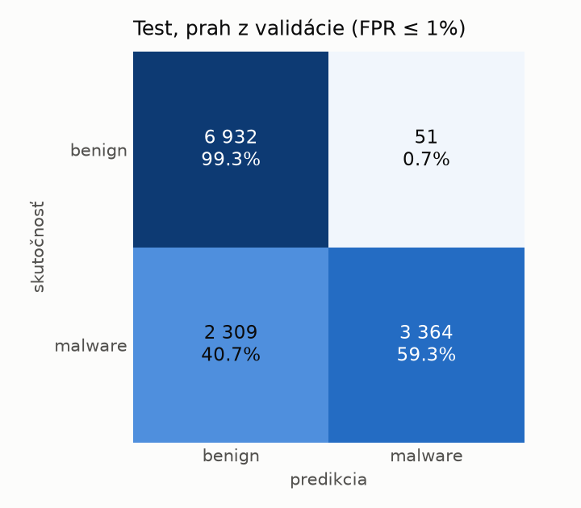
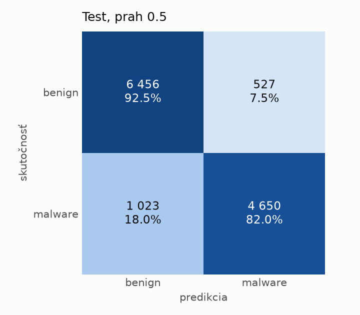
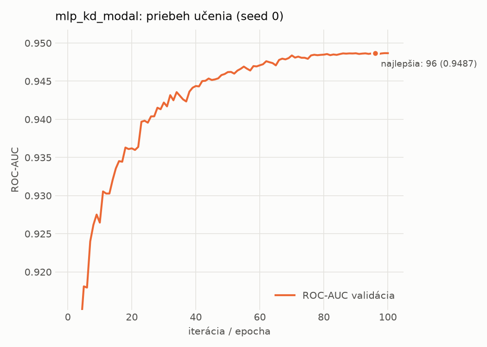

# dynamic/mlp_kd_modal – beh `20261123-221318`

> Automaticky generované (`src/training/run_tabular.py`). Konfigurácia: `config.yaml`, protokol: `protocol.yaml`.

- **Model:** `mlp` – študent – malé MLP učené destiláciou z učiteľa rovnakej modality (variant A)
- **Ladenie:** bez ladenia – hyperparametre prevzaté z `runs_v4/emu_p/full/students_dynamic/mlp_kd_modal/20261123-210004`
- **Finálne modely:** seedy [0, 1, 2]; hodnoty sú priemer ± smerodajná odchýlka cez seedy
- **Najlepšie hyperparametre:** `{"hidden_layers": 1, "max_epochs": 100, "patience": 8, "hidden_width": 64, "dropout": 0.17256398759806554, "lr": 0.00273877224500614, "weight_decay": 0.00015336049950880602, "batch_size": 1024, "kd_alpha": 0.5720540077101433, "kd_temperature": 1.5970216771892711}`

## Detekčná kvalita (bez prahu)
| metrika | train (podvzorka) | validácia | test |
|---|---|---|---|
| ROC-AUC | 0.9565 ± 0.0011 | 0.9475 ± 0.0010 | 0.9399 ± 0.0007 |
| PR-AUC | 0.9537 ± 0.0008 | 0.9456 ± 0.0009 | 0.9416 ± 0.0009 |
| TPR pri FPR 1 % | 0.6876 ± 0.0027 | 0.6299 ± 0.0128 | 0.6296 ± 0.0052 |
| TPR pri FPR 0,1 % | 0.4421 ± 0.0291 | 0.2637 ± 0.0387 | 0.3372 ± 0.0177 |
| log loss | 0.2543 ± 0.0025 | 0.2858 ± 0.0041 | 0.3081 ± 0.0019 |
| Brier skóre | 0.0757 ± 0.0008 | 0.0815 ± 0.0005 | 0.0903 ± 0.0008 |

Rozdiel ROC-AUC train − validácia: **0.0090** (veľký rozdiel = preučenie).

## Pri prahu z validácie (FPR ≤ 1% na validácii)
| metrika | train (podvzorka) | validácia | test |
|---|---|---|---|
| accuracy | 0.8497 ± 0.0045 | 0.8342 ± 0.0056 | 0.8167 ± 0.0046 |
| balanced accuracy | 0.8239 ± 0.0055 | 0.8101 ± 0.0064 | 0.7964 ± 0.0053 |
| precision | 0.9854 ± 0.0017 | 0.9801 ± 0.0004 | 0.9840 ± 0.0022 |
| recall (TPR) | 0.6550 ± 0.0120 | 0.6299 ± 0.0128 | 0.6008 ± 0.0119 |
| FPR | 0.0072 ± 0.0010 | 0.0097 ± 0.0000 | 0.0080 ± 0.0013 |
| F1 | 0.7869 ± 0.0081 | 0.7669 ± 0.0096 | 0.7460 ± 0.0085 |
| MCC | 0.7117 ± 0.0078 | 0.6857 ± 0.0100 | 0.6613 ± 0.0073 |

## Pri pevnom prahu 0.5
| metrika | train (podvzorka) | validácia | test |
|---|---|---|---|
| accuracy | 0.8966 ± 0.0021 | 0.8929 ± 0.0011 | 0.8782 ± 0.0023 |
| balanced accuracy | 0.8903 ± 0.0022 | 0.8883 ± 0.0008 | 0.8726 ± 0.0025 |
| precision | 0.9012 ± 0.0026 | 0.8945 ± 0.0034 | 0.9009 ± 0.0025 |
| recall (TPR) | 0.8490 ± 0.0036 | 0.8534 ± 0.0018 | 0.8182 ± 0.0050 |
| FPR | 0.0684 ± 0.0019 | 0.0769 ± 0.0029 | 0.0731 ± 0.0021 |
| F1 | 0.8743 ± 0.0026 | 0.8735 ± 0.0010 | 0.8576 ± 0.0030 |
| MCC | 0.7876 ± 0.0043 | 0.7814 ± 0.0022 | 0.7543 ± 0.0046 |

## Výpočtové nároky (seed 0, testovacia množina)
| meranie | hodnota |
|---|---|
| tréning finálneho modelu | 5.9 s (priemer cez seedy) |
| ladenie spolu | 0 s |
| počet parametrov / uzlov | 8 129 |
| veľkosť modelu na disku | 0.04 MB |
| transformácia vstupu – latencia (1 vlákno) | 0.015 ms |
| transformácia vstupu – priepustnosť | 748 924 vzoriek/s |
| CPU latencia modelu (batch 1, 1 vlákno) | 0.154 ms (p95 0.163) |
| CPU priepustnosť (24 vlákien) | 5 283 681 vzoriek/s |
| GPU latencia (batch 1) | 0.447 ms (p95 0.476) |
| GPU priepustnosť | 2 523 277 vzoriek/s |
| GPU špičková pamäť | 53 MB |

## Grafy
| | |
|---|---|
|  |  |
|  |  |
|  |  |
|  |  |

## Súbory
`metrics.json` (všetky metriky po seedoch vrátane rodín), `timing.json`, `hpo_trials.csv`,
`predictions/<časť>_seed<N>.parquet` (sha256, family, label, score), `model/seed_<N>/`, `log.txt`.
