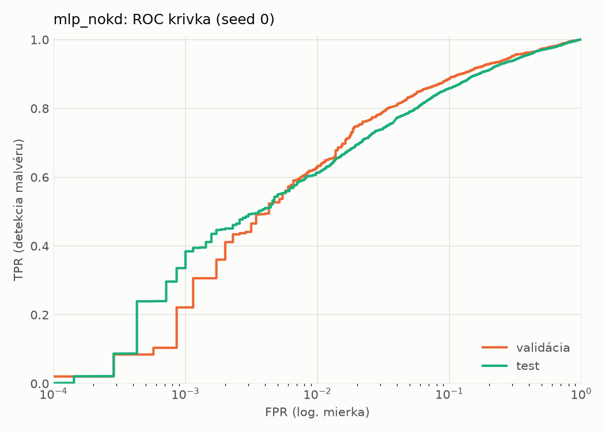
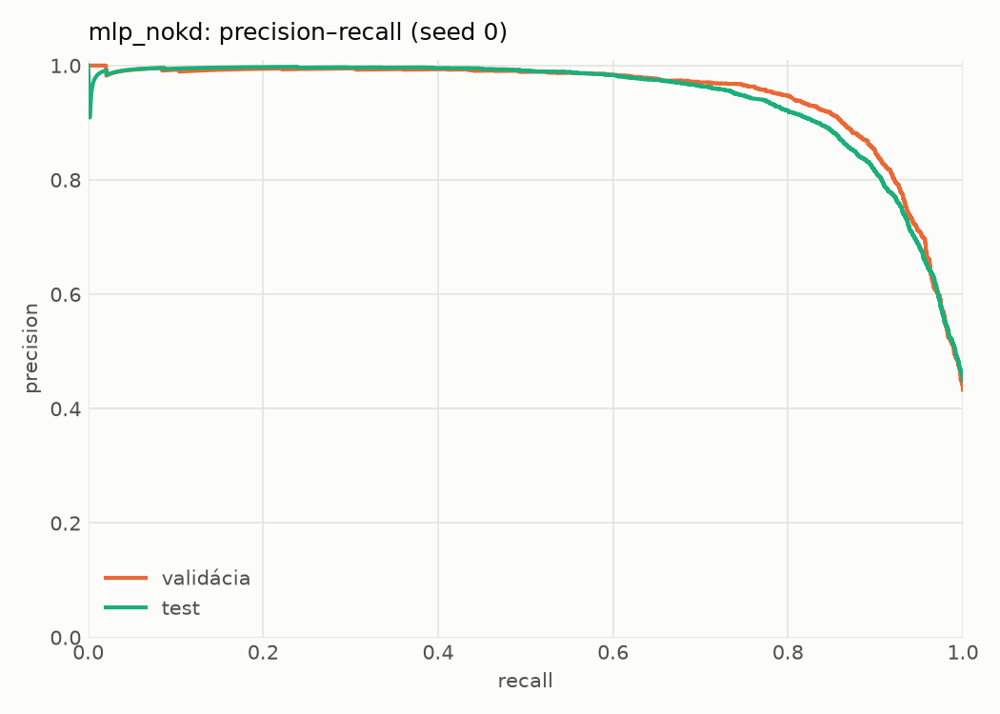
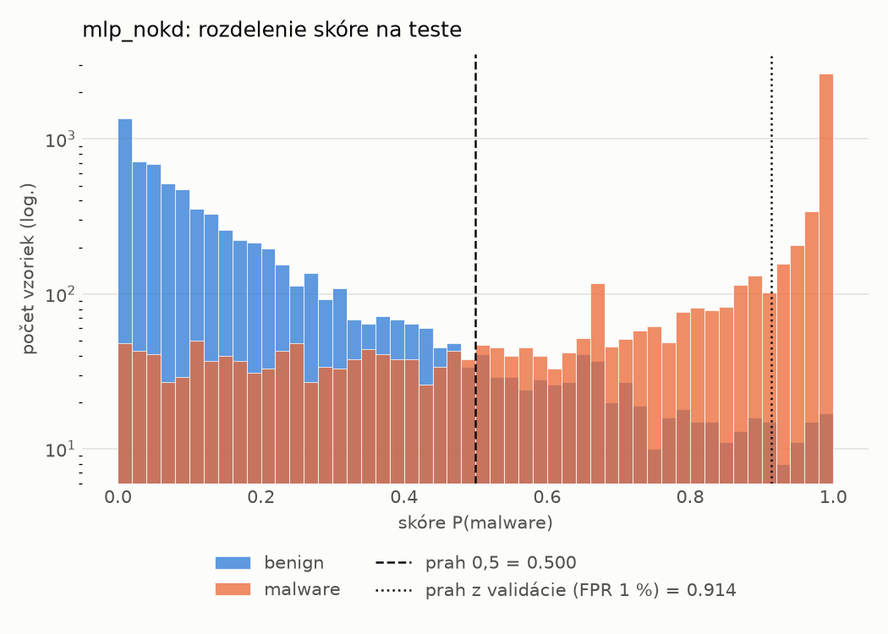
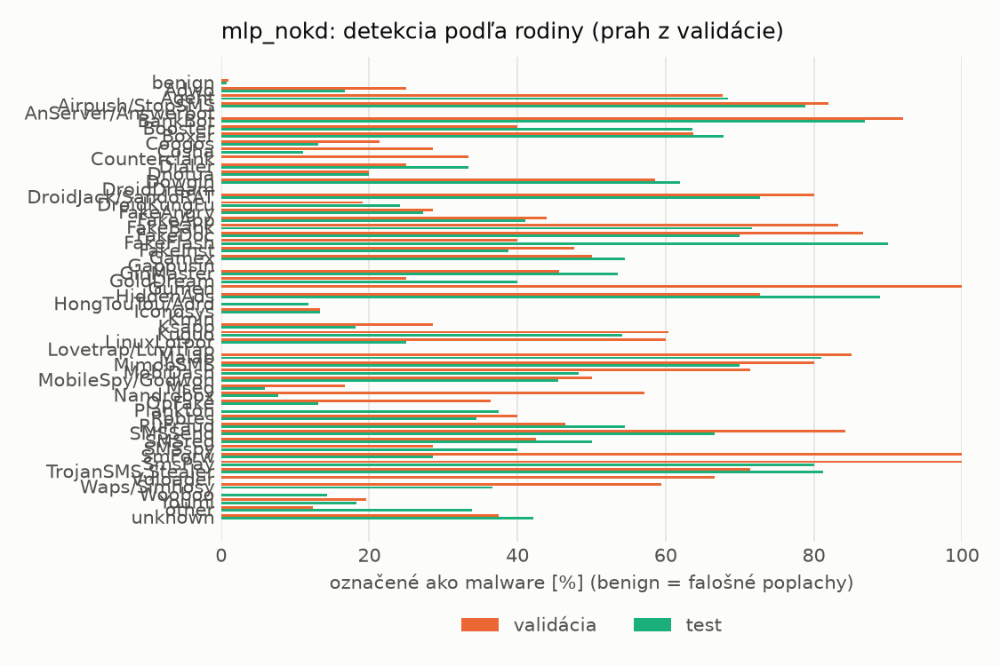
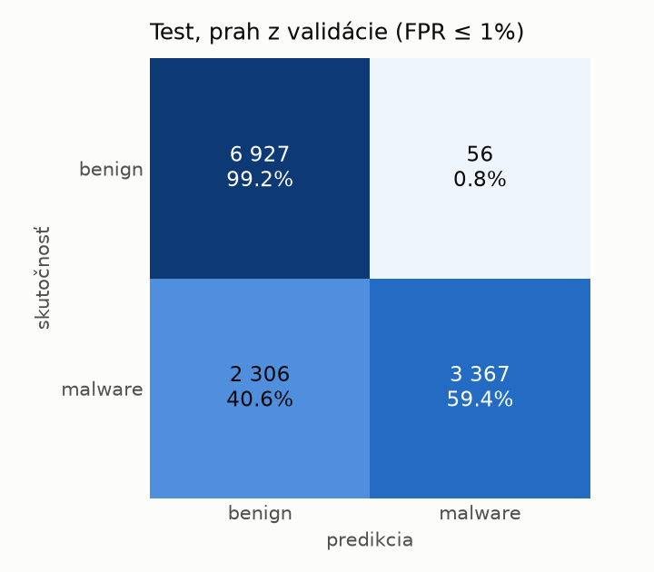
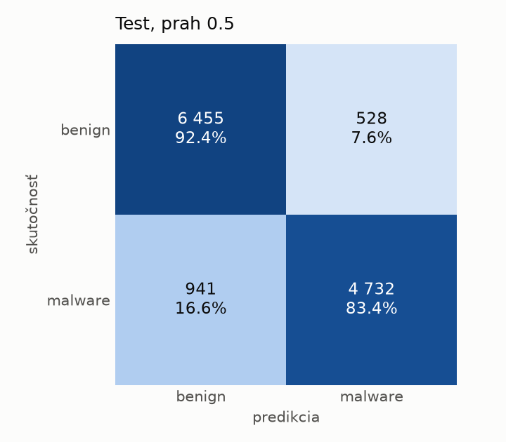
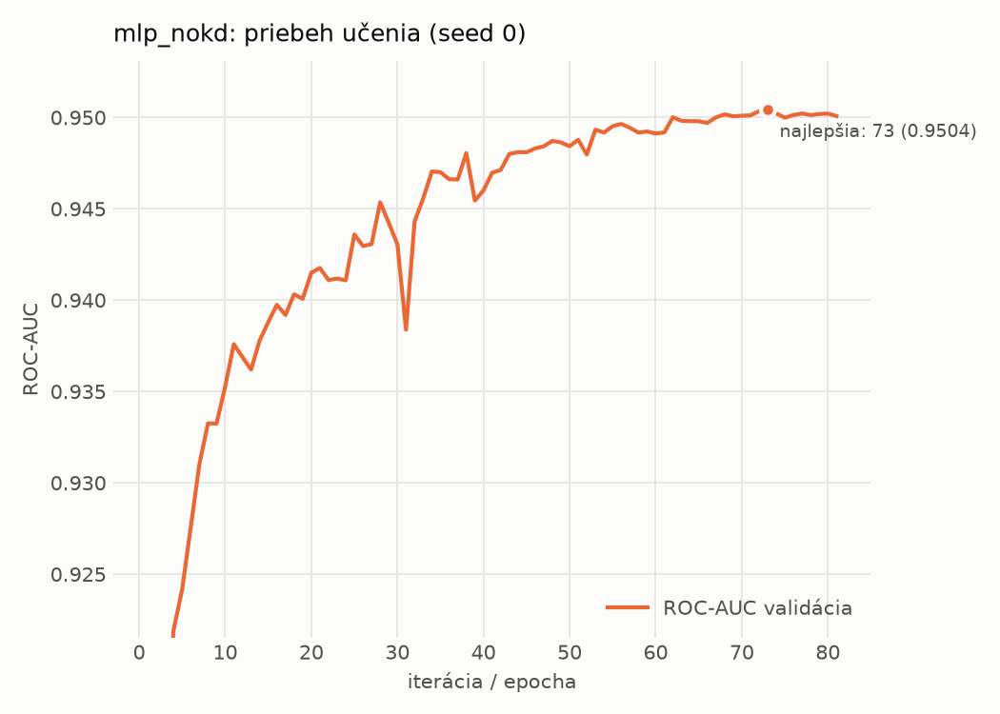

# dynamic/mlp_nokd – beh `20261123-221228`

> Automaticky generované (`src/training/run_tabular.py`). Konfigurácia: `config.yaml`, protokol: `protocol.yaml`.

- **Model:** `mlp` – kontrola – rovnaké malé MLP bez destilácie (iba skutočné označenia)
- **Ladenie:** bez ladenia – hyperparametre prevzaté z `runs_v4/emu_p/full/students_dynamic/mlp_nokd/20261123-205230`
- **Finálne modely:** seedy [0, 1, 2]; hodnoty sú priemer ± smerodajná odchýlka cez seedy
- **Najlepšie hyperparametre:** `{"hidden_layers": 1, "max_epochs": 100, "patience": 8, "hidden_width": 64, "dropout": 0.039782849658421375, "lr": 0.0018574312606020214, "weight_decay": 6.674701047165933e-06, "batch_size": 256}`

## Detekčná kvalita (bez prahu)
| metrika | train (podvzorka) | validácia | test |
|---|---|---|---|
| ROC-AUC | 0.9648 ± 0.0020 | 0.9498 ± 0.0011 | 0.9416 ± 0.0004 |
| PR-AUC | 0.9619 ± 0.0022 | 0.9475 ± 0.0015 | 0.9422 ± 0.0007 |
| TPR pri FPR 1 % | 0.7242 ± 0.0076 | 0.6394 ± 0.0115 | 0.6190 ± 0.0073 |
| TPR pri FPR 0,1 % | 0.5362 ± 0.0183 | 0.1945 ± 0.0278 | 0.3206 ± 0.0493 |
| log loss | 0.2332 ± 0.0083 | 0.2761 ± 0.0052 | 0.2982 ± 0.0015 |
| Brier skóre | 0.0697 ± 0.0027 | 0.0801 ± 0.0023 | 0.0884 ± 0.0011 |

Rozdiel ROC-AUC train − validácia: **0.0149** (veľký rozdiel = preučenie).

## Pri prahu z validácie (FPR ≤ 1% na validácii)
| metrika | train (podvzorka) | validácia | test |
|---|---|---|---|
| accuracy | 0.8526 ± 0.0043 | 0.8383 ± 0.0050 | 0.8177 ± 0.0038 |
| balanced accuracy | 0.8270 ± 0.0050 | 0.8148 ± 0.0057 | 0.7977 ± 0.0043 |
| precision | 0.9901 ± 0.0017 | 0.9804 ± 0.0003 | 0.9825 ± 0.0012 |
| recall (TPR) | 0.6589 ± 0.0098 | 0.6394 ± 0.0115 | 0.6041 ± 0.0092 |
| FPR | 0.0049 ± 0.0008 | 0.0097 ± 0.0000 | 0.0087 ± 0.0007 |
| F1 | 0.7912 ± 0.0073 | 0.7740 ± 0.0085 | 0.7481 ± 0.0068 |
| MCC | 0.7182 ± 0.0080 | 0.6930 ± 0.0089 | 0.6626 ± 0.0062 |

## Pri pevnom prahu 0.5
| metrika | train (podvzorka) | validácia | test |
|---|---|---|---|
| accuracy | 0.9058 ± 0.0047 | 0.8960 ± 0.0016 | 0.8823 ± 0.0030 |
| balanced accuracy | 0.9016 ± 0.0039 | 0.8931 ± 0.0011 | 0.8784 ± 0.0026 |
| precision | 0.9010 ± 0.0116 | 0.8862 ± 0.0059 | 0.8912 ± 0.0089 |
| recall (TPR) | 0.8739 ± 0.0036 | 0.8718 ± 0.0037 | 0.8401 ± 0.0052 |
| FPR | 0.0707 ± 0.0094 | 0.0855 ± 0.0053 | 0.0834 ± 0.0080 |
| F1 | 0.8872 ± 0.0048 | 0.8789 ± 0.0013 | 0.8649 ± 0.0028 |
| MCC | 0.8068 ± 0.0095 | 0.7879 ± 0.0031 | 0.7619 ± 0.0062 |

## Výpočtové nároky (seed 0, testovacia množina)
| meranie | hodnota |
|---|---|
| tréning finálneho modelu | 16.3 s (priemer cez seedy) |
| ladenie spolu | 0 s |
| počet parametrov / uzlov | 8 129 |
| veľkosť modelu na disku | 0.04 MB |
| transformácia vstupu – latencia (1 vlákno) | 0.015 ms |
| transformácia vstupu – priepustnosť | 773 807 vzoriek/s |
| CPU latencia modelu (batch 1, 1 vlákno) | 0.153 ms (p95 0.163) |
| CPU priepustnosť (24 vlákien) | 6 112 533 vzoriek/s |
| GPU latencia (batch 1) | 0.452 ms (p95 0.474) |
| GPU priepustnosť | 2 922 459 vzoriek/s |
| GPU špičková pamäť | 77 MB |

## Grafy
| | |
|---|---|
|  |  |
|  |  |
|  |  |
|  |  |

## Súbory
`metrics.json` (všetky metriky po seedoch vrátane rodín), `timing.json`, `hpo_trials.csv`,
`predictions/<časť>_seed<N>.parquet` (sha256, family, label, score), `model/seed_<N>/`, `log.txt`.
