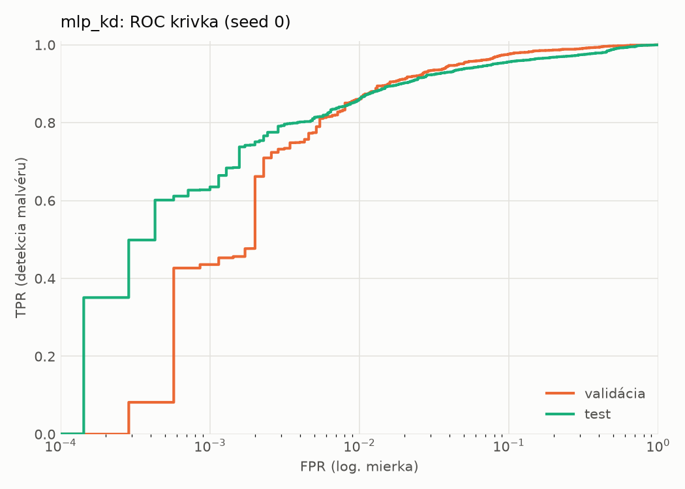
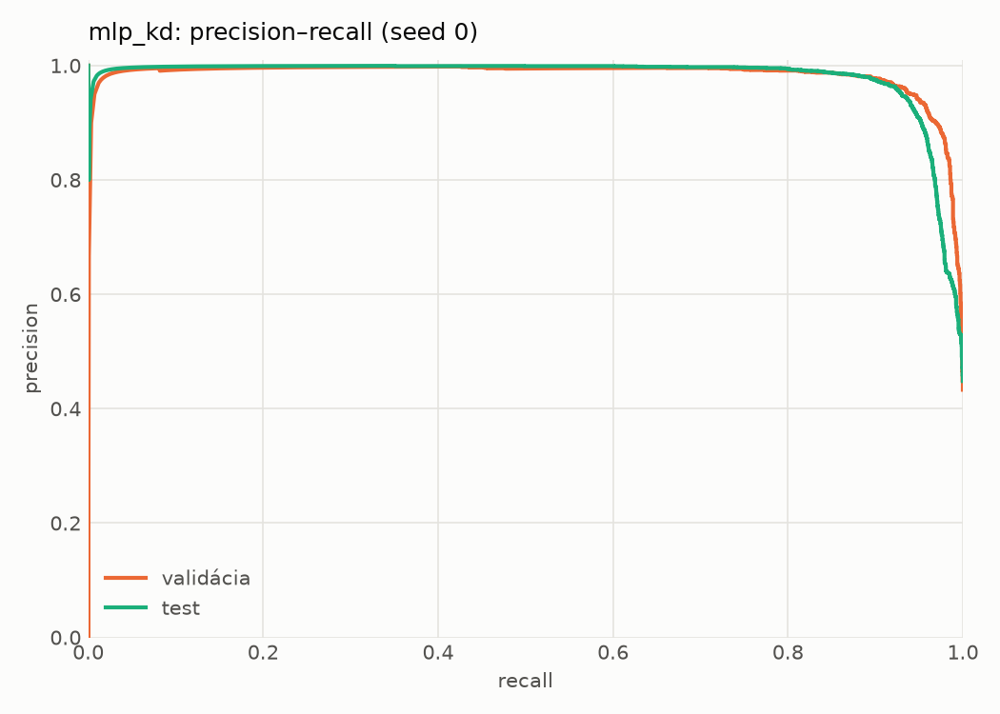
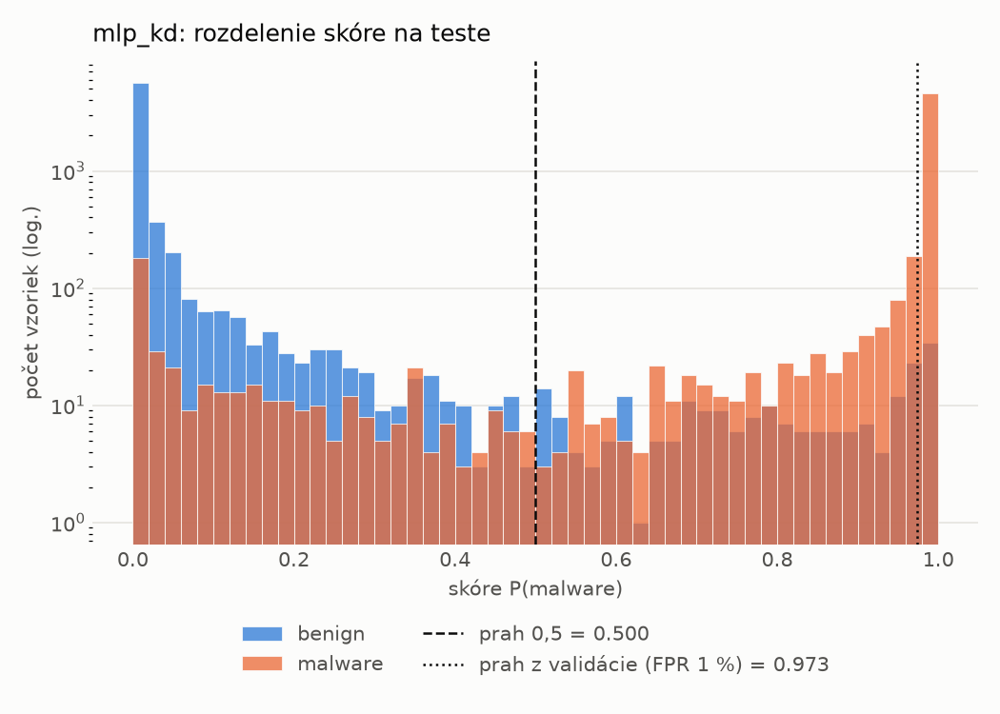
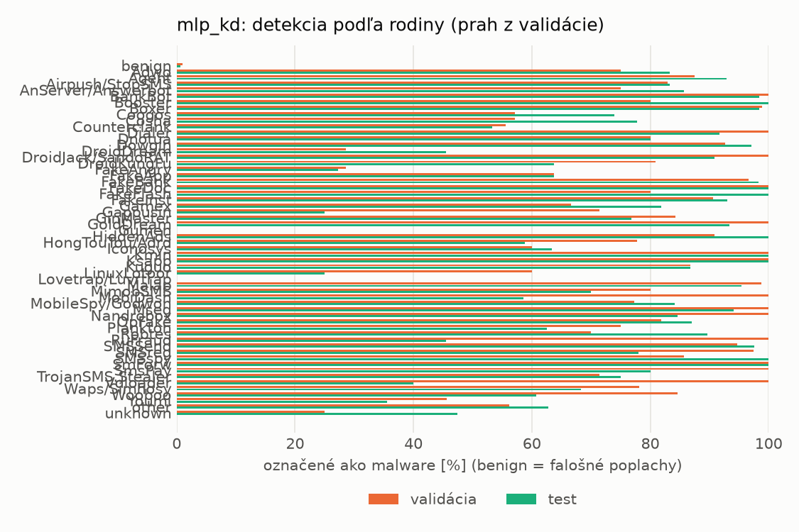
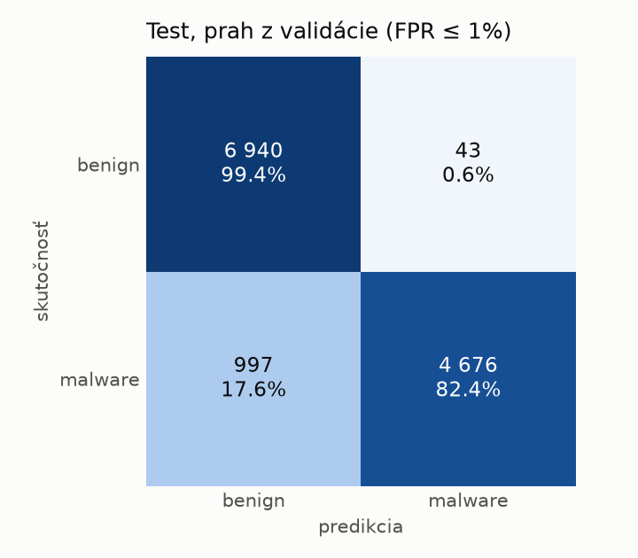
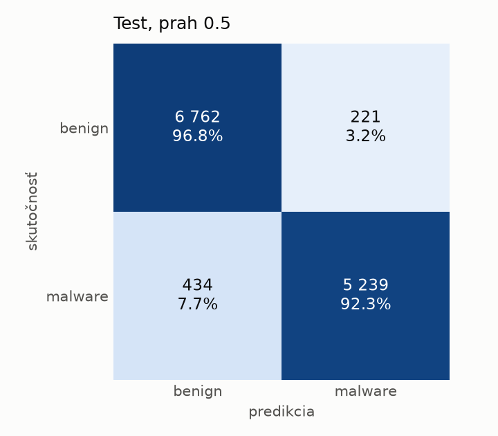
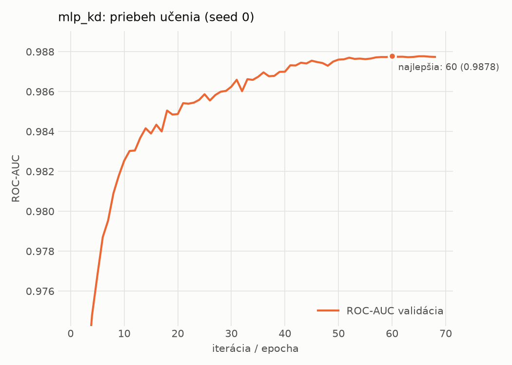

# static/mlp_kd – beh `20261123-221044`

> Automaticky generované (`src/training/run_tabular.py`). Konfigurácia: `config.yaml`, protokol: `protocol.yaml`.

- **Model:** `mlp` – študent – malé MLP učené destiláciou z hybridného učiteľa
- **Ladenie:** bez ladenia – hyperparametre prevzaté z `runs_v4/emu_p/full/students_static/mlp_kd/20261123-203204`
- **Finálne modely:** seedy [0, 1, 2]; hodnoty sú priemer ± smerodajná odchýlka cez seedy
- **Najlepšie hyperparametre:** `{"hidden_layers": 1, "max_epochs": 100, "patience": 8, "hidden_width": 64, "dropout": 0.0038513032258879476, "lr": 0.0011339137585789736, "weight_decay": 0.00026533084929296607, "batch_size": 1024, "kd_alpha": 0.3835611341536954, "kd_temperature": 1.7047486853284286}`

## Detekčná kvalita (bez prahu)
| metrika | train (podvzorka) | validácia | test |
|---|---|---|---|
| ROC-AUC | 0.9921 ± 0.0005 | 0.9875 ± 0.0005 | 0.9801 ± 0.0006 |
| PR-AUC | 0.9915 ± 0.0005 | 0.9847 ± 0.0018 | 0.9811 ± 0.0005 |
| TPR pri FPR 1 % | 0.9165 ± 0.0067 | 0.8499 ± 0.0172 | 0.8610 ± 0.0021 |
| TPR pri FPR 0,1 % | 0.7319 ± 0.0131 | 0.5161 ± 0.0768 | 0.6605 ± 0.0292 |
| log loss | 0.1051 ± 0.0039 | 0.1494 ± 0.0024 | 0.1868 ± 0.0029 |
| Brier skóre | 0.0270 ± 0.0011 | 0.0373 ± 0.0005 | 0.0430 ± 0.0003 |

Rozdiel ROC-AUC train − validácia: **0.0046** (veľký rozdiel = preučenie).

## Pri prahu z validácie (FPR ≤ 1% na validácii)
| metrika | train (podvzorka) | validácia | test |
|---|---|---|---|
| accuracy | 0.9403 ± 0.0040 | 0.9295 ± 0.0075 | 0.9166 ± 0.0034 |
| balanced accuracy | 0.9304 ± 0.0047 | 0.9201 ± 0.0086 | 0.9077 ± 0.0038 |
| precision | 0.9934 ± 0.0001 | 0.9852 ± 0.0003 | 0.9909 ± 0.0002 |
| recall (TPR) | 0.8650 ± 0.0095 | 0.8499 ± 0.0172 | 0.8214 ± 0.0076 |
| FPR | 0.0042 ± 0.0001 | 0.0097 ± 0.0000 | 0.0061 ± 0.0001 |
| F1 | 0.9247 ± 0.0055 | 0.9125 ± 0.0101 | 0.8982 ± 0.0046 |
| MCC | 0.8815 ± 0.0077 | 0.8606 ± 0.0141 | 0.8391 ± 0.0063 |

## Pri pevnom prahu 0.5
| metrika | train (podvzorka) | validácia | test |
|---|---|---|---|
| accuracy | 0.9659 ± 0.0015 | 0.9538 ± 0.0014 | 0.9488 ± 0.0005 |
| balanced accuracy | 0.9641 ± 0.0014 | 0.9525 ± 0.0013 | 0.9465 ± 0.0005 |
| precision | 0.9669 ± 0.0030 | 0.9499 ± 0.0022 | 0.9599 ± 0.0014 |
| recall (TPR) | 0.9522 ± 0.0008 | 0.9431 ± 0.0013 | 0.9243 ± 0.0011 |
| FPR | 0.0240 ± 0.0023 | 0.0380 ± 0.0017 | 0.0314 ± 0.0012 |
| F1 | 0.9595 ± 0.0017 | 0.9465 ± 0.0015 | 0.9418 ± 0.0006 |
| MCC | 0.9302 ± 0.0030 | 0.9058 ± 0.0028 | 0.8966 ± 0.0011 |

## Výpočtové nároky (seed 0, testovacia množina)
| meranie | hodnota |
|---|---|
| tréning finálneho modelu | 4.7 s (priemer cez seedy) |
| ladenie spolu | 0 s |
| počet parametrov / uzlov | 10 689 |
| veľkosť modelu na disku | 0.05 MB |
| transformácia vstupu – latencia (1 vlákno) | 0.006 ms |
| transformácia vstupu – priepustnosť | 1 067 323 vzoriek/s |
| CPU latencia modelu (batch 1, 1 vlákno) | 0.151 ms (p95 0.160) |
| CPU priepustnosť (24 vlákien) | 3 423 872 vzoriek/s |
| GPU latencia (batch 1) | 0.465 ms (p95 0.487) |
| GPU priepustnosť | 4 751 821 vzoriek/s |
| GPU špičková pamäť | 62 MB |

## Grafy
| | |
|---|---|
|  |  |
|  |  |
|  |  |
|  |  |

## Súbory
`metrics.json` (všetky metriky po seedoch vrátane rodín), `timing.json`, `hpo_trials.csv`,
`predictions/<časť>_seed<N>.parquet` (sha256, family, label, score), `model/seed_<N>/`, `log.txt`.
