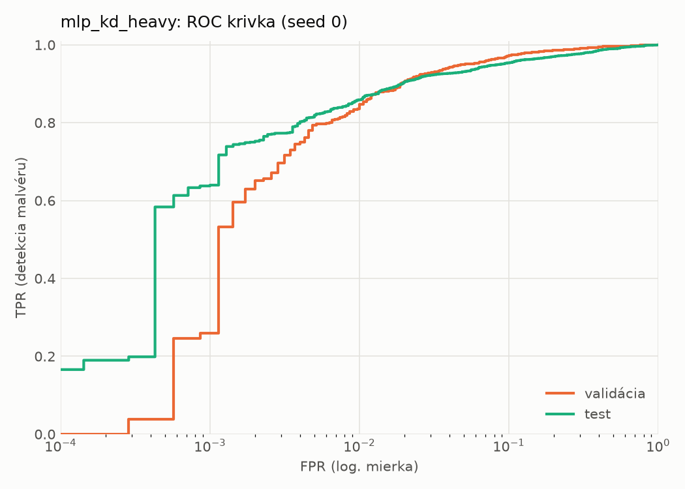
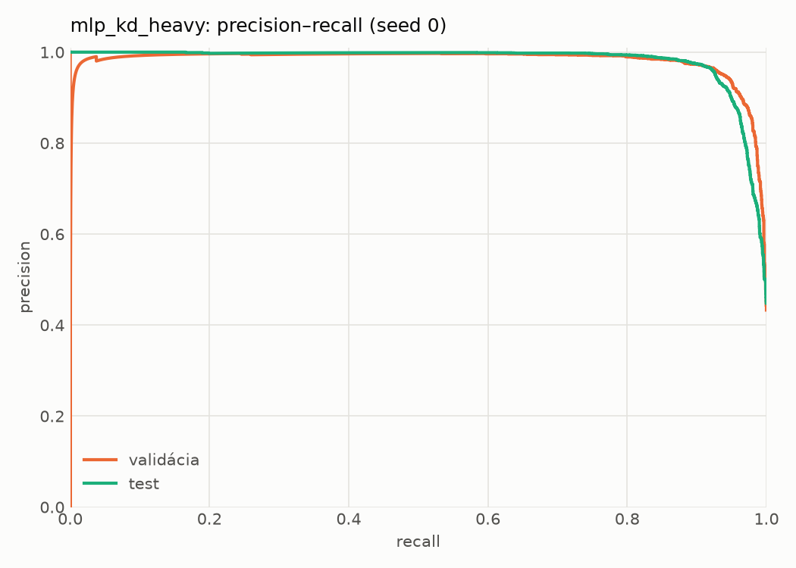
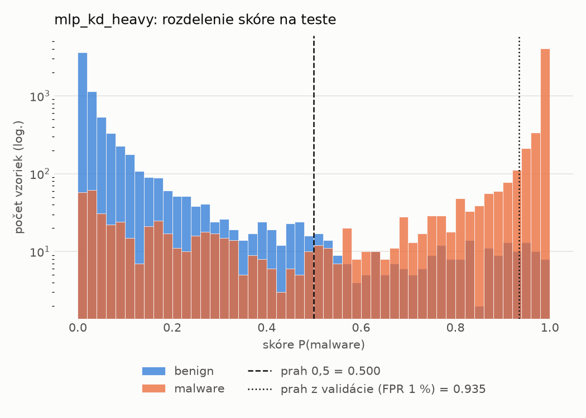
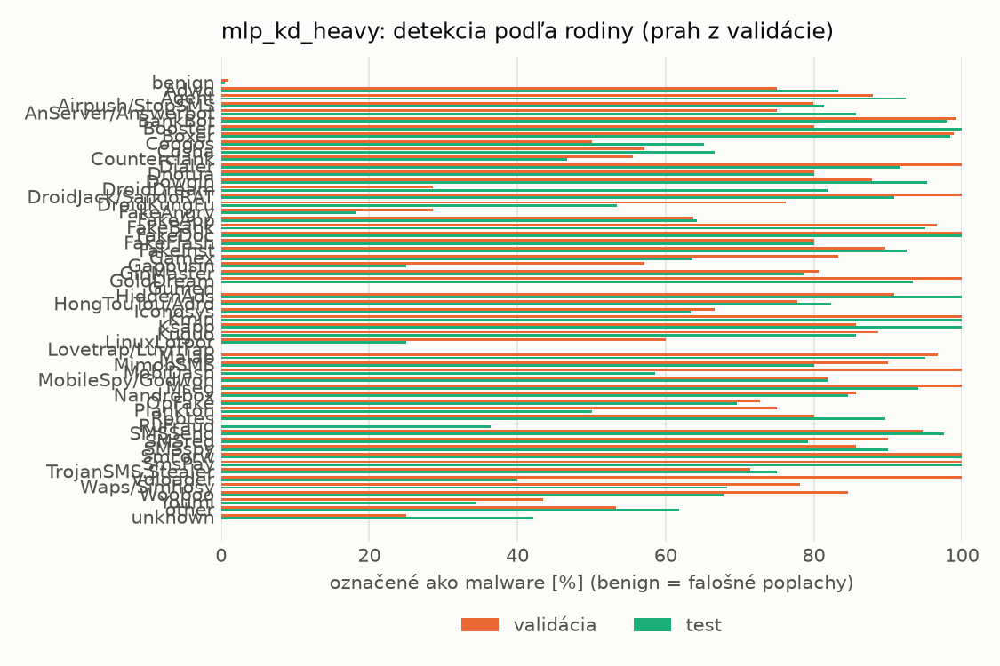
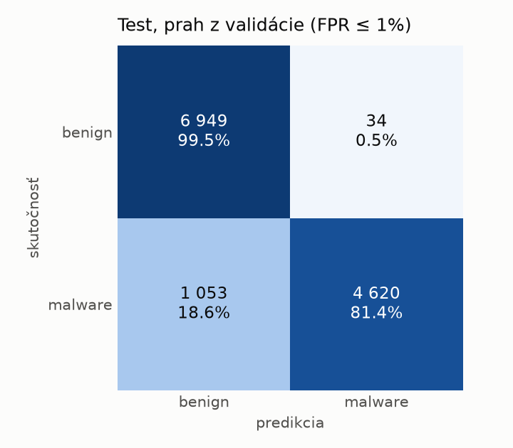
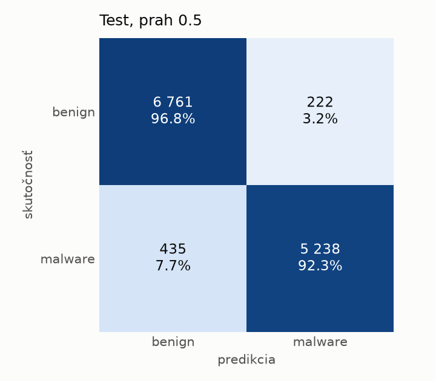
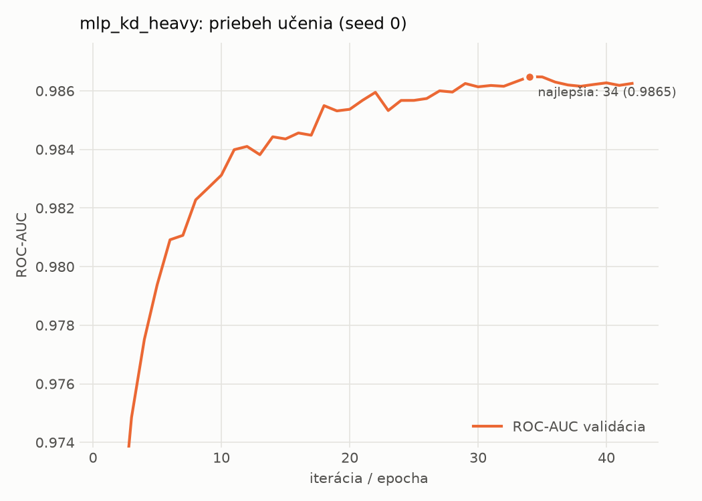

# static/mlp_kd_heavy – beh `20261123-221149`

> Automaticky generované (`src/training/run_tabular.py`). Konfigurácia: `config.yaml`, protokol: `protocol.yaml`.

- **Model:** `mlp` – študent – malé MLP učené destiláciou z mlp_large hybridu (V4)
- **Ladenie:** bez ladenia – hyperparametre prevzaté z `runs_v4/emu_p/full/students_static/mlp_kd_heavy/20261123-204329`
- **Finálne modely:** seedy [0, 1, 2]; hodnoty sú priemer ± smerodajná odchýlka cez seedy
- **Najlepšie hyperparametre:** `{"hidden_layers": 1, "max_epochs": 100, "patience": 8, "hidden_width": 64, "dropout": 0.1254973730751401, "lr": 0.0014439667191275393, "weight_decay": 1.2808340108243318e-06, "batch_size": 1024, "kd_alpha": 0.5142654341824873, "kd_temperature": 1.3883261824077338}`

## Detekčná kvalita (bez prahu)
| metrika | train (podvzorka) | validácia | test |
|---|---|---|---|
| ROC-AUC | 0.9920 ± 0.0005 | 0.9865 ± 0.0002 | 0.9811 ± 0.0007 |
| PR-AUC | 0.9913 ± 0.0006 | 0.9822 ± 0.0005 | 0.9822 ± 0.0008 |
| TPR pri FPR 1 % | 0.9125 ± 0.0065 | 0.8472 ± 0.0163 | 0.8613 ± 0.0026 |
| TPR pri FPR 0,1 % | 0.7084 ± 0.0289 | 0.4001 ± 0.1357 | 0.6654 ± 0.0331 |
| log loss | 0.1044 ± 0.0040 | 0.1396 ± 0.0013 | 0.1554 ± 0.0030 |
| Brier skóre | 0.0281 ± 0.0010 | 0.0378 ± 0.0003 | 0.0420 ± 0.0008 |

Rozdiel ROC-AUC train − validácia: **0.0055** (veľký rozdiel = preučenie).

## Pri prahu z validácie (FPR ≤ 1% na validácii)
| metrika | train (podvzorka) | validácia | test |
|---|---|---|---|
| accuracy | 0.9403 ± 0.0047 | 0.9283 ± 0.0072 | 0.9180 ± 0.0044 |
| balanced accuracy | 0.9304 ± 0.0055 | 0.9188 ± 0.0082 | 0.9093 ± 0.0050 |
| precision | 0.9929 ± 0.0002 | 0.9853 ± 0.0005 | 0.9913 ± 0.0014 |
| recall (TPR) | 0.8653 ± 0.0109 | 0.8472 ± 0.0163 | 0.8244 ± 0.0103 |
| FPR | 0.0046 ± 0.0001 | 0.0096 ± 0.0002 | 0.0059 ± 0.0010 |
| F1 | 0.9247 ± 0.0063 | 0.9110 ± 0.0096 | 0.9001 ± 0.0059 |
| MCC | 0.8813 ± 0.0090 | 0.8584 ± 0.0136 | 0.8418 ± 0.0080 |

## Pri pevnom prahu 0.5
| metrika | train (podvzorka) | validácia | test |
|---|---|---|---|
| accuracy | 0.9643 ± 0.0017 | 0.9517 ± 0.0008 | 0.9484 ± 0.0005 |
| balanced accuracy | 0.9626 ± 0.0015 | 0.9506 ± 0.0006 | 0.9463 ± 0.0006 |
| precision | 0.9636 ± 0.0040 | 0.9456 ± 0.0029 | 0.9577 ± 0.0024 |
| recall (TPR) | 0.9517 ± 0.0012 | 0.9427 ± 0.0013 | 0.9258 ± 0.0023 |
| FPR | 0.0264 ± 0.0030 | 0.0415 ± 0.0024 | 0.0332 ± 0.0020 |
| F1 | 0.9576 ± 0.0020 | 0.9441 ± 0.0008 | 0.9415 ± 0.0006 |
| MCC | 0.9268 ± 0.0036 | 0.9016 ± 0.0016 | 0.8958 ± 0.0011 |

## Výpočtové nároky (seed 0, testovacia množina)
| meranie | hodnota |
|---|---|
| tréning finálneho modelu | 3.8 s (priemer cez seedy) |
| ladenie spolu | 0 s |
| počet parametrov / uzlov | 10 689 |
| veľkosť modelu na disku | 0.05 MB |
| transformácia vstupu – latencia (1 vlákno) | 0.015 ms |
| transformácia vstupu – priepustnosť | 747 240 vzoriek/s |
| CPU latencia modelu (batch 1, 1 vlákno) | 0.151 ms (p95 0.161) |
| CPU priepustnosť (24 vlákien) | 4 528 572 vzoriek/s |
| GPU latencia (batch 1) | 0.280 ms (p95 0.468) |
| GPU priepustnosť | 2 498 963 vzoriek/s |
| GPU špičková pamäť | 94 MB |

## Grafy
| | |
|---|---|
|  |  |
|  |  |
|  |  |
|  |  |

## Súbory
`metrics.json` (všetky metriky po seedoch vrátane rodín), `timing.json`, `hpo_trials.csv`,
`predictions/<časť>_seed<N>.parquet` (sha256, family, label, score), `model/seed_<N>/`, `log.txt`.
