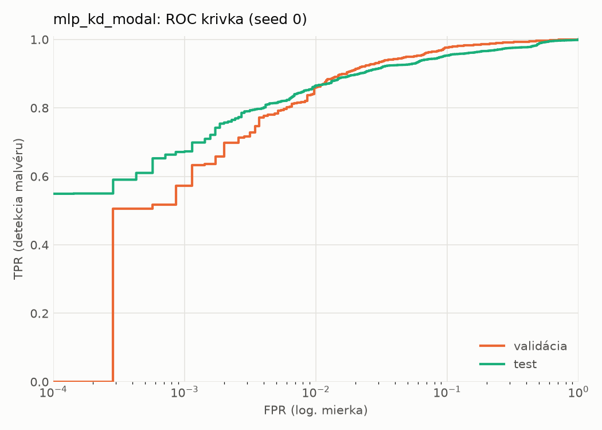
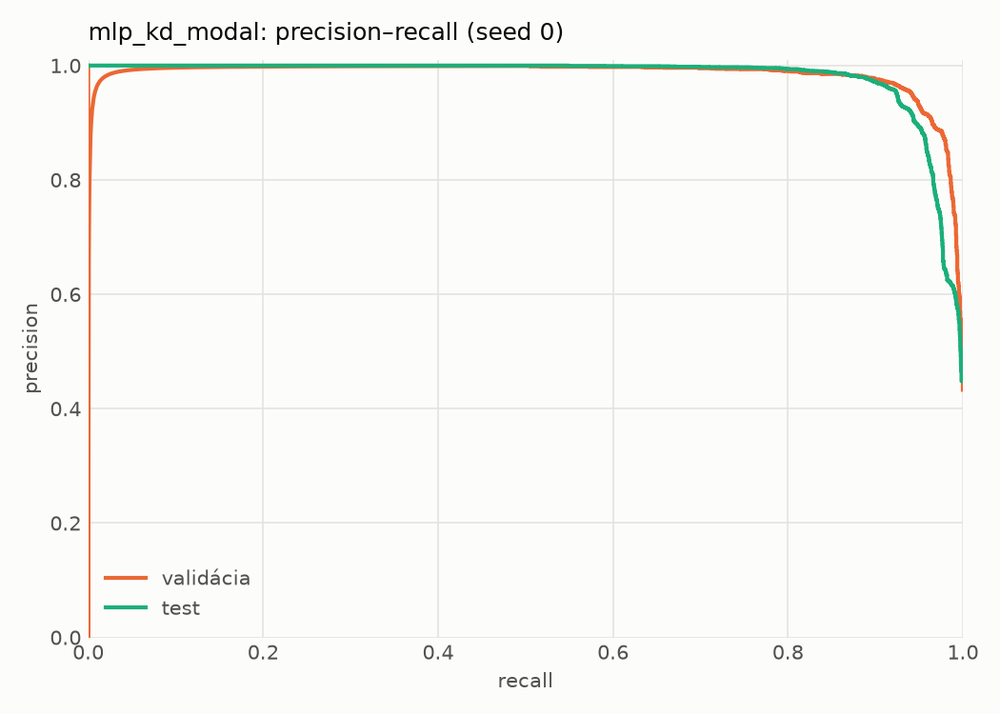
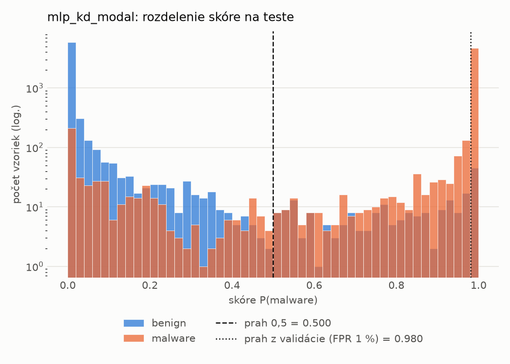
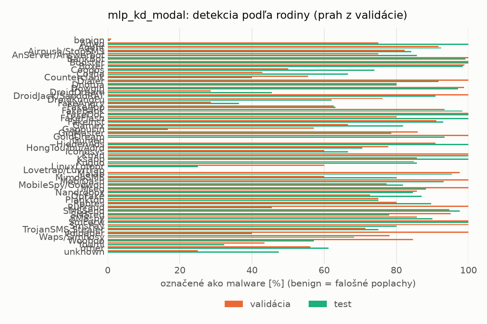
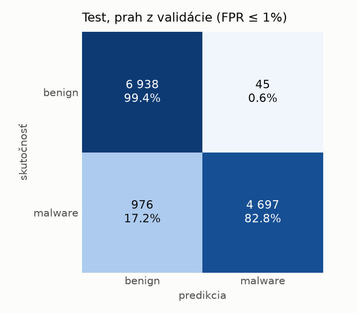
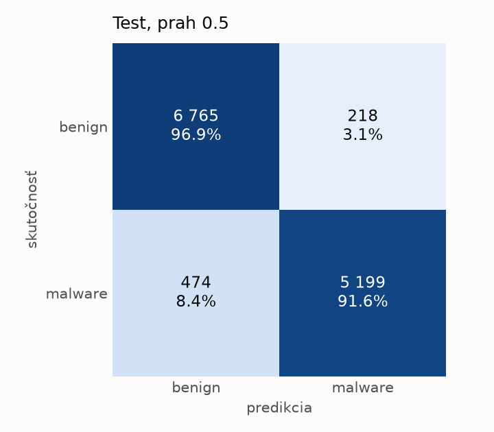
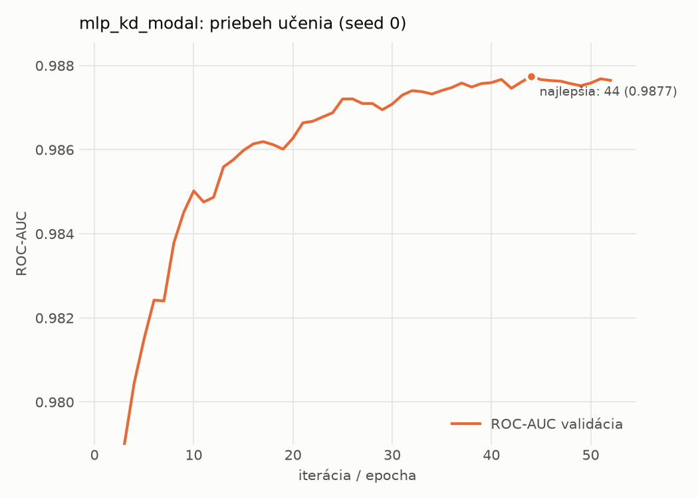

# static/mlp_kd_modal – beh `20261123-221125`

> Automaticky generované (`src/training/run_tabular.py`). Konfigurácia: `config.yaml`, protokol: `protocol.yaml`.

- **Model:** `mlp` – študent – malé MLP učené destiláciou z učiteľa rovnakej modality (variant A)
- **Ladenie:** bez ladenia – hyperparametre prevzaté z `runs_v4/emu_p/full/students_static/mlp_kd_modal/20261123-203932`
- **Finálne modely:** seedy [0, 1, 2]; hodnoty sú priemer ± smerodajná odchýlka cez seedy
- **Najlepšie hyperparametre:** `{"hidden_layers": 1, "max_epochs": 100, "patience": 8, "hidden_width": 64, "dropout": 0.037581027791643296, "lr": 0.0019348891318937097, "weight_decay": 9.225533739654786e-05, "batch_size": 512, "kd_alpha": 0.37781550385889523, "kd_temperature": 3.209412682485264}`

## Detekčná kvalita (bez prahu)
| metrika | train (podvzorka) | validácia | test |
|---|---|---|---|
| ROC-AUC | 0.9919 ± 0.0003 | 0.9876 ± 0.0003 | 0.9798 ± 0.0014 |
| PR-AUC | 0.9909 ± 0.0003 | 0.9850 ± 0.0010 | 0.9817 ± 0.0008 |
| TPR pri FPR 1 % | 0.9103 ± 0.0011 | 0.8550 ± 0.0099 | 0.8629 ± 0.0020 |
| TPR pri FPR 0,1 % | 0.7269 ± 0.0054 | 0.5910 ± 0.0250 | 0.6838 ± 0.0190 |
| log loss | 0.1185 ± 0.0025 | 0.1615 ± 0.0034 | 0.2052 ± 0.0073 |
| Brier skóre | 0.0300 ± 0.0004 | 0.0392 ± 0.0008 | 0.0456 ± 0.0005 |

Rozdiel ROC-AUC train − validácia: **0.0043** (veľký rozdiel = preučenie).

## Pri prahu z validácie (FPR ≤ 1% na validácii)
| metrika | train (podvzorka) | validácia | test |
|---|---|---|---|
| accuracy | 0.9393 ± 0.0021 | 0.9317 ± 0.0043 | 0.9184 ± 0.0008 |
| balanced accuracy | 0.9293 ± 0.0025 | 0.9226 ± 0.0049 | 0.9097 ± 0.0009 |
| precision | 0.9922 ± 0.0003 | 0.9853 ± 0.0002 | 0.9903 ± 0.0002 |
| recall (TPR) | 0.8636 ± 0.0051 | 0.8550 ± 0.0099 | 0.8260 ± 0.0019 |
| FPR | 0.0050 ± 0.0002 | 0.0097 ± 0.0000 | 0.0065 ± 0.0002 |
| F1 | 0.9235 ± 0.0029 | 0.9155 ± 0.0057 | 0.9007 ± 0.0011 |
| MCC | 0.8794 ± 0.0041 | 0.8648 ± 0.0081 | 0.8423 ± 0.0016 |

## Pri pevnom prahu 0.5
| metrika | train (podvzorka) | validácia | test |
|---|---|---|---|
| accuracy | 0.9634 ± 0.0004 | 0.9520 ± 0.0017 | 0.9465 ± 0.0010 |
| balanced accuracy | 0.9613 ± 0.0003 | 0.9506 ± 0.0016 | 0.9439 ± 0.0011 |
| precision | 0.9655 ± 0.0010 | 0.9485 ± 0.0031 | 0.9599 ± 0.0002 |
| recall (TPR) | 0.9475 ± 0.0004 | 0.9402 ± 0.0009 | 0.9190 ± 0.0022 |
| FPR | 0.0249 ± 0.0007 | 0.0390 ± 0.0024 | 0.0312 ± 0.0001 |
| F1 | 0.9564 ± 0.0004 | 0.9443 ± 0.0019 | 0.9390 ± 0.0012 |
| MCC | 0.9249 ± 0.0008 | 0.9022 ± 0.0035 | 0.8920 ± 0.0020 |

## Výpočtové nároky (seed 0, testovacia množina)
| meranie | hodnota |
|---|---|
| tréning finálneho modelu | 7.3 s (priemer cez seedy) |
| ladenie spolu | 0 s |
| počet parametrov / uzlov | 10 689 |
| veľkosť modelu na disku | 0.05 MB |
| transformácia vstupu – latencia (1 vlákno) | 0.015 ms |
| transformácia vstupu – priepustnosť | 730 729 vzoriek/s |
| CPU latencia modelu (batch 1, 1 vlákno) | 0.152 ms (p95 0.161) |
| CPU priepustnosť (24 vlákien) | 5 184 336 vzoriek/s |
| GPU latencia (batch 1) | 0.442 ms (p95 0.472) |
| GPU priepustnosť | 2 520 413 vzoriek/s |
| GPU špičková pamäť | 62 MB |

## Grafy
| | |
|---|---|
|  |  |
|  |  |
|  |  |
|  |  |

## Súbory
`metrics.json` (všetky metriky po seedoch vrátane rodín), `timing.json`, `hpo_trials.csv`,
`predictions/<časť>_seed<N>.parquet` (sha256, family, label, score), `model/seed_<N>/`, `log.txt`.
