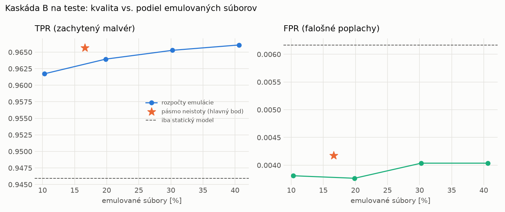

# Kaskáda B `b_baselines` – beh `20261122-212803`

> Generované `src/cascade/evaluate_b.py` (2026-11-22T21:28:04+01:00). Seedy: [0, 1, 2]; hodnoty = priemer ± sm. odchýlka.
> Všetky prahy a pásmo neistoty sú z validácie; test sa na nič nenastavuje. Postup: `docs/09_plan_v2.md`.

| rola | beh |
|---|---|
| static | `runs_v4/real_full/full/static/lightgbm/20261122-184829` |
| dynamic | `runs_v4/real_full/full/dynamic/lightgbm/20261122-191914` |
| hybrid | `runs_v4/real_full/full/hybrid/lightgbm/20261122-195127` |

Druhý stupeň: **dynamic**. Pásmo neistoty statického modelu: FPR ≤ 0.1% nad `hi`,
najviac 1% malvéru validácie pod `lo` (seed 0: lo = 0.0357, hi = 0.9968, seed 1: lo = 0.0196, hi = 0.9985, seed 2: lo = 0.0190, hi = 0.9986).

## Test
| prístup | accuracy | balanced_accuracy | precision | recall_tpr | fpr | f1 | mcc |
|---|---|---|---|---|---|---|---|
| kaskáda B | 0.9798 ± 0.0009 | 0.9807 ± 0.0009 | 0.9962 ± 0.0003 | 0.9656 ± 0.0014 | 0.0042 ± 0.0003 | 0.9807 ± 0.0009 | 0.9601 ± 0.0017 |
| statický | 0.9685 ± 0.0019 | 0.9699 ± 0.0018 | 0.9942 ± 0.0005 | 0.9459 ± 0.0040 | 0.0062 ± 0.0005 | 0.9695 ± 0.0019 | 0.9382 ± 0.0035 |
| dynamický | 0.9263 ± 0.0023 | 0.9299 ± 0.0021 | 0.9909 ± 0.0009 | 0.8688 ± 0.0051 | 0.0090 ± 0.0010 | 0.9259 ± 0.0026 | 0.8606 ± 0.0039 |
| hybrid (každá vzorka) | 0.9818 ± 0.0005 | 0.9824 ± 0.0005 | 0.9931 ± 0.0005 | 0.9724 ± 0.0006 | 0.0076 ± 0.0005 | 0.9826 ± 0.0005 | 0.9638 ± 0.0010 |

- **emulované súbory: 16.61%** (ostatné rozhodne iba statický model); na hybrid ide 4.08% súborov
- chyby pri istom rozhodnutí statického modelu (seed 0): 81
- validácia: emulované 15.96%, na hybrid 4.11%

## Validácia
| prístup | accuracy | balanced_accuracy | precision | recall_tpr | fpr | f1 | mcc |
|---|---|---|---|---|---|---|---|
| kaskáda B | 0.9800 ± 0.0003 | 0.9809 ± 0.0003 | 0.9952 ± 0.0003 | 0.9670 ± 0.0008 | 0.0053 ± 0.0003 | 0.9809 ± 0.0003 | 0.9604 ± 0.0006 |
| statický | 0.9678 ± 0.0012 | 0.9691 ± 0.0011 | 0.9909 ± 0.0000 | 0.9480 ± 0.0023 | 0.0098 ± 0.0000 | 0.9690 ± 0.0012 | 0.9366 ± 0.0023 |
| dynamický | 0.9274 ± 0.0022 | 0.9310 ± 0.0020 | 0.9901 ± 0.0000 | 0.8717 ± 0.0041 | 0.0098 ± 0.0000 | 0.9271 ± 0.0023 | 0.8624 ± 0.0038 |
| hybrid (každá vzorka) | 0.9807 ± 0.0001 | 0.9812 ± 0.0001 | 0.9914 ± 0.0002 | 0.9720 ± 0.0005 | 0.0095 ± 0.0003 | 0.9816 ± 0.0001 | 0.9615 ± 0.0002 |

## Krivka rozpočtu emulácie (test, priemer cez seedy)
| budget_val | emulation_rate | hybrid_rate | recall_tpr | fpr | f1 |
|---|---|---|---|---|---|
| 0.1000 | 0.1031 | 0.0335 | 0.9617 | 0.0038 | 0.9788 |
| 0.2000 | 0.1987 | 0.0494 | 0.9639 | 0.0038 | 0.9800 |
| 0.3000 | 0.3026 | 0.0596 | 0.9653 | 0.0040 | 0.9805 |
| 0.4000 | 0.4061 | 0.0705 | 0.9661 | 0.0040 | 0.9810 |

## Výpočtové nároky
Čas dynamickej analýzy (beh v emulátore alebo na zariadení) dataset neuvádza, preto sa neodhaduje. Úspora kaskády B = podiel súborov s dynamickou analýzou: **16.61%** (ostatné prístupy 100 %).

| meranie | statický | dynamický | hybrid na každej vzorke | kaskáda B (odhad) |
|---|---|---|---|---|
| CPU čas ms/vz. (dávka) | 0.2054 | 0.2410 | 0.1787 | 0.2527 |
| CPU čas ms/vz. (1 vz.) | 0.1454 | 0.1497 | 0.1223 | 0.1752 |

