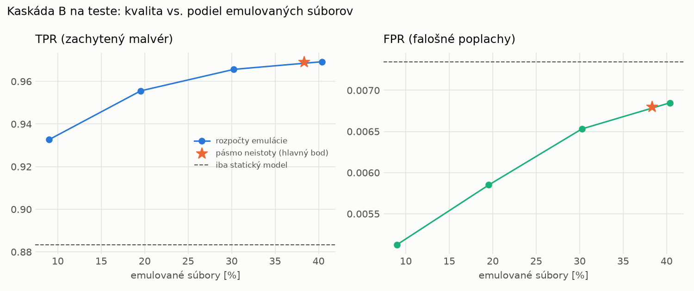

# Kaskáda B `b_direct` – beh `20261122-212800`

> Generované `src/cascade/evaluate_b.py` (2026-11-22T21:28:00+01:00). Seedy: [0, 1, 2]; hodnoty = priemer ± sm. odchýlka.
> Všetky prahy a pásmo neistoty sú z validácie; test sa na nič nenastavuje. Postup: `docs/09_plan_v2.md`.

| rola | beh |
|---|---|
| static | `runs_v4/real_full/full/students_static/mlp_kd/20261122-203423` |
| hybrid | `runs_v4/real_full/full/hybrid/lightgbm/20261122-195127` |

Druhý stupeň: **hybrid**. Pásmo neistoty statického modelu: FPR ≤ 0.1% nad `hi`,
najviac 1% malvéru validácie pod `lo` (seed 0: lo = 0.0280, hi = 0.9998, seed 1: lo = 0.0265, hi = 0.9999, seed 2: lo = 0.0228, hi = 0.9999).

## Test
| prístup | accuracy | balanced_accuracy | precision | recall_tpr | fpr | f1 | mcc |
|---|---|---|---|---|---|---|---|
| kaskáda B | 0.9805 ± 0.0007 | 0.9812 ± 0.0007 | 0.9938 ± 0.0007 | 0.9692 ± 0.0008 | 0.0068 ± 0.0008 | 0.9813 ± 0.0006 | 0.9612 ± 0.0014 |
| statický | 0.9348 ± 0.0031 | 0.9380 ± 0.0029 | 0.9927 ± 0.0004 | 0.8834 ± 0.0063 | 0.0073 ± 0.0005 | 0.9348 ± 0.0034 | 0.8760 ± 0.0056 |
| hybrid (každá vzorka) | 0.9818 ± 0.0005 | 0.9824 ± 0.0005 | 0.9931 ± 0.0005 | 0.9724 ± 0.0006 | 0.0076 ± 0.0005 | 0.9826 ± 0.0005 | 0.9638 ± 0.0010 |

- **emulované súbory: 38.31%** (ostatné rozhodne iba statický model); na hybrid ide 38.31% súborov
- chyby pri istom rozhodnutí statického modelu (seed 0): 80
- validácia: emulované 37.80%, na hybrid 37.80%

## Validácia
| prístup | accuracy | balanced_accuracy | precision | recall_tpr | fpr | f1 | mcc |
|---|---|---|---|---|---|---|---|
| kaskáda B | 0.9798 ± 0.0002 | 0.9805 ± 0.0002 | 0.9923 ± 0.0002 | 0.9694 ± 0.0003 | 0.0084 ± 0.0003 | 0.9807 ± 0.0002 | 0.9599 ± 0.0004 |
| statický | 0.9349 ± 0.0023 | 0.9380 ± 0.0022 | 0.9903 ± 0.0000 | 0.8857 ± 0.0044 | 0.0098 ± 0.0000 | 0.9351 ± 0.0025 | 0.8756 ± 0.0042 |
| hybrid (každá vzorka) | 0.9807 ± 0.0001 | 0.9812 ± 0.0001 | 0.9914 ± 0.0002 | 0.9720 ± 0.0005 | 0.0095 ± 0.0003 | 0.9816 ± 0.0001 | 0.9615 ± 0.0002 |

## Krivka rozpočtu emulácie (test, priemer cez seedy)
| budget_val | emulation_rate | hybrid_rate | recall_tpr | fpr | f1 |
|---|---|---|---|---|---|
| 0.1000 | 0.0899 | 0.0899 | 0.9326 | 0.0051 | 0.9629 |
| 0.2000 | 0.1954 | 0.1954 | 0.9556 | 0.0059 | 0.9747 |
| 0.3000 | 0.3025 | 0.3025 | 0.9656 | 0.0065 | 0.9796 |
| 0.4000 | 0.4038 | 0.4038 | 0.9692 | 0.0068 | 0.9813 |

## Výpočtové nároky
Čas dynamickej analýzy (beh v emulátore alebo na zariadení) dataset neuvádza, preto sa neodhaduje. Úspora kaskády B = podiel súborov s dynamickou analýzou: **38.31%** (ostatné prístupy 100 %).

| meranie | statický | hybrid na každej vzorke | kaskáda B (odhad) |
|---|---|---|---|
| CPU čas ms/vz. (dávka) | 0.0476 | 0.1787 | 0.1161 |
| CPU čas ms/vz. (1 vz.) | 0.1442 | 0.1223 | 0.1910 |

