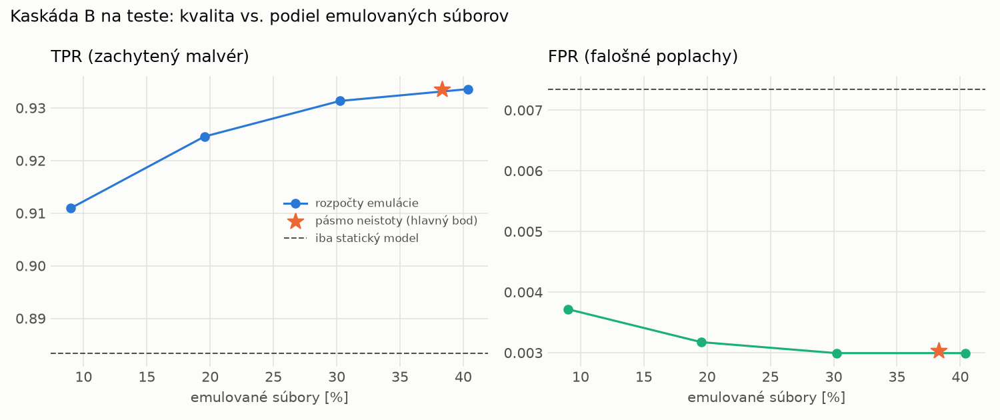

# Kaskáda B `b_heavy` – beh `20261122-212802`

> Generované `src/cascade/evaluate_b.py` (2026-11-22T21:28:02+01:00). Seedy: [0, 1, 2]; hodnoty = priemer ± sm. odchýlka.
> Všetky prahy a pásmo neistoty sú z validácie; test sa na nič nenastavuje. Postup: `docs/09_plan_v2.md`.

| rola | beh |
|---|---|
| static | `runs_v4/real_full/full/students_static/mlp_kd/20261122-203423` |
| dynamic | `runs_v4/real_full/full/students_dynamic/mlp_kd/20261122-205301` |
| hybrid | `runs_v4/real_full/full/hybrid/mlp_large/20261122-201300` |

Druhý stupeň: **dynamic**. Pásmo neistoty statického modelu: FPR ≤ 0.1% nad `hi`,
najviac 1% malvéru validácie pod `lo` (seed 0: lo = 0.0280, hi = 0.9998, seed 1: lo = 0.0265, hi = 0.9999, seed 2: lo = 0.0228, hi = 0.9999).

## Test
| prístup | accuracy | balanced_accuracy | precision | recall_tpr | fpr | f1 | mcc |
|---|---|---|---|---|---|---|---|
| kaskáda B | 0.9634 ± 0.0020 | 0.9652 ± 0.0019 | 0.9971 ± 0.0005 | 0.9335 ± 0.0039 | 0.0030 ± 0.0005 | 0.9643 ± 0.0020 | 0.9289 ± 0.0038 |
| statický | 0.9348 ± 0.0031 | 0.9380 ± 0.0029 | 0.9927 ± 0.0004 | 0.8834 ± 0.0063 | 0.0073 ± 0.0005 | 0.9348 ± 0.0034 | 0.8760 ± 0.0056 |
| dynamický | 0.8626 ± 0.0048 | 0.8697 ± 0.0045 | 0.9886 ± 0.0005 | 0.7492 ± 0.0095 | 0.0098 ± 0.0006 | 0.8524 ± 0.0060 | 0.7529 ± 0.0076 |
| hybrid (každá vzorka) | 0.9756 ± 0.0013 | 0.9765 ± 0.0013 | 0.9934 ± 0.0006 | 0.9603 ± 0.0024 | 0.0072 ± 0.0006 | 0.9765 ± 0.0013 | 0.9517 ± 0.0026 |

- **emulované súbory: 38.31%** (ostatné rozhodne iba statický model); na hybrid ide 9.88% súborov
- chyby pri istom rozhodnutí statického modelu (seed 0): 80
- validácia: emulované 37.80%, na hybrid 10.07%

## Validácia
| prístup | accuracy | balanced_accuracy | precision | recall_tpr | fpr | f1 | mcc |
|---|---|---|---|---|---|---|---|
| kaskáda B | 0.9629 ± 0.0013 | 0.9647 ± 0.0013 | 0.9948 ± 0.0001 | 0.9348 ± 0.0026 | 0.0055 ± 0.0002 | 0.9639 ± 0.0014 | 0.9277 ± 0.0025 |
| statický | 0.9349 ± 0.0023 | 0.9380 ± 0.0022 | 0.9903 ± 0.0000 | 0.8857 ± 0.0044 | 0.0098 ± 0.0000 | 0.9351 ± 0.0025 | 0.8756 ± 0.0042 |
| dynamický | 0.8643 ± 0.0056 | 0.8713 ± 0.0053 | 0.9886 ± 0.0002 | 0.7524 ± 0.0105 | 0.0098 ± 0.0000 | 0.8545 ± 0.0069 | 0.7557 ± 0.0090 |
| hybrid (každá vzorka) | 0.9756 ± 0.0016 | 0.9765 ± 0.0015 | 0.9911 ± 0.0001 | 0.9626 ± 0.0031 | 0.0097 ± 0.0002 | 0.9767 ± 0.0016 | 0.9516 ± 0.0031 |

## Krivka rozpočtu emulácie (test, priemer cez seedy)
| budget_val | emulation_rate | hybrid_rate | recall_tpr | fpr | f1 |
|---|---|---|---|---|---|
| 0.1000 | 0.0899 | 0.0391 | 0.9109 | 0.0037 | 0.9517 |
| 0.2000 | 0.1954 | 0.0724 | 0.9246 | 0.0032 | 0.9594 |
| 0.3000 | 0.3025 | 0.0907 | 0.9313 | 0.0030 | 0.9631 |
| 0.4000 | 0.4038 | 0.1028 | 0.9336 | 0.0030 | 0.9643 |

## Výpočtové nároky
Čas dynamickej analýzy (beh v emulátore alebo na zariadení) dataset neuvádza, preto sa neodhaduje. Úspora kaskády B = podiel súborov s dynamickou analýzou: **38.31%** (ostatné prístupy 100 %).

| meranie | statický | dynamický | hybrid na každej vzorke | kaskáda B (odhad) |
|---|---|---|---|---|
| CPU čas ms/vz. (dávka) | 0.0476 | 0.0353 | 0.1148 | 0.0725 |
| CPU čas ms/vz. (1 vz.) | 0.1442 | 0.1408 | 0.2782 | 0.2256 |

