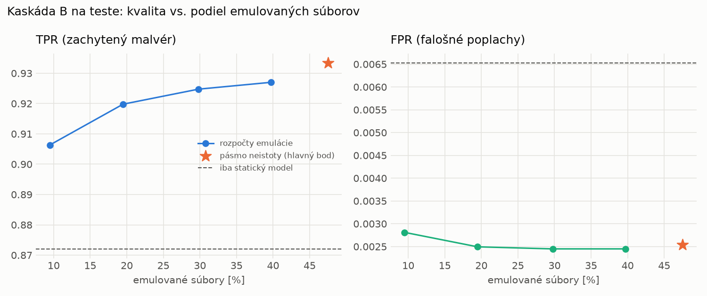

# Kaskáda B `b_heavyteacher` – beh `20261122-212807`

> Generované `src/cascade/evaluate_b.py` (2026-11-22T21:28:07+01:00). Seedy: [0, 1, 2]; hodnoty = priemer ± sm. odchýlka.
> Všetky prahy a pásmo neistoty sú z validácie; test sa na nič nenastavuje. Postup: `docs/09_plan_v2.md`.

| rola | beh |
|---|---|
| static | `runs_v4/real_full/full/students_static/mlp_kd_heavy/20261122-204855` |
| dynamic | `runs_v4/real_full/full/students_dynamic/mlp_kd_heavy/20261122-211545` |
| hybrid | `runs_v4/real_full/full/hybrid/lightgbm/20261122-195127` |

Druhý stupeň: **dynamic**. Pásmo neistoty statického modelu: FPR ≤ 0.1% nad `hi`,
najviac 1% malvéru validácie pod `lo` (seed 0: lo = 0.0295, hi = 0.9998, seed 1: lo = 0.0346, hi = 0.9993, seed 2: lo = 0.0290, hi = 0.9994).

## Test
| prístup | accuracy | balanced_accuracy | precision | recall_tpr | fpr | f1 | mcc |
|---|---|---|---|---|---|---|---|
| kaskáda B | 0.9636 ± 0.0023 | 0.9655 ± 0.0021 | 0.9976 ± 0.0005 | 0.9335 ± 0.0045 | 0.0025 ± 0.0005 | 0.9645 ± 0.0023 | 0.9293 ± 0.0042 |
| statický | 0.9292 ± 0.0033 | 0.9328 ± 0.0030 | 0.9934 ± 0.0016 | 0.8721 ± 0.0077 | 0.0065 ± 0.0016 | 0.9288 ± 0.0037 | 0.8662 ± 0.0055 |
| dynamický | 0.8636 ± 0.0052 | 0.8707 ± 0.0049 | 0.9892 ± 0.0010 | 0.7507 ± 0.0107 | 0.0093 ± 0.0010 | 0.8536 ± 0.0066 | 0.7548 ± 0.0081 |
| hybrid (každá vzorka) | 0.9818 ± 0.0005 | 0.9824 ± 0.0005 | 0.9931 ± 0.0005 | 0.9724 ± 0.0006 | 0.0076 ± 0.0005 | 0.9826 ± 0.0005 | 0.9638 ± 0.0010 |

- **emulované súbory: 47.50%** (ostatné rozhodne iba statický model); na hybrid ide 10.75% súborov
- chyby pri istom rozhodnutí statického modelu (seed 0): 75
- validácia: emulované 47.62%, na hybrid 10.83%

## Validácia
| prístup | accuracy | balanced_accuracy | precision | recall_tpr | fpr | f1 | mcc |
|---|---|---|---|---|---|---|---|
| kaskáda B | 0.9632 ± 0.0024 | 0.9650 ± 0.0023 | 0.9952 ± 0.0003 | 0.9350 ± 0.0047 | 0.0051 ± 0.0003 | 0.9642 ± 0.0025 | 0.9283 ± 0.0046 |
| statický | 0.9280 ± 0.0063 | 0.9315 ± 0.0060 | 0.9901 ± 0.0001 | 0.8728 ± 0.0119 | 0.0098 ± 0.0000 | 0.9278 ± 0.0068 | 0.8634 ± 0.0112 |
| dynamický | 0.8680 ± 0.0051 | 0.8748 ± 0.0048 | 0.9887 ± 0.0001 | 0.7594 ± 0.0097 | 0.0098 ± 0.0000 | 0.8590 ± 0.0063 | 0.7617 ± 0.0083 |
| hybrid (každá vzorka) | 0.9807 ± 0.0001 | 0.9812 ± 0.0001 | 0.9914 ± 0.0002 | 0.9720 ± 0.0005 | 0.0095 ± 0.0003 | 0.9816 ± 0.0001 | 0.9615 ± 0.0002 |

## Krivka rozpočtu emulácie (test, priemer cez seedy)
| budget_val | emulation_rate | hybrid_rate | recall_tpr | fpr | f1 |
|---|---|---|---|---|---|
| 0.1000 | 0.0948 | 0.0424 | 0.9063 | 0.0028 | 0.9496 |
| 0.2000 | 0.1949 | 0.0730 | 0.9198 | 0.0025 | 0.9571 |
| 0.3000 | 0.2979 | 0.0913 | 0.9248 | 0.0024 | 0.9598 |
| 0.4000 | 0.3969 | 0.1028 | 0.9270 | 0.0024 | 0.9610 |

## Výpočtové nároky
Čas dynamickej analýzy (beh v emulátore alebo na zariadení) dataset neuvádza, preto sa neodhaduje. Úspora kaskády B = podiel súborov s dynamickou analýzou: **47.50%** (ostatné prístupy 100 %).

| meranie | statický | dynamický | hybrid na každej vzorke | kaskáda B (odhad) |
|---|---|---|---|---|
| CPU čas ms/vz. (dávka) | 0.0481 | 0.0354 | 0.1787 | 0.0841 |
| CPU čas ms/vz. (1 vz.) | 0.1470 | 0.1439 | 0.1223 | 0.2285 |

