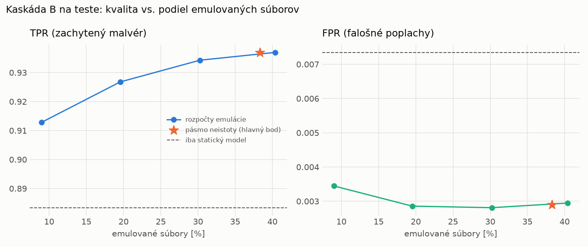

# Kaskáda B `b_main` – beh `20261122-212758`

> Generované `src/cascade/evaluate_b.py` (2026-11-22T21:27:58+01:00). Seedy: [0, 1, 2]; hodnoty = priemer ± sm. odchýlka.
> Všetky prahy a pásmo neistoty sú z validácie; test sa na nič nenastavuje. Postup: `docs/09_plan_v2.md`.

| rola | beh |
|---|---|
| static | `runs_v4/real_full/full/students_static/mlp_kd/20261122-203423` |
| dynamic | `runs_v4/real_full/full/students_dynamic/mlp_kd/20261122-205301` |
| hybrid | `runs_v4/real_full/full/hybrid/lightgbm/20261122-195127` |

Druhý stupeň: **dynamic**. Pásmo neistoty statického modelu: FPR ≤ 0.1% nad `hi`,
najviac 1% malvéru validácie pod `lo` (seed 0: lo = 0.0280, hi = 0.9998, seed 1: lo = 0.0265, hi = 0.9999, seed 2: lo = 0.0228, hi = 0.9999).

## Test
| prístup | accuracy | balanced_accuracy | precision | recall_tpr | fpr | f1 | mcc |
|---|---|---|---|---|---|---|---|
| kaskáda B | 0.9652 ± 0.0014 | 0.9670 ± 0.0013 | 0.9973 ± 0.0003 | 0.9369 ± 0.0025 | 0.0029 ± 0.0003 | 0.9661 ± 0.0014 | 0.9324 ± 0.0026 |
| statický | 0.9348 ± 0.0031 | 0.9380 ± 0.0029 | 0.9927 ± 0.0004 | 0.8834 ± 0.0063 | 0.0073 ± 0.0005 | 0.9348 ± 0.0034 | 0.8760 ± 0.0056 |
| dynamický | 0.8626 ± 0.0048 | 0.8697 ± 0.0045 | 0.9886 ± 0.0005 | 0.7492 ± 0.0095 | 0.0098 ± 0.0006 | 0.8524 ± 0.0060 | 0.7529 ± 0.0076 |
| hybrid (každá vzorka) | 0.9818 ± 0.0005 | 0.9824 ± 0.0005 | 0.9931 ± 0.0005 | 0.9724 ± 0.0006 | 0.0076 ± 0.0005 | 0.9826 ± 0.0005 | 0.9638 ± 0.0010 |

- **emulované súbory: 38.31%** (ostatné rozhodne iba statický model); na hybrid ide 9.88% súborov
- chyby pri istom rozhodnutí statického modelu (seed 0): 80
- validácia: emulované 37.80%, na hybrid 10.07%

## Validácia
| prístup | accuracy | balanced_accuracy | precision | recall_tpr | fpr | f1 | mcc |
|---|---|---|---|---|---|---|---|
| kaskáda B | 0.9652 ± 0.0001 | 0.9669 ± 0.0001 | 0.9953 ± 0.0006 | 0.9387 ± 0.0008 | 0.0050 ± 0.0007 | 0.9662 ± 0.0001 | 0.9321 ± 0.0002 |
| statický | 0.9349 ± 0.0023 | 0.9380 ± 0.0022 | 0.9903 ± 0.0000 | 0.8857 ± 0.0044 | 0.0098 ± 0.0000 | 0.9351 ± 0.0025 | 0.8756 ± 0.0042 |
| dynamický | 0.8643 ± 0.0056 | 0.8713 ± 0.0053 | 0.9886 ± 0.0002 | 0.7524 ± 0.0105 | 0.0098 ± 0.0000 | 0.8545 ± 0.0069 | 0.7557 ± 0.0090 |
| hybrid (každá vzorka) | 0.9807 ± 0.0001 | 0.9812 ± 0.0001 | 0.9914 ± 0.0002 | 0.9720 ± 0.0005 | 0.0095 ± 0.0003 | 0.9816 ± 0.0001 | 0.9615 ± 0.0002 |

## Krivka rozpočtu emulácie (test, priemer cez seedy)
| budget_val | emulation_rate | hybrid_rate | recall_tpr | fpr | f1 |
|---|---|---|---|---|---|
| 0.1000 | 0.0899 | 0.0391 | 0.9128 | 0.0034 | 0.9529 |
| 0.2000 | 0.1954 | 0.0724 | 0.9268 | 0.0029 | 0.9607 |
| 0.3000 | 0.3025 | 0.0907 | 0.9343 | 0.0028 | 0.9648 |
| 0.4000 | 0.4038 | 0.1028 | 0.9370 | 0.0029 | 0.9661 |

## Výpočtové nároky
Čas dynamickej analýzy (beh v emulátore alebo na zariadení) dataset neuvádza, preto sa neodhaduje. Úspora kaskády B = podiel súborov s dynamickou analýzou: **38.31%** (ostatné prístupy 100 %).

| meranie | statický | dynamický | hybrid na každej vzorke | kaskáda B (odhad) |
|---|---|---|---|---|
| CPU čas ms/vz. (dávka) | 0.0476 | 0.0353 | 0.1787 | 0.0788 |
| CPU čas ms/vz. (1 vz.) | 0.1442 | 0.1408 | 0.1223 | 0.2102 |

