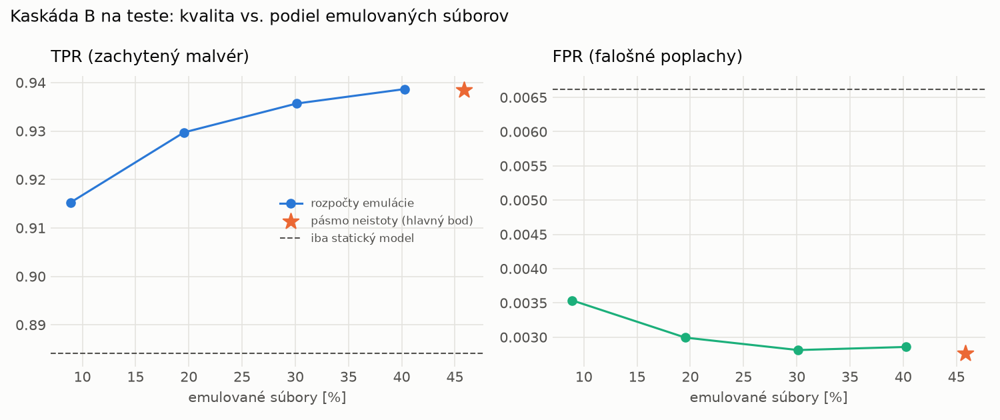

# Kaskáda B `b_nokd` – beh `20261122-212805`

> Generované `src/cascade/evaluate_b.py` (2026-11-22T21:28:06+01:00). Seedy: [0, 1, 2]; hodnoty = priemer ± sm. odchýlka.
> Všetky prahy a pásmo neistoty sú z validácie; test sa na nič nenastavuje. Postup: `docs/09_plan_v2.md`.

| rola | beh |
|---|---|
| static | `runs_v4/real_full/full/students_static/mlp_nokd/20261122-203844` |
| dynamic | `runs_v4/real_full/full/students_dynamic/mlp_nokd/20261122-205917` |
| hybrid | `runs_v4/real_full/full/hybrid/lightgbm/20261122-195127` |

Druhý stupeň: **dynamic**. Pásmo neistoty statického modelu: FPR ≤ 0.1% nad `hi`,
najviac 1% malvéru validácie pod `lo` (seed 0: lo = 0.0309, hi = 0.9999, seed 1: lo = 0.0485, hi = 1.0000, seed 2: lo = 0.0559, hi = 0.9996).

## Test
| prístup | accuracy | balanced_accuracy | precision | recall_tpr | fpr | f1 | mcc |
|---|---|---|---|---|---|---|---|
| kaskáda B | 0.9661 ± 0.0040 | 0.9679 ± 0.0038 | 0.9974 ± 0.0004 | 0.9385 ± 0.0073 | 0.0028 ± 0.0004 | 0.9670 ± 0.0040 | 0.9341 ± 0.0076 |
| statický | 0.9355 ± 0.0070 | 0.9388 ± 0.0066 | 0.9934 ± 0.0003 | 0.8841 ± 0.0134 | 0.0066 ± 0.0003 | 0.9356 ± 0.0075 | 0.8775 ± 0.0124 |
| dynamický | 0.8618 ± 0.0036 | 0.8691 ± 0.0033 | 0.9903 ± 0.0018 | 0.7465 ± 0.0079 | 0.0083 ± 0.0016 | 0.8512 ± 0.0046 | 0.7524 ± 0.0052 |
| hybrid (každá vzorka) | 0.9818 ± 0.0005 | 0.9824 ± 0.0005 | 0.9931 ± 0.0005 | 0.9724 ± 0.0006 | 0.0076 ± 0.0005 | 0.9826 ± 0.0005 | 0.9638 ± 0.0010 |

- **emulované súbory: 45.83%** (ostatné rozhodne iba statický model); na hybrid ide 10.91% súborov
- chyby pri istom rozhodnutí statického modelu (seed 0): 75
- validácia: emulované 45.65%, na hybrid 11.04%

## Validácia
| prístup | accuracy | balanced_accuracy | precision | recall_tpr | fpr | f1 | mcc |
|---|---|---|---|---|---|---|---|
| kaskáda B | 0.9657 ± 0.0032 | 0.9674 ± 0.0030 | 0.9956 ± 0.0004 | 0.9394 ± 0.0056 | 0.0047 ± 0.0004 | 0.9667 ± 0.0032 | 0.9331 ± 0.0060 |
| statický | 0.9325 ± 0.0097 | 0.9358 ± 0.0092 | 0.9903 ± 0.0000 | 0.8812 ± 0.0185 | 0.0097 ± 0.0002 | 0.9325 ± 0.0104 | 0.8715 ± 0.0173 |
| dynamický | 0.8650 ± 0.0043 | 0.8720 ± 0.0040 | 0.9886 ± 0.0001 | 0.7538 ± 0.0081 | 0.0098 ± 0.0000 | 0.8554 ± 0.0052 | 0.7568 ± 0.0069 |
| hybrid (každá vzorka) | 0.9807 ± 0.0001 | 0.9812 ± 0.0001 | 0.9914 ± 0.0002 | 0.9720 ± 0.0005 | 0.0095 ± 0.0003 | 0.9816 ± 0.0001 | 0.9615 ± 0.0002 |

## Krivka rozpočtu emulácie (test, priemer cez seedy)
| budget_val | emulation_rate | hybrid_rate | recall_tpr | fpr | f1 |
|---|---|---|---|---|---|
| 0.1000 | 0.0889 | 0.0390 | 0.9152 | 0.0035 | 0.9542 |
| 0.2000 | 0.1954 | 0.0721 | 0.9297 | 0.0030 | 0.9622 |
| 0.3000 | 0.3012 | 0.0879 | 0.9357 | 0.0028 | 0.9655 |
| 0.4000 | 0.4026 | 0.0982 | 0.9387 | 0.0029 | 0.9671 |

## Výpočtové nároky
Čas dynamickej analýzy (beh v emulátore alebo na zariadení) dataset neuvádza, preto sa neodhaduje. Úspora kaskády B = podiel súborov s dynamickou analýzou: **45.83%** (ostatné prístupy 100 %).

| meranie | statický | dynamický | hybrid na každej vzorke | kaskáda B (odhad) |
|---|---|---|---|---|
| CPU čas ms/vz. (dávka) | 0.0478 | 0.0356 | 0.1787 | 0.0836 |
| CPU čas ms/vz. (1 vz.) | 0.1341 | 0.1334 | 0.1223 | 0.2086 |

