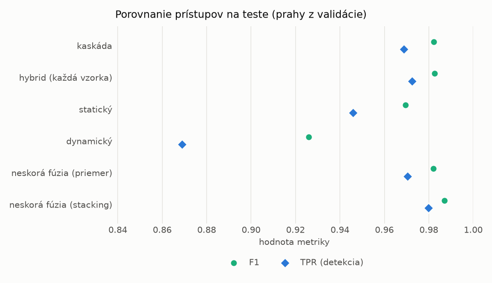
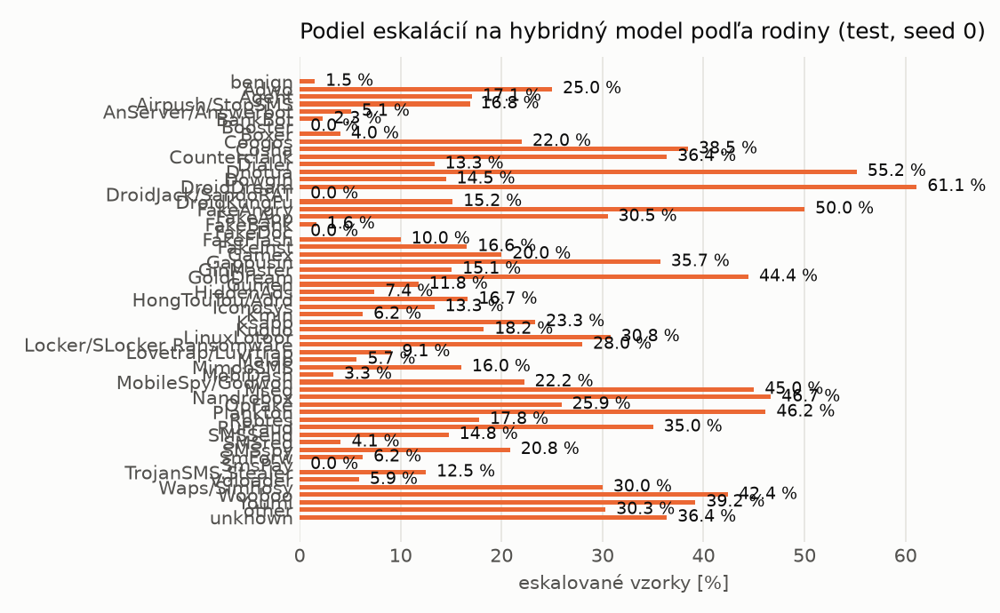

# Kaskáda `baselines` – beh `20261122-212754`

> Generované `src/cascade/evaluate.py` (2026-11-22T21:27:54+01:00). Seedy: [0, 1, 2]; hodnoty = priemer ± sm. odchýlka.
> Všetky prahy sú určené na validácii (FPR ≤ 1 %); test sa na nič nenastavuje.

| rola | beh |
|---|---|
| static | `runs_v4/real_full/full/static/lightgbm/20261122-184829` |
| dynamic | `runs_v4/real_full/full/dynamic/lightgbm/20261122-191914` |
| hybrid | `runs_v4/real_full/full/hybrid/lightgbm/20261122-195127` |

## Test
| prístup | accuracy | balanced_accuracy | precision | recall_tpr | fpr | f1 | mcc |
|---|---|---|---|---|---|---|---|
| kaskáda | 0.9815 ± 0.0011 | 0.9823 ± 0.0010 | 0.9963 ± 0.0003 | 0.9687 ± 0.0018 | 0.0040 ± 0.0003 | 0.9823 ± 0.0010 | 0.9634 ± 0.0021 |
| hybrid (každá vzorka) | 0.9818 ± 0.0005 | 0.9824 ± 0.0005 | 0.9931 ± 0.0005 | 0.9724 ± 0.0006 | 0.0076 ± 0.0005 | 0.9826 ± 0.0005 | 0.9638 ± 0.0010 |
| statický | 0.9685 ± 0.0019 | 0.9699 ± 0.0018 | 0.9942 ± 0.0005 | 0.9459 ± 0.0040 | 0.0062 ± 0.0005 | 0.9695 ± 0.0019 | 0.9382 ± 0.0035 |
| dynamický | 0.9263 ± 0.0023 | 0.9299 ± 0.0021 | 0.9909 ± 0.0009 | 0.8688 ± 0.0051 | 0.0090 ± 0.0010 | 0.9259 ± 0.0026 | 0.8606 ± 0.0039 |
| neskorá fúzia (priemer) | 0.9813 ± 0.0021 | 0.9820 ± 0.0019 | 0.9942 ± 0.0007 | 0.9704 ± 0.0046 | 0.0064 ± 0.0008 | 0.9821 ± 0.0020 | 0.9629 ± 0.0040 |
| neskorá fúzia (stacking) | 0.9864 ± 0.0003 | 0.9868 ± 0.0003 | 0.9944 ± 0.0003 | 0.9799 ± 0.0009 | 0.0062 ± 0.0003 | 0.9871 ± 0.0003 | 0.9729 ± 0.0006 |

## Validácia
| prístup | accuracy | balanced_accuracy | precision | recall_tpr | fpr | f1 | mcc |
|---|---|---|---|---|---|---|---|
| kaskáda | 0.9814 ± 0.0003 | 0.9822 ± 0.0003 | 0.9951 ± 0.0004 | 0.9697 ± 0.0009 | 0.0054 ± 0.0004 | 0.9823 ± 0.0003 | 0.9632 ± 0.0006 |
| hybrid (každá vzorka) | 0.9807 ± 0.0001 | 0.9812 ± 0.0001 | 0.9914 ± 0.0002 | 0.9720 ± 0.0005 | 0.0095 ± 0.0003 | 0.9816 ± 0.0001 | 0.9615 ± 0.0002 |
| statický | 0.9678 ± 0.0012 | 0.9691 ± 0.0011 | 0.9909 ± 0.0000 | 0.9480 ± 0.0023 | 0.0098 ± 0.0000 | 0.9690 ± 0.0012 | 0.9366 ± 0.0023 |
| dynamický | 0.9274 ± 0.0022 | 0.9310 ± 0.0020 | 0.9901 ± 0.0000 | 0.8717 ± 0.0041 | 0.0098 ± 0.0000 | 0.9271 ± 0.0023 | 0.8624 ± 0.0038 |
| neskorá fúzia (priemer) | 0.9794 ± 0.0028 | 0.9800 ± 0.0026 | 0.9911 ± 0.0000 | 0.9698 ± 0.0053 | 0.0098 ± 0.0000 | 0.9803 ± 0.0027 | 0.9590 ± 0.0055 |
| neskorá fúzia (stacking) | 0.9848 ± 0.0004 | 0.9851 ± 0.0004 | 0.9913 ± 0.0001 | 0.9799 ± 0.0007 | 0.0097 ± 0.0002 | 0.9856 ± 0.0004 | 0.9696 ± 0.0009 |

## Správanie kaskády (test, seed 0)
- podiel eskalácií na hybrid: **8.49%** (1327 vzoriek)
- chyby pri zhode študentov (kaskáda ich nemôže opraviť): **144**
  (1.007% zo zhôd; FP 2, FN 142)
- úspešnosť na eskalovaných vzorkách: hybrid 0.8997739261492087, statický 0.7452901281085155,
  dynamický 0.25470987189148453  → prínos hybridu pri nezhode

## Výpočtové nároky (odhad z benchmarkov komponentov)
| meranie | statický | dynamický | hybrid na každej vzorke | neskorá fúzia | kaskáda (odhad) |
|---|---|---|---|---|---|
| CPU čas ms/vz. (dávka) | 0.2054 | 0.2410 | 0.1787 | 0.4464 | 0.4617 |
| CPU čas ms/vz. (1 vz.) | 0.1454 | 0.1497 | 0.1223 | 0.2951 | 0.3056 |
| latencia ms (1 vz., postupne) | 0.1441 | 0.1595 | 0.1271 | 0.3036 | 0.3145 |

