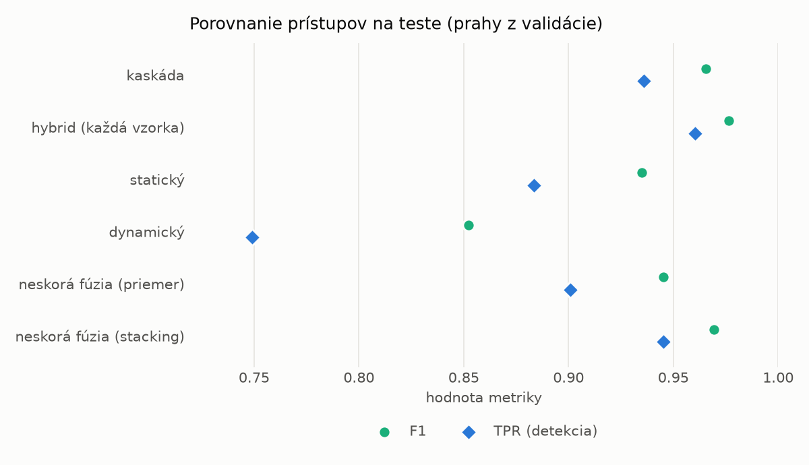
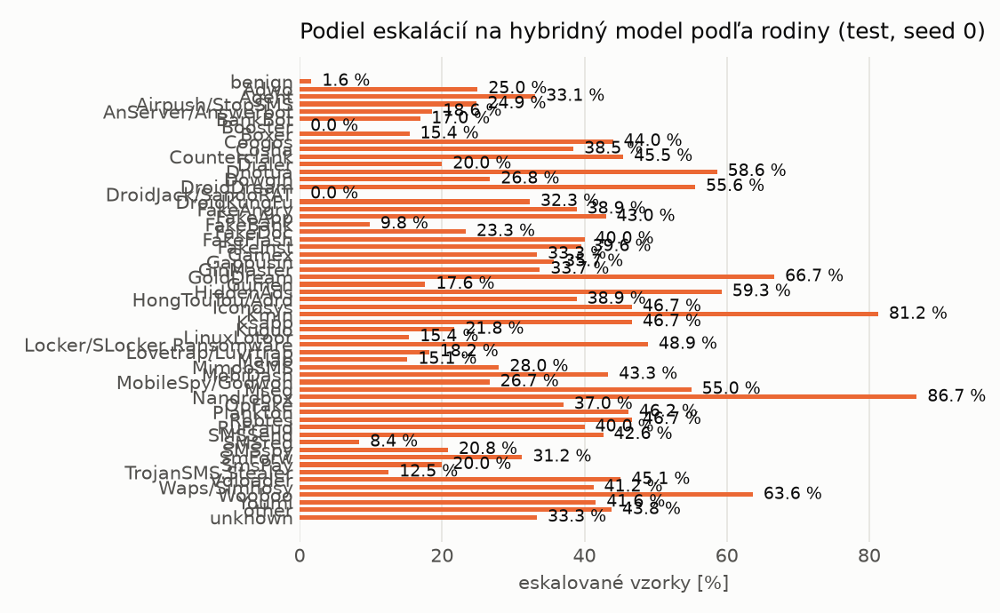

# Kaskáda `heavy` – beh `20261122-212752`

> Generované `src/cascade/evaluate.py` (2026-11-22T21:27:52+01:00). Seedy: [0, 1, 2]; hodnoty = priemer ± sm. odchýlka.
> Všetky prahy sú určené na validácii (FPR ≤ 1 %); test sa na nič nenastavuje.

| rola | beh |
|---|---|
| static | `runs_v4/real_full/full/students_static/mlp_kd/20261122-203423` |
| dynamic | `runs_v4/real_full/full/students_dynamic/mlp_kd/20261122-205301` |
| hybrid | `runs_v4/real_full/full/hybrid/mlp_large/20261122-201300` |

## Test
| prístup | accuracy | balanced_accuracy | precision | recall_tpr | fpr | f1 | mcc |
|---|---|---|---|---|---|---|---|
| kaskáda | 0.9647 ± 0.0018 | 0.9665 ± 0.0017 | 0.9972 ± 0.0004 | 0.9361 ± 0.0037 | 0.0030 ± 0.0005 | 0.9657 ± 0.0018 | 0.9315 ± 0.0033 |
| hybrid (každá vzorka) | 0.9756 ± 0.0013 | 0.9765 ± 0.0013 | 0.9934 ± 0.0006 | 0.9603 ± 0.0024 | 0.0072 ± 0.0006 | 0.9765 ± 0.0013 | 0.9517 ± 0.0026 |
| statický | 0.9348 ± 0.0031 | 0.9380 ± 0.0029 | 0.9927 ± 0.0004 | 0.8834 ± 0.0063 | 0.0073 ± 0.0005 | 0.9348 ± 0.0034 | 0.8760 ± 0.0056 |
| dynamický | 0.8626 ± 0.0048 | 0.8697 ± 0.0045 | 0.9886 ± 0.0005 | 0.7492 ± 0.0095 | 0.0098 ± 0.0006 | 0.8524 ± 0.0060 | 0.7529 ± 0.0076 |
| neskorá fúzia (priemer) | 0.9447 ± 0.0053 | 0.9475 ± 0.0050 | 0.9942 ± 0.0009 | 0.9008 ± 0.0108 | 0.0059 ± 0.0010 | 0.9452 ± 0.0056 | 0.8941 ± 0.0095 |
| neskorá fúzia (stacking) | 0.9682 ± 0.0009 | 0.9696 ± 0.0008 | 0.9945 ± 0.0013 | 0.9452 ± 0.0024 | 0.0059 ± 0.0014 | 0.9692 ± 0.0009 | 0.9377 ± 0.0016 |

## Validácia
| prístup | accuracy | balanced_accuracy | precision | recall_tpr | fpr | f1 | mcc |
|---|---|---|---|---|---|---|---|
| kaskáda | 0.9640 ± 0.0015 | 0.9657 ± 0.0015 | 0.9949 ± 0.0003 | 0.9368 ± 0.0028 | 0.0054 ± 0.0003 | 0.9649 ± 0.0015 | 0.9297 ± 0.0029 |
| hybrid (každá vzorka) | 0.9756 ± 0.0016 | 0.9765 ± 0.0015 | 0.9911 ± 0.0001 | 0.9626 ± 0.0031 | 0.0097 ± 0.0002 | 0.9767 ± 0.0016 | 0.9516 ± 0.0031 |
| statický | 0.9349 ± 0.0023 | 0.9380 ± 0.0022 | 0.9903 ± 0.0000 | 0.8857 ± 0.0044 | 0.0098 ± 0.0000 | 0.9351 ± 0.0025 | 0.8756 ± 0.0042 |
| dynamický | 0.8643 ± 0.0056 | 0.8713 ± 0.0053 | 0.9886 ± 0.0002 | 0.7524 ± 0.0105 | 0.0098 ± 0.0000 | 0.8545 ± 0.0069 | 0.7557 ± 0.0090 |
| neskorá fúzia (priemer) | 0.9396 ± 0.0054 | 0.9425 ± 0.0051 | 0.9904 ± 0.0001 | 0.8947 ± 0.0101 | 0.0098 ± 0.0000 | 0.9401 ± 0.0056 | 0.8842 ± 0.0097 |
| neskorá fúzia (stacking) | 0.9666 ± 0.0021 | 0.9680 ± 0.0020 | 0.9911 ± 0.0003 | 0.9456 ± 0.0037 | 0.0096 ± 0.0003 | 0.9678 ± 0.0021 | 0.9344 ± 0.0040 |

## Správanie kaskády (test, seed 0)
- podiel eskalácií na hybrid: **14.95%** (2336 vzoriek)
- chyby pri zhode študentov (kaskáda ich nemôže opraviť): **462**
  (3.477% zo zhôd; FP 1, FN 461)
- úspešnosť na eskalovaných vzorkách: hybrid 0.9533390410958904, statický 0.7564212328767124,
  dynamický 0.24357876712328766  → prínos hybridu pri nezhode

## Výpočtové nároky (odhad z benchmarkov komponentov)
| meranie | statický | dynamický | hybrid na každej vzorke | neskorá fúzia | kaskáda (odhad) |
|---|---|---|---|---|---|
| CPU čas ms/vz. (dávka) | 0.0476 | 0.0353 | 0.1148 | 0.0829 | 0.0996 |
| CPU čas ms/vz. (1 vz.) | 0.1442 | 0.1408 | 0.2782 | 0.2849 | 0.3254 |
| latencia ms (1 vz., postupne) | 0.0799 | 0.0790 | 0.1574 | 0.1589 | 0.1818 |

