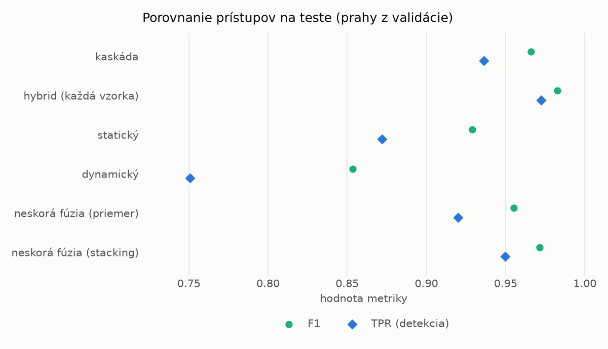
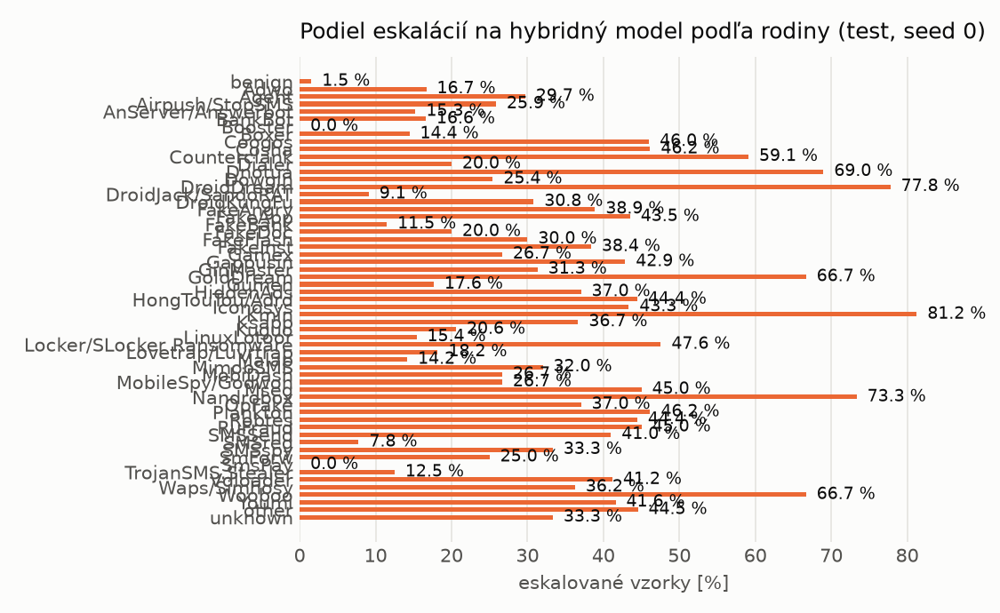

# Kaskáda `heavyteacher` – beh `20261122-212756`

> Generované `src/cascade/evaluate.py` (2026-11-22T21:27:56+01:00). Seedy: [0, 1, 2]; hodnoty = priemer ± sm. odchýlka.
> Všetky prahy sú určené na validácii (FPR ≤ 1 %); test sa na nič nenastavuje.

| rola | beh |
|---|---|
| static | `runs_v4/real_full/full/students_static/mlp_kd_heavy/20261122-204855` |
| dynamic | `runs_v4/real_full/full/students_dynamic/mlp_kd_heavy/20261122-211545` |
| hybrid | `runs_v4/real_full/full/hybrid/lightgbm/20261122-195127` |

## Test
| prístup | accuracy | balanced_accuracy | precision | recall_tpr | fpr | f1 | mcc |
|---|---|---|---|---|---|---|---|
| kaskáda | 0.9649 ± 0.0026 | 0.9668 ± 0.0025 | 0.9974 ± 0.0004 | 0.9362 ± 0.0052 | 0.0027 ± 0.0005 | 0.9659 ± 0.0027 | 0.9319 ± 0.0049 |
| hybrid (každá vzorka) | 0.9818 ± 0.0005 | 0.9824 ± 0.0005 | 0.9931 ± 0.0005 | 0.9724 ± 0.0006 | 0.0076 ± 0.0005 | 0.9826 ± 0.0005 | 0.9638 ± 0.0010 |
| statický | 0.9292 ± 0.0033 | 0.9328 ± 0.0030 | 0.9934 ± 0.0016 | 0.8721 ± 0.0077 | 0.0065 ± 0.0016 | 0.9288 ± 0.0037 | 0.8662 ± 0.0055 |
| dynamický | 0.8636 ± 0.0052 | 0.8707 ± 0.0049 | 0.9892 ± 0.0010 | 0.7507 ± 0.0107 | 0.0093 ± 0.0010 | 0.8536 ± 0.0066 | 0.7548 ± 0.0081 |
| neskorá fúzia (priemer) | 0.9543 ± 0.0018 | 0.9565 ± 0.0016 | 0.9934 ± 0.0010 | 0.9198 ± 0.0044 | 0.0068 ± 0.0011 | 0.9552 ± 0.0019 | 0.9116 ± 0.0032 |
| neskorá fúzia (stacking) | 0.9705 ± 0.0009 | 0.9717 ± 0.0009 | 0.9941 ± 0.0010 | 0.9498 ± 0.0026 | 0.0063 ± 0.0011 | 0.9715 ± 0.0010 | 0.9419 ± 0.0017 |

## Validácia
| prístup | accuracy | balanced_accuracy | precision | recall_tpr | fpr | f1 | mcc |
|---|---|---|---|---|---|---|---|
| kaskáda | 0.9646 ± 0.0024 | 0.9663 ± 0.0022 | 0.9952 ± 0.0003 | 0.9377 ± 0.0045 | 0.0051 ± 0.0003 | 0.9656 ± 0.0024 | 0.9310 ± 0.0045 |
| hybrid (každá vzorka) | 0.9807 ± 0.0001 | 0.9812 ± 0.0001 | 0.9914 ± 0.0002 | 0.9720 ± 0.0005 | 0.0095 ± 0.0003 | 0.9816 ± 0.0001 | 0.9615 ± 0.0002 |
| statický | 0.9280 ± 0.0063 | 0.9315 ± 0.0060 | 0.9901 ± 0.0001 | 0.8728 ± 0.0119 | 0.0098 ± 0.0000 | 0.9278 ± 0.0068 | 0.8634 ± 0.0112 |
| dynamický | 0.8680 ± 0.0051 | 0.8748 ± 0.0048 | 0.9887 ± 0.0001 | 0.7594 ± 0.0097 | 0.0098 ± 0.0000 | 0.8590 ± 0.0063 | 0.7617 ± 0.0083 |
| neskorá fúzia (priemer) | 0.9528 ± 0.0034 | 0.9549 ± 0.0032 | 0.9906 ± 0.0001 | 0.9196 ± 0.0063 | 0.0098 ± 0.0000 | 0.9538 ± 0.0035 | 0.9084 ± 0.0062 |
| neskorá fúzia (stacking) | 0.9684 ± 0.0018 | 0.9696 ± 0.0017 | 0.9909 ± 0.0000 | 0.9490 ± 0.0033 | 0.0098 ± 0.0000 | 0.9695 ± 0.0018 | 0.9377 ± 0.0034 |

## Správanie kaskády (test, seed 0)
- podiel eskalácií na hybrid: **14.51%** (2267 vzoriek)
- chyby pri zhode študentov (kaskáda ich nemôže opraviť): **467**
  (3.496% zo zhôd; FP 3, FN 464)
- úspešnosť na eskalovaných vzorkách: hybrid 0.9730921923246582, statický 0.7194530216144684,
  dynamický 0.28054697838553155  → prínos hybridu pri nezhode

## Výpočtové nároky (odhad z benchmarkov komponentov)
| meranie | statický | dynamický | hybrid na každej vzorke | neskorá fúzia | kaskáda (odhad) |
|---|---|---|---|---|---|
| CPU čas ms/vz. (dávka) | 0.0481 | 0.0354 | 0.1787 | 0.0835 | 0.1095 |
| CPU čas ms/vz. (1 vz.) | 0.1470 | 0.1439 | 0.1223 | 0.2909 | 0.3087 |
| latencia ms (1 vz., postupne) | 0.0793 | 0.0779 | 0.1271 | 0.1572 | 0.1757 |

