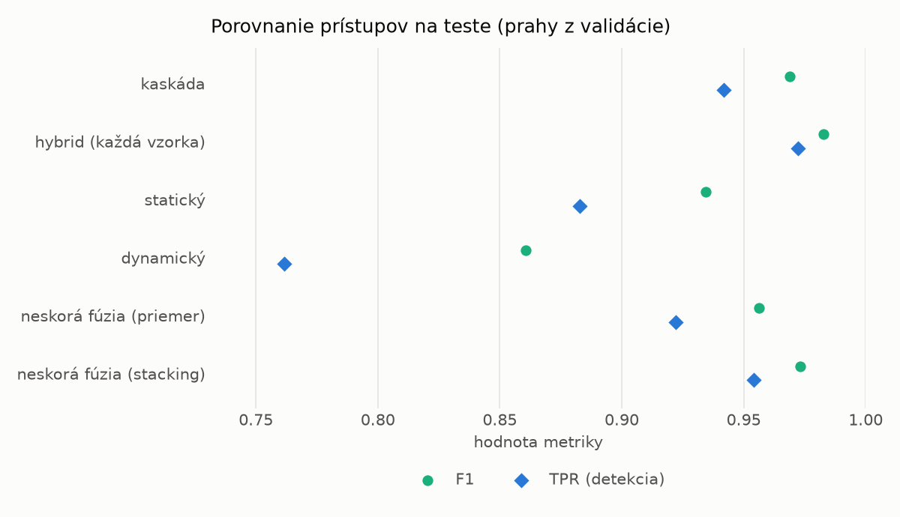
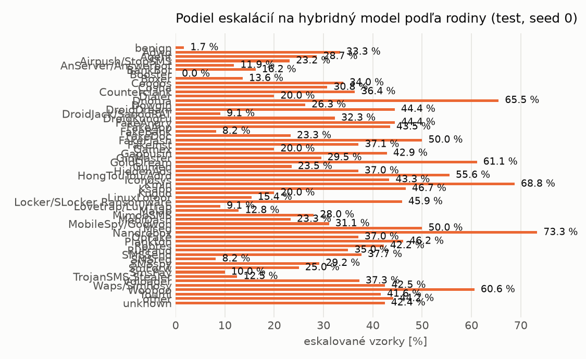

# Kaskáda `modal` – beh `20261122-212749`

> Generované `src/cascade/evaluate.py` (2026-11-22T21:27:50+01:00). Seedy: [0, 1, 2]; hodnoty = priemer ± sm. odchýlka.
> Všetky prahy sú určené na validácii (FPR ≤ 1 %); test sa na nič nenastavuje.

| rola | beh |
|---|---|
| static | `runs_v4/real_full/full/students_static/mlp_kd_modal/20261122-204432` |
| dynamic | `runs_v4/real_full/full/students_dynamic/mlp_kd_modal/20261122-210858` |
| hybrid | `runs_v4/real_full/full/hybrid/lightgbm/20261122-195127` |

## Test
| prístup | accuracy | balanced_accuracy | precision | recall_tpr | fpr | f1 | mcc |
|---|---|---|---|---|---|---|---|
| kaskáda | 0.9678 ± 0.0012 | 0.9695 ± 0.0012 | 0.9974 ± 0.0003 | 0.9417 ± 0.0021 | 0.0028 ± 0.0003 | 0.9687 ± 0.0012 | 0.9373 ± 0.0024 |
| hybrid (každá vzorka) | 0.9818 ± 0.0005 | 0.9824 ± 0.0005 | 0.9931 ± 0.0005 | 0.9724 ± 0.0006 | 0.0076 ± 0.0005 | 0.9826 ± 0.0005 | 0.9638 ± 0.0010 |
| statický | 0.9345 ± 0.0037 | 0.9378 ± 0.0034 | 0.9928 ± 0.0012 | 0.8829 ± 0.0081 | 0.0073 ± 0.0013 | 0.9346 ± 0.0040 | 0.8756 ± 0.0064 |
| dynamický | 0.8693 ± 0.0012 | 0.8761 ± 0.0011 | 0.9892 ± 0.0008 | 0.7615 ± 0.0025 | 0.0094 ± 0.0007 | 0.8605 ± 0.0014 | 0.7639 ± 0.0018 |
| neskorá fúzia (priemer) | 0.9554 ± 0.0032 | 0.9575 ± 0.0030 | 0.9933 ± 0.0014 | 0.9220 ± 0.0072 | 0.0070 ± 0.0015 | 0.9563 ± 0.0034 | 0.9135 ± 0.0059 |
| neskorá fúzia (stacking) | 0.9722 ± 0.0011 | 0.9733 ± 0.0010 | 0.9931 ± 0.0007 | 0.9541 ± 0.0023 | 0.0075 ± 0.0007 | 0.9732 ± 0.0011 | 0.9451 ± 0.0021 |

## Validácia
| prístup | accuracy | balanced_accuracy | precision | recall_tpr | fpr | f1 | mcc |
|---|---|---|---|---|---|---|---|
| kaskáda | 0.9675 ± 0.0009 | 0.9691 ± 0.0009 | 0.9958 ± 0.0001 | 0.9427 ± 0.0017 | 0.0044 ± 0.0002 | 0.9685 ± 0.0009 | 0.9366 ± 0.0017 |
| hybrid (každá vzorka) | 0.9807 ± 0.0001 | 0.9812 ± 0.0001 | 0.9914 ± 0.0002 | 0.9720 ± 0.0005 | 0.0095 ± 0.0003 | 0.9816 ± 0.0001 | 0.9615 ± 0.0002 |
| statický | 0.9337 ± 0.0043 | 0.9369 ± 0.0040 | 0.9903 ± 0.0001 | 0.8835 ± 0.0080 | 0.0098 ± 0.0000 | 0.9338 ± 0.0045 | 0.8735 ± 0.0076 |
| dynamický | 0.8709 ± 0.0018 | 0.8776 ± 0.0017 | 0.9888 ± 0.0000 | 0.7650 ± 0.0034 | 0.0098 ± 0.0000 | 0.8626 ± 0.0022 | 0.7664 ± 0.0029 |
| neskorá fúzia (priemer) | 0.9532 ± 0.0049 | 0.9553 ± 0.0046 | 0.9906 ± 0.0001 | 0.9204 ± 0.0093 | 0.0098 ± 0.0000 | 0.9542 ± 0.0050 | 0.9092 ± 0.0091 |
| neskorá fúzia (stacking) | 0.9713 ± 0.0019 | 0.9724 ± 0.0018 | 0.9910 ± 0.0000 | 0.9546 ± 0.0036 | 0.0098 ± 0.0000 | 0.9724 ± 0.0019 | 0.9433 ± 0.0037 |

## Správanie kaskády (test, seed 0)
- podiel eskalácií na hybrid: **14.01%** (2189 vzoriek)
- chyby pri zhode študentov (kaskáda ich nemôže opraviť): **414**
  (3.081% zo zhôd; FP 3, FN 411)
- úspešnosť na eskalovaných vzorkách: hybrid 0.968478757423481, statický 0.7523983554134308,
  dynamický 0.24760164458656922  → prínos hybridu pri nezhode

## Výpočtové nároky (odhad z benchmarkov komponentov)
| meranie | statický | dynamický | hybrid na každej vzorke | neskorá fúzia | kaskáda (odhad) |
|---|---|---|---|---|---|
| CPU čas ms/vz. (dávka) | 0.0460 | 0.0355 | 0.1787 | 0.0815 | 0.1067 |
| CPU čas ms/vz. (1 vz.) | 0.1397 | 0.1386 | 0.1223 | 0.2783 | 0.2956 |
| latencia ms (1 vz., postupne) | 0.0785 | 0.0781 | 0.1271 | 0.1566 | 0.1746 |

