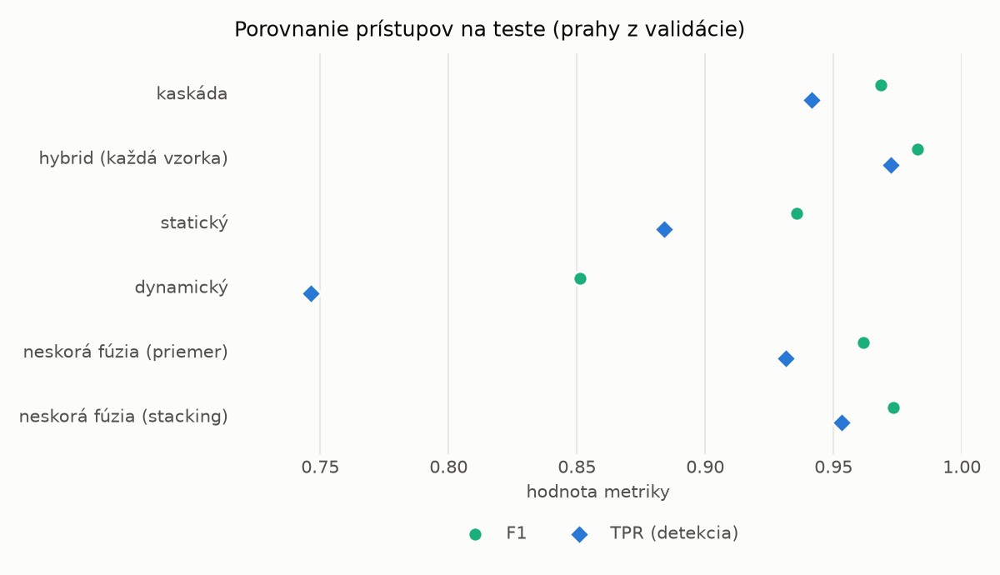
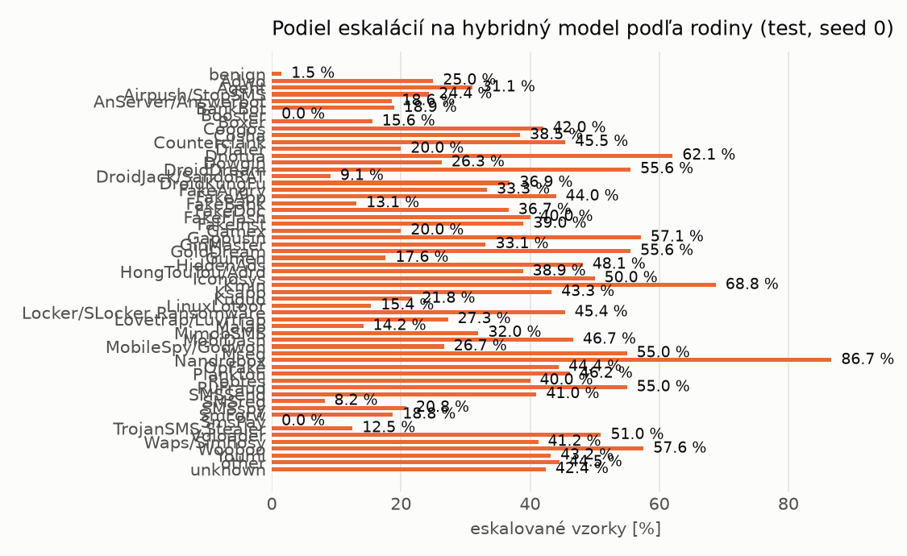

# Kaskáda `nokd` – beh `20261122-212747`

> Generované `src/cascade/evaluate.py` (2026-11-22T21:27:48+01:00). Seedy: [0, 1, 2]; hodnoty = priemer ± sm. odchýlka.
> Všetky prahy sú určené na validácii (FPR ≤ 1 %); test sa na nič nenastavuje.

| rola | beh |
|---|---|
| static | `runs_v4/real_full/full/students_static/mlp_nokd/20261122-203844` |
| dynamic | `runs_v4/real_full/full/students_dynamic/mlp_nokd/20261122-205917` |
| hybrid | `runs_v4/real_full/full/hybrid/lightgbm/20261122-195127` |

## Test
| prístup | accuracy | balanced_accuracy | precision | recall_tpr | fpr | f1 | mcc |
|---|---|---|---|---|---|---|---|
| kaskáda | 0.9676 ± 0.0038 | 0.9693 ± 0.0037 | 0.9973 ± 0.0003 | 0.9415 ± 0.0070 | 0.0029 ± 0.0003 | 0.9686 ± 0.0039 | 0.9369 ± 0.0073 |
| hybrid (každá vzorka) | 0.9818 ± 0.0005 | 0.9824 ± 0.0005 | 0.9931 ± 0.0005 | 0.9724 ± 0.0006 | 0.0076 ± 0.0005 | 0.9826 ± 0.0005 | 0.9638 ± 0.0010 |
| statický | 0.9355 ± 0.0070 | 0.9388 ± 0.0066 | 0.9934 ± 0.0003 | 0.8841 ± 0.0134 | 0.0066 ± 0.0003 | 0.9356 ± 0.0075 | 0.8775 ± 0.0124 |
| dynamický | 0.8618 ± 0.0036 | 0.8691 ± 0.0033 | 0.9903 ± 0.0018 | 0.7465 ± 0.0079 | 0.0083 ± 0.0016 | 0.8512 ± 0.0046 | 0.7524 ± 0.0052 |
| neskorá fúzia (priemer) | 0.9604 ± 0.0002 | 0.9623 ± 0.0002 | 0.9934 ± 0.0007 | 0.9315 ± 0.0010 | 0.0069 ± 0.0007 | 0.9615 ± 0.0003 | 0.9229 ± 0.0004 |
| neskorá fúzia (stacking) | 0.9723 ± 0.0012 | 0.9735 ± 0.0010 | 0.9944 ± 0.0024 | 0.9530 ± 0.0046 | 0.0061 ± 0.0026 | 0.9733 ± 0.0013 | 0.9454 ± 0.0022 |

## Validácia
| prístup | accuracy | balanced_accuracy | precision | recall_tpr | fpr | f1 | mcc |
|---|---|---|---|---|---|---|---|
| kaskáda | 0.9670 ± 0.0034 | 0.9686 ± 0.0032 | 0.9956 ± 0.0004 | 0.9419 ± 0.0060 | 0.0047 ± 0.0004 | 0.9680 ± 0.0033 | 0.9355 ± 0.0064 |
| hybrid (každá vzorka) | 0.9807 ± 0.0001 | 0.9812 ± 0.0001 | 0.9914 ± 0.0002 | 0.9720 ± 0.0005 | 0.0095 ± 0.0003 | 0.9816 ± 0.0001 | 0.9615 ± 0.0002 |
| statický | 0.9325 ± 0.0097 | 0.9358 ± 0.0092 | 0.9903 ± 0.0000 | 0.8812 ± 0.0185 | 0.0097 ± 0.0002 | 0.9325 ± 0.0104 | 0.8715 ± 0.0173 |
| dynamický | 0.8650 ± 0.0043 | 0.8720 ± 0.0040 | 0.9886 ± 0.0001 | 0.7538 ± 0.0081 | 0.0098 ± 0.0000 | 0.8554 ± 0.0052 | 0.7568 ± 0.0069 |
| neskorá fúzia (priemer) | 0.9596 ± 0.0009 | 0.9614 ± 0.0009 | 0.9908 ± 0.0000 | 0.9325 ± 0.0017 | 0.0098 ± 0.0000 | 0.9608 ± 0.0009 | 0.9211 ± 0.0017 |
| neskorá fúzia (stacking) | 0.9711 ± 0.0022 | 0.9722 ± 0.0021 | 0.9910 ± 0.0001 | 0.9540 ± 0.0043 | 0.0097 ± 0.0002 | 0.9722 ± 0.0022 | 0.9428 ± 0.0043 |

## Správanie kaskády (test, seed 0)
- podiel eskalácií na hybrid: **14.74%** (2303 vzoriek)
- chyby pri zhode študentov (kaskáda ich nemôže opraviť): **399**
  (2.995% zo zhôd; FP 2, FN 397)
- úspešnosť na eskalovaných vzorkách: hybrid 0.9674337820234477, statický 0.7694311767260096,
  dynamický 0.23056882327399045  → prínos hybridu pri nezhode

## Výpočtové nároky (odhad z benchmarkov komponentov)
| meranie | statický | dynamický | hybrid na každej vzorke | neskorá fúzia | kaskáda (odhad) |
|---|---|---|---|---|---|
| CPU čas ms/vz. (dávka) | 0.0478 | 0.0356 | 0.1787 | 0.0834 | 0.1097 |
| CPU čas ms/vz. (1 vz.) | 0.1341 | 0.1334 | 0.1223 | 0.2675 | 0.2856 |
| latencia ms (1 vz., postupne) | 0.0787 | 0.0783 | 0.1271 | 0.1570 | 0.1757 |

