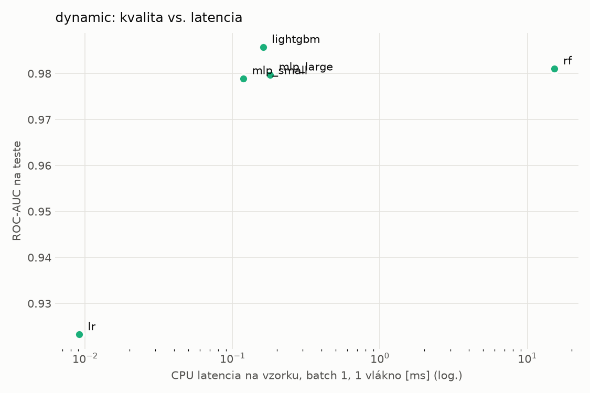
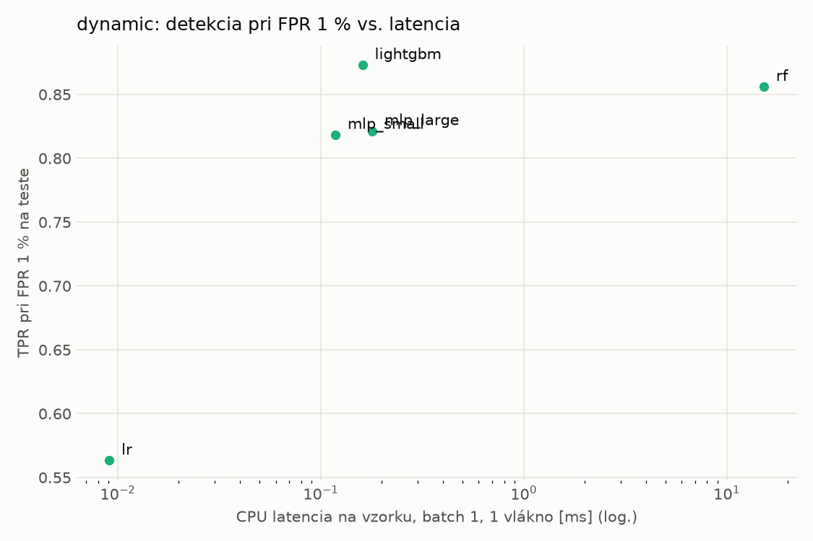
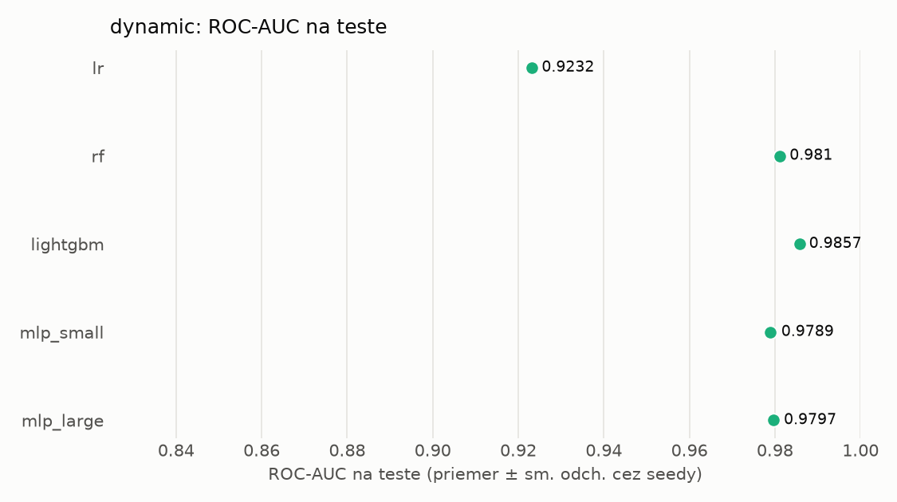
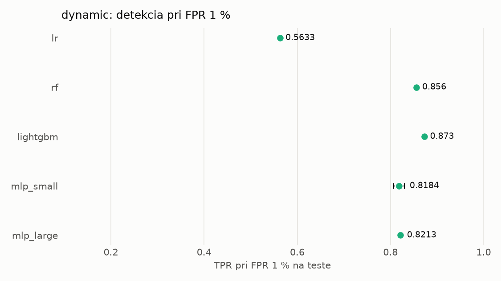

# Porovnanie modelov – dynamic

> Generované `src/evaluation/compare.py` (2026-11-22T19:49:58+01:00); použitý je posledný beh každého modelu.
> Metriky sú priemer cez seedy. \* = pri prahu určenom na validácii (FPR ≤ 1 %).
> CPU ms/vz. = medián latencie jednej vzorky na 1 vlákne vrátane transformácie vstupu (meranie hneď po tréningu,
> orientačné). Oficiálne merania spotreby sú v časti „Spotreba zdrojov pri inferencii“.

## Detekčná kvalita a orientačné časy
| model | ROC-AUC val | ROC-AUC test | TPR@FPR 1 % test | TPR@FPR 0,1 % test | F1 test* | FPR test* | gap train−val | CPU ms/vz. | CPU vz./s | GPU ms/vz. | parametre | MB | tréning s | ladenie min |
|---|---|---|---|---|---|---|---|---|---|---|---|---|---|---|
| [lr](../../dynamic/lr/20261122-191725/README.md) | 0.9207 | 0.9232 ± 0.0000 | 0.5633 | 0.4604 | 0.7224 | 0.0114 | 0.0049 | 0.009 | 3 808 932 | – | 132 | 0.01 | 0.4 | 0.1 |
| [rf](../../dynamic/rf/20261122-191738/README.md) | 0.9797 | 0.9810 ± 0.0001 | 0.8560 | 0.7570 | 0.9118 | 0.0078 | 0.0194 | 15.262 | 116 486 | – | 4 585 180 | 367.23 | 3.6 | 1.2 |
| [lightgbm](../../dynamic/lightgbm/20261122-191914/README.md) | 0.9848 | 0.9857 ± 0.0000 | 0.8730 | 0.7717 | 0.9259 | 0.0090 | 0.0143 | 0.161 | 86 304 | – | 434 868 | 23.89 | 17.2 | 11.9 |
| [mlp_small](../../dynamic/mlp_small/20261122-193213/README.md) | 0.9773 | 0.9789 ± 0.0003 | 0.8184 | 0.6433 | 0.8848 | 0.0074 | 0.0103 | 0.118 | 2 151 226 | 0.660 | 67 585 | 0.28 | 19.5 | 10.1 |
| [mlp_large](../../dynamic/mlp_large/20261122-194320/README.md) | 0.9786 | 0.9797 ± 0.0001 | 0.8213 | 0.6540 | 0.8882 | 0.0073 | 0.0106 | 0.180 | 652 175 | 0.546 | 596 481 | 2.41 | 5.5 | 6.3 |

## Nízka prevalencia malvéru (test, prah z validácie)
| model | TPR | FPR | precision @ 1 % | falošné na 1 skutočný poplach @ 1 % | precision @ 0.1 % | falošné na 1 skutočný poplach @ 0.1 % |
|---|---|---|---|---|---|---|
| lr | 0.5711 | 0.0114 | 0.335 | 1.98 | 0.048 | 19.99 |
| rf | 0.8437 | 0.0078 | 0.522 | 0.92 | 0.098 | 9.24 |
| lightgbm | 0.8688 | 0.0090 | 0.494 | 1.02 | 0.088 | 10.32 |
| mlp_small | 0.7987 | 0.0074 | 0.522 | 0.92 | 0.098 | 9.25 |
| mlp_large | 0.8040 | 0.0073 | 0.528 | 0.89 | 0.100 | 9.02 |

Prepočet: TPR a FPR nezávisia od podielu malvéru, preto sa dajú preniesť na nízku prevalenciu (v reálnej prevádzke je malvéru ~1 % alebo menej; v teste 54 %). „Falošné na 1 skutočný poplach“ = koľko neškodných súborov je označených na každý zachytený malvér.

## Spotreba zdrojov pri inferencii (benchmark, testovacia množina)
_Benchmark zatiaľ nebol spustený (`python -m src.evaluation.benchmark --approach dynamic`)._

## Grafy

