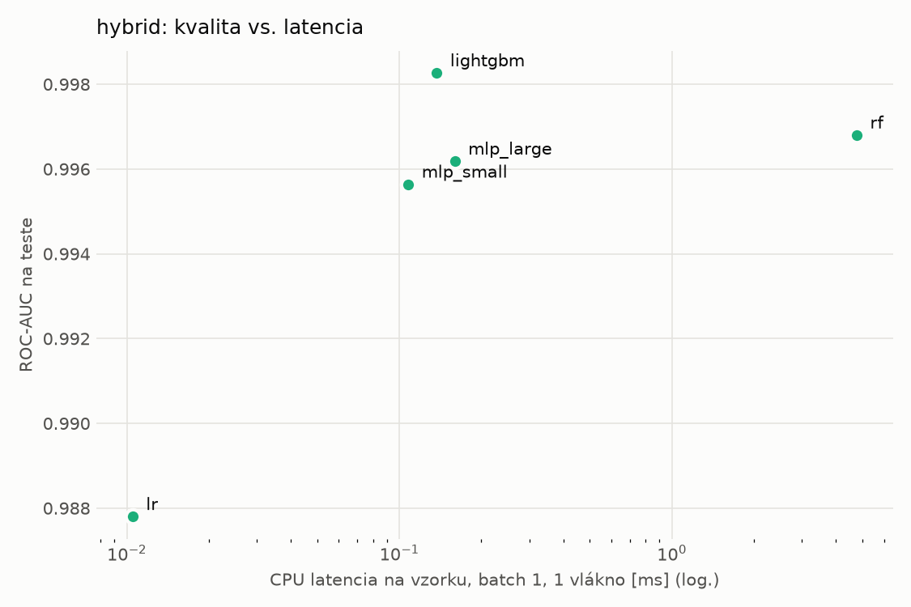
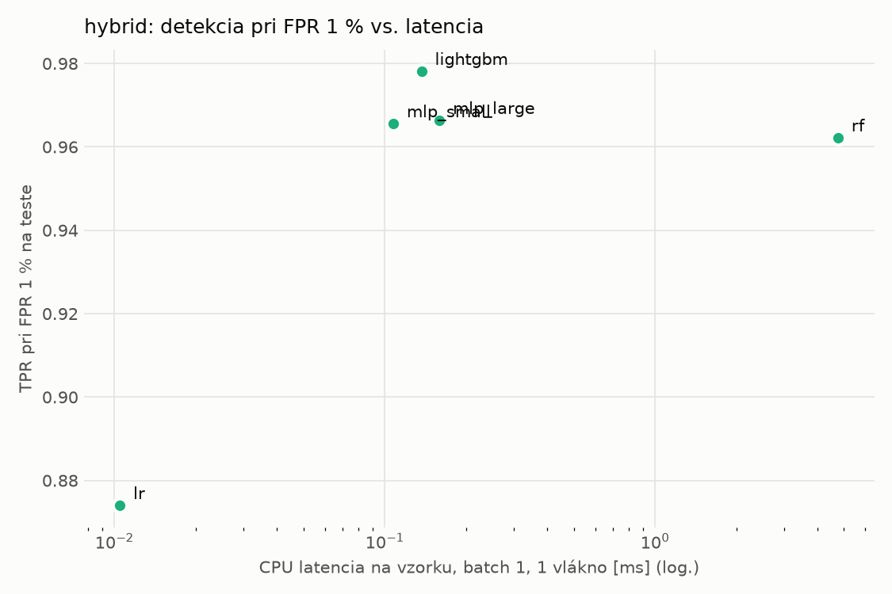
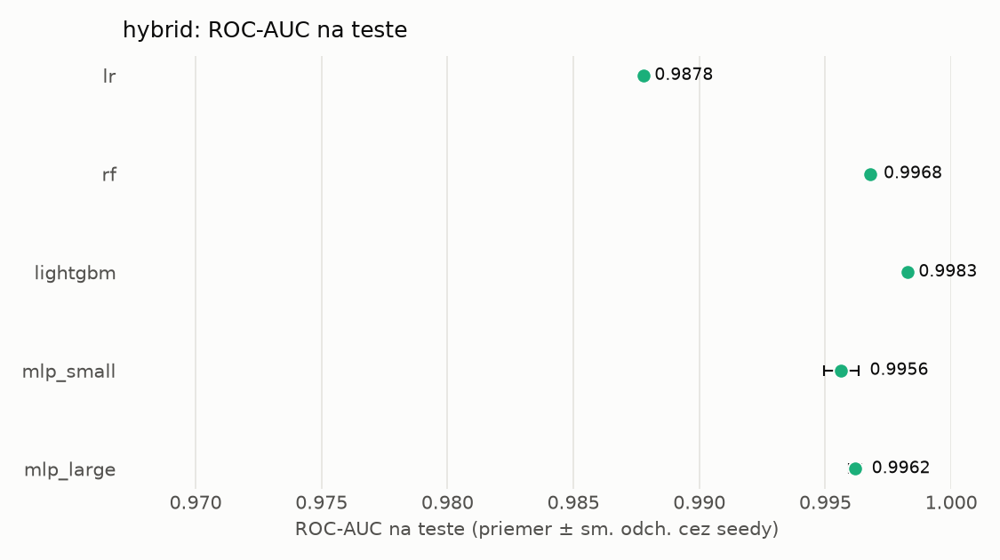
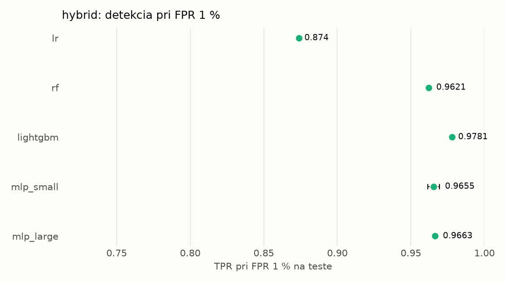

# Porovnanie modelov – hybrid

> Generované `src/evaluation/compare.py` (2026-11-22T20:18:23+01:00); použitý je posledný beh každého modelu.
> Metriky sú priemer cez seedy. \* = pri prahu určenom na validácii (FPR ≤ 1 %).
> CPU ms/vz. = medián latencie jednej vzorky na 1 vlákne vrátane transformácie vstupu (meranie hneď po tréningu,
> orientačné). Oficiálne merania spotreby sú v časti „Spotreba zdrojov pri inferencii“.

## Detekčná kvalita a orientačné časy
| model | ROC-AUC val | ROC-AUC test | TPR@FPR 1 % test | TPR@FPR 0,1 % test | F1 test* | FPR test* | gap train−val | CPU ms/vz. | CPU vz./s | GPU ms/vz. | parametre | MB | tréning s | ladenie min |
|---|---|---|---|---|---|---|---|---|---|---|---|---|---|---|
| [lr](../../hybrid/lr/20261122-195001/README.md) | 0.9869 | 0.9878 ± 0.0000 | 0.8740 | 0.6184 | 0.9256 | 0.0097 | 0.0020 | 0.010 | 2 158 805 | – | 296 | 0.01 | 0.4 | 0.1 |
| [rf](../../hybrid/rf/20261122-195013/README.md) | 0.9962 | 0.9968 ± 0.0001 | 0.9621 | 0.9109 | 0.9737 | 0.0064 | 0.0038 | 4.760 | 243 821 | – | 790 326 | 63.51 | 1.5 | 1.1 |
| [lightgbm](../../hybrid/lightgbm/20261122-195127/README.md) | 0.9975 | 0.9983 ± 0.0000 | 0.9781 | 0.9330 | 0.9826 | 0.0076 | 0.0025 | 0.137 | 108 719 | – | 357 120 | 19.88 | 19.1 | 15.8 |
| [mlp_small](../../hybrid/mlp_small/20261122-200826/README.md) | 0.9950 | 0.9956 ± 0.0007 | 0.9655 | 0.8821 | 0.9756 | 0.0080 | 0.0041 | 0.108 | 1 081 547 | 0.594 | 109 569 | 0.45 | 9.8 | 4.0 |
| [mlp_large](../../hybrid/mlp_large/20261122-201300/README.md) | 0.9952 | 0.9962 ± 0.0002 | 0.9663 | 0.8937 | 0.9765 | 0.0072 | 0.0038 | 0.160 | 568 790 | 0.464 | 317 697 | 1.29 | 13.7 | 4.6 |

## Nízka prevalencia malvéru (test, prah z validácie)
| model | TPR | FPR | precision @ 1 % | falošné na 1 skutočný poplach @ 1 % | precision @ 0.1 % | falošné na 1 skutočný poplach @ 0.1 % |
|---|---|---|---|---|---|---|
| lr | 0.8689 | 0.0097 | 0.476 | 1.10 | 0.083 | 11.11 |
| rf | 0.9541 | 0.0064 | 0.601 | 0.66 | 0.130 | 6.70 |
| lightgbm | 0.9724 | 0.0076 | 0.565 | 0.77 | 0.114 | 7.78 |
| mlp_small | 0.9592 | 0.0080 | 0.548 | 0.82 | 0.107 | 8.31 |
| mlp_large | 0.9603 | 0.0072 | 0.574 | 0.74 | 0.118 | 7.50 |

Prepočet: TPR a FPR nezávisia od podielu malvéru, preto sa dajú preniesť na nízku prevalenciu (v reálnej prevádzke je malvéru ~1 % alebo menej; v teste 54 %). „Falošné na 1 skutočný poplach“ = koľko neškodných súborov je označených na každý zachytený malvér.

## Spotreba zdrojov pri inferencii (benchmark, testovacia množina)
_Benchmark zatiaľ nebol spustený (`python -m src.evaluation.benchmark --approach hybrid`)._

## Grafy

