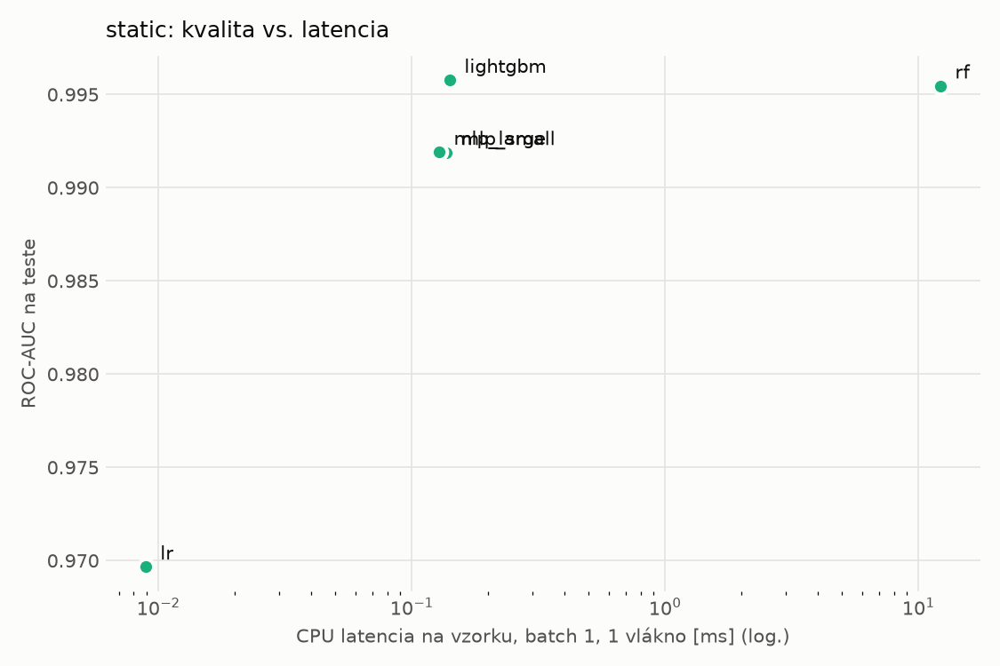
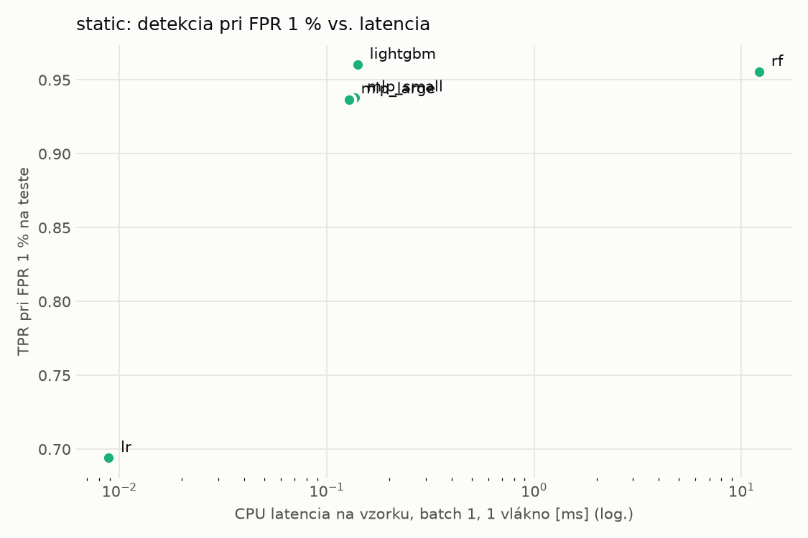
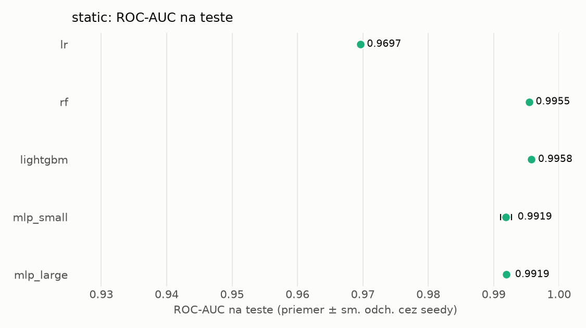
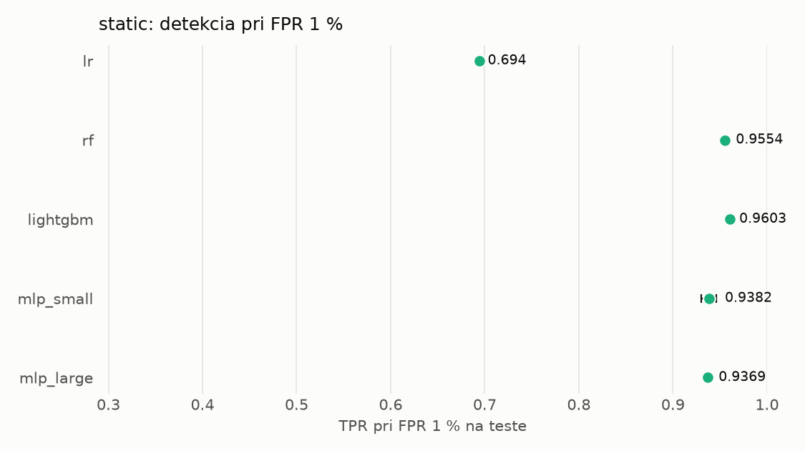

# Porovnanie modelov – static

> Generované `src/evaluation/compare.py` (2026-11-22T19:15:11+01:00); použitý je posledný beh každého modelu.
> Metriky sú priemer cez seedy. \* = pri prahu určenom na validácii (FPR ≤ 1 %).
> CPU ms/vz. = medián latencie jednej vzorky na 1 vlákne vrátane transformácie vstupu (meranie hneď po tréningu,
> orientačné). Oficiálne merania spotreby sú v časti „Spotreba zdrojov pri inferencii“.

## Detekčná kvalita a orientačné časy
| model | ROC-AUC val | ROC-AUC test | TPR@FPR 1 % test | TPR@FPR 0,1 % test | F1 test* | FPR test* | gap train−val | CPU ms/vz. | CPU vz./s | GPU ms/vz. | parametre | MB | tréning s | ladenie min |
|---|---|---|---|---|---|---|---|---|---|---|---|---|---|---|
| [lr](../../static/lr/20261122-184714/README.md) | 0.9687 | 0.9697 ± 0.0000 | 0.6940 | 0.2344 | 0.7747 | 0.0082 | 0.0034 | 0.009 | 3 855 169 | – | 165 | 0.01 | 0.2 | 0.1 |
| [rf](../../static/rf/20261122-184723/README.md) | 0.9945 | 0.9955 ± 0.0000 | 0.9554 | 0.8787 | 0.9669 | 0.0059 | 0.0055 | 12.189 | 151 388 | – | 2 643 426 | 211.85 | 2.2 | 0.8 |
| [lightgbm](../../static/lightgbm/20261122-184829/README.md) | 0.9950 | 0.9958 ± 0.0001 | 0.9603 | 0.8542 | 0.9695 | 0.0062 | 0.0050 | 0.141 | 106 000 | – | 498 553 | 27.62 | 13.4 | 12.1 |
| [mlp_small](../../static/mlp_small/20261122-190134/README.md) | 0.9915 | 0.9919 ± 0.0008 | 0.9382 | 0.7139 | 0.9513 | 0.0073 | 0.0067 | 0.137 | 1 044 242 | 0.658 | 76 033 | 0.32 | 12.7 | 6.0 |
| [mlp_large](../../static/mlp_large/20261122-190815/README.md) | 0.9918 | 0.9919 ± 0.0004 | 0.9369 | 0.7349 | 0.9477 | 0.0059 | 0.0062 | 0.128 | 786 856 | 0.502 | 250 625 | 1.02 | 14.4 | 6.2 |

## Nízka prevalencia malvéru (test, prah z validácie)
| model | TPR | FPR | precision @ 1 % | falošné na 1 skutočný poplach @ 1 % | precision @ 0.1 % | falošné na 1 skutočný poplach @ 0.1 % |
|---|---|---|---|---|---|---|
| lr | 0.6369 | 0.0082 | 0.441 | 1.27 | 0.072 | 12.81 |
| rf | 0.9408 | 0.0059 | 0.617 | 0.62 | 0.138 | 6.26 |
| lightgbm | 0.9459 | 0.0062 | 0.608 | 0.65 | 0.133 | 6.51 |
| mlp_small | 0.9129 | 0.0073 | 0.560 | 0.79 | 0.112 | 7.94 |
| mlp_large | 0.9054 | 0.0059 | 0.608 | 0.64 | 0.133 | 6.51 |

Prepočet: TPR a FPR nezávisia od podielu malvéru, preto sa dajú preniesť na nízku prevalenciu (v reálnej prevádzke je malvéru ~1 % alebo menej; v teste 54 %). „Falošné na 1 skutočný poplach“ = koľko neškodných súborov je označených na každý zachytený malvér.

## Spotreba zdrojov pri inferencii (benchmark, testovacia množina)
_Benchmark zatiaľ nebol spustený (`python -m src.evaluation.benchmark --approach static`)._

## Grafy

