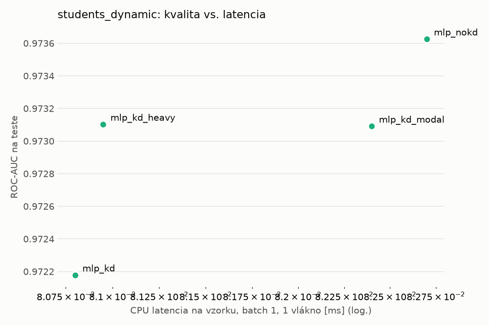
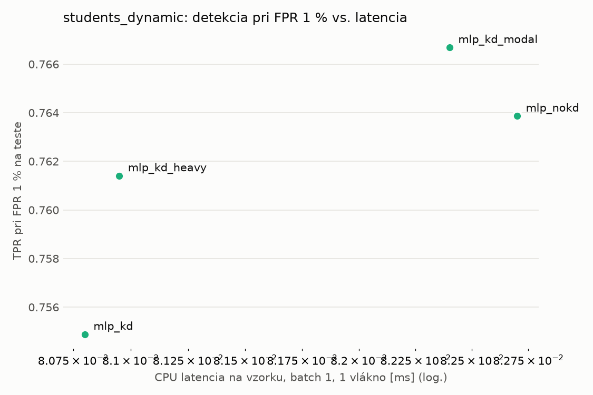
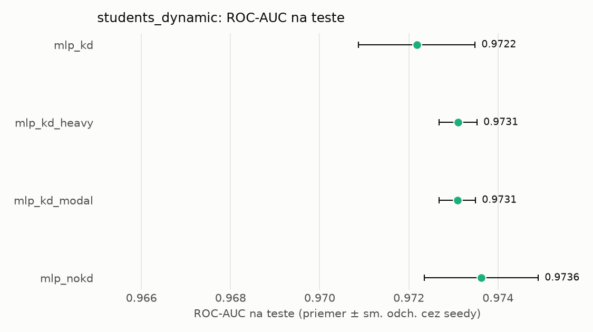
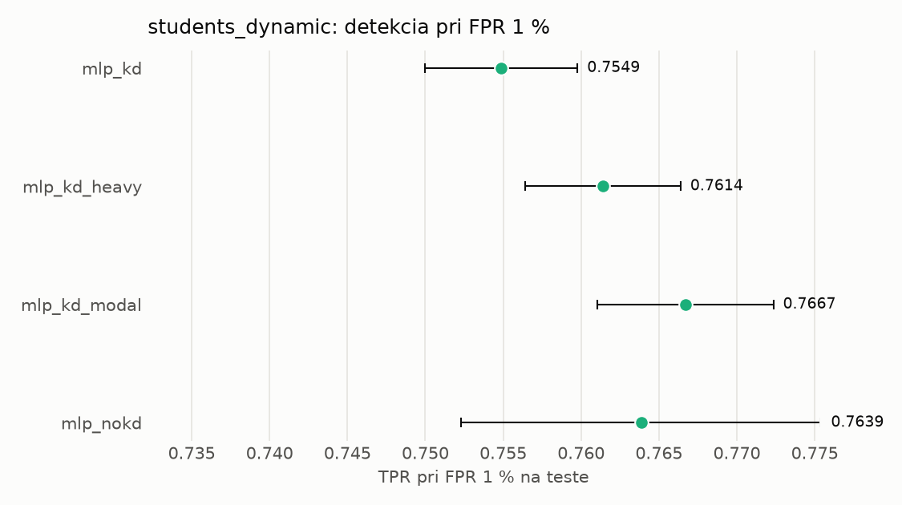

# Porovnanie modelov – students_dynamic

> Generované `src/evaluation/compare.py` (2026-11-22T21:24:29+01:00); použitý je posledný beh každého modelu.
> Metriky sú priemer cez seedy. \* = pri prahu určenom na validácii (FPR ≤ 1 %).
> CPU ms/vz. = medián latencie jednej vzorky na 1 vlákne vrátane transformácie vstupu (meranie hneď po tréningu,
> orientačné). Oficiálne merania spotreby sú v časti „Spotreba zdrojov pri inferencii“.

## Detekčná kvalita a orientačné časy
| model | ROC-AUC val | ROC-AUC test | TPR@FPR 1 % test | TPR@FPR 0,1 % test | F1 test* | FPR test* | gap train−val | CPU ms/vz. | CPU vz./s | GPU ms/vz. | parametre | MB | tréning s | ladenie min |
|---|---|---|---|---|---|---|---|---|---|---|---|---|---|---|
| [mlp_kd](../../students_dynamic/mlp_kd/20261122-205301/README.md) | 0.9698 | 0.9722 ± 0.0013 | 0.7549 | 0.5760 | 0.8524 | 0.0098 | 0.0065 | 0.081 | 6 561 542 | 0.270 | 8 641 | 0.04 | 13.2 | 5.6 |
| [mlp_kd_heavy](../../students_dynamic/mlp_kd_heavy/20261122-211545/README.md) | 0.9708 | 0.9731 ± 0.0004 | 0.7614 | 0.5614 | 0.8536 | 0.0093 | 0.0079 | 0.081 | 8 295 286 | 0.270 | 8 641 | 0.04 | 24.4 | 7.5 |
| [mlp_kd_modal](../../students_dynamic/mlp_kd_modal/20261122-210858/README.md) | 0.9716 | 0.9731 ± 0.0004 | 0.7667 | 0.5697 | 0.8605 | 0.0094 | 0.0061 | 0.082 | 5 830 877 | 0.452 | 8 641 | 0.04 | 14.0 | 6.0 |
| [mlp_nokd](../../students_dynamic/mlp_nokd/20261122-205917/README.md) | 0.9710 | 0.9736 ± 0.0013 | 0.7639 | 0.5711 | 0.8512 | 0.0083 | 0.0086 | 0.083 | 6 024 213 | 0.281 | 8 641 | 0.04 | 19.7 | 8.7 |

## Nízka prevalencia malvéru (test, prah z validácie)
| model | TPR | FPR | precision @ 1 % | falošné na 1 skutočný poplach @ 1 % | precision @ 0.1 % | falošné na 1 skutočný poplach @ 0.1 % |
|---|---|---|---|---|---|---|
| mlp_kd | 0.7492 | 0.0098 | 0.437 | 1.29 | 0.071 | 13.00 |
| mlp_kd_heavy | 0.7507 | 0.0093 | 0.450 | 1.22 | 0.075 | 12.31 |
| mlp_kd_modal | 0.7615 | 0.0094 | 0.450 | 1.22 | 0.075 | 12.32 |
| mlp_nokd | 0.7465 | 0.0083 | 0.477 | 1.09 | 0.083 | 11.05 |

Prepočet: TPR a FPR nezávisia od podielu malvéru, preto sa dajú preniesť na nízku prevalenciu (v reálnej prevádzke je malvéru ~1 % alebo menej; v teste 54 %). „Falošné na 1 skutočný poplach“ = koľko neškodných súborov je označených na každý zachytený malvér.

## Spotreba zdrojov pri inferencii (benchmark, testovacia množina)
_Benchmark zatiaľ nebol spustený (`python -m src.evaluation.benchmark --approach students_dynamic`)._

## Grafy

