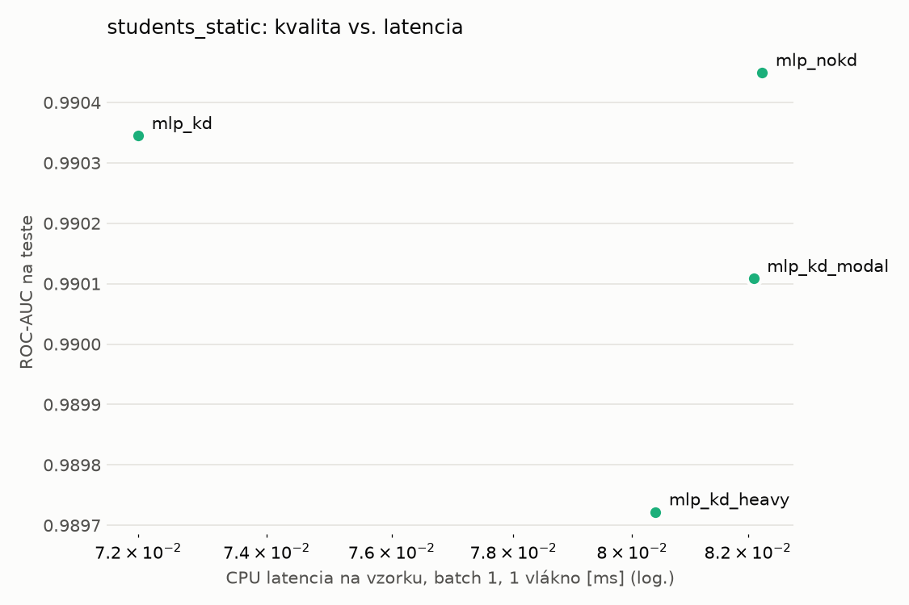
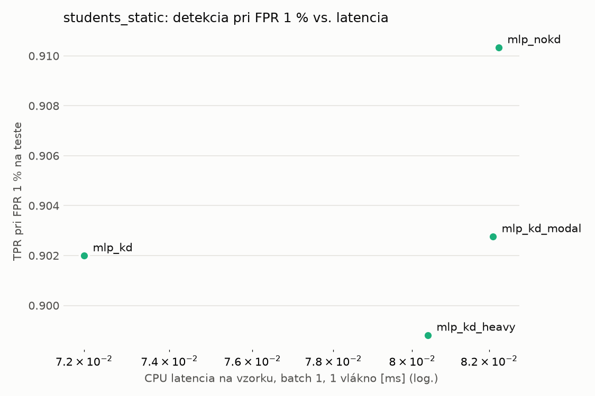
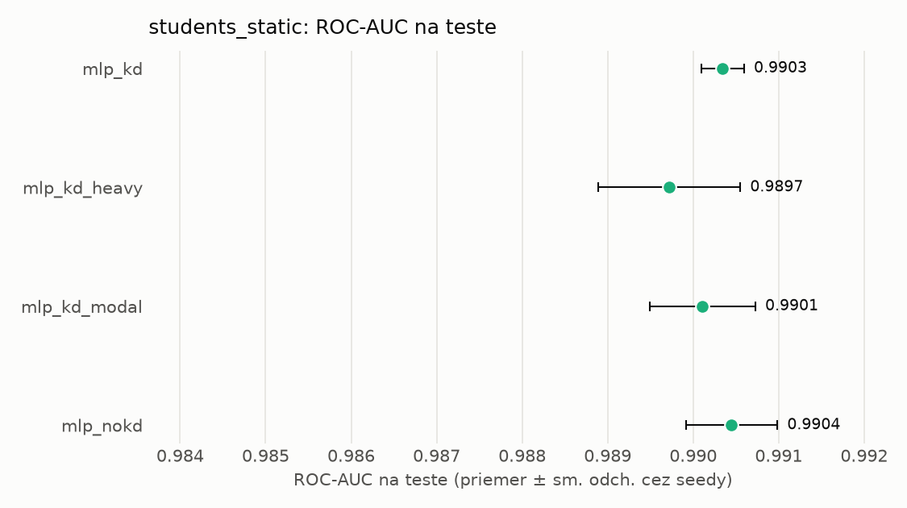
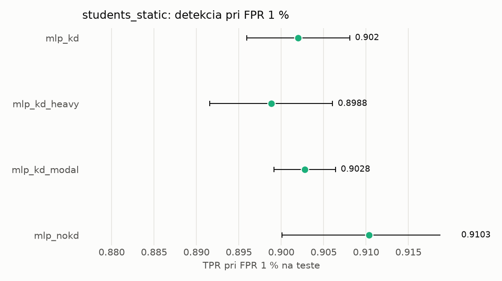

# Porovnanie modelov – students_static

> Generované `src/evaluation/compare.py` (2026-11-22T20:52:58+01:00); použitý je posledný beh každého modelu.
> Metriky sú priemer cez seedy. \* = pri prahu určenom na validácii (FPR ≤ 1 %).
> CPU ms/vz. = medián latencie jednej vzorky na 1 vlákne vrátane transformácie vstupu (meranie hneď po tréningu,
> orientačné). Oficiálne merania spotreby sú v časti „Spotreba zdrojov pri inferencii“.

## Detekčná kvalita a orientačné časy
| model | ROC-AUC val | ROC-AUC test | TPR@FPR 1 % test | TPR@FPR 0,1 % test | F1 test* | FPR test* | gap train−val | CPU ms/vz. | CPU vz./s | GPU ms/vz. | parametre | MB | tréning s | ladenie min |
|---|---|---|---|---|---|---|---|---|---|---|---|---|---|---|
| [mlp_kd](../../students_static/mlp_kd/20261122-203423/README.md) | 0.9896 | 0.9903 ± 0.0003 | 0.9020 | 0.6682 | 0.9348 | 0.0073 | 0.0052 | 0.072 | 3 184 097 | 0.279 | 10 753 | 0.05 | 5.2 | 4.1 |
| [mlp_kd_heavy](../../students_static/mlp_kd_heavy/20261122-204855/README.md) | 0.9887 | 0.9897 ± 0.0008 | 0.8988 | 0.7441 | 0.9288 | 0.0065 | 0.0055 | 0.080 | 2 622 172 | 0.475 | 10 753 | 0.05 | 4.8 | 3.8 |
| [mlp_kd_modal](../../students_static/mlp_kd_modal/20261122-204432/README.md) | 0.9895 | 0.9901 ± 0.0006 | 0.9028 | 0.7105 | 0.9346 | 0.0073 | 0.0044 | 0.082 | 3 639 731 | 0.286 | 10 753 | 0.05 | 5.9 | 4.1 |
| [mlp_nokd](../../students_static/mlp_nokd/20261122-203844/README.md) | 0.9894 | 0.9904 ± 0.0005 | 0.9103 | 0.5952 | 0.9356 | 0.0066 | 0.0064 | 0.082 | 3 324 468 | 0.457 | 10 753 | 0.05 | 14.5 | 5.0 |

## Nízka prevalencia malvéru (test, prah z validácie)
| model | TPR | FPR | precision @ 1 % | falošné na 1 skutočný poplach @ 1 % | precision @ 0.1 % | falošné na 1 skutočný poplach @ 0.1 % |
|---|---|---|---|---|---|---|
| mlp_kd | 0.8834 | 0.0073 | 0.548 | 0.82 | 0.107 | 8.31 |
| mlp_kd_heavy | 0.8721 | 0.0065 | 0.574 | 0.74 | 0.118 | 7.48 |
| mlp_kd_modal | 0.8829 | 0.0073 | 0.551 | 0.81 | 0.109 | 8.21 |
| mlp_nokd | 0.8841 | 0.0066 | 0.574 | 0.74 | 0.118 | 7.48 |

Prepočet: TPR a FPR nezávisia od podielu malvéru, preto sa dajú preniesť na nízku prevalenciu (v reálnej prevádzke je malvéru ~1 % alebo menej; v teste 54 %). „Falošné na 1 skutočný poplach“ = koľko neškodných súborov je označených na každý zachytený malvér.

## Spotreba zdrojov pri inferencii (benchmark, testovacia množina)
_Benchmark zatiaľ nebol spustený (`python -m src.evaluation.benchmark --approach students_static`)._

## Grafy

