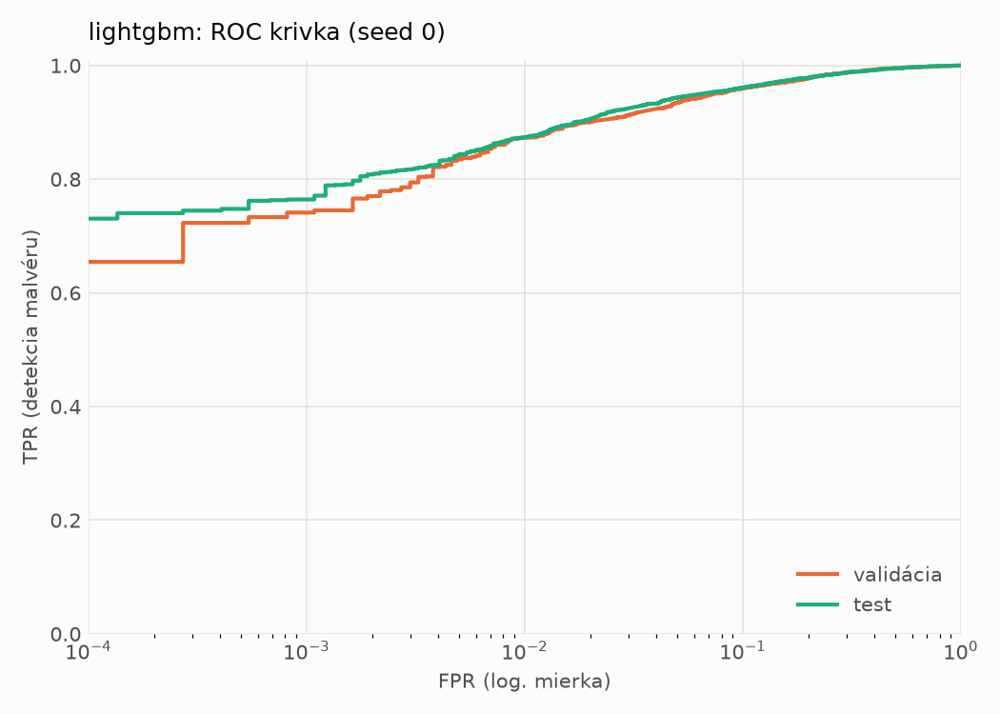
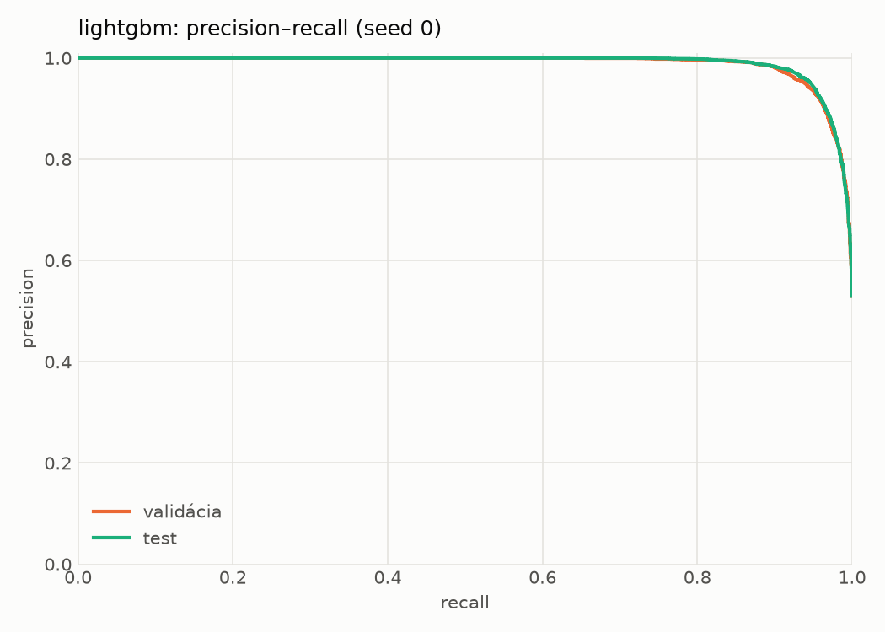
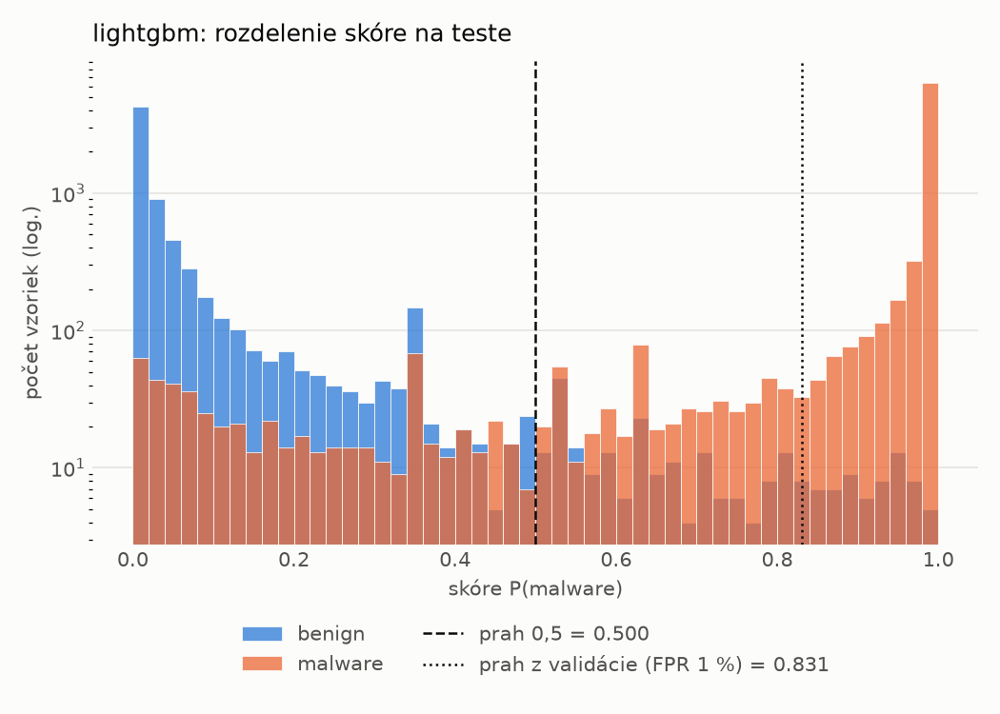
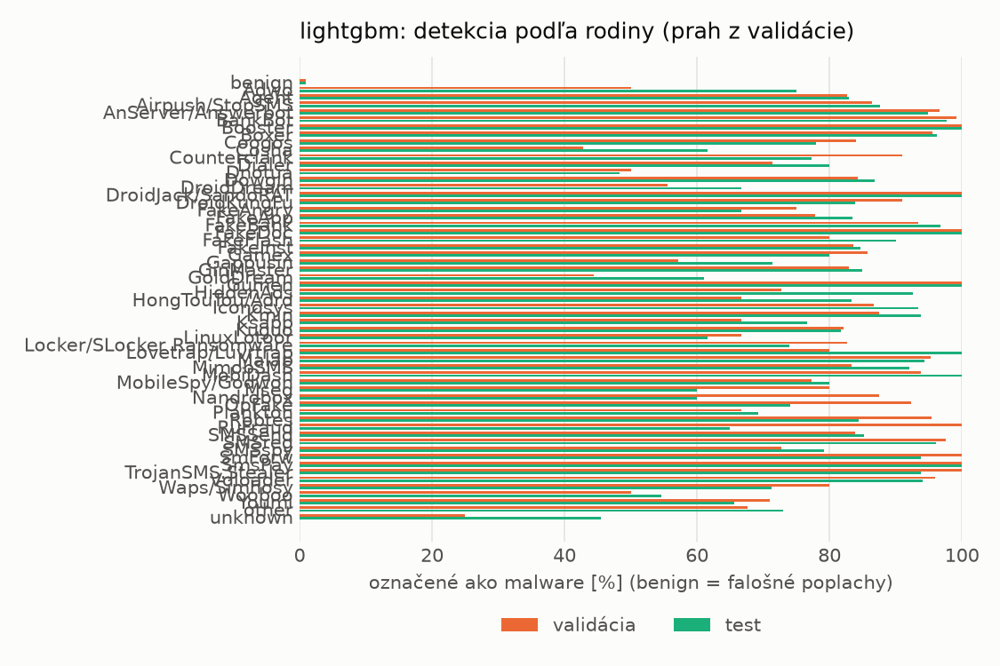
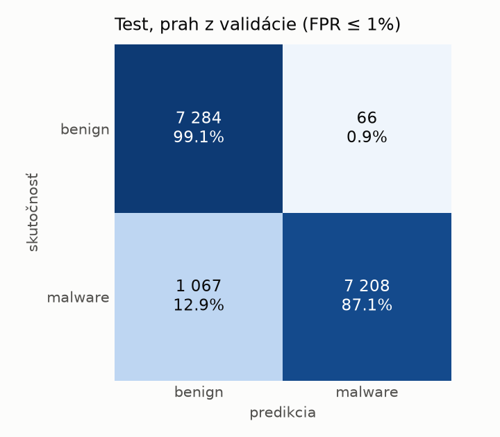
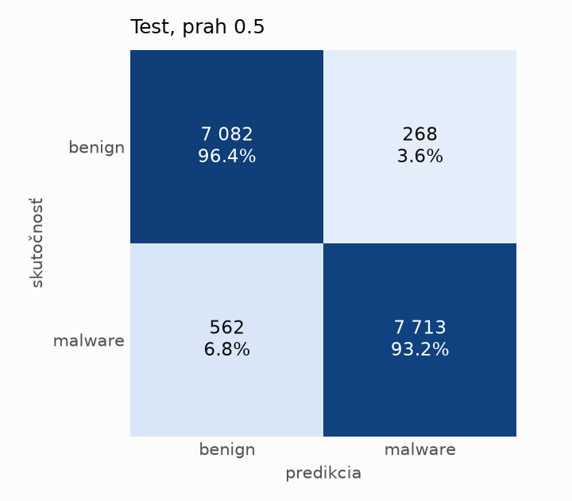
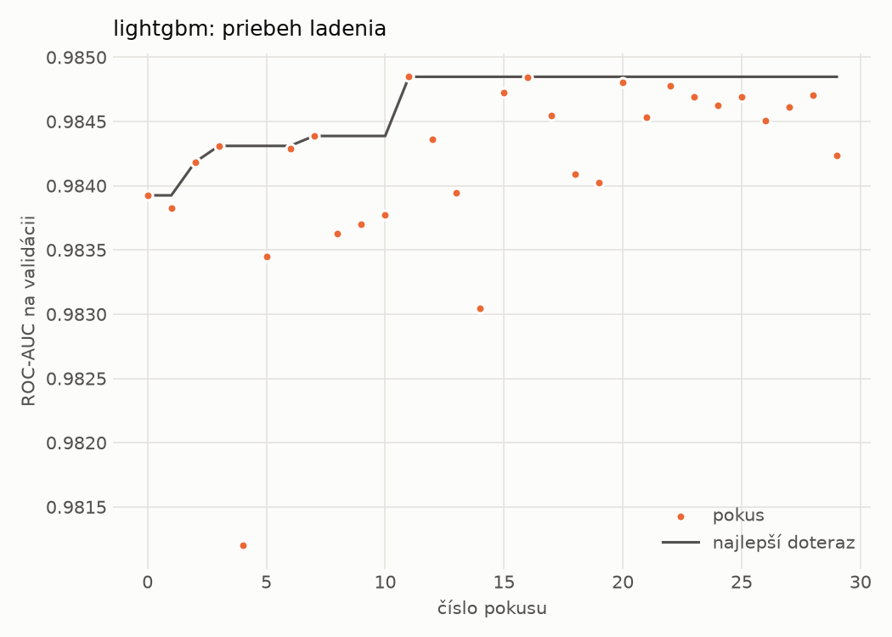
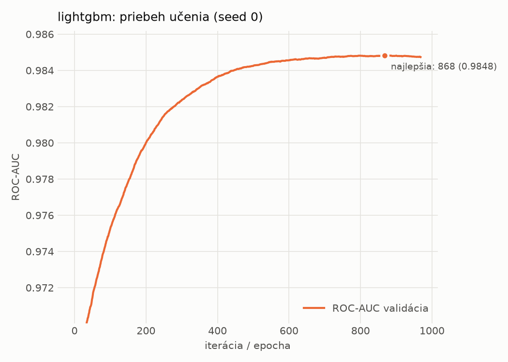

# dynamic/lightgbm – beh `20261122-191914`

> Automaticky generované (`src/training/run_tabular.py`). Konfigurácia: `config.yaml`, protokol: `protocol.yaml`.

- **Model:** `lightgbm` – LightGBM, gradient boosting stromov s early stopping na validácii (pôvodné hodnoty príznakov)
- **Ladenie:** 30 dokončených pokusov (Optuna TPE), cieľ ROC-AUC na validácii, 11.9 min
- **Finálne modely:** seedy [0, 1, 2]; hodnoty sú priemer ± smerodajná odchýlka cez seedy
- **Najlepšie hyperparametre:** `{"num_boost_round": 5000, "early_stopping_rounds": 100, "learning_rate": 0.017901592505193763, "num_leaves": 251, "min_child_samples": 52, "feature_fraction": 0.9358255991772038, "bagging_fraction": 0.8815171244905227, "lambda_l1": 0.02987319702672823, "lambda_l2": 0.017348460156736675}`

## Detekčná kvalita (bez prahu)
| metrika | train (podvzorka) | validácia | test |
|---|---|---|---|
| ROC-AUC | 0.9991 ± 0.0001 | 0.9848 ± 0.0000 | 0.9857 ± 0.0000 |
| PR-AUC | 0.9991 ± 0.0001 | 0.9886 ± 0.0000 | 0.9894 ± 0.0000 |
| TPR pri FPR 1 % | 0.9809 ± 0.0023 | 0.8717 ± 0.0041 | 0.8730 ± 0.0005 |
| TPR pri FPR 0,1 % | 0.9600 ± 0.0011 | 0.7520 ± 0.0123 | 0.7717 ± 0.0064 |
| log loss | 0.0485 ± 0.0025 | 0.1508 ± 0.0004 | 0.1445 ± 0.0004 |
| Brier skóre | 0.0120 ± 0.0006 | 0.0436 ± 0.0001 | 0.0413 ± 0.0001 |

Rozdiel ROC-AUC train − validácia: **0.0143** (veľký rozdiel = preučenie).

## Pri prahu z validácie (FPR ≤ 1% na validácii)
| metrika | train (podvzorka) | validácia | test |
|---|---|---|---|
| accuracy | 0.9691 ± 0.0029 | 0.9274 ± 0.0022 | 0.9263 ± 0.0023 |
| balanced accuracy | 0.9706 ± 0.0028 | 0.9310 ± 0.0020 | 0.9299 ± 0.0021 |
| precision | 0.9998 ± 0.0000 | 0.9901 ± 0.0000 | 0.9909 ± 0.0009 |
| recall (TPR) | 0.9414 ± 0.0056 | 0.8717 ± 0.0041 | 0.8688 ± 0.0051 |
| FPR | 0.0002 ± 0.0000 | 0.0098 ± 0.0000 | 0.0090 ± 0.0010 |
| F1 | 0.9697 ± 0.0030 | 0.9271 ± 0.0023 | 0.9259 ± 0.0026 |
| MCC | 0.9400 ± 0.0055 | 0.8624 ± 0.0038 | 0.8606 ± 0.0039 |

## Pri pevnom prahu 0.5
| metrika | train (podvzorka) | validácia | test |
|---|---|---|---|
| accuracy | 0.9847 ± 0.0006 | 0.9408 ± 0.0005 | 0.9465 ± 0.0005 |
| balanced accuracy | 0.9851 ± 0.0005 | 0.9416 ± 0.0006 | 0.9474 ± 0.0005 |
| precision | 0.9926 ± 0.0002 | 0.9592 ± 0.0011 | 0.9661 ± 0.0005 |
| recall (TPR) | 0.9782 ± 0.0009 | 0.9277 ± 0.0004 | 0.9316 ± 0.0005 |
| FPR | 0.0081 ± 0.0002 | 0.0444 ± 0.0012 | 0.0368 ± 0.0005 |
| F1 | 0.9854 ± 0.0005 | 0.9432 ± 0.0005 | 0.9485 ± 0.0005 |
| MCC | 0.9695 ± 0.0011 | 0.8819 ± 0.0011 | 0.8934 ± 0.0011 |

## Výpočtové nároky (seed 0, testovacia množina)
| meranie | hodnota |
|---|---|
| tréning finálneho modelu | 17.2 s (priemer cez seedy) |
| ladenie spolu | 713 s |
| počet parametrov / uzlov | 434 868 |
| veľkosť modelu na disku | 23.89 MB |
| CPU latencia modelu (batch 1, 1 vlákno) | 0.161 ms (p95 0.192) |
| CPU priepustnosť (24 vlákien) | 86 304 vzoriek/s |

## Grafy
| | |
|---|---|
|  |  |
|  |  |
|  |  |
|  |  |

## Súbory
`metrics.json` (všetky metriky po seedoch vrátane rodín), `timing.json`, `hpo_trials.csv`,
`predictions/<časť>_seed<N>.parquet` (sha256, family, label, score), `model/seed_<N>/`, `log.txt`.
