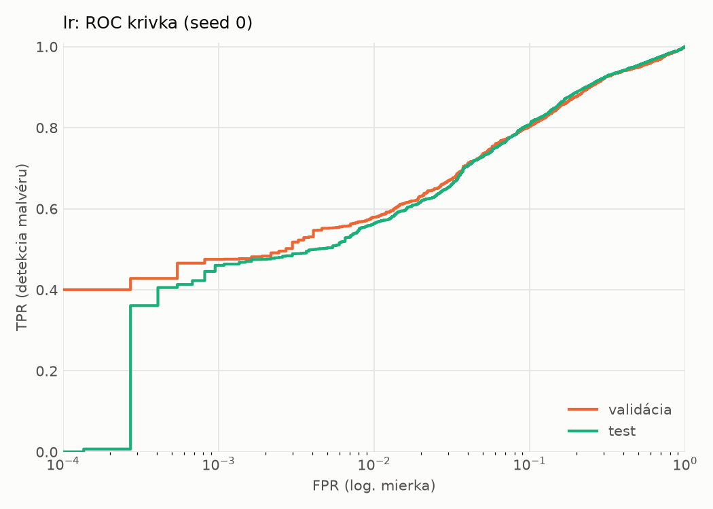
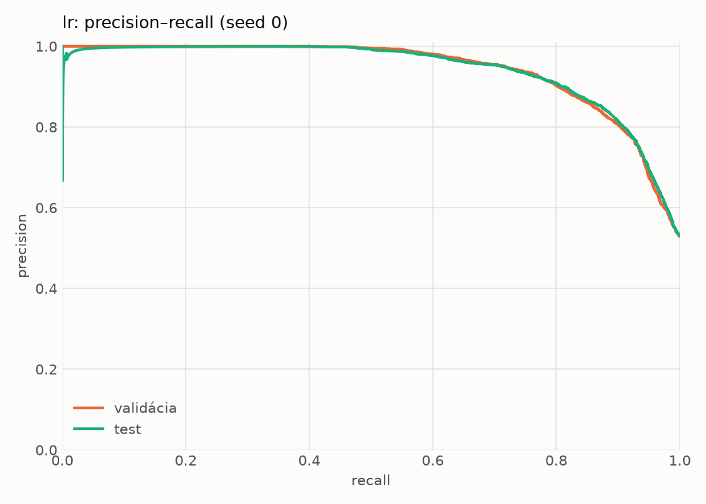
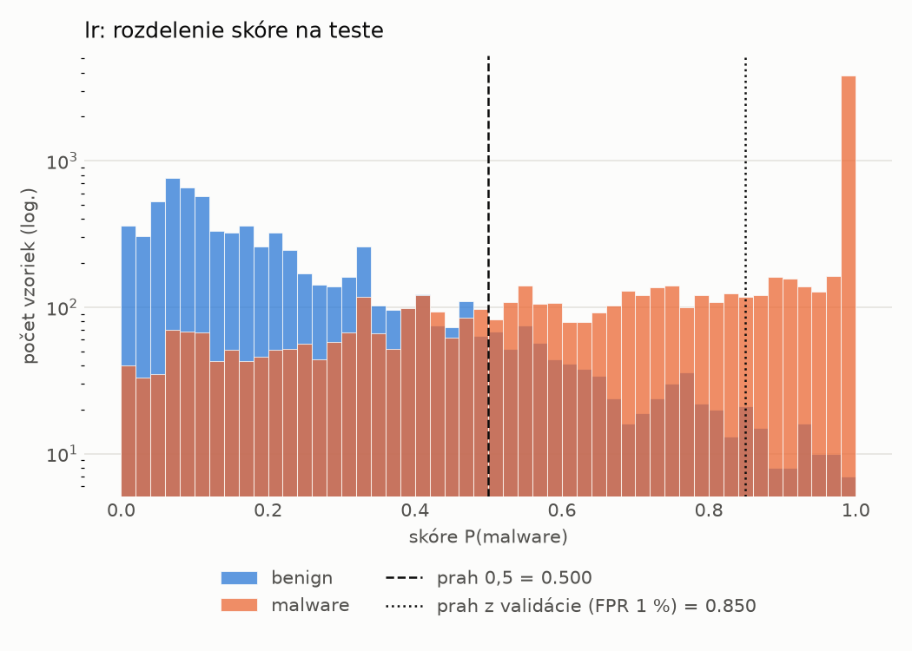
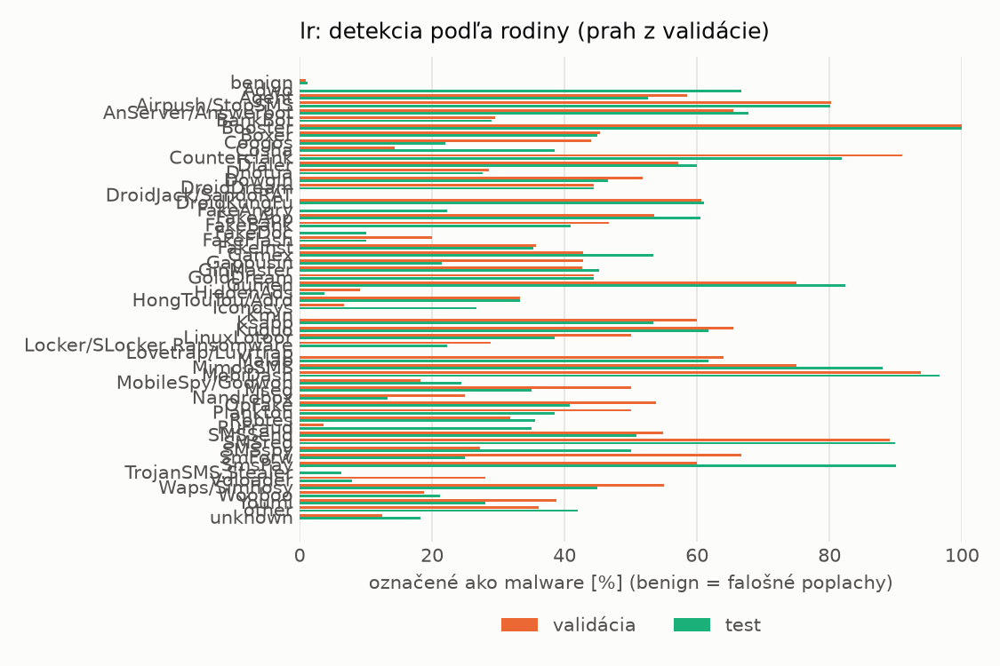
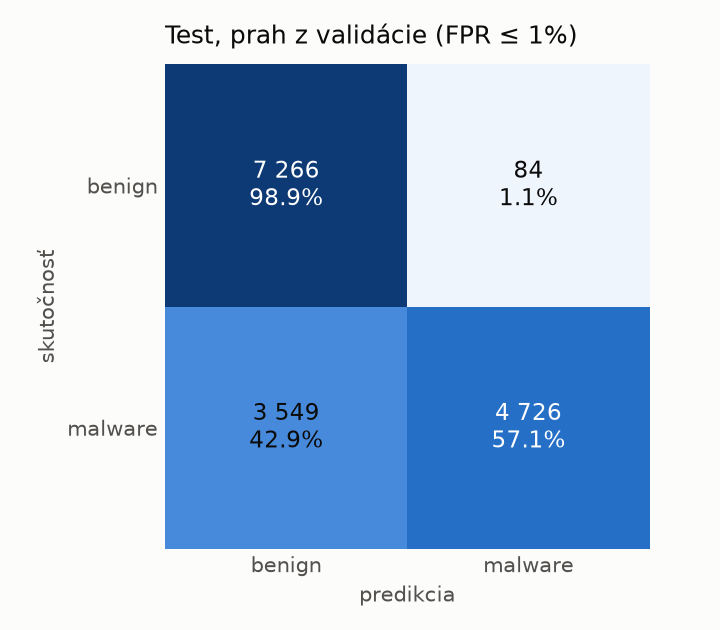
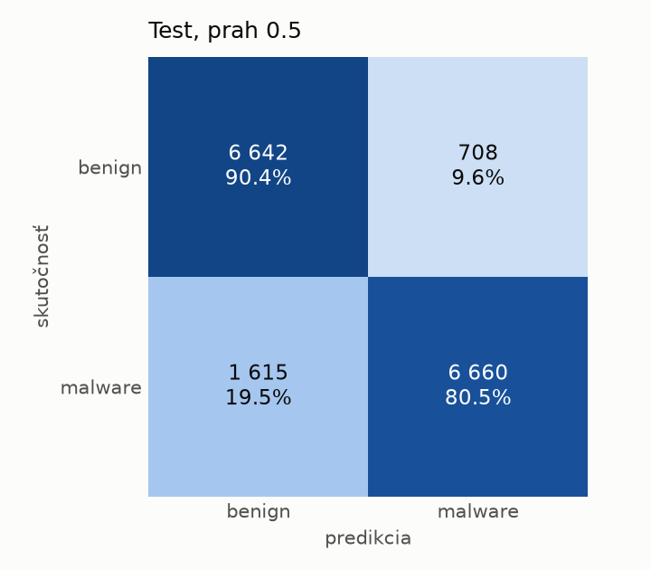
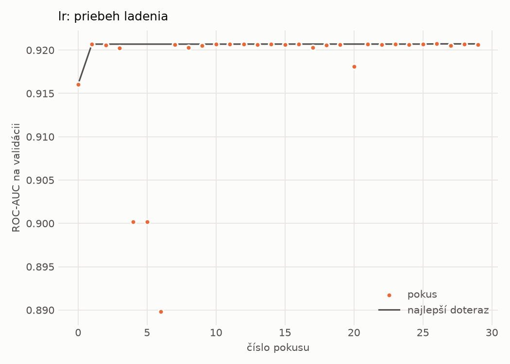

# dynamic/lr – beh `20261122-191725`

> Automaticky generované (`src/training/run_tabular.py`). Konfigurácia: `config.yaml`, protokol: `protocol.yaml`.

- **Model:** `logreg` – logistická regresia s L2 regularizáciou (vstup signed log1p + štandardizácia)
- **Ladenie:** 30 dokončených pokusov (Optuna TPE), cieľ ROC-AUC na validácii, 0.1 min
- **Finálne modely:** seedy [0, 1, 2]; hodnoty sú priemer ± smerodajná odchýlka cez seedy
- **Najlepšie hyperparametre:** `{"max_iter": 2000, "C": 3.784688828069828}`

## Detekčná kvalita (bez prahu)
| metrika | train (podvzorka) | validácia | test |
|---|---|---|---|
| ROC-AUC | 0.9257 ± 0.0000 | 0.9207 ± 0.0000 | 0.9232 ± 0.0000 |
| PR-AUC | 0.9440 ± 0.0000 | 0.9426 ± 0.0000 | 0.9423 ± 0.0000 |
| TPR pri FPR 1 % | 0.5663 ± 0.0000 | 0.5794 ± 0.0000 | 0.5633 ± 0.0000 |
| TPR pri FPR 0,1 % | 0.4333 ± 0.0000 | 0.4752 ± 0.0000 | 0.4604 ± 0.0000 |
| log loss | 0.3408 ± 0.0000 | 0.3492 ± 0.0000 | 0.3497 ± 0.0000 |
| Brier skóre | 0.1058 ± 0.0000 | 0.1087 ± 0.0000 | 0.1082 ± 0.0000 |

Rozdiel ROC-AUC train − validácia: **0.0049** (veľký rozdiel = preučenie).

## Pri prahu z validácie (FPR ≤ 1% na validácii)
| metrika | train (podvzorka) | validácia | test |
|---|---|---|---|
| accuracy | 0.7780 ± 0.0000 | 0.7726 ± 0.0000 | 0.7675 ± 0.0000 |
| balanced accuracy | 0.7881 ± 0.0000 | 0.7848 ± 0.0000 | 0.7798 ± 0.0000 |
| precision | 0.9795 ± 0.0000 | 0.9852 ± 0.0000 | 0.9825 ± 0.0000 |
| recall (TPR) | 0.5899 ± 0.0000 | 0.5794 ± 0.0000 | 0.5711 ± 0.0000 |
| FPR | 0.0137 ± 0.0000 | 0.0098 ± 0.0000 | 0.0114 ± 0.0000 |
| F1 | 0.7363 ± 0.0000 | 0.7297 ± 0.0000 | 0.7224 ± 0.0000 |
| MCC | 0.6186 ± 0.0000 | 0.6139 ± 0.0000 | 0.6052 ± 0.0000 |

## Pri pevnom prahu 0.5
| metrika | train (podvzorka) | validácia | test |
|---|---|---|---|
| accuracy | 0.8554 ± 0.0000 | 0.8481 ± 0.0000 | 0.8513 ± 0.0000 |
| balanced accuracy | 0.8577 ± 0.0000 | 0.8507 ± 0.0000 | 0.8543 ± 0.0000 |
| precision | 0.9019 ± 0.0000 | 0.8959 ± 0.0000 | 0.9039 ± 0.0000 |
| recall (TPR) | 0.8133 ± 0.0000 | 0.8070 ± 0.0000 | 0.8048 ± 0.0000 |
| FPR | 0.0980 ± 0.0000 | 0.1056 ± 0.0000 | 0.0963 ± 0.0000 |
| F1 | 0.8553 ± 0.0000 | 0.8491 ± 0.0000 | 0.8515 ± 0.0000 |
| MCC | 0.7154 ± 0.0000 | 0.7009 ± 0.0000 | 0.7084 ± 0.0000 |

## Výpočtové nároky (seed 0, testovacia množina)
| meranie | hodnota |
|---|---|
| tréning finálneho modelu | 0.4 s (priemer cez seedy) |
| ladenie spolu | 8 s |
| počet parametrov / uzlov | 132 |
| veľkosť modelu na disku | 0.01 MB |
| transformácia vstupu – latencia (1 vlákno) | 0.005 ms |
| transformácia vstupu – priepustnosť | 1 318 343 vzoriek/s |
| CPU latencia modelu (batch 1, 1 vlákno) | 0.004 ms (p95 0.004) |
| CPU priepustnosť (24 vlákien) | 3 808 932 vzoriek/s |

## Grafy
| | |
|---|---|
|  |  |
|  |  |
|  |  |
|  |  |

## Súbory
`metrics.json` (všetky metriky po seedoch vrátane rodín), `timing.json`, `hpo_trials.csv`,
`predictions/<časť>_seed<N>.parquet` (sha256, family, label, score), `model/seed_<N>/`, `log.txt`.
