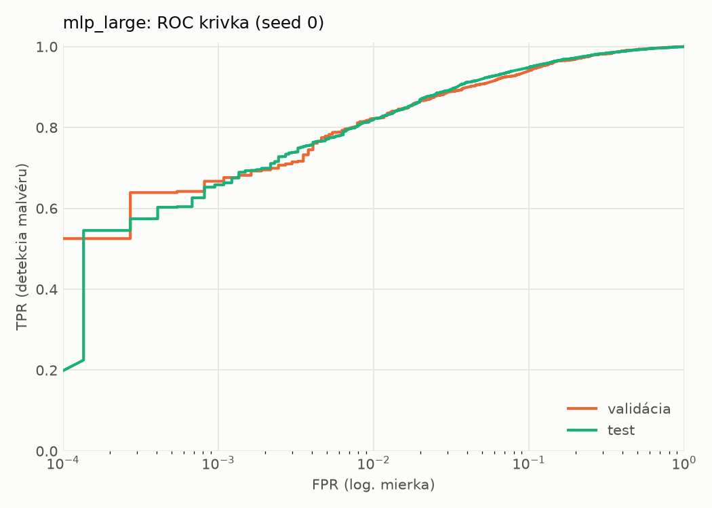
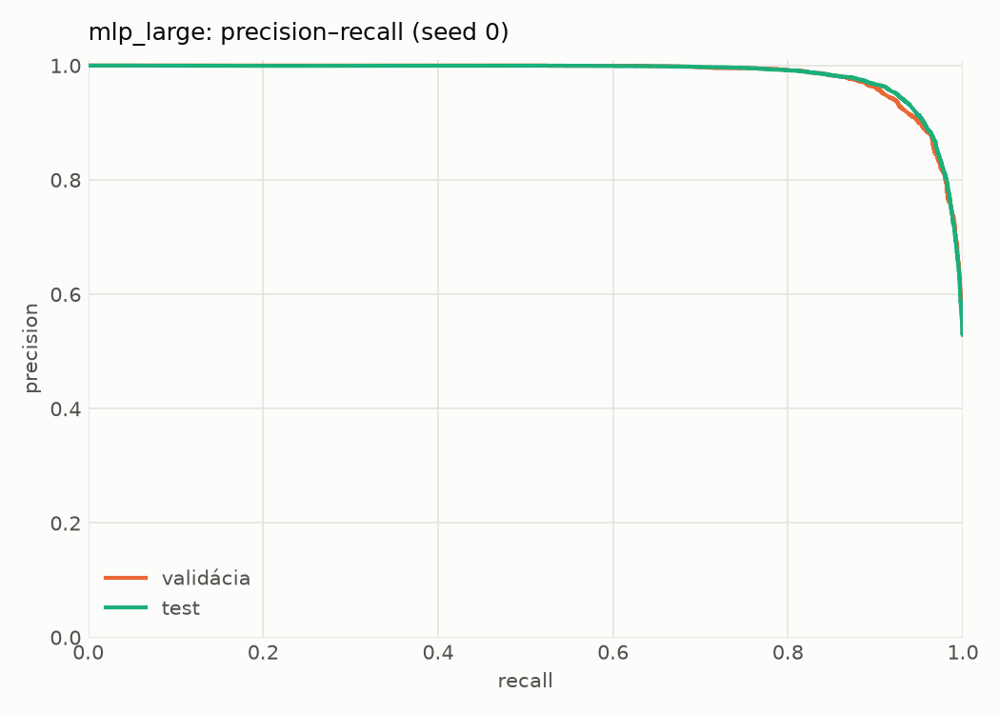
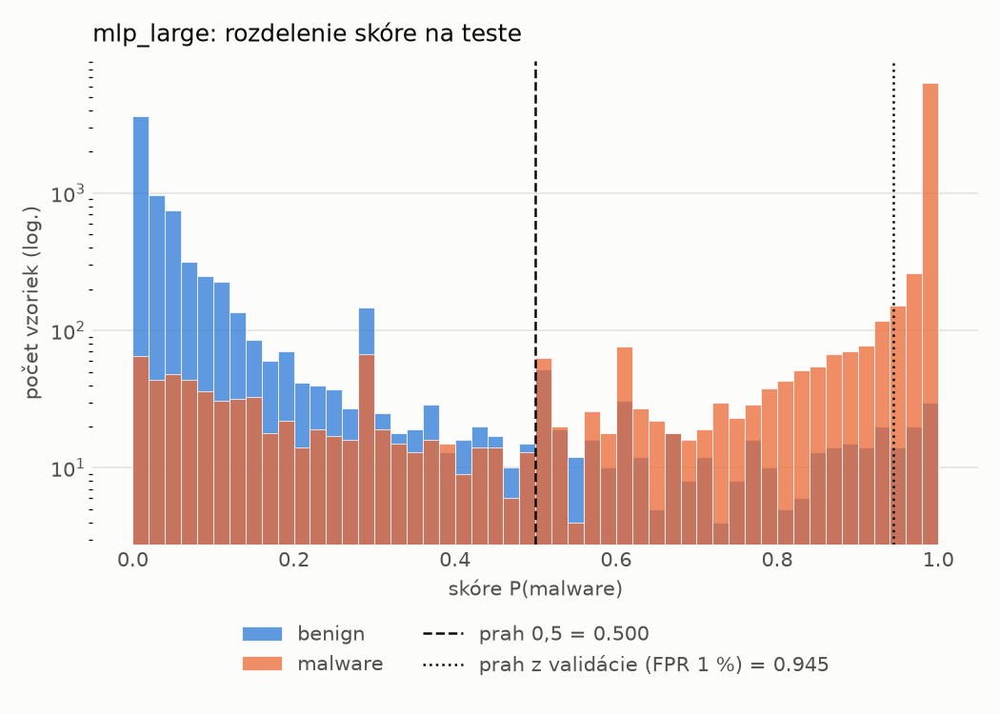
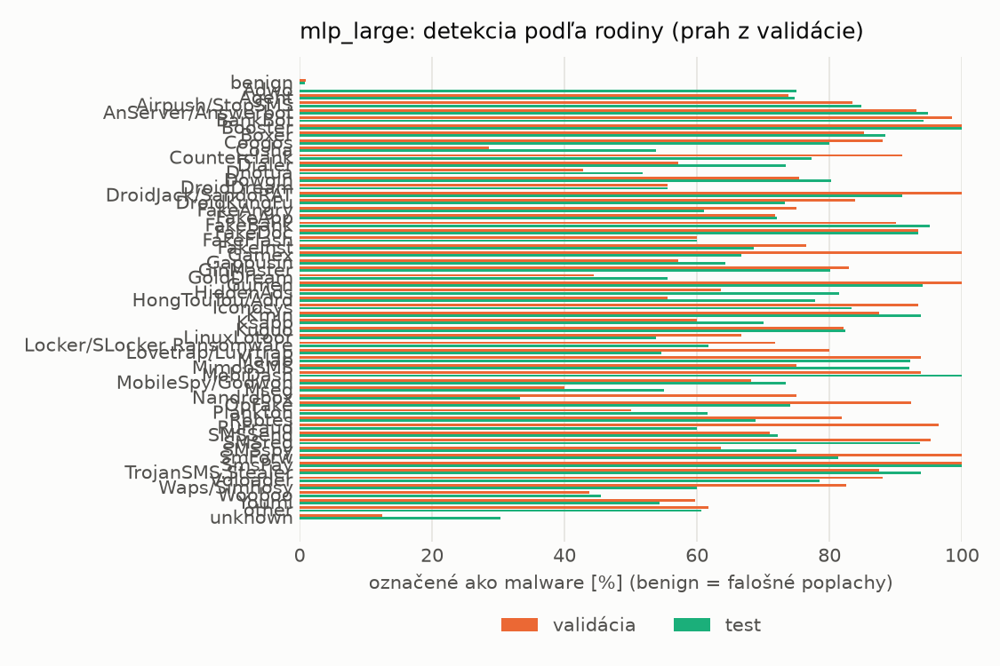
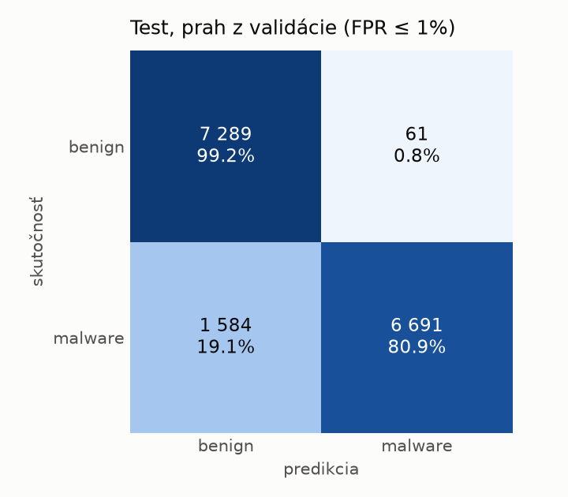
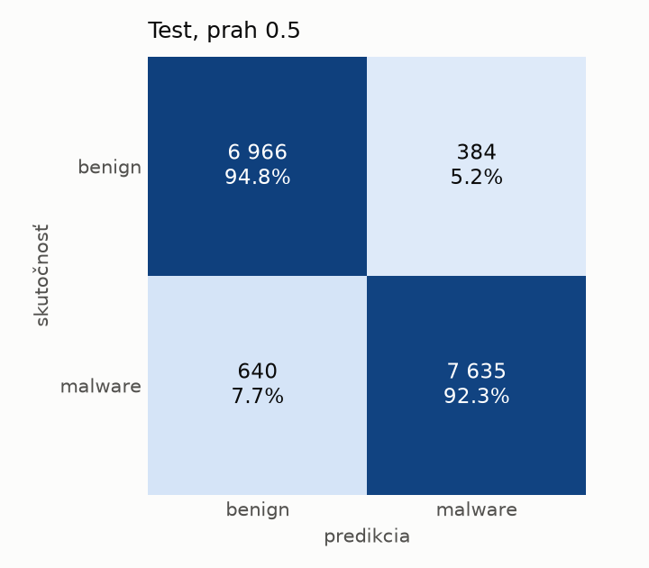
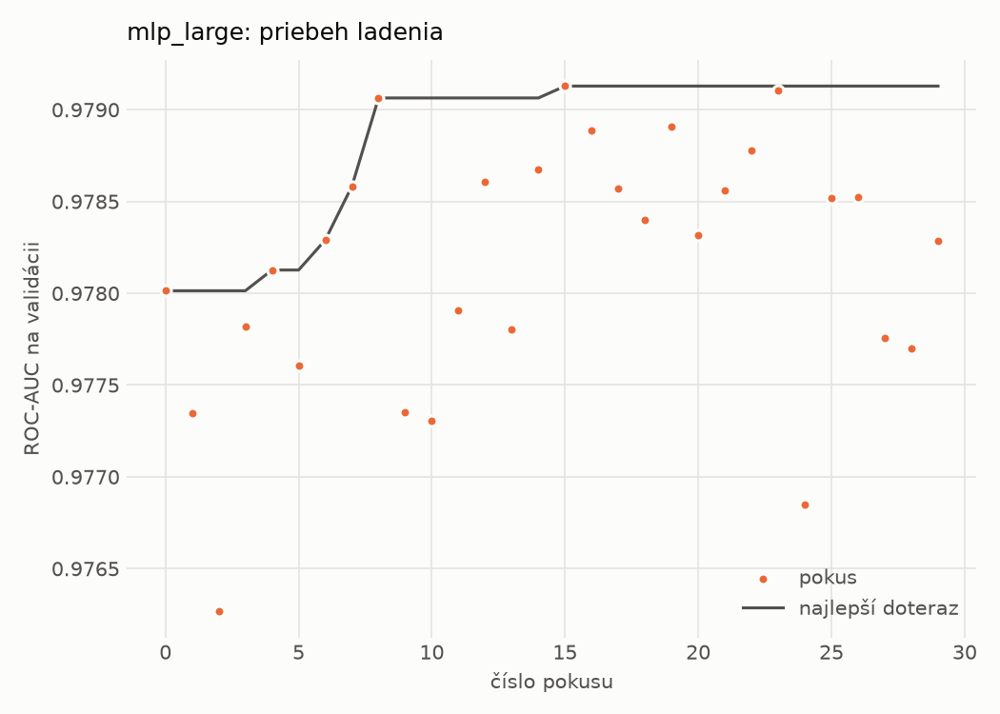
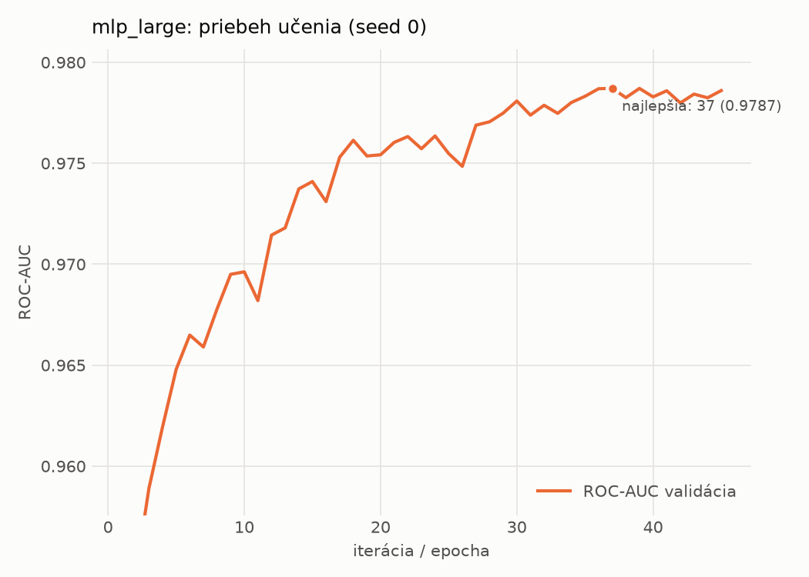

# dynamic/mlp_large – beh `20261122-194320`

> Automaticky generované (`src/training/run_tabular.py`). Konfigurácia: `config.yaml`, protokol: `protocol.yaml`.

- **Model:** `mlp` – veľká neurónová sieť (3–5 skrytých vrstiev, 512–2048 neurónov), kandidát na učiteľa
- **Ladenie:** 30 dokončených pokusov (Optuna TPE), cieľ ROC-AUC na validácii, 6.3 min
- **Finálne modely:** seedy [0, 1, 2]; hodnoty sú priemer ± smerodajná odchýlka cez seedy
- **Najlepšie hyperparametre:** `{"max_epochs": 100, "patience": 8, "hidden_layers": 3, "hidden_width": 512, "width_decay": 1.0, "dropout": 0.16077310300541978, "lr": 0.0005048635567863703, "weight_decay": 0.004783411439856203, "batch_size": 1024}`

## Detekčná kvalita (bez prahu)
| metrika | train (podvzorka) | validácia | test |
|---|---|---|---|
| ROC-AUC | 0.9892 ± 0.0004 | 0.9786 ± 0.0001 | 0.9797 ± 0.0001 |
| PR-AUC | 0.9919 ± 0.0003 | 0.9839 ± 0.0001 | 0.9847 ± 0.0002 |
| TPR pri FPR 1 % | 0.9090 ± 0.0027 | 0.8179 ± 0.0033 | 0.8213 ± 0.0028 |
| TPR pri FPR 0,1 % | 0.8330 ± 0.0079 | 0.6453 ± 0.0196 | 0.6540 ± 0.0052 |
| log loss | 0.1214 ± 0.0021 | 0.1881 ± 0.0009 | 0.1802 ± 0.0010 |
| Brier skóre | 0.0347 ± 0.0005 | 0.0537 ± 0.0003 | 0.0504 ± 0.0002 |

Rozdiel ROC-AUC train − validácia: **0.0106** (veľký rozdiel = preučenie).

## Pri prahu z validácie (FPR ≤ 1% na validácii)
| metrika | train (podvzorka) | validácia | test |
|---|---|---|---|
| accuracy | 0.9133 ± 0.0032 | 0.8989 ± 0.0017 | 0.8928 ± 0.0019 |
| balanced accuracy | 0.9174 ± 0.0031 | 0.9041 ± 0.0016 | 0.8984 ± 0.0017 |
| precision | 0.9987 ± 0.0005 | 0.9895 ± 0.0000 | 0.9921 ± 0.0009 |
| recall (TPR) | 0.8361 ± 0.0063 | 0.8179 ± 0.0033 | 0.8040 ± 0.0043 |
| FPR | 0.0012 ± 0.0005 | 0.0098 ± 0.0000 | 0.0073 ± 0.0009 |
| F1 | 0.9102 ± 0.0036 | 0.8955 ± 0.0020 | 0.8882 ± 0.0023 |
| MCC | 0.8399 ± 0.0055 | 0.8130 ± 0.0029 | 0.8034 ± 0.0029 |

## Pri pevnom prahu 0.5
| metrika | train (podvzorka) | validácia | test |
|---|---|---|---|
| accuracy | 0.9567 ± 0.0003 | 0.9277 ± 0.0007 | 0.9345 ± 0.0008 |
| balanced accuracy | 0.9575 ± 0.0004 | 0.9284 ± 0.0007 | 0.9354 ± 0.0009 |
| precision | 0.9750 ± 0.0012 | 0.9447 ± 0.0008 | 0.9531 ± 0.0014 |
| recall (TPR) | 0.9417 ± 0.0007 | 0.9172 ± 0.0006 | 0.9217 ± 0.0010 |
| FPR | 0.0268 ± 0.0014 | 0.0605 ± 0.0010 | 0.0510 ± 0.0016 |
| F1 | 0.9581 ± 0.0003 | 0.9307 ± 0.0006 | 0.9372 ± 0.0008 |
| MCC | 0.9139 ± 0.0007 | 0.8555 ± 0.0014 | 0.8694 ± 0.0017 |

## Výpočtové nároky (seed 0, testovacia množina)
| meranie | hodnota |
|---|---|
| tréning finálneho modelu | 5.5 s (priemer cez seedy) |
| ladenie spolu | 378 s |
| počet parametrov / uzlov | 596 481 |
| veľkosť modelu na disku | 2.41 MB |
| transformácia vstupu – latencia (1 vlákno) | 0.015 ms |
| transformácia vstupu – priepustnosť | 723 520 vzoriek/s |
| CPU latencia modelu (batch 1, 1 vlákno) | 0.165 ms (p95 0.202) |
| CPU priepustnosť (24 vlákien) | 652 175 vzoriek/s |
| GPU latencia (batch 1) | 0.546 ms (p95 0.823) |
| GPU priepustnosť | 2 697 081 vzoriek/s |
| GPU špičková pamäť | 130 MB |

## Grafy
| | |
|---|---|
|  |  |
|  |  |
|  |  |
|  |  |

## Súbory
`metrics.json` (všetky metriky po seedoch vrátane rodín), `timing.json`, `hpo_trials.csv`,
`predictions/<časť>_seed<N>.parquet` (sha256, family, label, score), `model/seed_<N>/`, `log.txt`.
