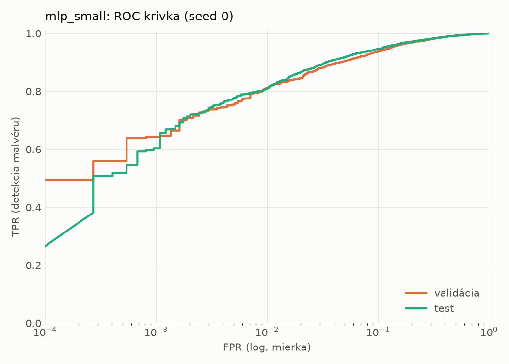
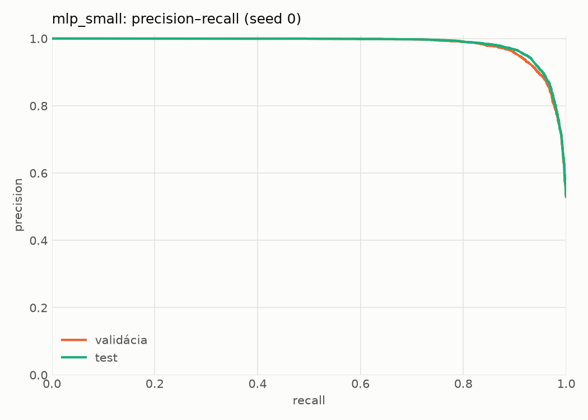
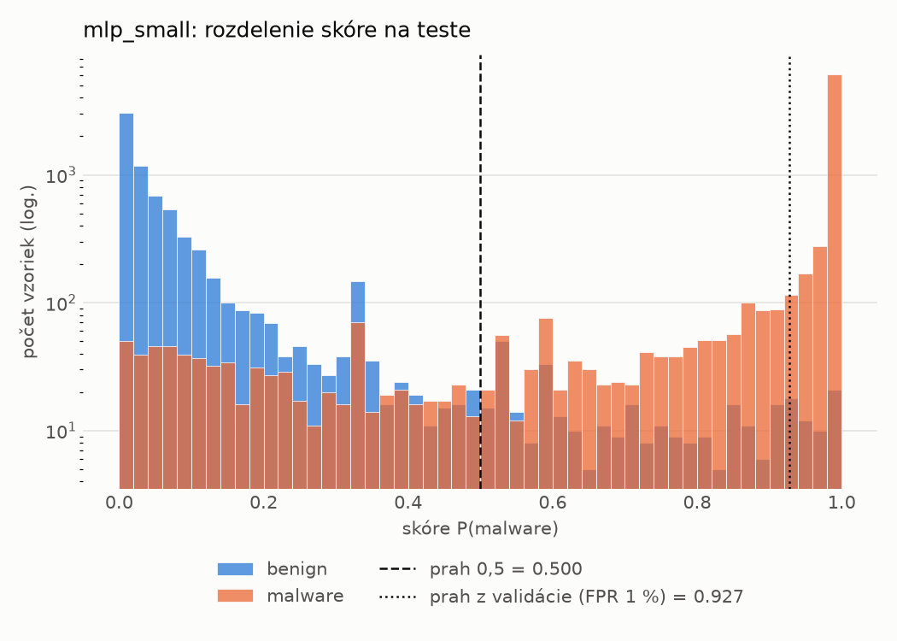
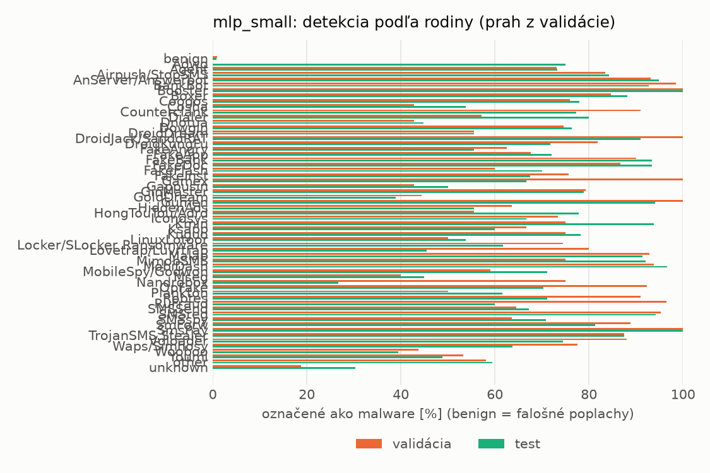
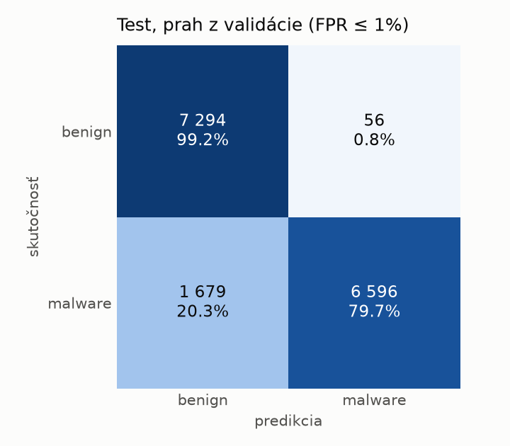
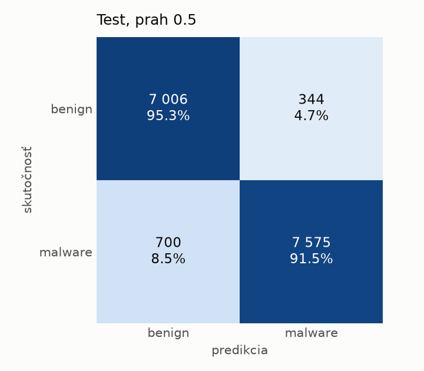
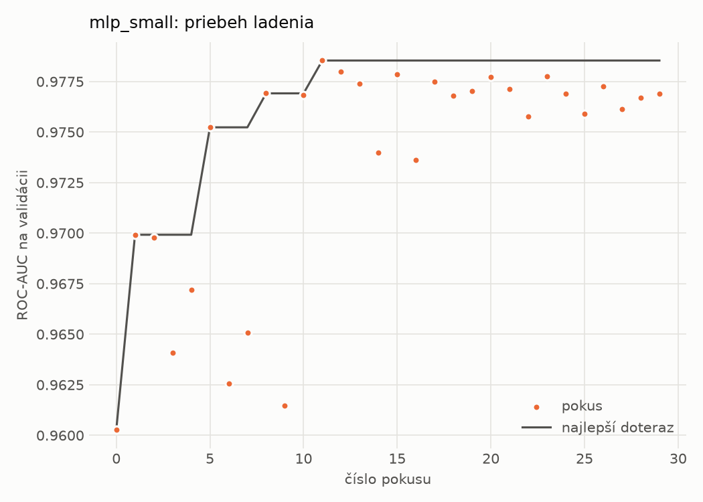
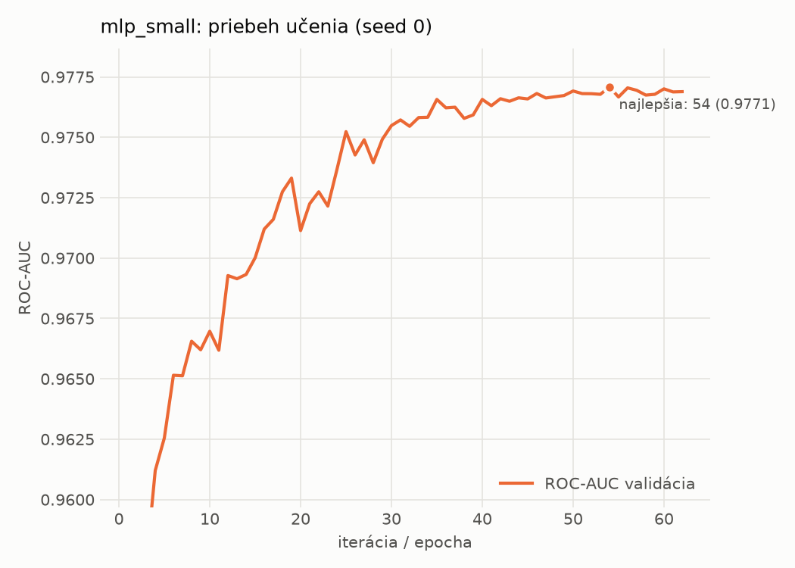

# dynamic/mlp_small – beh `20261122-193213`

> Automaticky generované (`src/training/run_tabular.py`). Konfigurácia: `config.yaml`, protokol: `protocol.yaml`.

- **Model:** `mlp` – malá neurónová sieť (1–2 skryté vrstvy), kandidát na ľahkého študenta
- **Ladenie:** 30 dokončených pokusov (Optuna TPE), cieľ ROC-AUC na validácii, 10.1 min
- **Finálne modely:** seedy [0, 1, 2]; hodnoty sú priemer ± smerodajná odchýlka cez seedy
- **Najlepšie hyperparametre:** `{"width_decay": 0.5, "max_epochs": 100, "patience": 8, "hidden_layers": 2, "hidden_width": 256, "dropout": 0.2449160262890371, "lr": 0.002872548733508973, "weight_decay": 4.509331245708397e-06, "batch_size": 256}`

## Detekčná kvalita (bez prahu)
| metrika | train (podvzorka) | validácia | test |
|---|---|---|---|
| ROC-AUC | 0.9876 ± 0.0008 | 0.9773 ± 0.0002 | 0.9789 ± 0.0003 |
| PR-AUC | 0.9906 ± 0.0005 | 0.9830 ± 0.0002 | 0.9842 ± 0.0003 |
| TPR pri FPR 1 % | 0.8972 ± 0.0053 | 0.8130 ± 0.0015 | 0.8184 ± 0.0114 |
| TPR pri FPR 0,1 % | 0.8085 ± 0.0052 | 0.6363 ± 0.0233 | 0.6433 ± 0.0428 |
| log loss | 0.1319 ± 0.0036 | 0.1913 ± 0.0014 | 0.1814 ± 0.0015 |
| Brier skóre | 0.0379 ± 0.0010 | 0.0550 ± 0.0005 | 0.0511 ± 0.0007 |

Rozdiel ROC-AUC train − validácia: **0.0103** (veľký rozdiel = preučenie).

## Pri prahu z validácie (FPR ≤ 1% na validácii)
| metrika | train (podvzorka) | validácia | test |
|---|---|---|---|
| accuracy | 0.9085 ± 0.0005 | 0.8963 ± 0.0008 | 0.8899 ± 0.0009 |
| balanced accuracy | 0.9129 ± 0.0005 | 0.9016 ± 0.0008 | 0.8956 ± 0.0009 |
| precision | 0.9980 ± 0.0005 | 0.9894 ± 0.0000 | 0.9918 ± 0.0009 |
| recall (TPR) | 0.8275 ± 0.0010 | 0.8130 ± 0.0015 | 0.7987 ± 0.0014 |
| FPR | 0.0018 ± 0.0004 | 0.0098 ± 0.0000 | 0.0074 ± 0.0008 |
| F1 | 0.9048 ± 0.0006 | 0.8926 ± 0.0009 | 0.8848 ± 0.0010 |
| MCC | 0.8315 ± 0.0009 | 0.8086 ± 0.0013 | 0.7986 ± 0.0017 |

## Pri pevnom prahu 0.5
| metrika | train (podvzorka) | validácia | test |
|---|---|---|---|
| accuracy | 0.9529 ± 0.0007 | 0.9255 ± 0.0018 | 0.9332 ± 0.0014 |
| balanced accuracy | 0.9538 ± 0.0006 | 0.9263 ± 0.0019 | 0.9342 ± 0.0015 |
| precision | 0.9724 ± 0.0006 | 0.9450 ± 0.0033 | 0.9550 ± 0.0024 |
| recall (TPR) | 0.9369 ± 0.0009 | 0.9125 ± 0.0023 | 0.9171 ± 0.0016 |
| FPR | 0.0294 ± 0.0006 | 0.0598 ± 0.0039 | 0.0486 ± 0.0027 |
| F1 | 0.9544 ± 0.0006 | 0.9285 ± 0.0017 | 0.9357 ± 0.0013 |
| MCC | 0.9064 ± 0.0013 | 0.8514 ± 0.0037 | 0.8671 ± 0.0029 |

## Výpočtové nároky (seed 0, testovacia množina)
| meranie | hodnota |
|---|---|
| tréning finálneho modelu | 19.5 s (priemer cez seedy) |
| ladenie spolu | 607 s |
| počet parametrov / uzlov | 67 585 |
| veľkosť modelu na disku | 0.28 MB |
| transformácia vstupu – latencia (1 vlákno) | 0.014 ms |
| transformácia vstupu – priepustnosť | 729 264 vzoriek/s |
| CPU latencia modelu (batch 1, 1 vlákno) | 0.104 ms (p95 0.232) |
| CPU priepustnosť (24 vlákien) | 2 151 226 vzoriek/s |
| GPU latencia (batch 1) | 0.660 ms (p95 0.719) |
| GPU priepustnosť | 2 488 890 vzoriek/s |
| GPU špičková pamäť | 76 MB |

## Grafy
| | |
|---|---|
|  |  |
|  |  |
|  |  |
|  |  |

## Súbory
`metrics.json` (všetky metriky po seedoch vrátane rodín), `timing.json`, `hpo_trials.csv`,
`predictions/<časť>_seed<N>.parquet` (sha256, family, label, score), `model/seed_<N>/`, `log.txt`.
