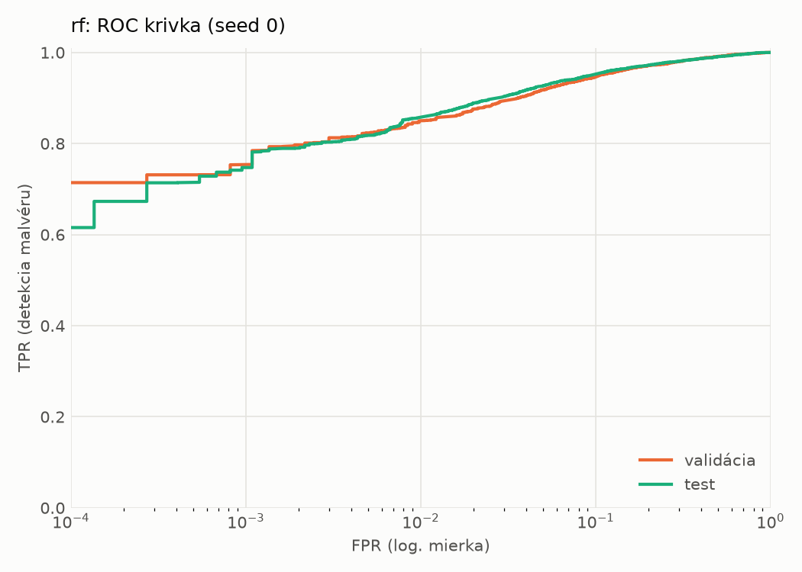
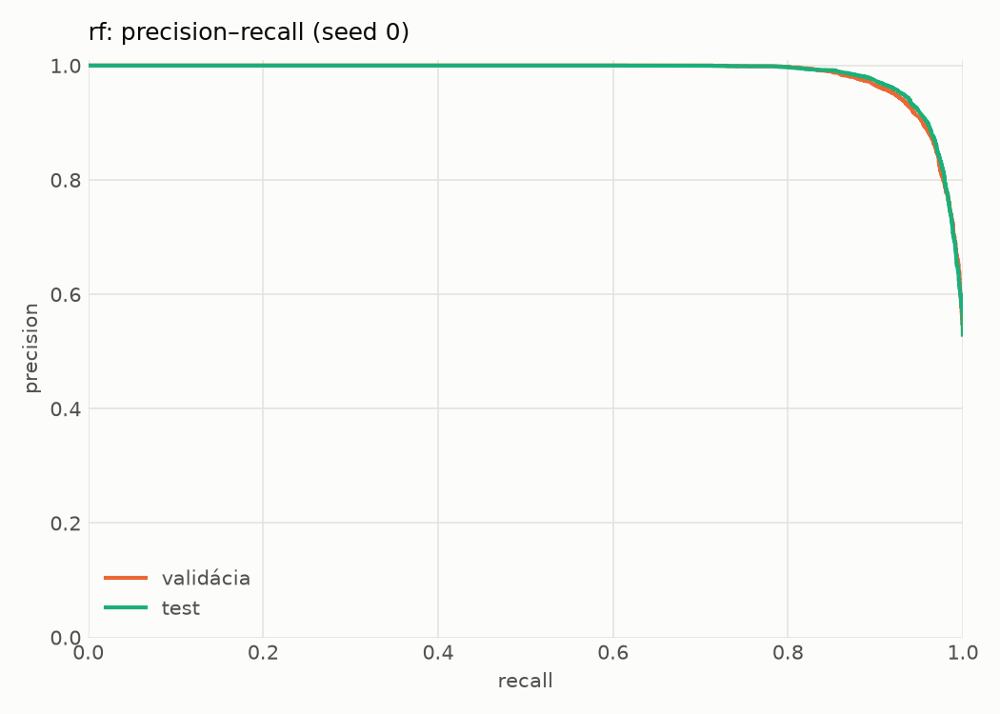
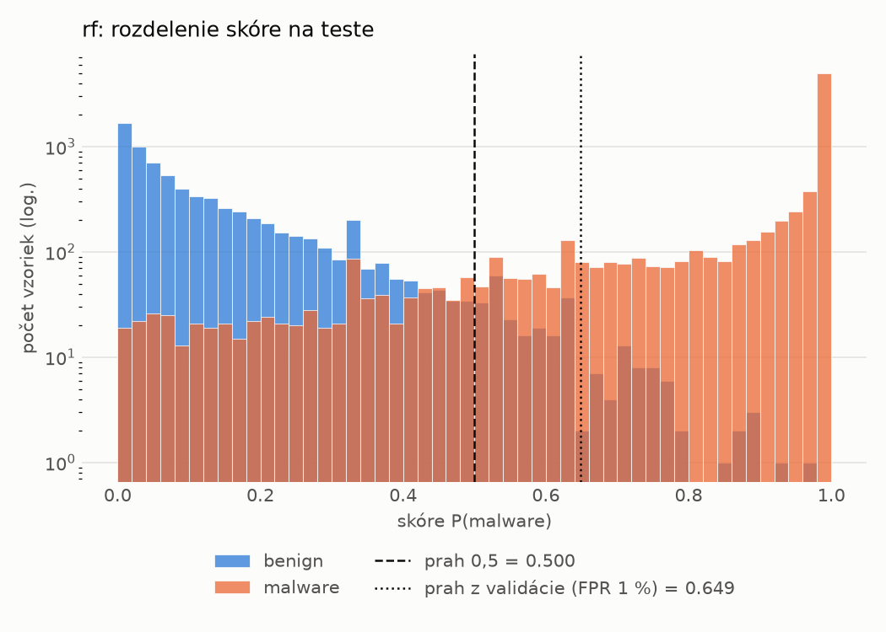
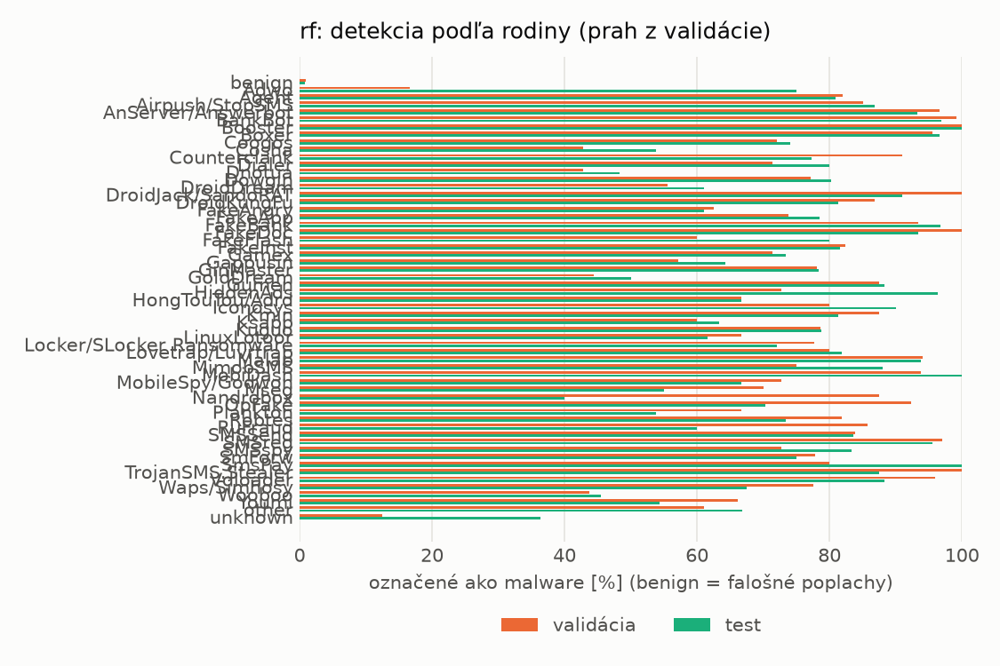
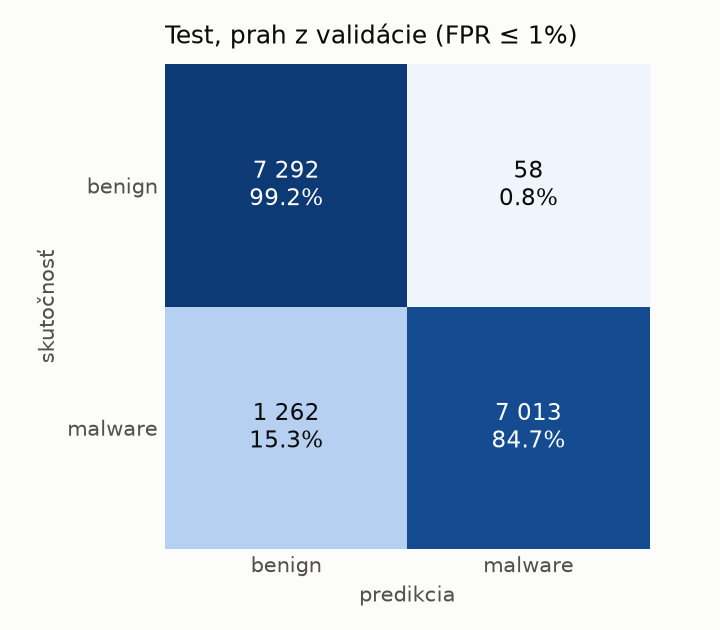
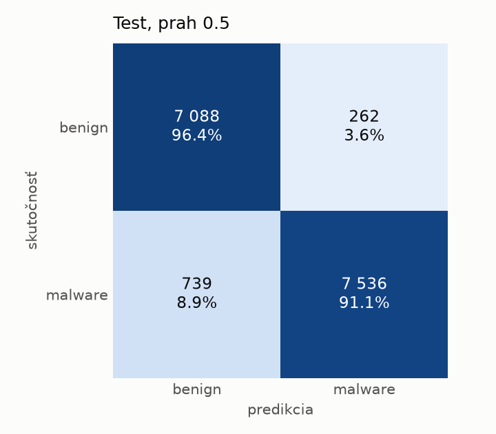
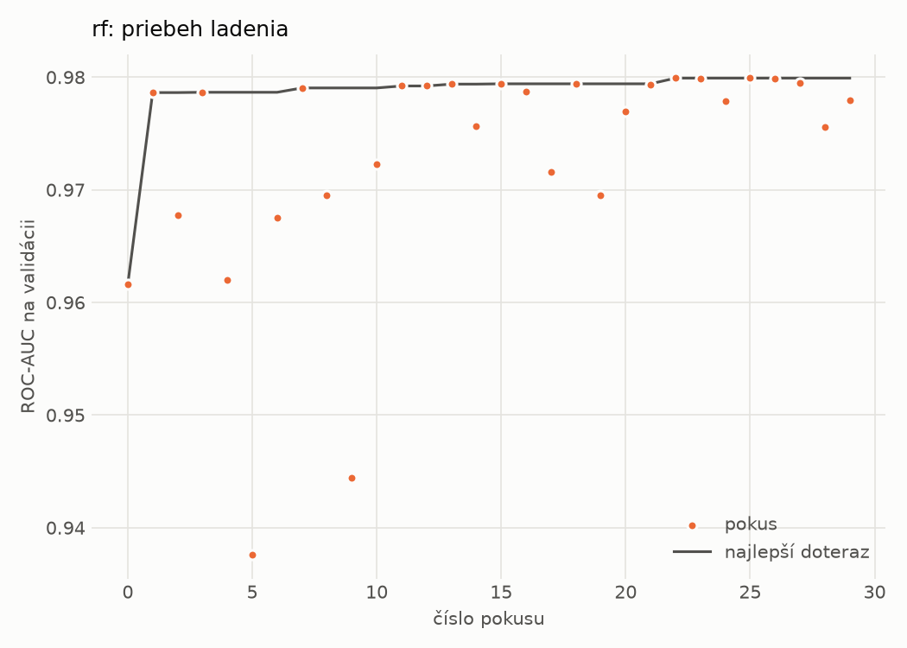

# dynamic/rf – beh `20261122-191738`

> Automaticky generované (`src/training/run_tabular.py`). Konfigurácia: `config.yaml`, protokol: `protocol.yaml`.

- **Model:** `random_forest` – Random Forest (pôvodné hodnoty príznakov)
- **Ladenie:** 30 dokončených pokusov (Optuna TPE), cieľ ROC-AUC na validácii, 1.2 min
- **Finálne modely:** seedy [0, 1, 2]; hodnoty sú priemer ± smerodajná odchýlka cez seedy
- **Najlepšie hyperparametre:** `{"n_estimators": 500, "max_depth": 32, "min_samples_leaf": 1, "max_features": "sqrt"}`

## Detekčná kvalita (bez prahu)
| metrika | train (podvzorka) | validácia | test |
|---|---|---|---|
| ROC-AUC | 0.9991 ± 0.0000 | 0.9797 ± 0.0001 | 0.9810 ± 0.0001 |
| PR-AUC | 0.9993 ± 0.0000 | 0.9853 ± 0.0001 | 0.9863 ± 0.0001 |
| TPR pri FPR 1 % | 0.9899 ± 0.0002 | 0.8452 ± 0.0042 | 0.8560 ± 0.0008 |
| TPR pri FPR 0,1 % | 0.9572 ± 0.0007 | 0.7546 ± 0.0036 | 0.7570 ± 0.0084 |
| log loss | 0.0670 ± 0.0001 | 0.1854 ± 0.0006 | 0.1824 ± 0.0002 |
| Brier skóre | 0.0137 ± 0.0000 | 0.0536 ± 0.0002 | 0.0521 ± 0.0000 |

Rozdiel ROC-AUC train − validácia: **0.0194** (veľký rozdiel = preučenie).

## Pri prahu z validácie (FPR ≤ 1% na validácii)
| metrika | train (podvzorka) | validácia | test |
|---|---|---|---|
| accuracy | 0.9757 ± 0.0008 | 0.9134 ± 0.0022 | 0.9136 ± 0.0017 |
| balanced accuracy | 0.9769 ± 0.0007 | 0.9177 ± 0.0021 | 0.9180 ± 0.0016 |
| precision | 0.9998 ± 0.0000 | 0.9898 ± 0.0000 | 0.9919 ± 0.0003 |
| recall (TPR) | 0.9539 ± 0.0014 | 0.8452 ± 0.0042 | 0.8437 ± 0.0033 |
| FPR | 0.0002 ± 0.0000 | 0.0098 ± 0.0000 | 0.0078 ± 0.0003 |
| F1 | 0.9763 ± 0.0008 | 0.9118 ± 0.0025 | 0.9118 ± 0.0019 |
| MCC | 0.9525 ± 0.0014 | 0.8378 ± 0.0039 | 0.8386 ± 0.0029 |

## Pri pevnom prahu 0.5
| metrika | train (podvzorka) | validácia | test |
|---|---|---|---|
| accuracy | 0.9880 ± 0.0002 | 0.9311 ± 0.0002 | 0.9363 ± 0.0003 |
| balanced accuracy | 0.9883 ± 0.0002 | 0.9326 ± 0.0002 | 0.9379 ± 0.0003 |
| precision | 0.9935 ± 0.0000 | 0.9606 ± 0.0003 | 0.9669 ± 0.0004 |
| recall (TPR) | 0.9837 ± 0.0004 | 0.9071 ± 0.0001 | 0.9109 ± 0.0002 |
| FPR | 0.0072 ± 0.0000 | 0.0419 ± 0.0003 | 0.0351 ± 0.0005 |
| F1 | 0.9886 ± 0.0002 | 0.9331 ± 0.0002 | 0.9380 ± 0.0003 |
| MCC | 0.9761 ± 0.0004 | 0.8636 ± 0.0004 | 0.8742 ± 0.0006 |

## Výpočtové nároky (seed 0, testovacia množina)
| meranie | hodnota |
|---|---|
| tréning finálneho modelu | 3.6 s (priemer cez seedy) |
| ladenie spolu | 75 s |
| počet parametrov / uzlov | 4 585 180 |
| veľkosť modelu na disku | 367.23 MB |
| CPU latencia modelu (batch 1, 1 vlákno) | 15.262 ms (p95 15.659) |
| CPU priepustnosť (24 vlákien) | 116 486 vzoriek/s |

## Grafy
| | |
|---|---|
|  |  |
|  |  |
|  |  |
|  |  |

## Súbory
`metrics.json` (všetky metriky po seedoch vrátane rodín), `timing.json`, `hpo_trials.csv`,
`predictions/<časť>_seed<N>.parquet` (sha256, family, label, score), `model/seed_<N>/`, `log.txt`.
