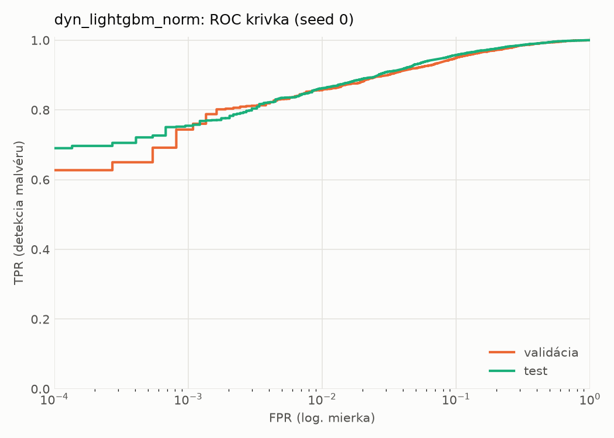
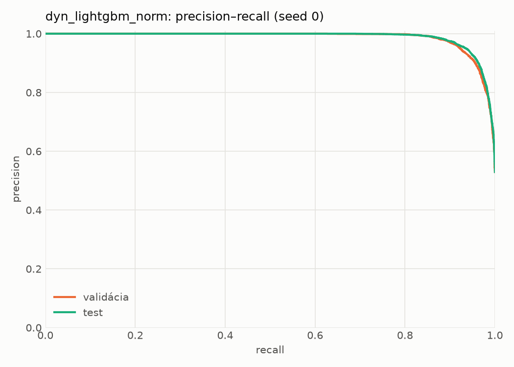
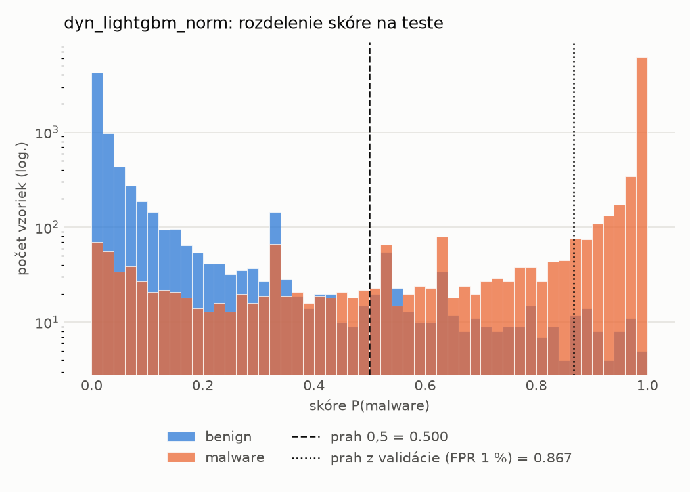
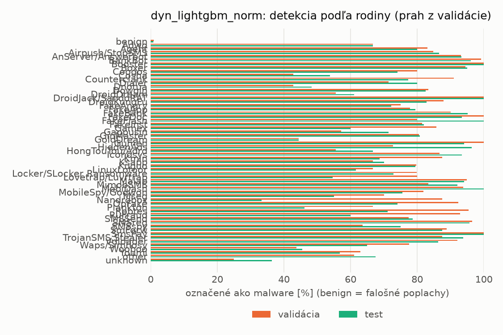
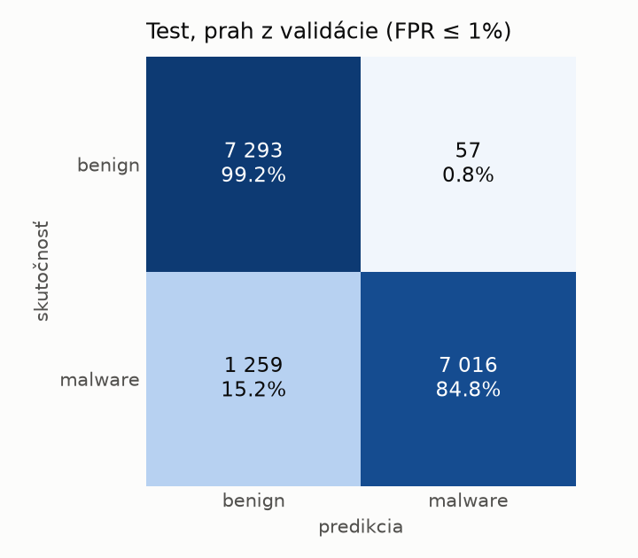
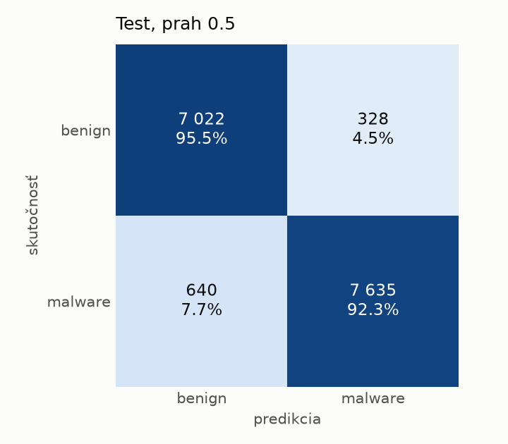
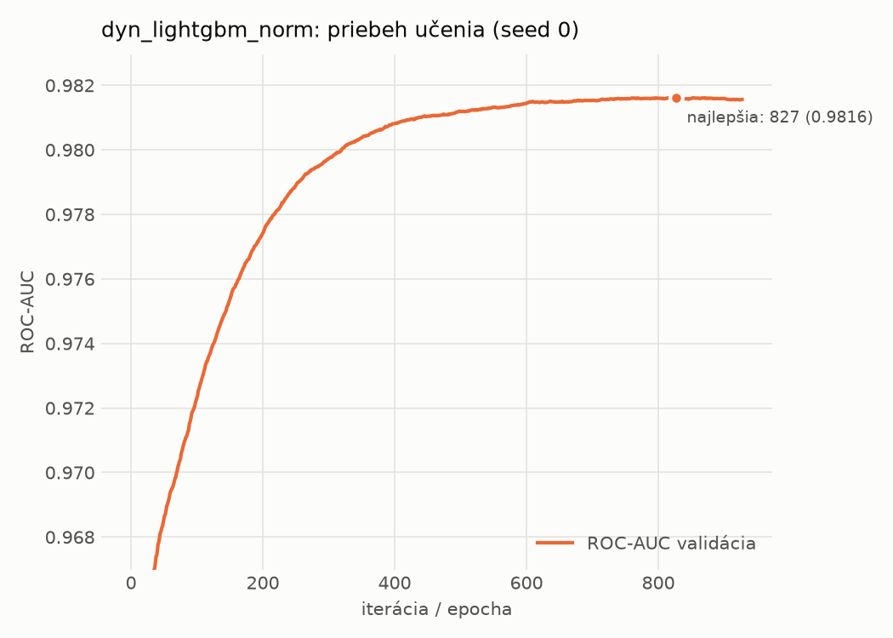

# dynamic_norm/dyn_lightgbm_norm – beh `20261122-201826`

> Automaticky generované (`src/training/run_tabular.py`). Konfigurácia: `config.yaml`, protokol: `protocol.yaml`.

- **Model:** `lightgbm` – dynamic lightgbm s dynamikou ako podiely systémových volaní (kontrola artefaktu množstva aktivity)
- **Ladenie:** bez ladenia – hyperparametre prevzaté z `runs_v4/real_full/full/dynamic/lightgbm/20261122-191914`
- **Finálne modely:** seedy [0, 1, 2]; hodnoty sú priemer ± smerodajná odchýlka cez seedy
- **Najlepšie hyperparametre:** `{"num_boost_round": 5000, "early_stopping_rounds": 100, "learning_rate": 0.017901592505193763, "num_leaves": 251, "min_child_samples": 52, "feature_fraction": 0.9358255991772038, "bagging_fraction": 0.8815171244905227, "lambda_l1": 0.02987319702672823, "lambda_l2": 0.017348460156736675}`

## Detekčná kvalita (bez prahu)
| metrika | train (podvzorka) | validácia | test |
|---|---|---|---|
| ROC-AUC | 0.9994 ± 0.0000 | 0.9816 ± 0.0000 | 0.9838 ± 0.0001 |
| PR-AUC | 0.9995 ± 0.0000 | 0.9864 ± 0.0000 | 0.9879 ± 0.0001 |
| TPR pri FPR 1 % | 0.9893 ± 0.0002 | 0.8552 ± 0.0018 | 0.8624 ± 0.0011 |
| TPR pri FPR 0,1 % | 0.9654 ± 0.0013 | 0.7408 ± 0.0029 | 0.7502 ± 0.0038 |
| log loss | 0.0416 ± 0.0014 | 0.1686 ± 0.0005 | 0.1564 ± 0.0007 |
| Brier skóre | 0.0095 ± 0.0003 | 0.0490 ± 0.0000 | 0.0454 ± 0.0001 |

Rozdiel ROC-AUC train − validácia: **0.0178** (veľký rozdiel = preučenie).

## Pri prahu z validácie (FPR ≤ 1% na validácii)
| metrika | train (podvzorka) | validácia | test |
|---|---|---|---|
| accuracy | 0.9674 ± 0.0023 | 0.9187 ± 0.0010 | 0.9167 ± 0.0019 |
| balanced accuracy | 0.9689 ± 0.0022 | 0.9227 ± 0.0010 | 0.9209 ± 0.0018 |
| precision | 0.9998 ± 0.0000 | 0.9900 ± 0.0002 | 0.9926 ± 0.0008 |
| recall (TPR) | 0.9381 ± 0.0044 | 0.8552 ± 0.0018 | 0.8490 ± 0.0039 |
| FPR | 0.0002 ± 0.0000 | 0.0097 ± 0.0002 | 0.0071 ± 0.0008 |
| F1 | 0.9680 ± 0.0023 | 0.9177 ± 0.0011 | 0.9152 ± 0.0021 |
| MCC | 0.9368 ± 0.0043 | 0.8471 ± 0.0018 | 0.8441 ± 0.0032 |

## Pri pevnom prahu 0.5
| metrika | train (podvzorka) | validácia | test |
|---|---|---|---|
| accuracy | 0.9883 ± 0.0003 | 0.9345 ± 0.0004 | 0.9387 ± 0.0006 |
| balanced accuracy | 0.9885 ± 0.0003 | 0.9354 ± 0.0004 | 0.9397 ± 0.0006 |
| precision | 0.9935 ± 0.0000 | 0.9548 ± 0.0005 | 0.9599 ± 0.0010 |
| recall (TPR) | 0.9841 ± 0.0006 | 0.9199 ± 0.0007 | 0.9228 ± 0.0001 |
| FPR | 0.0072 ± 0.0000 | 0.0491 ± 0.0006 | 0.0434 ± 0.0011 |
| F1 | 0.9888 ± 0.0003 | 0.9370 ± 0.0004 | 0.9410 ± 0.0005 |
| MCC | 0.9765 ± 0.0006 | 0.8694 ± 0.0009 | 0.8779 ± 0.0012 |

## Výpočtové nároky (seed 0, testovacia množina)
| meranie | hodnota |
|---|---|
| tréning finálneho modelu | 21.0 s (priemer cez seedy) |
| ladenie spolu | 0 s |
| počet parametrov / uzlov | 414 327 |
| veľkosť modelu na disku | 23.18 MB |
| CPU latencia modelu (batch 1, 1 vlákno) | 0.156 ms (p95 0.180) |
| CPU priepustnosť (24 vlákien) | 88 461 vzoriek/s |

## Grafy
| | |
|---|---|
|  |  |
|  |  |
|  |  |
|  |  |

## Súbory
`metrics.json` (všetky metriky po seedoch vrátane rodín), `timing.json`, `hpo_trials.csv`,
`predictions/<časť>_seed<N>.parquet` (sha256, family, label, score), `model/seed_<N>/`, `log.txt`.
