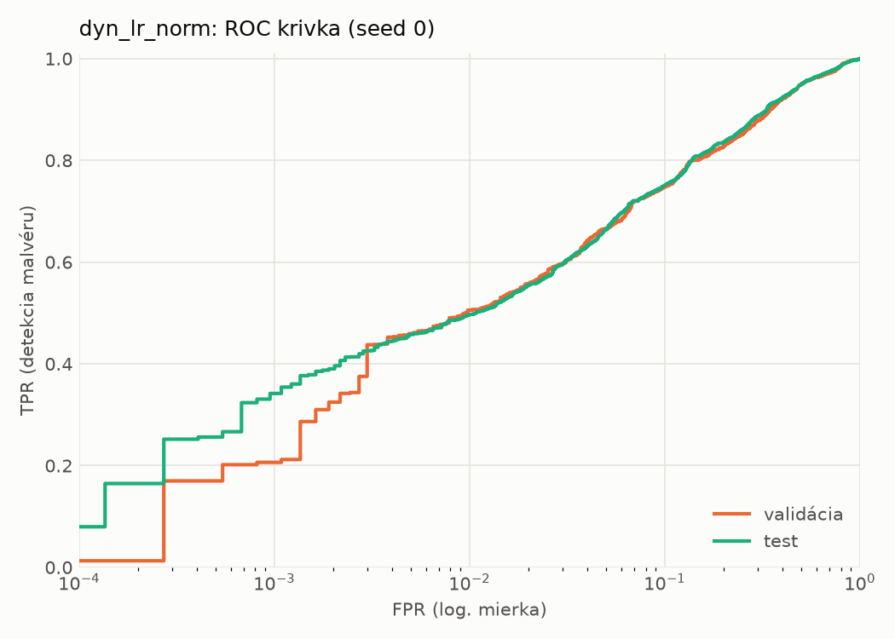
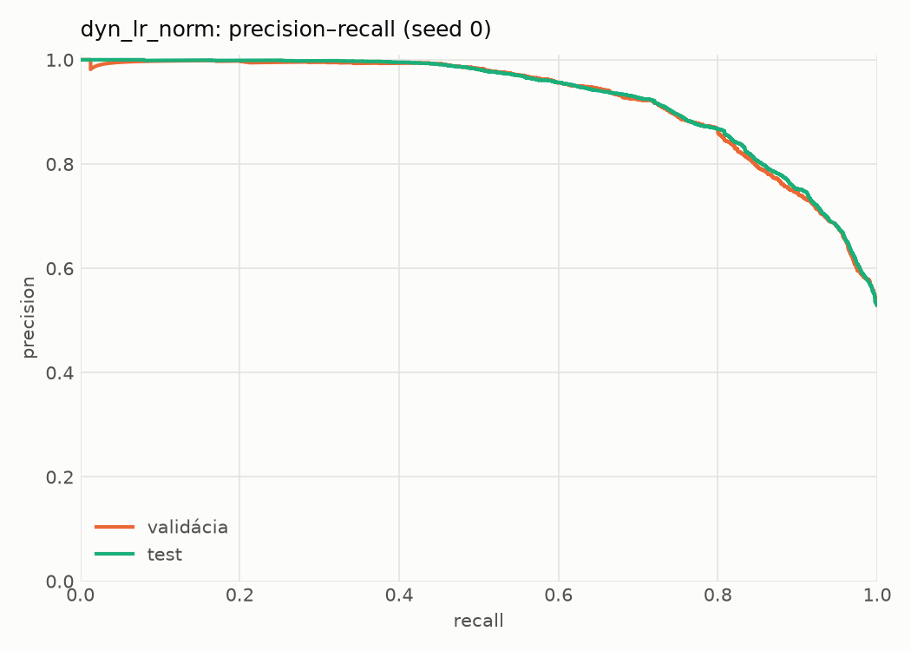
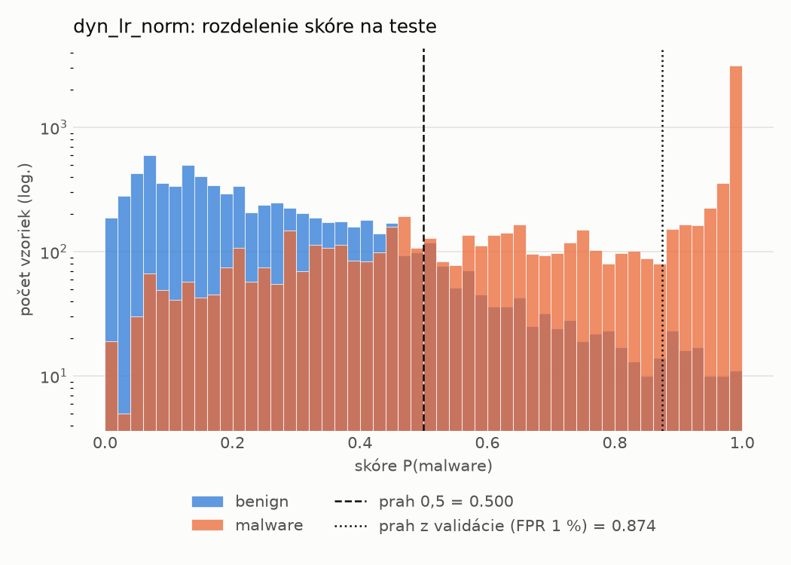
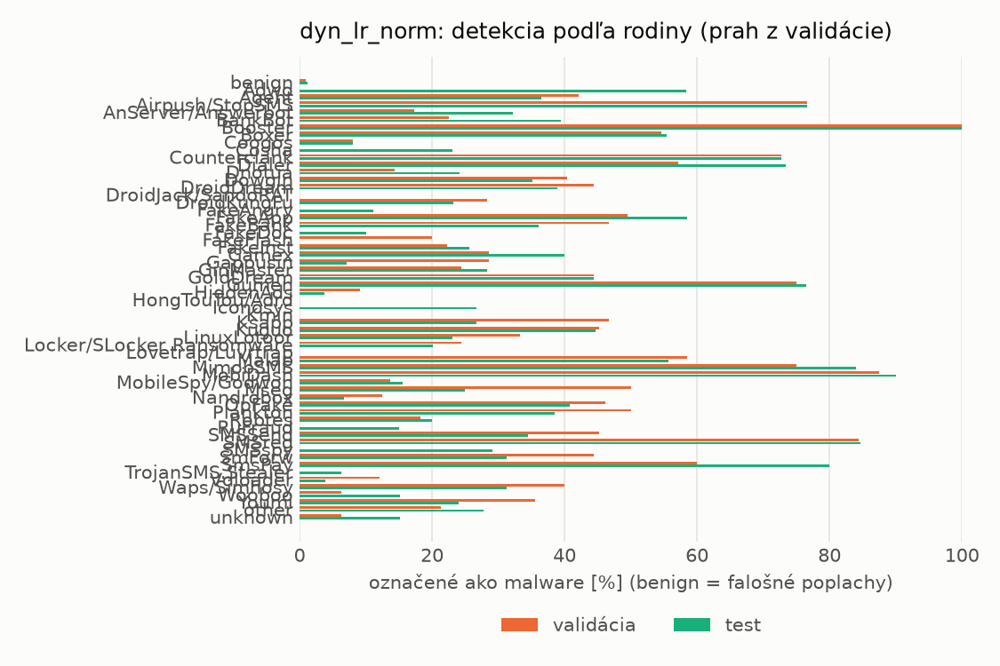
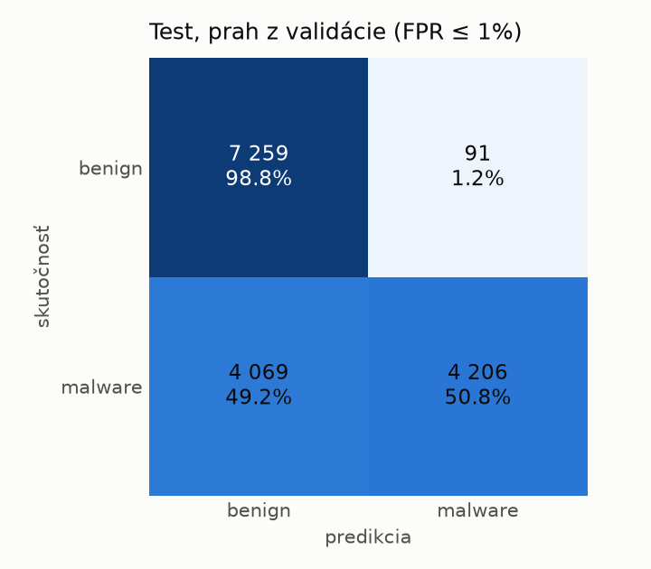
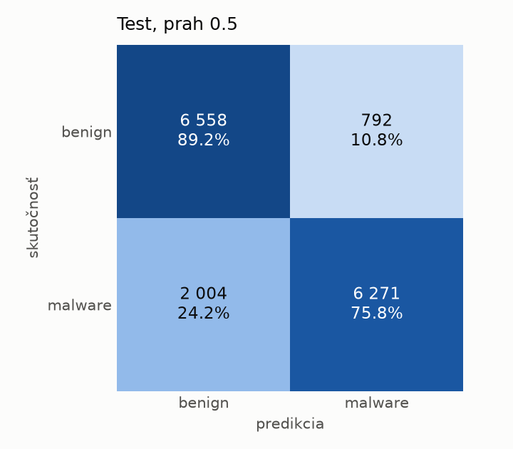

# dynamic_norm/dyn_lr_norm – beh `20261122-201943`

> Automaticky generované (`src/training/run_tabular.py`). Konfigurácia: `config.yaml`, protokol: `protocol.yaml`.

- **Model:** `logreg` – dynamic lr s dynamikou ako podiely systémových volaní (kontrola artefaktu množstva aktivity)
- **Ladenie:** bez ladenia – hyperparametre prevzaté z `runs_v4/real_full/full/dynamic/lr/20261122-191725`
- **Finálne modely:** seedy [0, 1, 2]; hodnoty sú priemer ± smerodajná odchýlka cez seedy
- **Najlepšie hyperparametre:** `{"max_iter": 2000, "C": 3.784688828069828}`

## Detekčná kvalita (bez prahu)
| metrika | train (podvzorka) | validácia | test |
|---|---|---|---|
| ROC-AUC | 0.9074 ± 0.0000 | 0.9011 ± 0.0000 | 0.9040 ± 0.0000 |
| PR-AUC | 0.9284 ± 0.0000 | 0.9238 ± 0.0000 | 0.9265 ± 0.0000 |
| TPR pri FPR 1 % | 0.5246 ± 0.0000 | 0.5054 ± 0.0000 | 0.4968 ± 0.0000 |
| TPR pri FPR 0,1 % | 0.3305 ± 0.0000 | 0.2063 ± 0.0000 | 0.3418 ± 0.0000 |
| log loss | 0.3797 ± 0.0000 | 0.3962 ± 0.0000 | 0.3917 ± 0.0000 |
| Brier skóre | 0.1216 ± 0.0000 | 0.1259 ± 0.0000 | 0.1246 ± 0.0000 |

Rozdiel ROC-AUC train − validácia: **0.0063** (veľký rozdiel = preučenie).

## Pri prahu z validácie (FPR ≤ 1% na validácii)
| metrika | train (podvzorka) | validácia | test |
|---|---|---|---|
| accuracy | 0.7458 ± 0.0000 | 0.7334 ± 0.0000 | 0.7338 ± 0.0000 |
| balanced accuracy | 0.7576 ± 0.0000 | 0.7478 ± 0.0000 | 0.7479 ± 0.0000 |
| precision | 0.9822 ± 0.0000 | 0.9831 ± 0.0000 | 0.9788 ± 0.0000 |
| recall (TPR) | 0.5258 ± 0.0000 | 0.5054 ± 0.0000 | 0.5083 ± 0.0000 |
| FPR | 0.0105 ± 0.0000 | 0.0098 ± 0.0000 | 0.0124 ± 0.0000 |
| F1 | 0.6849 ± 0.0000 | 0.6676 ± 0.0000 | 0.6691 ± 0.0000 |
| MCC | 0.5722 ± 0.0000 | 0.5557 ± 0.0000 | 0.5543 ± 0.0000 |

## Pri pevnom prahu 0.5
| metrika | train (podvzorka) | validácia | test |
|---|---|---|---|
| accuracy | 0.8271 ± 0.0000 | 0.8189 ± 0.0000 | 0.8211 ± 0.0000 |
| balanced accuracy | 0.8304 ± 0.0000 | 0.8231 ± 0.0000 | 0.8250 ± 0.0000 |
| precision | 0.8904 ± 0.0000 | 0.8883 ± 0.0000 | 0.8879 ± 0.0000 |
| recall (TPR) | 0.7652 ± 0.0000 | 0.7528 ± 0.0000 | 0.7578 ± 0.0000 |
| FPR | 0.1043 ± 0.0000 | 0.1067 ± 0.0000 | 0.1078 ± 0.0000 |
| F1 | 0.8230 ± 0.0000 | 0.8150 ± 0.0000 | 0.8177 ± 0.0000 |
| MCC | 0.6631 ± 0.0000 | 0.6484 ± 0.0000 | 0.6519 ± 0.0000 |

## Výpočtové nároky (seed 0, testovacia množina)
| meranie | hodnota |
|---|---|
| tréning finálneho modelu | 1.2 s (priemer cez seedy) |
| ladenie spolu | 0 s |
| počet parametrov / uzlov | 131 |
| veľkosť modelu na disku | 0.01 MB |
| transformácia vstupu – latencia (1 vlákno) | 0.005 ms |
| transformácia vstupu – priepustnosť | 1 368 657 vzoriek/s |
| CPU latencia modelu (batch 1, 1 vlákno) | 0.004 ms (p95 0.004) |
| CPU priepustnosť (24 vlákien) | 4 248 579 vzoriek/s |

## Grafy
| | |
|---|---|
|  |  |
|  |  |
|  |  |
|  |  |

## Súbory
`metrics.json` (všetky metriky po seedoch vrátane rodín), `timing.json`, `hpo_trials.csv`,
`predictions/<časť>_seed<N>.parquet` (sha256, family, label, score), `model/seed_<N>/`, `log.txt`.
