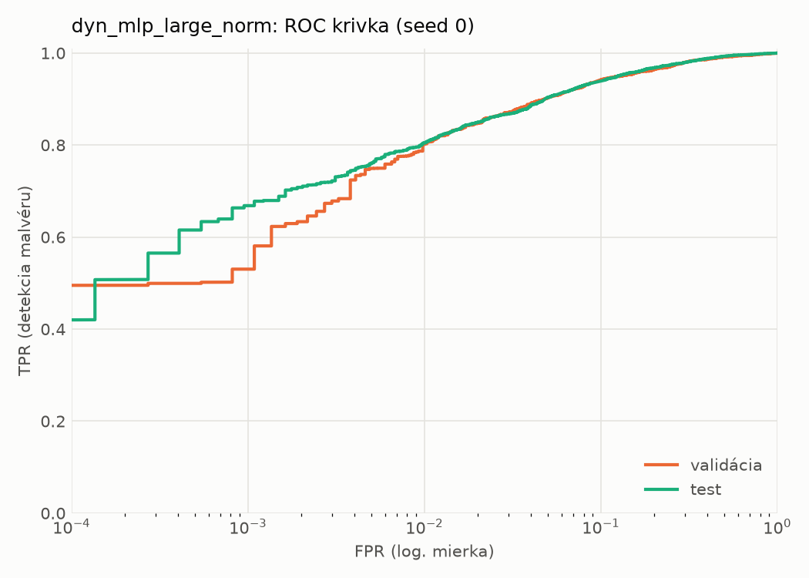
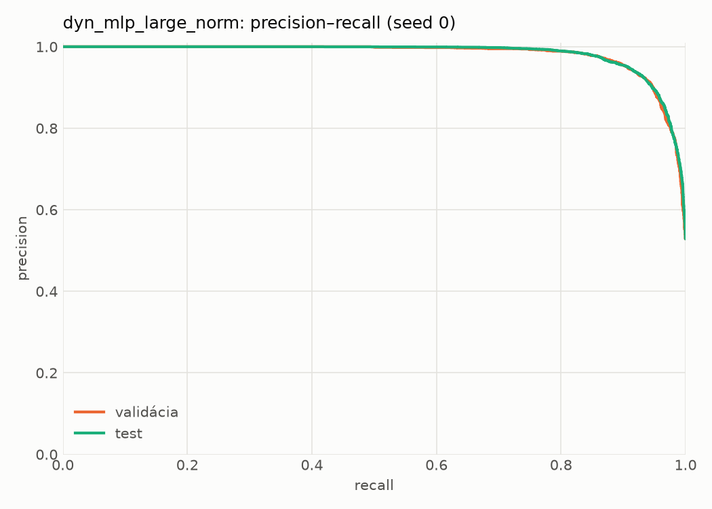
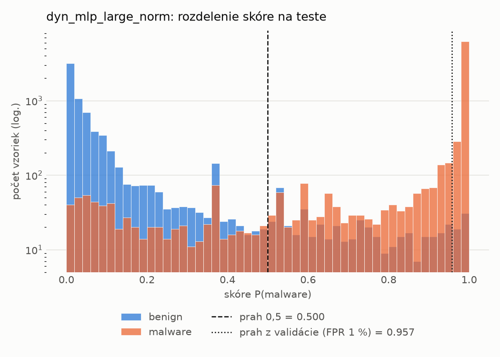
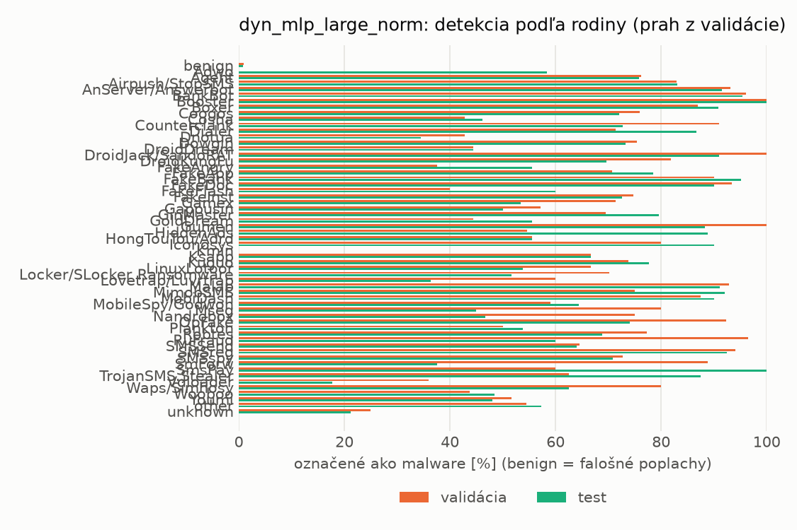
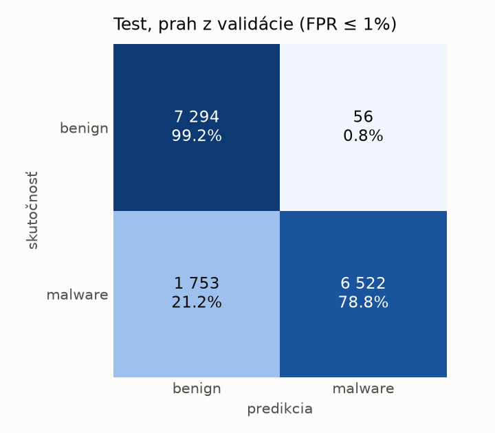
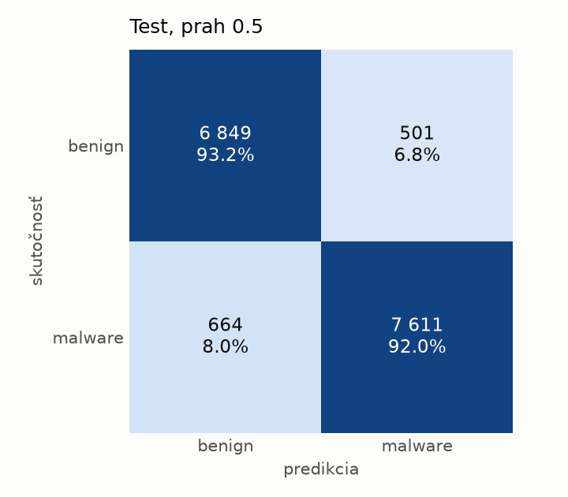
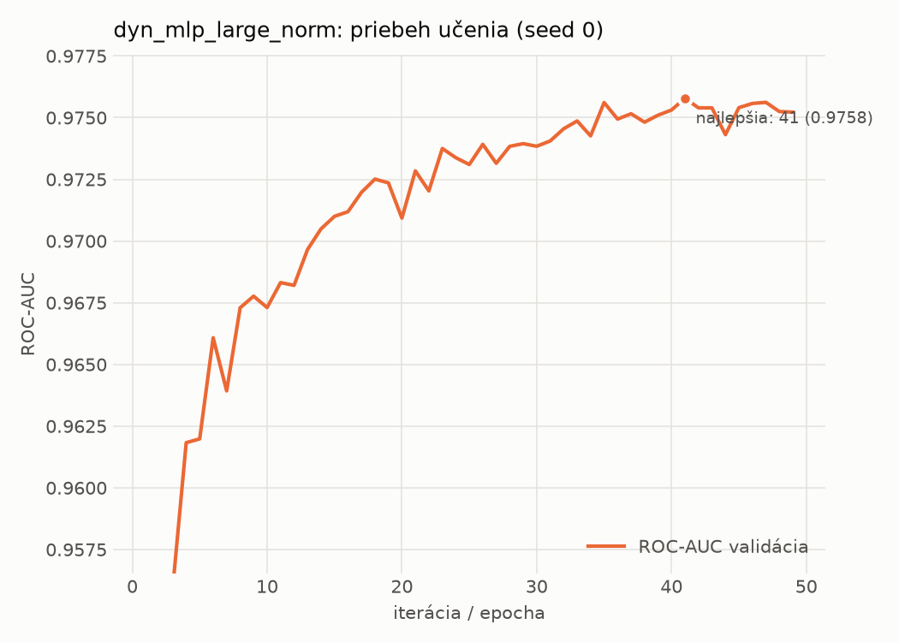

# dynamic_norm/dyn_mlp_large_norm – beh `20261122-201948`

> Automaticky generované (`src/training/run_tabular.py`). Konfigurácia: `config.yaml`, protokol: `protocol.yaml`.

- **Model:** `mlp` – dynamic mlp_large s dynamikou ako podiely systémových volaní (kontrola artefaktu množstva aktivity)
- **Ladenie:** bez ladenia – hyperparametre prevzaté z `runs_v4/real_full/full/dynamic/mlp_large/20261122-194320`
- **Finálne modely:** seedy [0, 1, 2]; hodnoty sú priemer ± smerodajná odchýlka cez seedy
- **Najlepšie hyperparametre:** `{"max_epochs": 100, "patience": 8, "hidden_layers": 3, "hidden_width": 512, "width_decay": 1.0, "dropout": 0.16077310300541978, "lr": 0.0005048635567863703, "weight_decay": 0.004783411439856203, "batch_size": 1024}`

## Detekčná kvalita (bez prahu)
| metrika | train (podvzorka) | validácia | test |
|---|---|---|---|
| ROC-AUC | 0.9880 ± 0.0013 | 0.9762 ± 0.0006 | 0.9776 ± 0.0003 |
| PR-AUC | 0.9908 ± 0.0009 | 0.9823 ± 0.0005 | 0.9831 ± 0.0003 |
| TPR pri FPR 1 % | 0.8918 ± 0.0080 | 0.7989 ± 0.0024 | 0.8061 ± 0.0024 |
| TPR pri FPR 0,1 % | 0.8110 ± 0.0075 | 0.5719 ± 0.0439 | 0.6778 ± 0.0093 |
| log loss | 0.1302 ± 0.0071 | 0.2004 ± 0.0028 | 0.1910 ± 0.0015 |
| Brier skóre | 0.0377 ± 0.0022 | 0.0555 ± 0.0011 | 0.0546 ± 0.0009 |

Rozdiel ROC-AUC train − validácia: **0.0118** (veľký rozdiel = preučenie).

## Pri prahu z validácie (FPR ≤ 1% na validácii)
| metrika | train (podvzorka) | validácia | test |
|---|---|---|---|
| accuracy | 0.8991 ± 0.0002 | 0.8889 ± 0.0012 | 0.8836 ± 0.0011 |
| balanced accuracy | 0.9040 ± 0.0002 | 0.8946 ± 0.0012 | 0.8897 ± 0.0011 |
| precision | 0.9990 ± 0.0004 | 0.9893 ± 0.0002 | 0.9921 ± 0.0005 |
| recall (TPR) | 0.8089 ± 0.0001 | 0.7989 ± 0.0024 | 0.7864 ± 0.0023 |
| FPR | 0.0009 ± 0.0003 | 0.0097 ± 0.0002 | 0.0071 ± 0.0005 |
| F1 | 0.8939 ± 0.0001 | 0.8840 ± 0.0014 | 0.8774 ± 0.0014 |
| MCC | 0.8160 ± 0.0004 | 0.7962 ± 0.0020 | 0.7882 ± 0.0019 |

## Pri pevnom prahu 0.5
| metrika | train (podvzorka) | validácia | test |
|---|---|---|---|
| accuracy | 0.9520 ± 0.0024 | 0.9265 ± 0.0018 | 0.9284 ± 0.0026 |
| balanced accuracy | 0.9525 ± 0.0024 | 0.9268 ± 0.0019 | 0.9288 ± 0.0027 |
| precision | 0.9657 ± 0.0031 | 0.9373 ± 0.0023 | 0.9424 ± 0.0036 |
| recall (TPR) | 0.9420 ± 0.0026 | 0.9231 ± 0.0019 | 0.9210 ± 0.0013 |
| FPR | 0.0370 ± 0.0034 | 0.0696 ± 0.0027 | 0.0634 ± 0.0042 |
| F1 | 0.9537 ± 0.0023 | 0.9301 ± 0.0017 | 0.9316 ± 0.0024 |
| MCC | 0.9041 ± 0.0049 | 0.8528 ± 0.0037 | 0.8567 ± 0.0052 |

## Výpočtové nároky (seed 0, testovacia množina)
| meranie | hodnota |
|---|---|
| tréning finálneho modelu | 8.0 s (priemer cez seedy) |
| ladenie spolu | 0 s |
| počet parametrov / uzlov | 595 969 |
| veľkosť modelu na disku | 2.41 MB |
| transformácia vstupu – latencia (1 vlákno) | 0.015 ms |
| transformácia vstupu – priepustnosť | 782 620 vzoriek/s |
| CPU latencia modelu (batch 1, 1 vlákno) | 0.175 ms (p95 0.191) |
| CPU priepustnosť (24 vlákien) | 601 524 vzoriek/s |
| GPU latencia (batch 1) | 0.444 ms (p95 0.927) |
| GPU priepustnosť | 2 307 806 vzoriek/s |
| GPU špičková pamäť | 97 MB |

## Grafy
| | |
|---|---|
|  |  |
|  |  |
|  |  |
|  |  |

## Súbory
`metrics.json` (všetky metriky po seedoch vrátane rodín), `timing.json`, `hpo_trials.csv`,
`predictions/<časť>_seed<N>.parquet` (sha256, family, label, score), `model/seed_<N>/`, `log.txt`.
