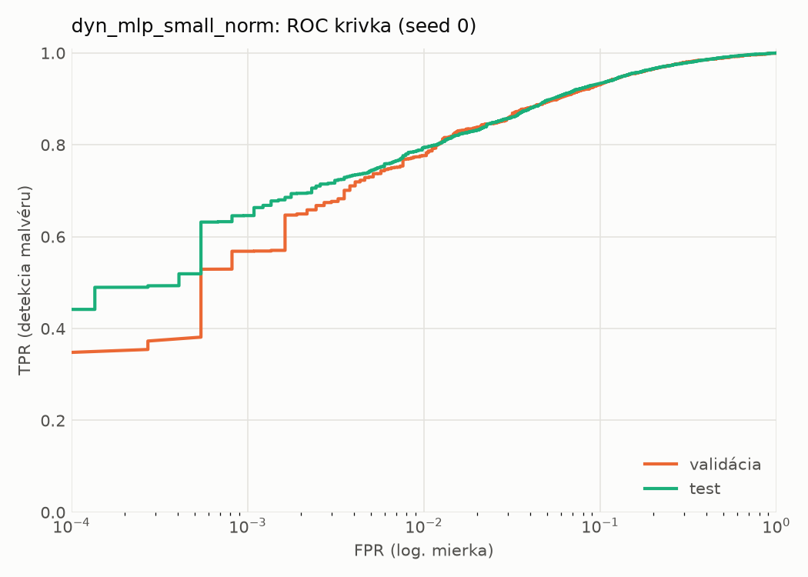
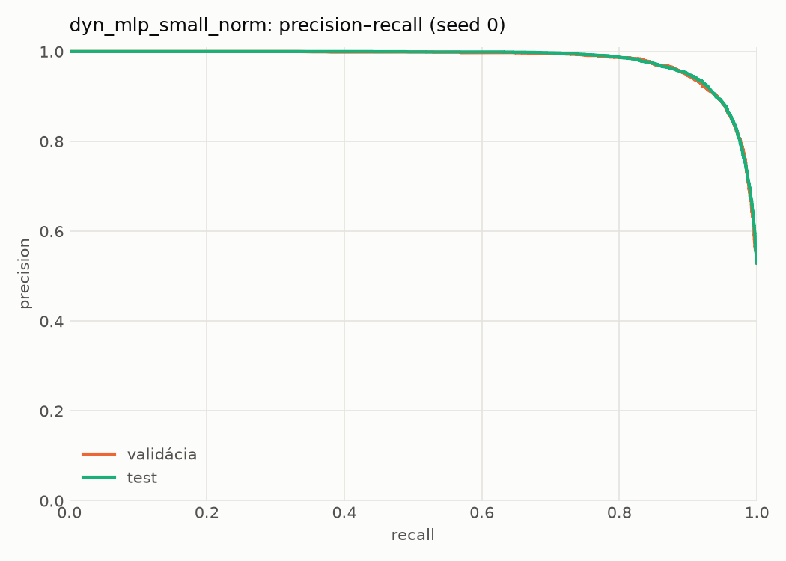
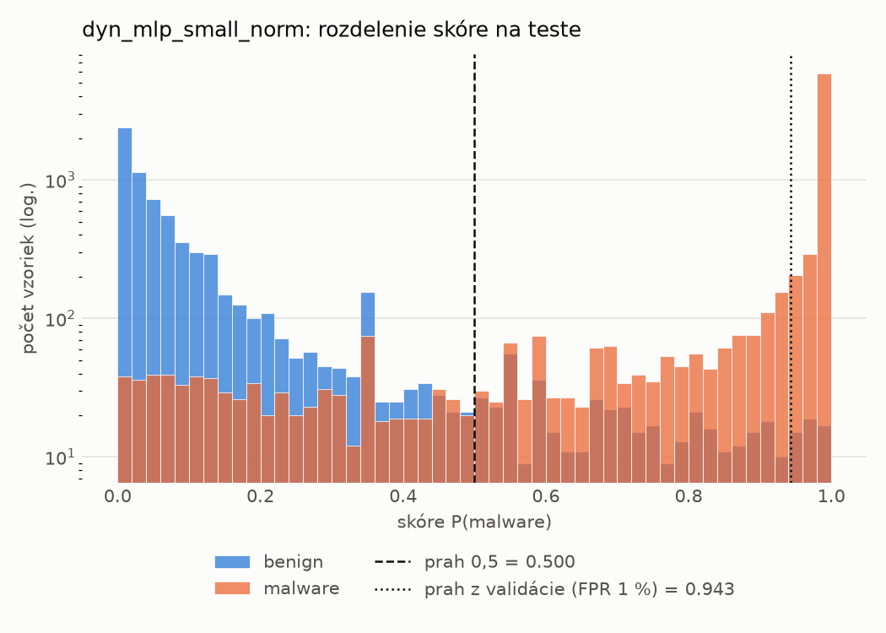
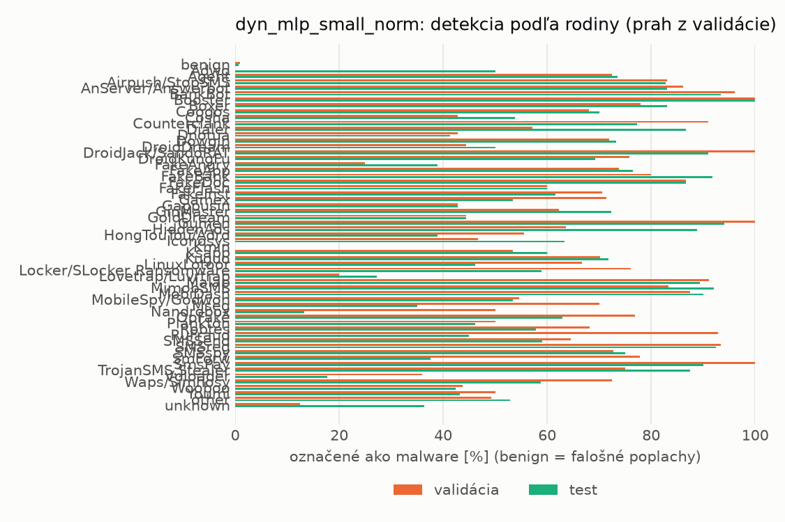
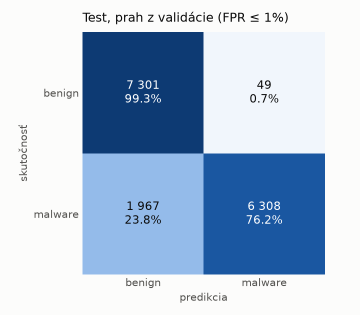
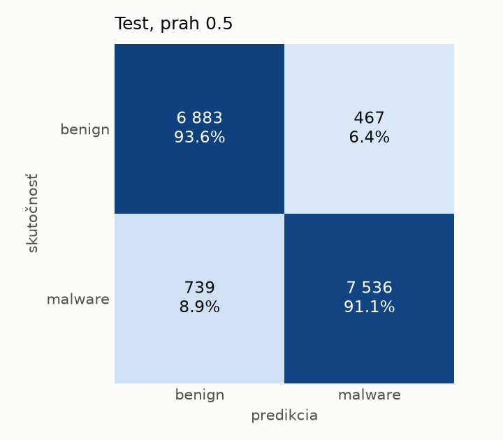
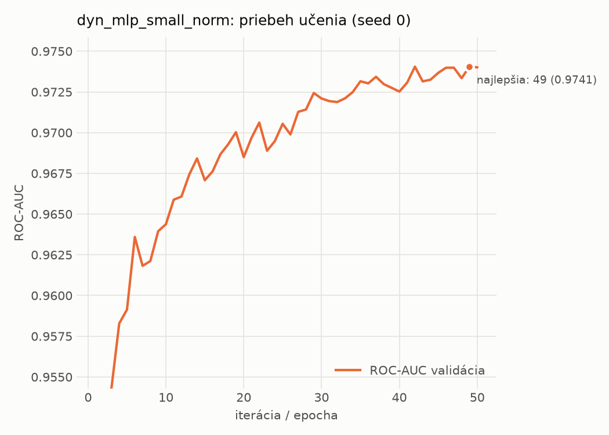

# dynamic_norm/dyn_mlp_small_norm – beh `20261122-202014`

> Automaticky generované (`src/training/run_tabular.py`). Konfigurácia: `config.yaml`, protokol: `protocol.yaml`.

- **Model:** `mlp` – dynamic mlp_small s dynamikou ako podiely systémových volaní (kontrola artefaktu množstva aktivity)
- **Ladenie:** bez ladenia – hyperparametre prevzaté z `runs_v4/real_full/full/dynamic/mlp_small/20261122-193213`
- **Finálne modely:** seedy [0, 1, 2]; hodnoty sú priemer ± smerodajná odchýlka cez seedy
- **Najlepšie hyperparametre:** `{"width_decay": 0.5, "max_epochs": 100, "patience": 8, "hidden_layers": 2, "hidden_width": 256, "dropout": 0.2449160262890371, "lr": 0.002872548733508973, "weight_decay": 4.509331245708397e-06, "batch_size": 256}`

## Detekčná kvalita (bez prahu)
| metrika | train (podvzorka) | validácia | test |
|---|---|---|---|
| ROC-AUC | 0.9829 ± 0.0010 | 0.9747 ± 0.0005 | 0.9759 ± 0.0009 |
| PR-AUC | 0.9872 ± 0.0007 | 0.9809 ± 0.0004 | 0.9819 ± 0.0006 |
| TPR pri FPR 1 % | 0.8621 ± 0.0135 | 0.7889 ± 0.0108 | 0.7959 ± 0.0036 |
| TPR pri FPR 0,1 % | 0.7552 ± 0.0072 | 0.5455 ± 0.0378 | 0.6623 ± 0.0155 |
| log loss | 0.1567 ± 0.0045 | 0.2021 ± 0.0027 | 0.1944 ± 0.0031 |
| Brier skóre | 0.0457 ± 0.0016 | 0.0580 ± 0.0006 | 0.0566 ± 0.0011 |

Rozdiel ROC-AUC train − validácia: **0.0082** (veľký rozdiel = preučenie).

## Pri prahu z validácie (FPR ≤ 1% na validácii)
| metrika | train (podvzorka) | validácia | test |
|---|---|---|---|
| accuracy | 0.8927 ± 0.0061 | 0.8836 ± 0.0058 | 0.8775 ± 0.0057 |
| balanced accuracy | 0.8978 ± 0.0058 | 0.8896 ± 0.0054 | 0.8839 ± 0.0053 |
| precision | 0.9979 ± 0.0003 | 0.9892 ± 0.0003 | 0.9913 ± 0.0009 |
| recall (TPR) | 0.7975 ± 0.0120 | 0.7889 ± 0.0108 | 0.7755 ± 0.0115 |
| FPR | 0.0018 ± 0.0003 | 0.0097 ± 0.0002 | 0.0077 ± 0.0009 |
| F1 | 0.8865 ± 0.0073 | 0.8778 ± 0.0068 | 0.8702 ± 0.0069 |
| MCC | 0.8050 ± 0.0101 | 0.7874 ± 0.0095 | 0.7780 ± 0.0090 |

## Pri pevnom prahu 0.5
| metrika | train (podvzorka) | validácia | test |
|---|---|---|---|
| accuracy | 0.9405 ± 0.0035 | 0.9204 ± 0.0007 | 0.9250 ± 0.0021 |
| balanced accuracy | 0.9413 ± 0.0035 | 0.9209 ± 0.0007 | 0.9259 ± 0.0021 |
| precision | 0.9601 ± 0.0040 | 0.9363 ± 0.0017 | 0.9452 ± 0.0032 |
| recall (TPR) | 0.9252 ± 0.0031 | 0.9117 ± 0.0014 | 0.9112 ± 0.0029 |
| FPR | 0.0426 ± 0.0044 | 0.0698 ± 0.0021 | 0.0595 ± 0.0037 |
| F1 | 0.9423 ± 0.0033 | 0.9238 ± 0.0006 | 0.9279 ± 0.0020 |
| MCC | 0.8816 ± 0.0070 | 0.8407 ± 0.0015 | 0.8504 ± 0.0042 |

## Výpočtové nároky (seed 0, testovacia množina)
| meranie | hodnota |
|---|---|
| tréning finálneho modelu | 23.4 s (priemer cez seedy) |
| ladenie spolu | 0 s |
| počet parametrov / uzlov | 67 329 |
| veľkosť modelu na disku | 0.28 MB |
| transformácia vstupu – latencia (1 vlákno) | 0.015 ms |
| transformácia vstupu – priepustnosť | 778 871 vzoriek/s |
| CPU latencia modelu (batch 1, 1 vlákno) | 0.106 ms (p95 0.240) |
| CPU priepustnosť (24 vlákien) | 2 052 249 vzoriek/s |
| GPU latencia (batch 1) | 0.638 ms (p95 0.671) |
| GPU priepustnosť | 2 175 426 vzoriek/s |
| GPU špičková pamäť | 109 MB |

## Grafy
| | |
|---|---|
|  |  |
|  |  |
|  |  |
|  |  |

## Súbory
`metrics.json` (všetky metriky po seedoch vrátane rodín), `timing.json`, `hpo_trials.csv`,
`predictions/<časť>_seed<N>.parquet` (sha256, family, label, score), `model/seed_<N>/`, `log.txt`.
