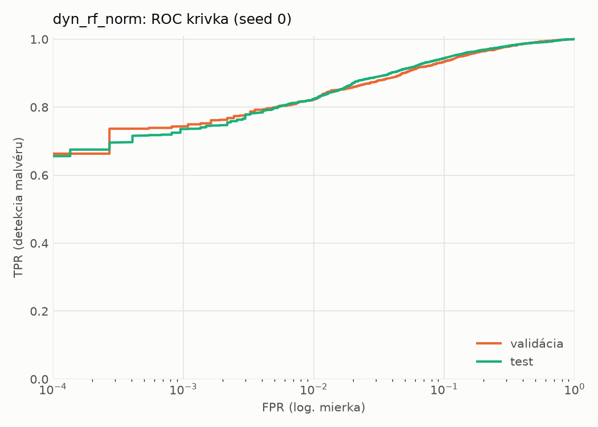
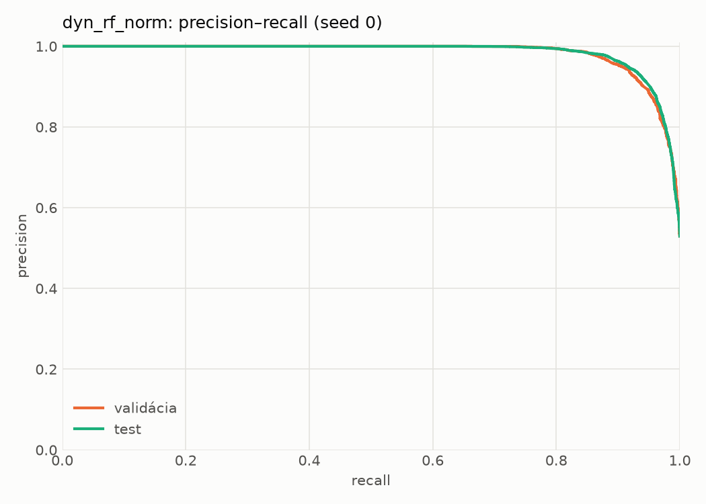
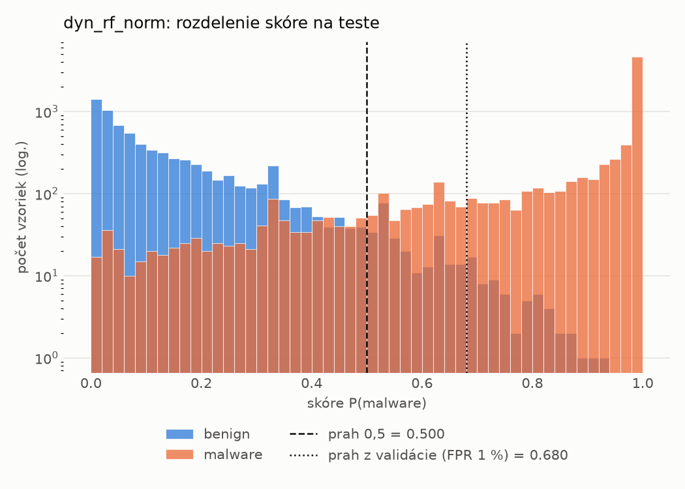
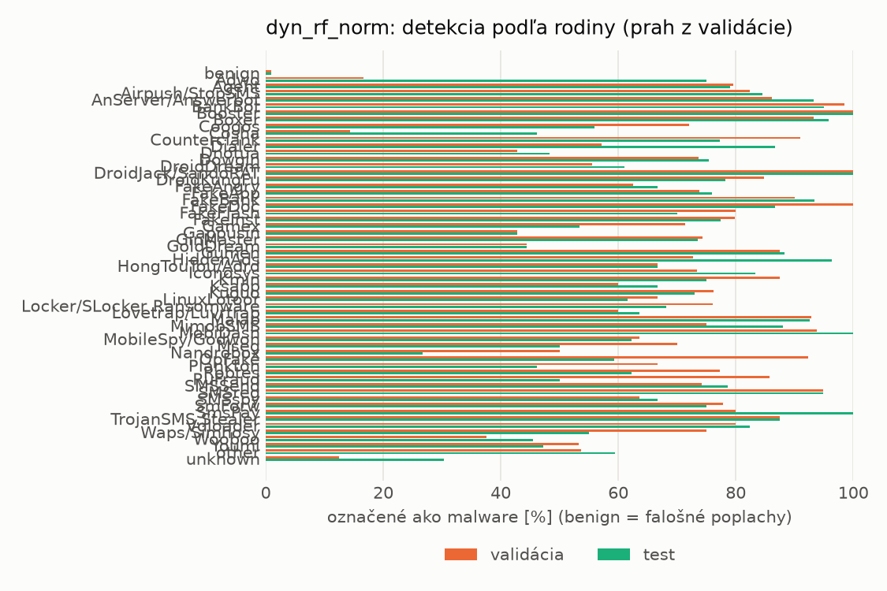
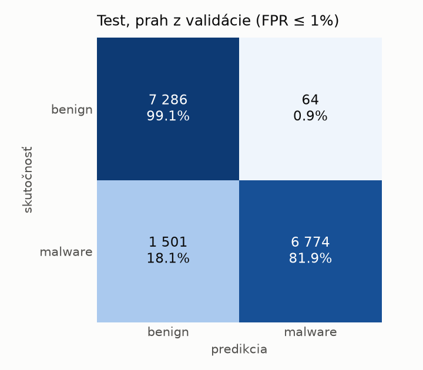
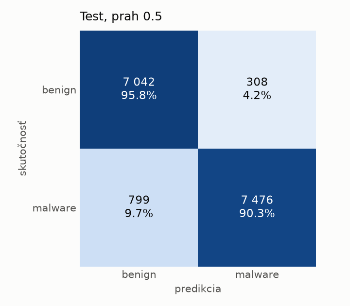

# dynamic_norm/dyn_rf_norm – beh `20261122-202126`

> Automaticky generované (`src/training/run_tabular.py`). Konfigurácia: `config.yaml`, protokol: `protocol.yaml`.

- **Model:** `random_forest` – dynamic rf s dynamikou ako podiely systémových volaní (kontrola artefaktu množstva aktivity)
- **Ladenie:** bez ladenia – hyperparametre prevzaté z `runs_v4/real_full/full/dynamic/rf/20261122-191738`
- **Finálne modely:** seedy [0, 1, 2]; hodnoty sú priemer ± smerodajná odchýlka cez seedy
- **Najlepšie hyperparametre:** `{"n_estimators": 500, "max_depth": 32, "min_samples_leaf": 1, "max_features": "sqrt"}`

## Detekčná kvalita (bez prahu)
| metrika | train (podvzorka) | validácia | test |
|---|---|---|---|
| ROC-AUC | 0.9992 ± 0.0000 | 0.9765 ± 0.0001 | 0.9780 ± 0.0001 |
| PR-AUC | 0.9993 ± 0.0000 | 0.9828 ± 0.0001 | 0.9841 ± 0.0001 |
| TPR pri FPR 1 % | 0.9913 ± 0.0001 | 0.8264 ± 0.0041 | 0.8255 ± 0.0022 |
| TPR pri FPR 0,1 % | 0.9586 ± 0.0004 | 0.7422 ± 0.0052 | 0.7366 ± 0.0026 |
| log loss | 0.0700 ± 0.0000 | 0.2009 ± 0.0002 | 0.1975 ± 0.0003 |
| Brier skóre | 0.0138 ± 0.0000 | 0.0588 ± 0.0001 | 0.0570 ± 0.0001 |

Rozdiel ROC-AUC train − validácia: **0.0227** (veľký rozdiel = preučenie).

## Pri prahu z validácie (FPR ≤ 1% na validácii)
| metrika | train (podvzorka) | validácia | test |
|---|---|---|---|
| accuracy | 0.9735 ± 0.0009 | 0.9034 ± 0.0022 | 0.9017 ± 0.0017 |
| balanced accuracy | 0.9748 ± 0.0008 | 0.9083 ± 0.0020 | 0.9067 ± 0.0016 |
| precision | 0.9998 ± 0.0000 | 0.9896 ± 0.0001 | 0.9903 ± 0.0005 |
| recall (TPR) | 0.9498 ± 0.0017 | 0.8264 ± 0.0041 | 0.8225 ± 0.0034 |
| FPR | 0.0002 ± 0.0000 | 0.0098 ± 0.0000 | 0.0091 ± 0.0005 |
| F1 | 0.9741 ± 0.0009 | 0.9006 ± 0.0024 | 0.8986 ± 0.0019 |
| MCC | 0.9483 ± 0.0017 | 0.8206 ± 0.0037 | 0.8179 ± 0.0028 |

## Pri pevnom prahu 0.5
| metrika | train (podvzorka) | validácia | test |
|---|---|---|---|
| accuracy | 0.9900 ± 0.0001 | 0.9245 ± 0.0005 | 0.9292 ± 0.0001 |
| balanced accuracy | 0.9902 ± 0.0001 | 0.9260 ± 0.0005 | 0.9308 ± 0.0001 |
| precision | 0.9934 ± 0.0001 | 0.9545 ± 0.0004 | 0.9610 ± 0.0005 |
| recall (TPR) | 0.9876 ± 0.0001 | 0.9003 ± 0.0007 | 0.9029 ± 0.0005 |
| FPR | 0.0072 ± 0.0001 | 0.0483 ± 0.0004 | 0.0412 ± 0.0006 |
| F1 | 0.9905 ± 0.0001 | 0.9266 ± 0.0005 | 0.9310 ± 0.0001 |
| MCC | 0.9800 ± 0.0001 | 0.8505 ± 0.0010 | 0.8602 ± 0.0002 |

## Výpočtové nároky (seed 0, testovacia množina)
| meranie | hodnota |
|---|---|
| tréning finálneho modelu | 4.6 s (priemer cez seedy) |
| ladenie spolu | 0 s |
| počet parametrov / uzlov | 4 134 084 |
| veľkosť modelu na disku | 331.15 MB |
| CPU latencia modelu (batch 1, 1 vlákno) | 15.790 ms (p95 16.255) |
| CPU priepustnosť (24 vlákien) | 124 913 vzoriek/s |

## Grafy
| | |
|---|---|
|  |  |
|  |  |
|  |  |
|  |  |

## Súbory
`metrics.json` (všetky metriky po seedoch vrátane rodín), `timing.json`, `hpo_trials.csv`,
`predictions/<časť>_seed<N>.parquet` (sha256, family, label, score), `model/seed_<N>/`, `log.txt`.
