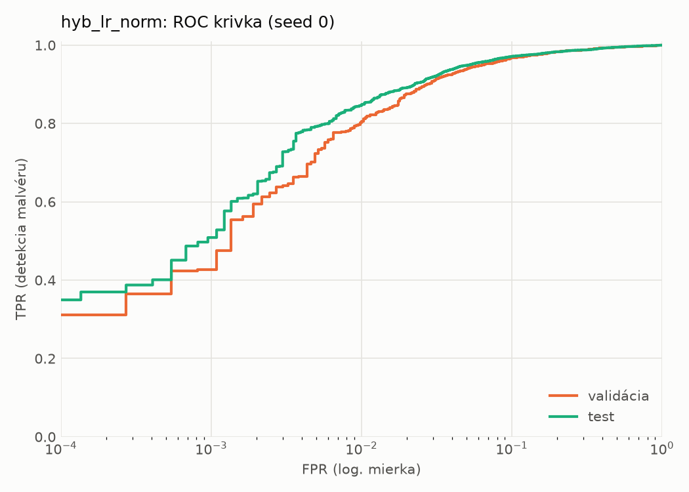
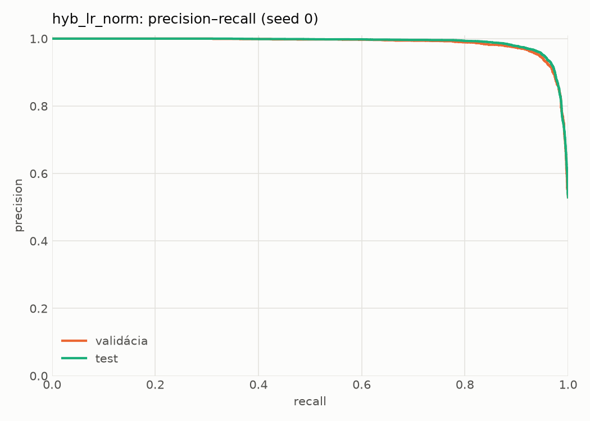
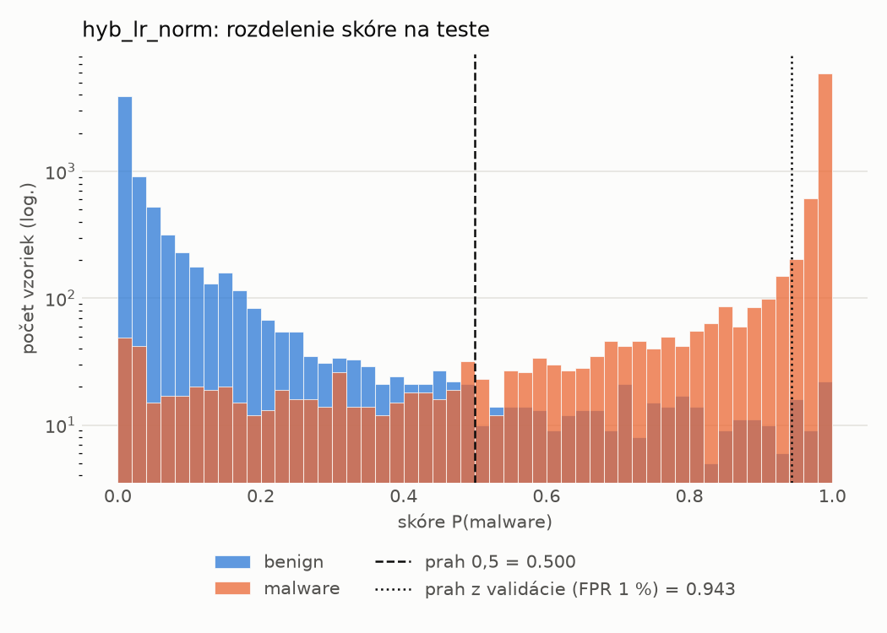
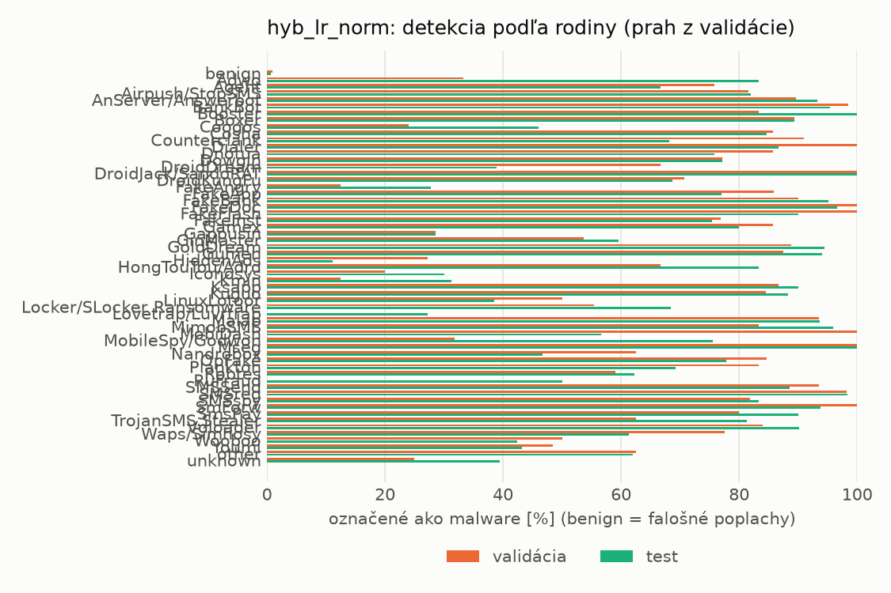
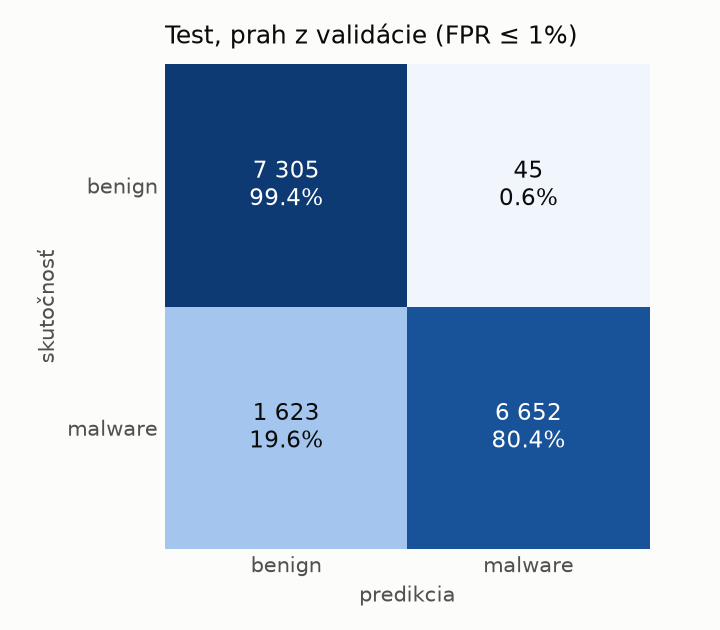
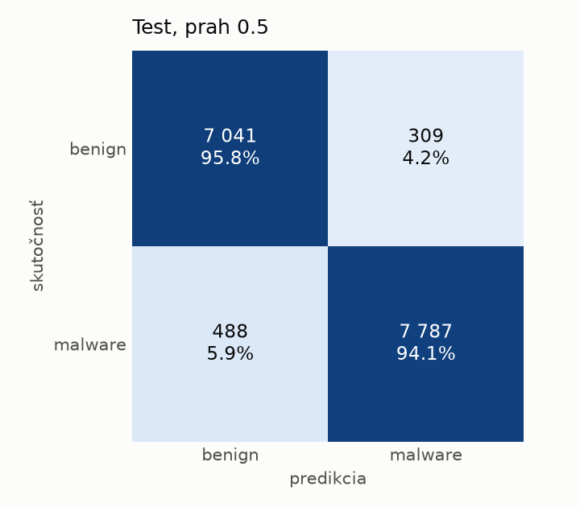

# hybrid_norm/hyb_lr_norm – beh `20261122-202322`

> Automaticky generované (`src/training/run_tabular.py`). Konfigurácia: `config.yaml`, protokol: `protocol.yaml`.

- **Model:** `logreg` – hybrid lr s dynamikou ako podiely systémových volaní (kontrola artefaktu množstva aktivity)
- **Ladenie:** bez ladenia – hyperparametre prevzaté z `runs_v4/real_full/full/hybrid/lr/20261122-195001`
- **Finálne modely:** seedy [0, 1, 2]; hodnoty sú priemer ± smerodajná odchýlka cez seedy
- **Najlepšie hyperparametre:** `{"max_iter": 2000, "C": 0.30240503427727145}`

## Detekčná kvalita (bez prahu)
| metrika | train (podvzorka) | validácia | test |
|---|---|---|---|
| ROC-AUC | 0.9871 ± 0.0000 | 0.9833 ± 0.0000 | 0.9855 ± 0.0000 |
| PR-AUC | 0.9896 ± 0.0000 | 0.9868 ± 0.0000 | 0.9888 ± 0.0000 |
| TPR pri FPR 1 % | 0.8660 ± 0.0000 | 0.8014 ± 0.0000 | 0.8463 ± 0.0000 |
| TPR pri FPR 0,1 % | 0.5205 ± 0.0000 | 0.4267 ± 0.0000 | 0.5088 ± 0.0000 |
| log loss | 0.1393 ± 0.0000 | 0.1613 ± 0.0000 | 0.1468 ± 0.0000 |
| Brier skóre | 0.0385 ± 0.0000 | 0.0439 ± 0.0000 | 0.0400 ± 0.0000 |

Rozdiel ROC-AUC train − validácia: **0.0037** (veľký rozdiel = preučenie).

## Pri prahu z validácie (FPR ≤ 1% na validácii)
| metrika | train (podvzorka) | validácia | test |
|---|---|---|---|
| accuracy | 0.8956 ± 0.0000 | 0.8902 ± 0.0000 | 0.8932 ± 0.0000 |
| balanced accuracy | 0.9005 ± 0.0000 | 0.8958 ± 0.0000 | 0.8989 ± 0.0000 |
| precision | 0.9955 ± 0.0000 | 0.9893 ± 0.0000 | 0.9933 ± 0.0000 |
| recall (TPR) | 0.8049 ± 0.0000 | 0.8014 ± 0.0000 | 0.8039 ± 0.0000 |
| FPR | 0.0040 ± 0.0000 | 0.0098 ± 0.0000 | 0.0061 ± 0.0000 |
| F1 | 0.8902 ± 0.0000 | 0.8855 ± 0.0000 | 0.8886 ± 0.0000 |
| MCC | 0.8091 ± 0.0000 | 0.7983 ± 0.0000 | 0.8046 ± 0.0000 |

## Pri pevnom prahu 0.5
| metrika | train (podvzorka) | validácia | test |
|---|---|---|---|
| accuracy | 0.9502 ± 0.0000 | 0.9431 ± 0.0000 | 0.9490 ± 0.0000 |
| balanced accuracy | 0.9508 ± 0.0000 | 0.9438 ± 0.0000 | 0.9495 ± 0.0000 |
| precision | 0.9646 ± 0.0000 | 0.9601 ± 0.0000 | 0.9618 ± 0.0000 |
| recall (TPR) | 0.9397 ± 0.0000 | 0.9311 ± 0.0000 | 0.9410 ± 0.0000 |
| FPR | 0.0381 ± 0.0000 | 0.0435 ± 0.0000 | 0.0420 ± 0.0000 |
| F1 | 0.9520 ± 0.0000 | 0.9454 ± 0.0000 | 0.9513 ± 0.0000 |
| MCC | 0.9006 ± 0.0000 | 0.8864 ± 0.0000 | 0.8980 ± 0.0000 |

## Výpočtové nároky (seed 0, testovacia množina)
| meranie | hodnota |
|---|---|
| tréning finálneho modelu | 0.4 s (priemer cez seedy) |
| ladenie spolu | 0 s |
| počet parametrov / uzlov | 295 |
| veľkosť modelu na disku | 0.01 MB |
| transformácia vstupu – latencia (1 vlákno) | 0.007 ms |
| transformácia vstupu – priepustnosť | 502 740 vzoriek/s |
| CPU latencia modelu (batch 1, 1 vlákno) | 0.004 ms (p95 0.004) |
| CPU priepustnosť (24 vlákien) | 2 219 397 vzoriek/s |

## Grafy
| | |
|---|---|
|  |  |
|  |  |
|  |  |
|  |  |

## Súbory
`metrics.json` (všetky metriky po seedoch vrátane rodín), `timing.json`, `hpo_trials.csv`,
`predictions/<časť>_seed<N>.parquet` (sha256, family, label, score), `model/seed_<N>/`, `log.txt`.
