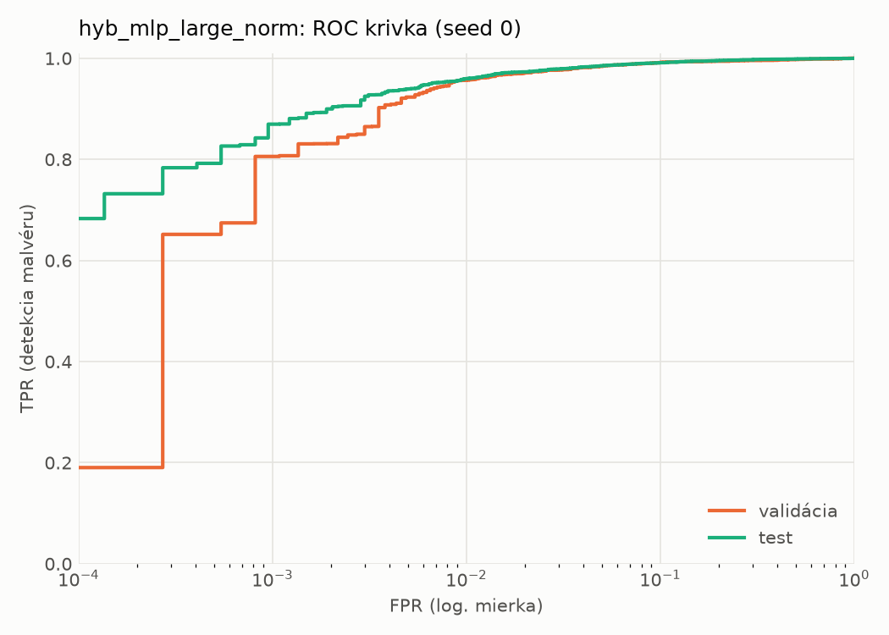
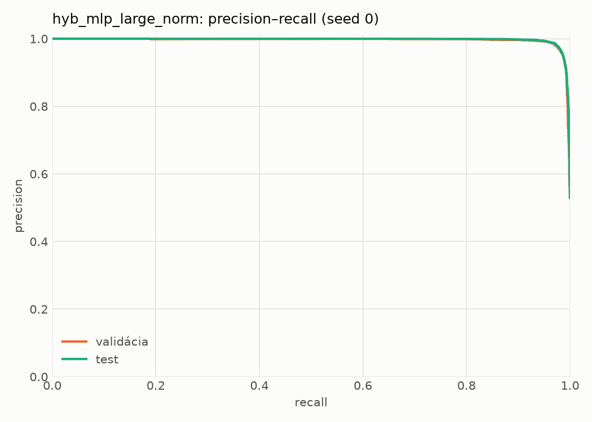
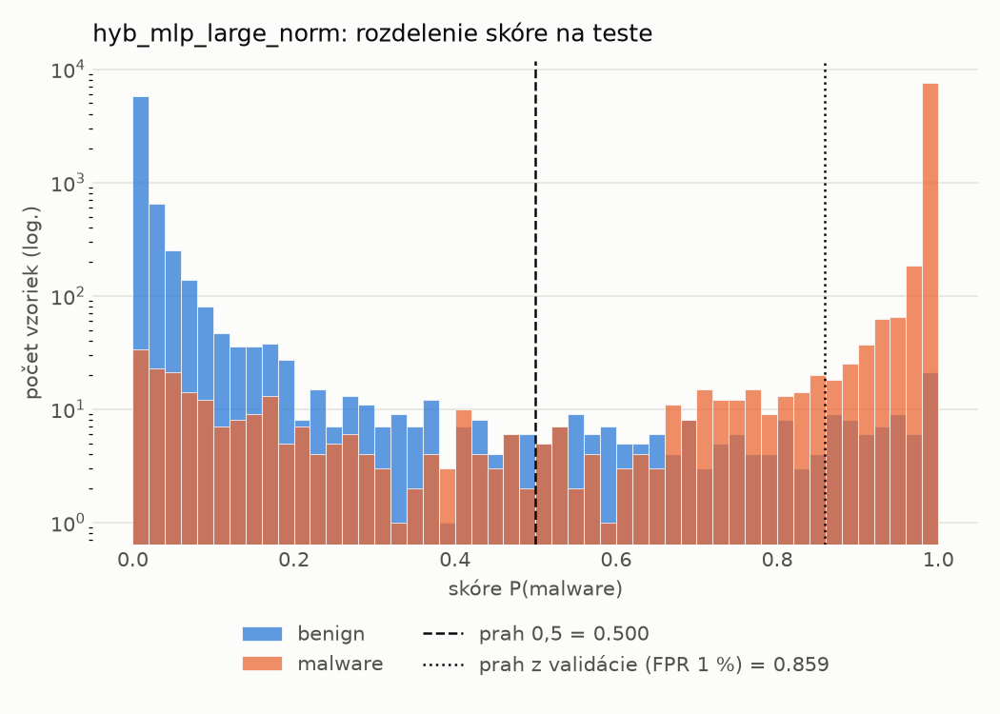
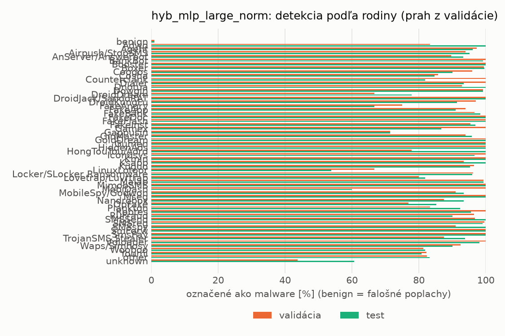
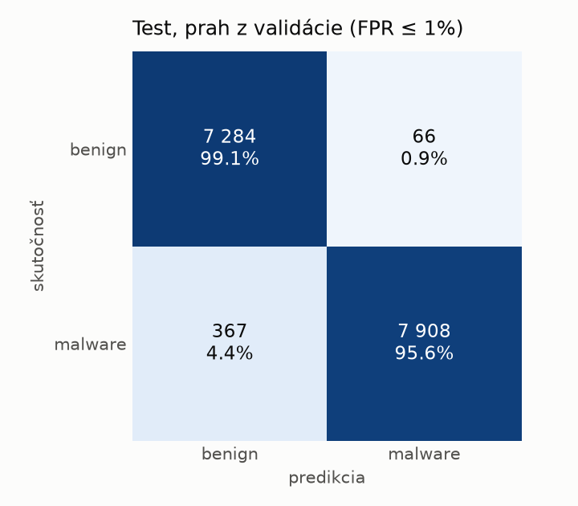
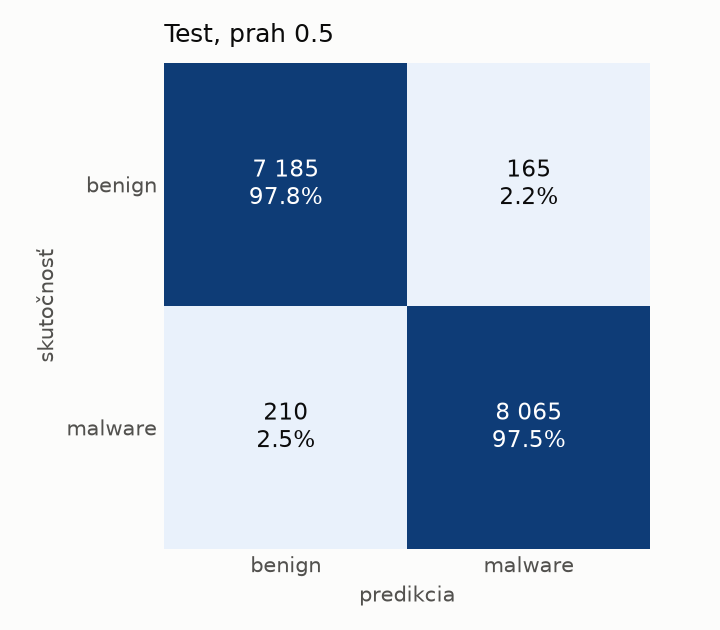
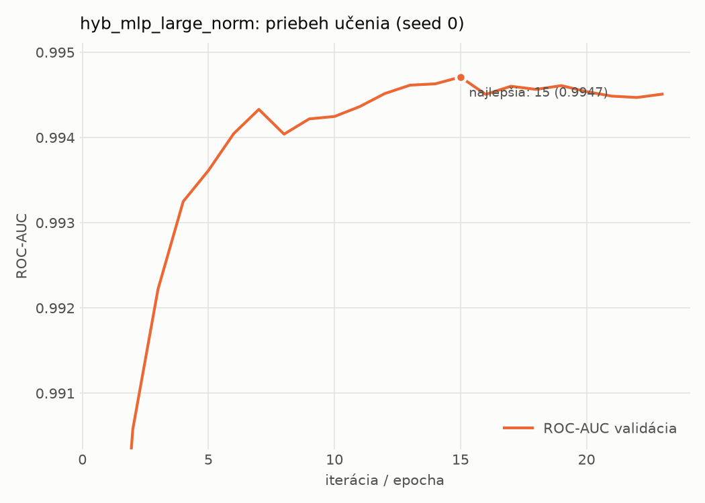

# hybrid_norm/hyb_mlp_large_norm – beh `20261122-202325`

> Automaticky generované (`src/training/run_tabular.py`). Konfigurácia: `config.yaml`, protokol: `protocol.yaml`.

- **Model:** `mlp` – hybrid mlp_large s dynamikou ako podiely systémových volaní (kontrola artefaktu množstva aktivity)
- **Ladenie:** bez ladenia – hyperparametre prevzaté z `runs_v4/real_full/full/hybrid/mlp_large/20261122-201300`
- **Finálne modely:** seedy [0, 1, 2]; hodnoty sú priemer ± smerodajná odchýlka cez seedy
- **Najlepšie hyperparametre:** `{"max_epochs": 100, "patience": 8, "hidden_layers": 3, "hidden_width": 512, "width_decay": 0.5, "dropout": 0.18171623767667733, "lr": 0.00010022812541545209, "weight_decay": 7.819097276436122e-06, "batch_size": 256}`

## Detekčná kvalita (bez prahu)
| metrika | train (podvzorka) | validácia | test |
|---|---|---|---|
| ROC-AUC | 0.9985 ± 0.0005 | 0.9947 ± 0.0002 | 0.9959 ± 0.0002 |
| PR-AUC | 0.9989 ± 0.0003 | 0.9957 ± 0.0008 | 0.9969 ± 0.0002 |
| TPR pri FPR 1 % | 0.9823 ± 0.0045 | 0.9533 ± 0.0033 | 0.9591 ± 0.0038 |
| TPR pri FPR 0,1 % | 0.9575 ± 0.0083 | 0.7906 ± 0.0365 | 0.8641 ± 0.0100 |
| log loss | 0.0417 ± 0.0070 | 0.0807 ± 0.0029 | 0.0727 ± 0.0028 |
| Brier skóre | 0.0109 ± 0.0018 | 0.0207 ± 0.0007 | 0.0189 ± 0.0013 |

Rozdiel ROC-AUC train − validácia: **0.0038** (veľký rozdiel = preučenie).

## Pri prahu z validácie (FPR ≤ 1% na validácii)
| metrika | train (podvzorka) | validácia | test |
|---|---|---|---|
| accuracy | 0.9811 ± 0.0022 | 0.9707 ± 0.0017 | 0.9720 ± 0.0013 |
| balanced accuracy | 0.9819 ± 0.0021 | 0.9717 ± 0.0016 | 0.9731 ± 0.0013 |
| precision | 0.9985 ± 0.0004 | 0.9910 ± 0.0000 | 0.9923 ± 0.0006 |
| recall (TPR) | 0.9655 ± 0.0042 | 0.9533 ± 0.0033 | 0.9545 ± 0.0024 |
| FPR | 0.0016 ± 0.0004 | 0.0098 ± 0.0000 | 0.0083 ± 0.0007 |
| F1 | 0.9817 ± 0.0021 | 0.9718 ± 0.0017 | 0.9731 ± 0.0013 |
| MCC | 0.9628 ± 0.0042 | 0.9420 ± 0.0033 | 0.9447 ± 0.0026 |

## Pri pevnom prahu 0.5
| metrika | train (podvzorka) | validácia | test |
|---|---|---|---|
| accuracy | 0.9863 ± 0.0023 | 0.9732 ± 0.0013 | 0.9759 ± 0.0022 |
| balanced accuracy | 0.9865 ± 0.0022 | 0.9732 ± 0.0013 | 0.9760 ± 0.0021 |
| precision | 0.9924 ± 0.0008 | 0.9761 ± 0.0021 | 0.9806 ± 0.0008 |
| recall (TPR) | 0.9814 ± 0.0037 | 0.9732 ± 0.0036 | 0.9738 ± 0.0038 |
| FPR | 0.0083 ± 0.0009 | 0.0268 ± 0.0025 | 0.0217 ± 0.0008 |
| F1 | 0.9869 ± 0.0022 | 0.9746 ± 0.0013 | 0.9772 ± 0.0022 |
| MCC | 0.9725 ± 0.0046 | 0.9462 ± 0.0027 | 0.9517 ± 0.0045 |

## Výpočtové nároky (seed 0, testovacia množina)
| meranie | hodnota |
|---|---|
| tréning finálneho modelu | 10.3 s (priemer cez seedy) |
| ladenie spolu | 0 s |
| počet parametrov / uzlov | 317 185 |
| veľkosť modelu na disku | 1.29 MB |
| transformácia vstupu – latencia (1 vlákno) | 0.017 ms |
| transformácia vstupu – priepustnosť | 308 718 vzoriek/s |
| CPU latencia modelu (batch 1, 1 vlákno) | 0.142 ms (p95 0.167) |
| CPU priepustnosť (24 vlákien) | 656 805 vzoriek/s |
| GPU latencia (batch 1) | 0.460 ms (p95 0.960) |
| GPU priepustnosť | 1 062 969 vzoriek/s |
| GPU špičková pamäť | 146 MB |

## Grafy
| | |
|---|---|
|  |  |
|  |  |
|  |  |
|  |  |

## Súbory
`metrics.json` (všetky metriky po seedoch vrátane rodín), `timing.json`, `hpo_trials.csv`,
`predictions/<časť>_seed<N>.parquet` (sha256, family, label, score), `model/seed_<N>/`, `log.txt`.
