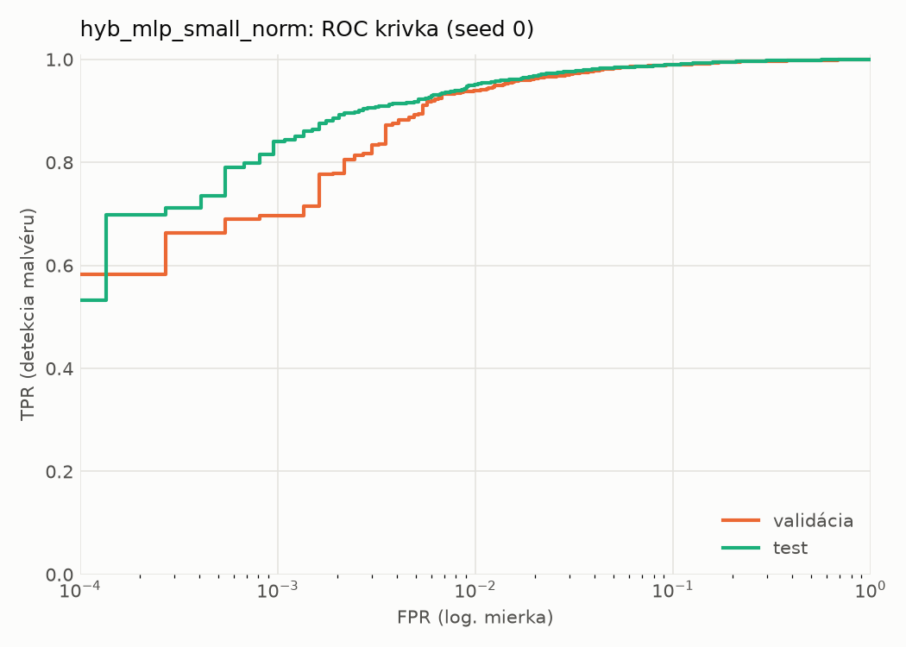
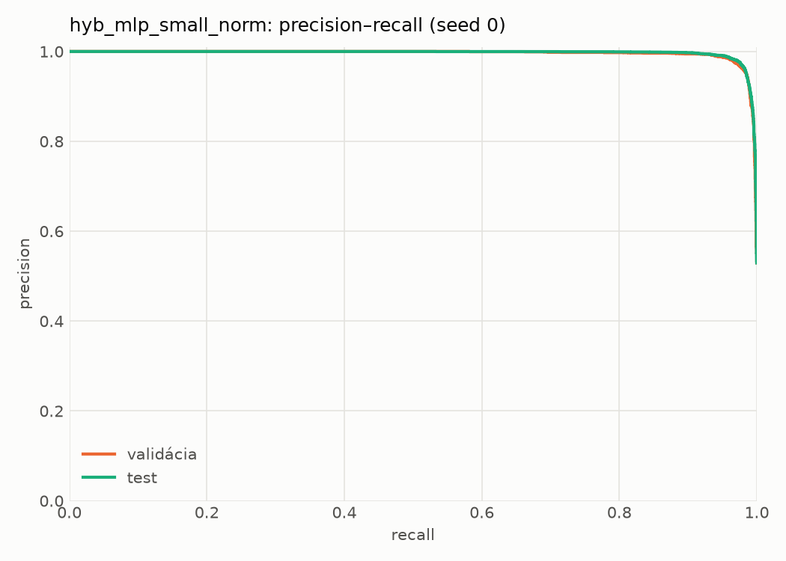
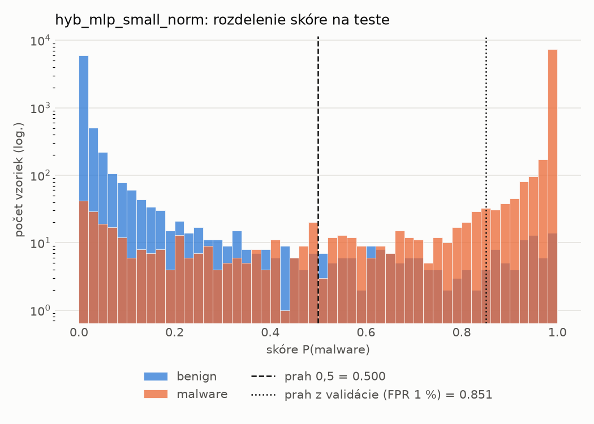
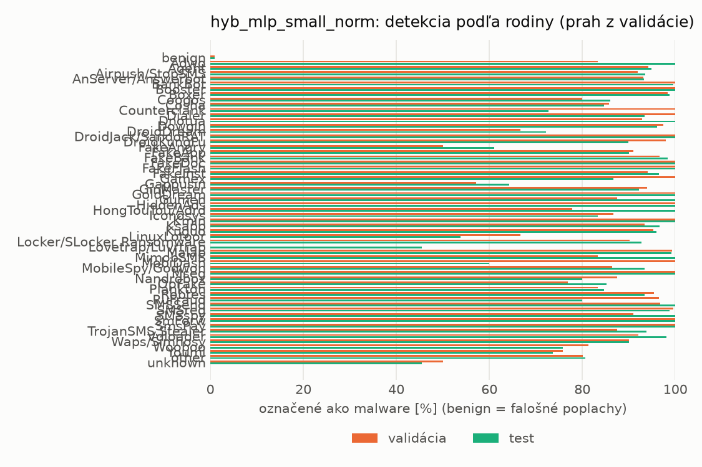
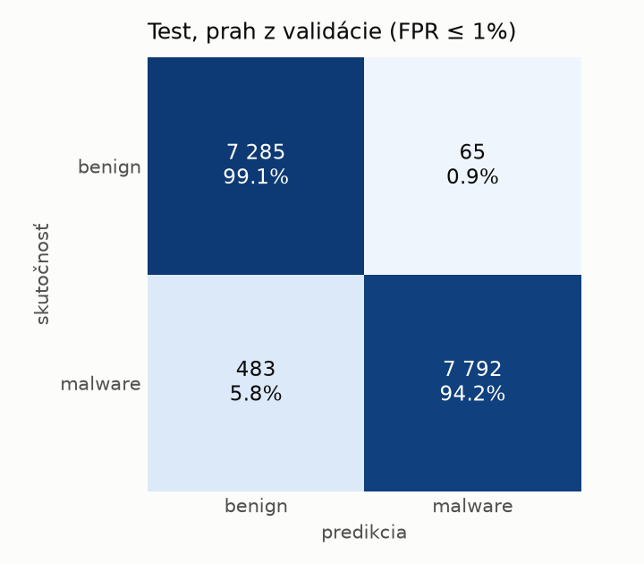
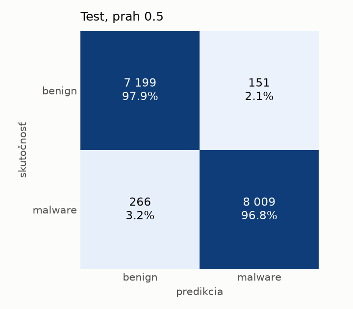
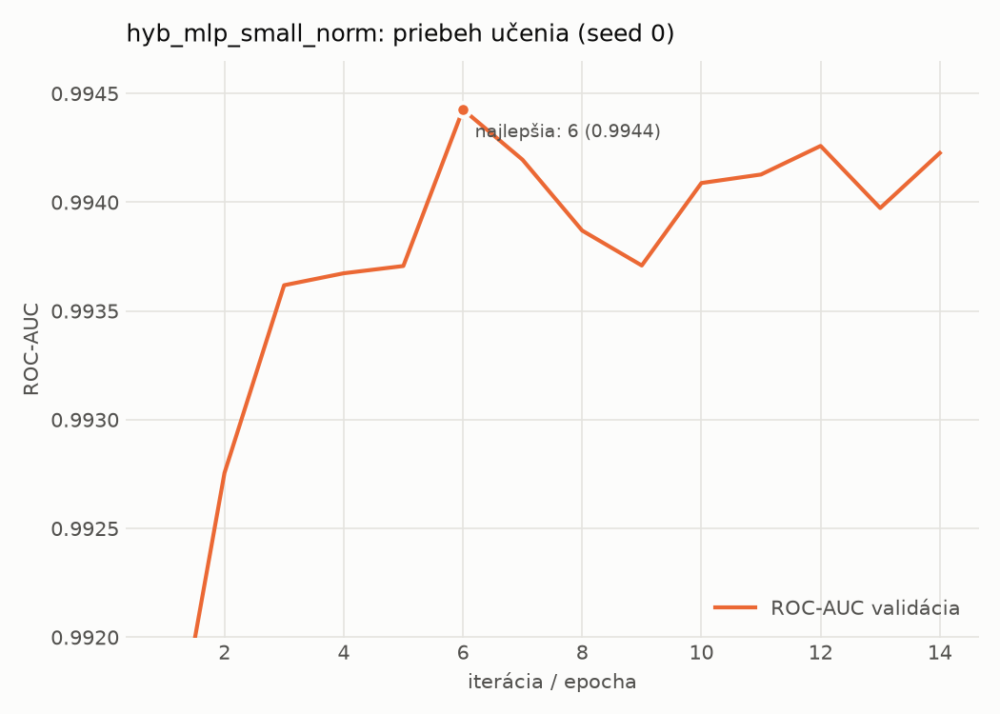

# hybrid_norm/hyb_mlp_small_norm – beh `20261122-202359`

> Automaticky generované (`src/training/run_tabular.py`). Konfigurácia: `config.yaml`, protokol: `protocol.yaml`.

- **Model:** `mlp` – hybrid mlp_small s dynamikou ako podiely systémových volaní (kontrola artefaktu množstva aktivity)
- **Ladenie:** bez ladenia – hyperparametre prevzaté z `runs_v4/real_full/full/hybrid/mlp_small/20261122-200826`
- **Finálne modely:** seedy [0, 1, 2]; hodnoty sú priemer ± smerodajná odchýlka cez seedy
- **Najlepšie hyperparametre:** `{"width_decay": 0.5, "max_epochs": 100, "patience": 8, "hidden_layers": 2, "hidden_width": 256, "dropout": 0.19625503285105284, "lr": 0.0008594281758471675, "weight_decay": 0.001025897876119634, "batch_size": 256}`

## Detekčná kvalita (bez prahu)
| metrika | train (podvzorka) | validácia | test |
|---|---|---|---|
| ROC-AUC | 0.9985 ± 0.0010 | 0.9945 ± 0.0002 | 0.9957 ± 0.0003 |
| PR-AUC | 0.9989 ± 0.0008 | 0.9959 ± 0.0003 | 0.9968 ± 0.0002 |
| TPR pri FPR 1 % | 0.9844 ± 0.0091 | 0.9469 ± 0.0073 | 0.9588 ± 0.0075 |
| TPR pri FPR 0,1 % | 0.9562 ± 0.0261 | 0.7127 ± 0.0887 | 0.8711 ± 0.0275 |
| log loss | 0.0396 ± 0.0156 | 0.0873 ± 0.0052 | 0.0754 ± 0.0029 |
| Brier skóre | 0.0103 ± 0.0042 | 0.0209 ± 0.0014 | 0.0187 ± 0.0018 |

Rozdiel ROC-AUC train − validácia: **0.0041** (veľký rozdiel = preučenie).

## Pri prahu z validácie (FPR ≤ 1% na validácii)
| metrika | train (podvzorka) | validácia | test |
|---|---|---|---|
| accuracy | 0.9775 ± 0.0043 | 0.9673 ± 0.0038 | 0.9683 ± 0.0029 |
| balanced accuracy | 0.9785 ± 0.0041 | 0.9686 ± 0.0036 | 0.9697 ± 0.0029 |
| precision | 0.9991 ± 0.0006 | 0.9909 ± 0.0001 | 0.9934 ± 0.0015 |
| recall (TPR) | 0.9580 ± 0.0077 | 0.9469 ± 0.0073 | 0.9464 ± 0.0042 |
| FPR | 0.0009 ± 0.0006 | 0.0098 ± 0.0000 | 0.0071 ± 0.0015 |
| F1 | 0.9781 ± 0.0042 | 0.9684 ± 0.0038 | 0.9693 ± 0.0029 |
| MCC | 0.9559 ± 0.0082 | 0.9356 ± 0.0073 | 0.9377 ± 0.0057 |

## Pri pevnom prahu 0.5
| metrika | train (podvzorka) | validácia | test |
|---|---|---|---|
| accuracy | 0.9873 ± 0.0053 | 0.9735 ± 0.0029 | 0.9763 ± 0.0028 |
| balanced accuracy | 0.9877 ± 0.0052 | 0.9737 ± 0.0029 | 0.9766 ± 0.0028 |
| precision | 0.9952 ± 0.0044 | 0.9800 ± 0.0022 | 0.9838 ± 0.0022 |
| recall (TPR) | 0.9807 ± 0.0058 | 0.9698 ± 0.0034 | 0.9712 ± 0.0031 |
| FPR | 0.0053 ± 0.0048 | 0.0223 ± 0.0024 | 0.0180 ± 0.0025 |
| F1 | 0.9879 ± 0.0050 | 0.9749 ± 0.0028 | 0.9774 ± 0.0027 |
| MCC | 0.9747 ± 0.0105 | 0.9469 ± 0.0058 | 0.9525 ± 0.0056 |

## Výpočtové nároky (seed 0, testovacia množina)
| meranie | hodnota |
|---|---|
| tréning finálneho modelu | 8.2 s (priemer cez seedy) |
| ladenie spolu | 0 s |
| počet parametrov / uzlov | 109 313 |
| veľkosť modelu na disku | 0.45 MB |
| transformácia vstupu – latencia (1 vlákno) | 0.017 ms |
| transformácia vstupu – priepustnosť | 284 359 vzoriek/s |
| CPU latencia modelu (batch 1, 1 vlákno) | 0.100 ms (p95 0.111) |
| CPU priepustnosť (24 vlákien) | 1 072 210 vzoriek/s |
| GPU latencia (batch 1) | 0.666 ms (p95 0.698) |
| GPU priepustnosť | 759 088 vzoriek/s |
| GPU špičková pamäť | 202 MB |

## Grafy
| | |
|---|---|
|  |  |
|  |  |
|  |  |
|  |  |

## Súbory
`metrics.json` (všetky metriky po seedoch vrátane rodín), `timing.json`, `hpo_trials.csv`,
`predictions/<časť>_seed<N>.parquet` (sha256, family, label, score), `model/seed_<N>/`, `log.txt`.
